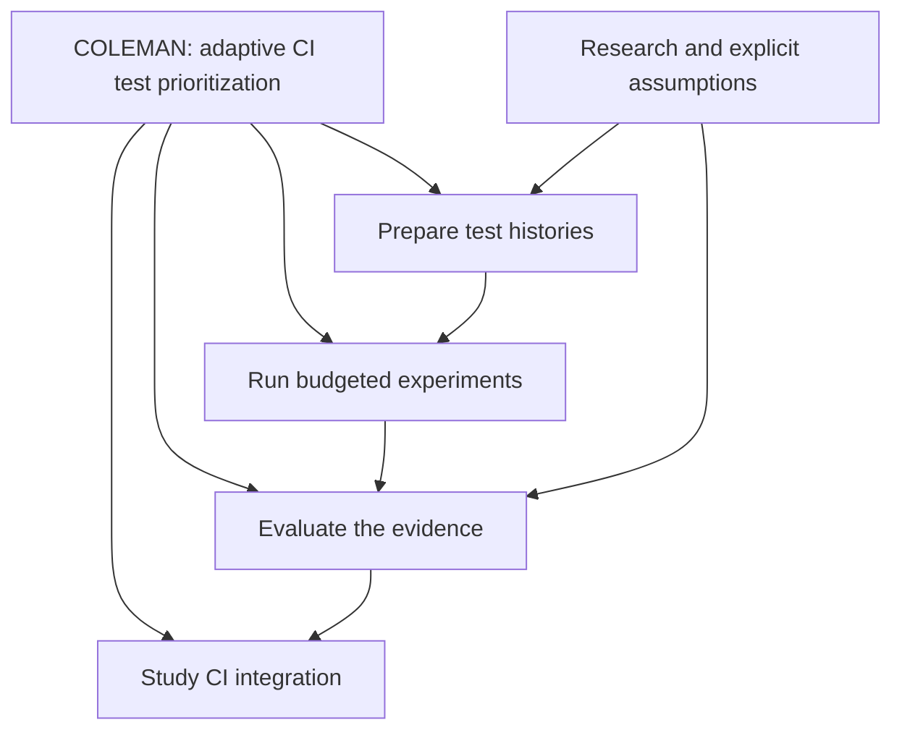

# COLEMAN

**Learn which CI tests to run first. Keep the evidence behind every decision.**

[](https://jacksonpradolima.github.io/coleman/)
[](https://www.python.org/downloads/)
[](LICENSE)

Your test suite changes, failures are rare, and the CI budget is finite. COLEMAN
lets you study how adaptive prioritization responds: rank tests with multi-armed
bandits, simulate budgeted execution, learn from feedback, and compare the results
with simple baselines. It supports ordinary suites and highly configurable systems.

The platform connects **source data → reproducible experiments → inspectable
results → evidence for a decision**. Use it as a Python library or through the CLI;
Parquet results and local checkpoints work without external services.

[Run your first experiment](docs/getting-started.md) · [Choose a dataset](docs/datasets.md) ·
[Understand the method](docs/concepts.md) · [Read the research](docs/research.md) ·
[Contribute](CONTRIBUTING.md)

## One platform, connected workflows



| Start with a question | Follow this path |
| --- | --- |
| How does the feedback loop work? | [Concepts](docs/concepts.md) → [policies and rewards](docs/policies.md) → [first experiment](docs/getting-started.md) |
| Can I use my CI history? | [Input format](docs/input-data.md) → [dataset workflows](docs/datasets.md) → [source qualification](docs/corpus-admission.md) |
| How do I compare methods fairly? | [Evaluation guide](docs/evaluation-guide.md) → [comparable baselines](docs/comparable-baselines.md) → [protected comparisons](docs/protected-evaluation.md) |
| What about configurations and variants? | [WTS and VTS](docs/highly-configurable.md) → [original LibSSH workflow](docs/hcs-parquet-etl.md) → [CTest evidence](docs/hcs-trace-evidence.md) |
| How would this fit into CI? | [Integration guide](docs/integration-guide.md) → [operational pilot](docs/operational-pilot.md) → [shadow evaluation](docs/prospective-shadow.md) |

## Quick start

Use Python 3.14+ in a virtual environment. This command pins a published wheel
and verifies its SHA-256 before installation:

```bash
python -m pip install "https://github.com/jacksonpradolima/coleman/releases/download/v4.19.0/coleman-4.19.0-py3-none-any.whl#sha256=070e21c19fb7e3f2e392bd68706c354ed5ab7f76b86db80f5f1bdc5721b767bd"
```

Save the following as `first_run.py` in an empty directory. It creates a tiny
authored history, runs the actual Random and UCB policies, and prints the result
directory. Durations in this example are seconds; the data demonstrates a mechanism.

```python
from pathlib import Path

import polars as pl

from coleman.api import run
from coleman.spec import RunSpec

dataset = Path("data/example-ci")
dataset.mkdir(parents=True, exist_ok=True)
rows = [
    {"BuildId": build, "Name": name, "Duration": duration,
     "CalcPrio": 0, "LastRun": "2026-01-01", "Verdict": verdict}
    for build in (1, 2, 3)
    for name, duration, verdict in (
        ("unit", 1.0, 0), ("integration", 2.0, build % 2), ("system", 4.0, 0)
    )
]
pl.DataFrame(rows).write_parquet(dataset / "features-engineered.parquet")

spec = RunSpec.model_validate({
    "execution": {"independent_executions": 1, "parallel_pool_size": 1, "seed": 42},
    "experiment": {
        "datasets_dir": "data", "datasets": ["example-ci"],
        "policies": ["Random", "UCB"], "rewards": ["RNFail"],
        "budget": {"mode": "ratio", "values": [0.5]},
    },
    "algorithm": {"ucb": {"rnfail": {"c": 1.0}}},
    "results": {"out_dir": "runs"},
    "checkpoint": {"enabled": True, "interval": 1},
})
result = run(spec)
print(result.run_id, result.artifacts_dir)
```

```bash
python first_run.py
```

The [complete tutorial](docs/getting-started.md) explains the output, queries it
with DuckDB, enables checkpoint continuation, and runs the same experiment from
YAML. The [configuration reference](docs/configuration.md) covers packs and sweeps.

## What you can do

- **Experiment with adaptive ranking.** Classical, contextual and changing-history
  policies share the runner, rewards, budgets and result sinks. Configure sweeps
  across candidates and seeds without replacing orchestration.
- **Work with configurations.** WTS prioritizes a union of tests; VTS maintains
  separate variant experiments. Preserve the grouping when interpreting evidence.
- **Inspect and recover experiments.** Typed RunSpec, resolved configuration,
  provenance, Parquet results and local checkpoints make inputs and progress visible.
- **Keep measurements meaningful.** Versioned records distinguish units, semantics,
  observed zero, signed values and unavailable measurements.
- **Evaluate before adopting.** Independent metric checks, source audits, repeated
  observations, protected comparisons and conservative outcomes support review.
- **Extend a focused platform.** Hooks, custom policies, finite coverage selection,
  scenario allocation and an optional MCP transport build on the same CI foundations.

See the [architecture](docs/setup.md), [API reference](docs/api-reference.md) and
[integration guide](docs/integration-guide.md) for the boundaries and supported use.

## Datasets

Choose the evidence type as well as the file format. Runnable data is useful
before it qualifies for a claim about effectiveness in historical or future CI.

| Source or laboratory | Usable workflow | Evidence scope |
| --- | --- | --- |
| [LRTS: Karaf, ActiveMQ, Log4j](docs/lrts-parquet-etl.md) | Original Jenkins reports → analytical/native Parquet → checkpointed replay; [separate stage views](docs/lrts-stage-views.md) | Historical observations with explicit post-hoc replay assumptions |
| [RTPTorrent: HikariCP](docs/rtptorrent-parquet-etl.md) | Verified ZIP64 archive → class-level history → bounded native replay | Class observations; source chronology and admission gaps remain visible |
| [LibSSH](docs/hcs-parquet-etl.md) | Original CSV/JSON → WTS/VTS inputs → native replay; [original CTest corroboration](docs/hcs-trace-evidence.md) | Variant/attempt-aware source evidence, including missing cells |
| [Westermo](docs/westermo-parquet-etl.md) | Original embedded-system results → typed analytical Parquet | Preserves abnormal outcomes and unverified duration semantics |
| [Controlled Java](docs/java-fault-matrix.md), [Python](docs/python-source-capture.md), [C](docs/c-seeded-source-capture.md) | Pinned source/runtime → raw process evidence → offline validation | Controlled fault or constructed weakness observations |
| [CI stress laboratory](docs/ci-stress-laboratory.md) | Deterministic cases → known truth → native Parquet and replay | Constructed mechanism checks for drift, churn, rare failures and late feedback |
| Druid, Retrofit and Dune examples | Native/contextual/variant inputs in the checkout | Legacy examples with source-specific qualification limits |

The [dataset guide](docs/datasets.md) connects downloads, resource requirements,
licenses, adapters and the question each source can answer. A full admitted
historical cross-corpus confirmation has **not** been completed; see
[evidence status](docs/roadmap.md). Negative and inconclusive findings are valid results.

## Research background

COLEMAN began as a research approach to **test case prioritization in continuous
integration (TCPCI)**. The [TSE article](https://doi.org/10.1109/TSE.2020.2992428)
describes its bandit-based approach. The [HCS study](https://doi.org/10.1007/s10664-021-10093-3)
examines whole-test-set and variant-test-set strategies. These studies ground the
method; their results do not establish superiority for every later extension or dataset.

The [research guide](docs/research.md) explains which papers inform the feedback
loop, contextual policies, configurable systems and evaluation, with links back
to the corresponding workflows.

## Citation

Use [CITATION.cff](CITATION.cff), or cite the original article:

```bibtex
@article{pradolima2022coleman,
  author = {Prado Lima, Jackson A. and Vergilio, Silvia Regina},
  title = {A Multi-Armed Bandit Approach for Test Case Prioritization in Continuous Integration Environments},
  journal = {IEEE Transactions on Software Engineering},
  year = {2022},
  volume = {48},
  number = {2},
  pages = {453--465},
  doi = {10.1109/TSE.2020.2992428}
}
```

## Contributing

Read [CONTRIBUTING.md](CONTRIBUTING.md) for development setup, NumPy-style
docstrings, scientific conventions and review checks. The
[maintainability guide](docs/maintainability.md) explains the current architecture
and measured improvement priorities. Report vulnerabilities through
[SECURITY.md](SECURITY.md). COLEMAN is distributed under the [MIT license](LICENSE).
