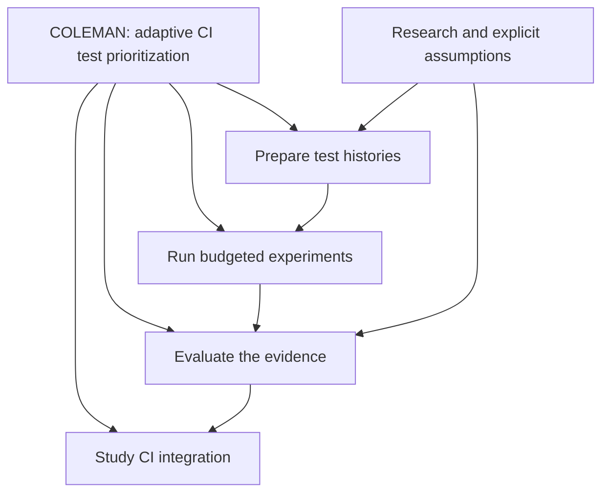

# COLEMAN

**Adaptive CI test prioritization, from 37 bandit policies to reproducible experiments and auditable evidence.**

[](https://jacksonpradolima.github.io/coleman/)
[](https://www.python.org/downloads/)
[](LICENSE)

[](https://github.com/jacksonpradolima/coleman/actions/workflows/codecov.yml?query=branch%3Amain)
[](docs/quality-and-security.md#tests-and-coverage)
[](https://sonarcloud.io/summary/overall?id=jacksonpradolima_coleman4hcs)
[](https://sonarcloud.io/summary/overall?id=jacksonpradolima_coleman4hcs)

[](https://github.com/jacksonpradolima/coleman/actions/workflows/security-audit.yml)
[](https://github.com/jacksonpradolima/coleman/actions/workflows/pylint.yml?query=event%3Apull_request)
[](https://github.com/jacksonpradolima/coleman/actions/workflows/code-cost.yml?query=event%3Apull_request)
[](https://github.com/jacksonpradolima/coleman/actions/workflows/docs.yml?query=branch%3Amain)

Your test suite changes, failures are rare, and the CI budget is finite. COLEMAN
brings adaptive ranking, budgeted test replay, configurable-system testing and
evidence-based comparison into one Python platform. Choose a policy, learn from
execution feedback, explore its parameters and inspect the resulting test order,
fault-detection quality and modeled execution cost.

The approach is grounded in the [original TCPCI study](https://doi.org/10.1109/TSE.2020.2992428),
the [SPLC configurable-software study](https://doi.org/10.1145/3382025.3414967)
and its [Empirical Software Engineering extension](https://doi.org/10.1007/s10664-021-10093-3).

The platform connects **source data → reproducible experiments → inspectable
results → evidence for a decision**. Use it as a Python library or through the CLI;
Parquet results and local checkpoints work without external services.

[Run your first experiment](#quick-start) · [Explore the policies](#mab-policies-available) ·
[Choose a dataset](#datasets) · [Read the research](#research-background) ·
[Inspect quality and security](#quality-you-can-inspect) · [Contribute](CONTRIBUTING.md)

## Quality you can inspect

Research software should make its engineering evidence inspectable too. COLEMAN
enforces a **configured 95% combined line/branch coverage gate**, checks complexity and
maintainability, audits every locked dependency, and publishes **Sigstore-signed
distributions with a CycloneDX SBOM**. Follow the checks to inspect their actual
scope and results:

| Engineering commitment | Verification and evidence |
| --- | --- |
| Test behavior and recovery | [Python 3.14 test suite](https://github.com/jacksonpradolima/coleman/actions/workflows/codecov.yml): unit/integration tests, versioned golden fixtures, deterministic identities, interrupted writes, checkpoint continuation and import boundaries; a failed configured coverage gate fails the run |
| Audit known dependency vulnerabilities | [Lock-wide advisory audit](https://github.com/jacksonpradolima/coleman/actions/workflows/security-audit.yml): runtime and optional/development packages across platforms, on dependency changes, weekly and on demand; queried pins and JSON results are retained |
| Review dependency changes | [License and vulnerability review](https://github.com/jacksonpradolima/coleman/actions/workflows/dependency-review.yml) on pull requests, alongside Dependabot updates and [security reporting](SECURITY.md) |
| Inspect source and credentials | [SonarCloud analysis](https://sonarcloud.io/summary/overall?id=jacksonpradolima_coleman4hcs) and GitGuardian PR checks; inspect the individual check results for the proposed commit |
| Keep code and API documentation consistent | [Ruff lint/format and NumPy parameter checks](https://github.com/jacksonpradolima/coleman/actions/workflows/pylint.yml) at the documented public entry points |
| Bound structural complexity | [Xenon and Radon gates](https://github.com/jacksonpradolima/coleman/actions/workflows/code-cost.yml): block/module/average limits C/B/A and maintainability index ≥20 |
| Keep human and machine documentation usable | [Strict documentation builds](https://github.com/jacksonpradolima/coleman/actions/workflows/docs.yml) and [deterministic `llms.txt` verification](https://github.com/jacksonpradolima/coleman/actions/workflows/llms-txt.yml) |
| Measure the installed implementation | [Decision observations](https://github.com/jacksonpradolima/coleman/actions/workflows/decision-benchmarks.yml): bounded correctness/performance profiles from an installed wheel, outside the checkout; manual runs and an opt-in weekly schedule |
| Make releases inspectable | [Published wheel, sdist, Sigstore bundles and SBOM](https://github.com/jacksonpradolima/coleman/releases/latest), produced with locked tooling by the [release workflow](https://github.com/jacksonpradolima/coleman/actions/workflows/release.yml) |

The [quality and security guide](docs/quality-and-security.md) explains how to read
the badges, reproduce checks and verify release artifacts. The coverage badge
states the enforced threshold; current measured coverage is in the test log.
Additional local qualification covers typing, docstring presence and
installed-package examples. Engineering checks complement the
[scientific comparison protocol](docs/evaluation-guide.md).

## One platform, connected workflows



## What you can build with COLEMAN

| Your goal | Available workflow |
| --- | --- |
| Compare adaptive CI prioritization policies | The native TCPCI runner, [37 policies](#mab-policies-available), RNFail/TimeRank rewards, contextual inputs and [parameter sweeps](#sweep-engine) |
| Stress a difficult CI decision | [32 deterministic interaction-covering cases](docs/ci-stress-laboratory.md), explicit truth and feedback clocks, native Parquet and resumable agents |
| Audit what a source actually supports | [Source admission](docs/corpus-admission.md): original evidence, explicit units and a 35-axis production-reality matrix |
| Compare repeated CI experiments | [Raw build/seed records and paired repository-family means](docs/corpus-evaluation.md), explicit missingness and protected access |
| Compare metrics with known limits | [Conservative bounded paired means](docs/bounded-paired-evaluation.md), full-family uncertainty and practical equivalence under declared independent-unit assumptions |
| Assess public CI collection | [Bounded public Actions collection](docs/public-ci-feasibility.md), typed receipts and reality-axis accounting that retains missing test and physical-cost evidence |
| Develop comparable baseline matrices | [Frozen native-policy and heuristic matrices](docs/comparable-baselines.md), explicit incompatibilities, raw costs and checkpoint recovery |
| Evaluate configurable software | [Original LibSSH → WTS/VTS Parquet and checkpointed replay](docs/hcs-parquet-etl.md), [CTest corroboration](docs/hcs-trace-evidence.md) and [whole-set/variant strategies](docs/highly-configurable.md) |
| Collect real-fault observations | [Controlled Java matrices](docs/java-fault-matrix.md) and [Python source capture](docs/python-source-capture.md), pinned source/runtime recipes, raw process evidence and offline recovery |
| Inspect a constructed C weakness | [Pinned Juliet/GCC capture](docs/c-seeded-source-capture.md), an independent arithmetic oracle, raw process evidence and interruption recovery |
| Reproduce and inspect an experiment | [Typed RunSpec and the library API](#library-api), [configuration identity and provenance](#provenance), Parquet results and resumable checkpoints |
| Select finite coverage under a budget | [Coverage selection](docs/finite-coverage.md), explicit costs and solver-specific certificates and limits |
| Allocate resources under declared scenarios | [Scenario-payoff allocation](docs/scenario-payoffs.md), signed outcomes, resource constraints and conservative evidence handling |
| Check a CI decision before adoption | [Independent mathematical benchmarks](docs/decision-benchmarks.md), [protected comparisons](docs/protected-evaluation.md) and [operational accounting](docs/operational-pilot.md) |
| Extend or integrate the platform | [Library API](#library-api), [application API and optional MCP](docs/application-api.md), [versioned domain results](docs/domain-results.md), hooks and [runner extensions](docs/extensibility.md) |

The workflows retain their own assumptions: a source conversion, controlled fault,
mathematical check and historical policy comparison answer different questions.
Follow the linked guide for a complete example and the evidence it supports.

## MAB policies available

**37 selectable policies** cover simple comparators, confidence bounds, Bayesian
sampling, changing histories, contextual features, subsets, pairwise rankings and
policy portfolios. These are the actual native configuration names:

| Family | Available policies |
| --- | --- |
| Random and greedy | `Random`, `Greedy`, `EpsilonGreedy`, `DecayEpsilonGreedy`, `OptimisticGreedy`, `EpsilonDecreasing` |
| Confidence-based exploration | `UCB`, `UCB1`, `UCB2`, `KLUCB`, `UCBTuned`, `UCBV`, `MOSSUCB` |
| Bayesian and stochastic exploration | `ThompsonSampling`, `BayesianUCB`, `BootstrappedThompson`, `Softmax`, `Pursuit`, `PHE` |
| Adversarial exploration | `EXP3`, `EXP3IX` |
| Changing histories and recent feedback | `SlidingWindowUCB`, `DiscountedUCB`, `ChangeDetectionUCB`, `FRRMAB`, `SlMAB` |
| Contextual | `LinUCB`, `SWLinUCB`, `LinTS`, `SWLinTS`, `ContextualEpsilonGreedy`, `SWContextualEpsilonGreedy` |
| Combinatorial | `CombinatorialUCB`, `CombinatorialThompson` |
| Dueling and ranking | `DuelingUCB`, `PairwiseThompsonRanking` |
| Portfolio meta-policy | `PortfolioUCB` |

Use the [policy guide](docs/policies.md) to understand the families, reward choices,
required parameters and contextual feature availability. The
[constructor reference](docs/api/policy.md) gives the exact API; configuration packs
cover a subset of the policies. The [baseline workflow](docs/comparable-baselines.md)
adds history-based heuristic comparators under a declared common protocol.

The original [bandit analysis](https://doi.org/10.1023/A:1013689704352),
[LinUCB study](https://arxiv.org/abs/1003.0146) and
[combinatorial framework](https://proceedings.mlr.press/v28/chen13a.html) explain
important foundations. A policy name alone does not establish that a CI adaptation
satisfies the original theorem's assumptions or outperforms the simple comparators.

## Choose your path

| Start with a question | Follow this path |
| --- | --- |
| How does the feedback loop work? | [Concepts](docs/concepts.md) → [policies and rewards](docs/policies.md) → [first experiment](docs/getting-started.md) |
| Can I use my CI history? | [Input format](docs/input-data.md) → [dataset workflows](docs/datasets.md) → [source qualification](docs/corpus-admission.md) |
| How do I compare methods fairly? | [Evaluation guide](docs/evaluation-guide.md) → [comparable baselines](docs/comparable-baselines.md) → [protected comparisons](docs/protected-evaluation.md) |
| What about configurations and variants? | [WTS and VTS](docs/highly-configurable.md) → [original LibSSH workflow](docs/hcs-parquet-etl.md) → [CTest evidence](docs/hcs-trace-evidence.md) |
| How would this fit into CI? | [Integration guide](docs/integration-guide.md) → [operational pilot](docs/operational-pilot.md) → [shadow evaluation](docs/prospective-shadow.md) |

## Quick start

Use Python 3.14+ in a virtual environment. This command pins a published wheel
and verifies its SHA-256 before installation:

```bash
python -m pip install "https://github.com/jacksonpradolima/coleman/releases/download/v4.19.1/coleman-4.19.1-py3-none-any.whl#sha256=ca470ba2be14ca755952f0bb3bc92615d76b90f95ebdd41dc1cdc9847713cc93"
```

### Library API

Save the following as `first_run.py` in an empty directory. It creates a tiny
authored history, runs the actual Random and UCB policies, and prints the result
directory. Durations in this example are seconds; the data demonstrates a mechanism.

```python
from pathlib import Path

import polars as pl

from coleman.api import run
from coleman.spec import RunSpec

dataset = Path("data/example-ci")
dataset.mkdir(parents=True, exist_ok=True)
rows = [
    {"BuildId": build, "Name": name, "Duration": duration,
     "CalcPrio": 0, "LastRun": "2026-01-01", "Verdict": verdict}
    for build in (1, 2, 3)
    for name, duration, verdict in (
        ("unit", 1.0, 0), ("integration", 2.0, build % 2), ("system", 4.0, 0)
    )
]
pl.DataFrame(rows).write_parquet(dataset / "features-engineered.parquet")

spec = RunSpec.model_validate({
    "execution": {"independent_executions": 1, "parallel_pool_size": 1, "seed": 42},
    "experiment": {
        "datasets_dir": "data", "datasets": ["example-ci"],
        "policies": ["Random", "UCB"], "rewards": ["RNFail"],
        "budget": {"mode": "ratio", "values": [0.5]},
    },
    "algorithm": {"ucb": {"rnfail": {"c": 1.0}}},
    "results": {"out_dir": "runs"},
    "checkpoint": {"enabled": True, "interval": 1},
})
result = run(spec)
print(result.run_id, result.artifacts_dir)
```

```bash
python first_run.py
```

The [complete tutorial](docs/getting-started.md) explains the output, queries it
with DuckDB, enables checkpoint continuation, and runs the same experiment from
YAML. The [configuration reference](docs/configuration.md) covers packs and sweeps.

## Sweep engine

Compare UCB exploration settings without writing another execution loop. After
the example above, reuse its `spec` and append this code to `first_run.py`:

```python
from coleman.api import run_many, sweep
from coleman.spec.sweep import SweepAxis, SweepSpec

base = spec.model_copy(deep=True)
base.experiment.policies = ["UCB"]
candidates = sweep(base, SweepSpec(
    axes=[SweepAxis(params={"algorithm.ucb.rnfail.c": [0.5, 1.0, 2.0]})],
    seeds=[42, 43],
))
results = run_many(candidates, max_workers=1)
print(f"Completed {len(results)} UCB runs")
```

This expands three exploration settings × two seeds into six specifications,
each with its own run directory and checkpoint namespace. Grid and zip axes are
supported. Seeds repeat algorithmic randomness; use
[protected evaluation](docs/protected-evaluation.md) to separate parameter tuning
from evaluation and preserve the actual independent observation units.
See [configuration and CLI sweeps](docs/configuration.md) for complete YAML forms.

## Provenance

A run retains its resolved specification, configuration-derived identity,
environment provenance, Parquet results and enabled checkpoints. Inspect and query
them using the [first-run tutorial](docs/getting-started.md) and
[analysis playbook](docs/analysis-playbook.md). The run ID identifies configuration;
source-adapter receipts separately bind original input and output bytes.

For extensions and integrations, [versioned measurement records](docs/domain-results.md)
retain units, semantics, logical identity, provenance and explicit missing states.
[Point-in-time observations](docs/point-in-time-observations.md) preserve what was
available at each decision even after late results or corrections arrive.
The [architecture guide](docs/setup.md) explains how these contracts connect to
the runner, result sinks, telemetry and artifact publication.

## Datasets

Choose the evidence type as well as the file format. Runnable data is useful
before it qualifies for a claim about effectiveness in historical or future CI.

| Source or laboratory | Usable workflow | Evidence scope |
| --- | --- | --- |
| [LRTS: Karaf, ActiveMQ, Log4j](docs/lrts-parquet-etl.md) | Original Jenkins reports → analytical/native Parquet → checkpointed replay; [separate stage views](docs/lrts-stage-views.md) | Historical observations with explicit post-hoc replay assumptions |
| [RTPTorrent: HikariCP](docs/rtptorrent-parquet-etl.md) | Verified ZIP64 archive → class-level history → bounded native replay | Class observations; source chronology and admission gaps remain visible |
| [LibSSH](docs/hcs-parquet-etl.md) | Original CSV/JSON → WTS/VTS inputs → native replay; [original CTest corroboration](docs/hcs-trace-evidence.md) | Variant/attempt-aware source evidence, including missing cells |
| [Westermo](docs/westermo-parquet-etl.md) | Original embedded-system results → typed analytical Parquet | Preserves abnormal outcomes and unverified duration semantics |
| [Controlled Java](docs/java-fault-matrix.md), [Python](docs/python-source-capture.md), [C](docs/c-seeded-source-capture.md) | Pinned source/runtime → raw process evidence → offline validation | Controlled fault or constructed weakness observations |
| [CI stress laboratory](docs/ci-stress-laboratory.md) | Deterministic cases → known truth → native Parquet and replay | Constructed mechanism checks for drift, churn, rare failures and late feedback |
| Druid, Retrofit and Dune examples | Native/contextual/variant inputs in the checkout | Legacy examples with source-specific qualification limits |

The [dataset guide](docs/datasets.md) connects downloads, resource requirements,
licenses, adapters and the question each source can answer. A full admitted
historical cross-corpus confirmation has **not** been completed; see
[evidence status](docs/roadmap.md). Negative and inconclusive findings are valid results.

## Research background

COLEMAN (*Combinatorial VOlatiLE Multi-Armed BANdit*) originated in **test case
prioritization in continuous integration (TCPCI)** and expanded to highly
configurable software. Its scientific lineage
is directly connected to the workflows above:

| Original publication | Research contribution | Explore it in COLEMAN |
| --- | --- | --- |
| Prado Lima and Vergilio. [*A Multi-Armed Bandit Approach for Test Case Prioritization in Continuous Integration Environments*](https://doi.org/10.1109/TSE.2020.2992428). **IEEE TSE 48(2), 453–465, 2022.** | Adaptive prioritization with feedback across changing CI test suites | [Bandit loop](docs/concepts.md), [policies](docs/policies.md), [experiments](docs/experiments.md) |
| Prado Lima, Mendonça, Vergilio and Assunção. [*Learning-based prioritization of test cases in continuous integration of highly-configurable software*](https://doi.org/10.1145/3382025.3414967). **SPLC, 2020.** | Learning-based prioritization in highly configurable software | [Whole-test-set and variant-test-set strategies](docs/highly-configurable.md) |
| The same authors. [*Cost-effective learning-based strategies for test case prioritization in continuous integration of highly-configurable software*](https://doi.org/10.1007/s10664-021-10093-3). **Empirical Software Engineering 27, article 133, 2022.** | Extended evaluation of WTS/VTS across variants and budgets | [LibSSH data and replay](docs/hcs-parquet-etl.md), [original CTest evidence](docs/hcs-trace-evidence.md) |

The [research guide](docs/research.md) also connects the original algorithm,
dataset, data-leakage and statistical-method papers to their corresponding
features. Findings from an original study apply to its subjects and protocol;
later policies and datasets need their own comparable evaluation.

## Citation

Use [CITATION.cff](CITATION.cff), or cite the original article:

```bibtex
@article{pradolima2022coleman,
  author = {Prado Lima, Jackson A. and Vergilio, Silvia Regina},
  title = {A Multi-Armed Bandit Approach for Test Case Prioritization in Continuous Integration Environments},
  journal = {IEEE Transactions on Software Engineering},
  year = {2022},
  volume = {48},
  number = {2},
  pages = {453--465},
  doi = {10.1109/TSE.2020.2992428}
}
```

## Contributing

Read [CONTRIBUTING.md](CONTRIBUTING.md) for development setup, NumPy-style
docstrings, scientific conventions and review checks. The
[maintainability guide](docs/maintainability.md) explains the current architecture
and measured improvement priorities. Report vulnerabilities through
[SECURITY.md](SECURITY.md). COLEMAN is distributed under the [MIT license](LICENSE).
