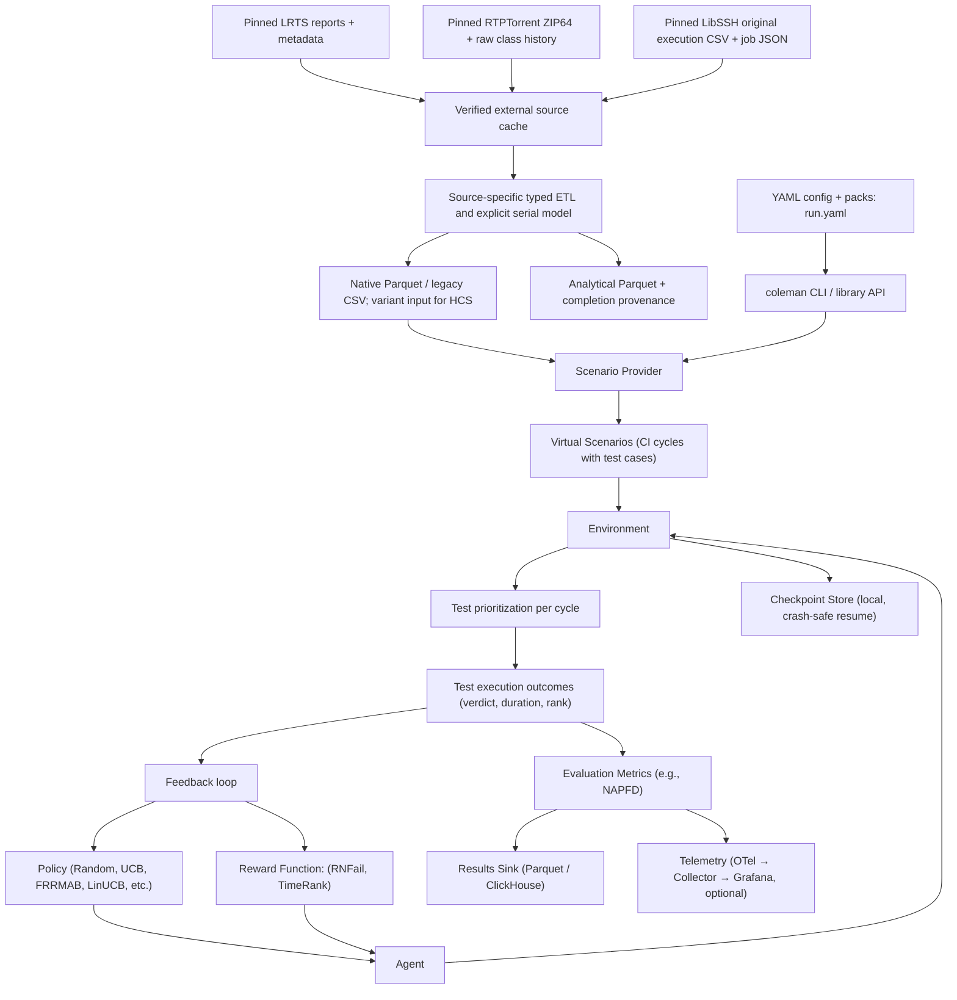

# Coleman

[](https://jacksonpradolima.github.io/coleman/)

[](https://sonarcloud.io/summary/new_code?id=jacksonpradolima_coleman4hcs)
[](https://codecov.io/github/jacksonpradolima/coleman4hcs)


**Adaptive test prioritization for continuous integration. Reproducible experiments from source data to results.**

COLEMAN learns from test outcomes to prioritize CI suites under an execution budget.
Compare classical, contextual and non-stationary bandit policies, run experiments
across seeds and budgets, and resume interrupted work with the same configuration
and checkpoint. Inspect the inputs, decisions and evidence behind each result.

[**Run real CI data**](#start-with-real-ci-data) · [**Explore benchmarks**](#datasets) ·
[**Library and CLI**](#quick-start) · [**Documentation**](https://jacksonpradolima.github.io/coleman/) ·
[**4.14 release**](https://github.com/jacksonpradolima/coleman/releases/tag/v4.14.0) · [**Cite COLEMAN**](#citation)

## What you can build with COLEMAN

| Your goal | Available workflow |
| --- | --- |
| Stress a difficult CI decision | [32 deterministic interaction-covering cases](docs/ci-stress-laboratory.md), explicit truth and feedback clocks, native Parquet and resumable agents |
| Audit what a source actually supports | [Development source-admission API](docs/corpus-admission.md): verify original evidence, retain explicit units and inspect a 35-axis production-reality matrix |
| Compare adaptive CI prioritization policies | Native TCPCI runner, configurable policies/rewards, contextual inputs and [parameter sweeps](#sweep-engine) |
| Evaluate configurable software | [Pinned LibSSH data → WTS/VTS Parquet and checkpointed replay](docs/hcs-parquet-etl.md), plus the existing Dune examples |
| Collect real-fault observations | [Controlled Java matrix](docs/java-fault-matrix.md) and [Python source capture](docs/python-source-capture.md): frozen source/runtime recipes, raw evidence and offline recovery |
| Inspect a constructed C weakness | [Pinned Juliet/GCC capture](docs/c-seeded-source-capture.md), an independent arithmetic oracle, raw process evidence and interruption recovery |
| Reproduce and inspect an experiment | Typed RunSpec, deterministic run identity, [provenance](#provenance), Parquet results and resumable checkpoints |
| Check a CI decision before adoption | [Independent mathematical benchmarks](docs/decision-benchmarks.md), [protected comparisons](docs/protected-evaluation.md) and [operational accounting](docs/operational-pilot.md) |
| Extend or integrate the platform | [Library API](#library-api), [application API and optional MCP](docs/application-api.md), [versioned domain results](docs/domain-results.md) and runner extensions |

Use the [resource replay](docs/resource-replay.md),
[point-in-time observations](docs/point-in-time-observations.md) and
[frozen shadow evaluation](docs/prospective-shadow.md) workflows to distinguish
modeled costs, observed execution and evidence available at decision time.
Negative and inconclusive results remain visible in their reports.

## Start with real CI data

With Python 3.14+ in an activated environment, install the published wheel and run
the complete LRTS workflow. Use cache/output directories outside Git:

```bash
python -m pip install "https://github.com/jacksonpradolima/coleman/releases/download/v4.14.0/coleman-4.14.0-py3-none-any.whl#sha256=de46ef9482f45372c96dd3d402f85daa18c3079733b4008ec05885e0d2d5cf66"
python -m coleman.transports.lrts_etl \
  --cache /tmp/coleman-lrts-source-cache \
  --output /tmp/coleman-lrts-data --fetch --run

# Continue the same experiment from the verified cache, offline:
python -m coleman.transports.lrts_etl \
  --cache /tmp/coleman-lrts-source-cache \
  --output /tmp/coleman-lrts-data --run
```

This downloads pinned public reports for **eight Karaf builds**, preserves
**6,876 observations** in analytical Parquet and projects **6,567 compatible
executions** into native input. **309 not-run cases** stay visible as exclusions.
Random and UCB produce **16 native result rows** across eight modeled rounds;
repeating the command resumes the same run. The JSON summary gives the data,
completion receipt and native-result paths. The [complete guide](docs/lrts-parquet-etl.md)
explains schemas, provenance, attribution and resource limits. Docker and MCP are
optional for other integrations and are unnecessary for this workflow.

The replay declares serial costs, assumed label correspondence and budget-censored
RNFail feedback. Source temporal admission remains blocked; this run demonstrates
a usable data pipeline and simulation. Policy efficacy and prospective savings
require their own eligible observations and comparisons.

The same **4.14 wheel** also provides
[RTPTorrent → analytical/native Parquet → checkpointed replay](docs/rtptorrent-parquet-etl.md).
Its complete HikariCP raw member preserves **46,995 class executions across 1,662
source jobs**. The declared eight-job preset projects **18 executions** and
produces **16 Random/UCB result rows**, with the other **46,977 records** retained
analytically. The guide includes a resumable download of the approximately 5 GB
source, full ZIP64 verification and an owned offline example. Method observations
from LRTS and class observations from RTPTorrent retain their distinct units.
Both workflows are explicit post-hoc simulations; the admission and comparison
gates remain visible in the [benchmark readiness table](#datasets).

For larger method histories, the **published 4.14 wheel** includes
[ActiveMQ and separate Log4j stage views](docs/lrts-stage-views.md). ActiveMQ
preserves **18,901 method observations / 18,668 native cases**. Log4j preserves
**30,066 observations**, with **14,957 Ubuntu / 14,906 Windows native cases**.
Each view runs two policies over four modeled rounds and resumes from checkpoint.
The Log4j views share source build groups; their observations are correlated.
The guide includes explicit archive acquisition, exact raw-node bindings and
the temporal evidence still missing for protected evaluation.

The **4.14 wheel** also takes [original LibSSH CI data through WTS/VTS
Parquet and checkpointed replay](docs/hcs-parquet-etl.md). Its frozen sixteen
pipelines retain 856 test executions and all 208 sparse cells across 13 known
job labels. Seven labels have parsed tests; the remaining six keep their missing
evidence. Compare each active variant's native budget and outcome counts, and
resume both budgets without mixing their checkpoints. Temporal admission stays
separate from this reproducible data path.

Reproduce upstream Java faults with the [controlled CLI/Codec matrix](docs/java-fault-matrix.md),
also included in **4.14**. One frozen plan collects three curated fixes across two
codebases, retaining all **714 role observations / 357 same-test pairs** from the
initial qualification, including both-fail and inconclusive outcomes. Typed indices
verify source, context and raw packets; interrupted collection remains incomplete,
and completed evidence reopens offline. This optional workflow requires the pinned
native arm64 Docker runtime. These constructed functional observations retain
separate admission and generalization limits.

The **published 4.14 wheel** also offers [controlled Python capture](docs/python-source-capture.md).
Reproduce a PySnooper Unicode fix with unchanged source/tests, pinned wheels and
two explicit locales. The installed qualification retains an ASCII exception-to-pass
pair as **inconclusive**, plus a UTF-8 both-pass contrast. Real process interruption,
offline replay and native checkpoint integration are verified. The guide includes
the verified published-wheel installation command and explicit runtime preparation.

The **4.14 wheel** includes [constructed C source capture](docs/c-seeded-source-capture.md):
unchanged NIST Juliet functions, a pinned GCC runtime and six frozen uint32 inputs
checked against an independent arithmetic oracle. The initial qualification
retains five both-pass pairs and one assertion-failure/pass pair. Inspect raw
streams, compiler/ABI provenance and offline/interruption recovery. These are six
correlated inputs from one synthetic template, with separate native CI costs and
benchmark admission gates.

# Getting started

- [Coleman](#coleman)
  - [What you can build with COLEMAN](#what-you-can-build-with-coleman)
  - [Start with real CI data](#start-with-real-ci-data)
- [Getting started](#getting-started)
- [Quick start](#quick-start)
  - [Library API](#library-api)
  - [CLI](#cli)
  - [Config packs](#config-packs)
  - [Sweep engine](#sweep-engine)
  - [Deterministic run\_id](#deterministic-run_id)
  - [Provenance](#provenance)
- [Installation](#installation)
  - [As a library (recommended for new projects)](#as-a-library-recommended-for-new-projects)
  - [From source (for development)](#from-source-for-development)
- [Development](#development)
  - [Code Cost Evaluation](#code-cost-evaluation)
  - [DevContainer (recommended)](#devcontainer-recommended)
- [Architecture: Results, Checkpoints \& Telemetry](#architecture-results-checkpoints--telemetry)
  - [Configuration](#configuration)
  - [Optional extras](#optional-extras)
  - [Querying results](#querying-results)
- [Observability](#observability)
  - [Using the DevContainer (zero-step setup)](#using-the-devcontainer-zero-step-setup)
  - [Local setup (without DevContainer)](#local-setup-without-devcontainer)
  - [Port reference](#port-reference)
  - [Metric names](#metric-names)
    - [Cardinality rules](#cardinality-rules)
  - [Adding ClickHouse (optional)](#adding-clickhouse-optional)
  - [Tear down](#tear-down)
- [Datasets](#datasets)
  - [Available today](#available-today)
  - [What remains in the benchmark roadmap](#what-remains-in-the-benchmark-roadmap)
- [About the files input](#about-the-files-input)
- [Using the tool](#using-the-tool)
  - [How data flows through Coleman](#how-data-flows-through-coleman)
  - [MAB Policies Available](#mab-policies-available)
  - [Running for Non-HCS System](#running-for-non-hcs-system)
  - [Running for an HCS system](#running-for-an-hcs-system)
    - [Whole Test Set Strategy](#whole-test-set-strategy)
    - [Variant Test Set Strategy](#variant-test-set-strategy)
- [Analysis of COLEMAN Performance](#analysis-of-coleman-performance)
  - [Performance Metrics](#performance-metrics)
  - [Methodologies](#methodologies)
  - [Visualizations](#visualizations)
- [Research background](#research-background)
- [Citation](#citation)
- [References](#references)
- [Contributors](#contributors)
----------------------------------


# Quick start

Coleman ships a **typed, library-first experiment system** with
YAML configs, composable config packs, a sweep engine, and deterministic
`run_id` hashing.  External projects can install the [release wheel](#installation) and
drive experiments programmatically **or** via the `coleman` CLI — no repo
checkout required.

The library namespace is now `coleman`.

> **Breaking change** — the `CONFIG_FILE` environment variable, raw TOML
> dict workflow, and `main.py` entry-point are removed.  Configuration is now
> handled via YAML configs, typed Pydantic v2 models, config packs, and
> the `coleman` CLI.

## Library API

```python
from coleman.spec import RunSpec, SweepSpec, SweepAxis, compute_run_id
from coleman.api import run, run_many, sweep

# 1. Define a spec
spec = RunSpec(
    experiment={"datasets": ["alibaba@druid"], "policies": ["UCB"], "rewards": ["RNFail"]},
    results={"out_dir": "./runs"},
)

# 2. Deterministic run_id — same config always produces the same ID
assert compute_run_id(spec) == compute_run_id(spec)

# 3. Single run
result = run(spec)
print(result.run_id, result.artifacts_dir)

# 4. Parameter sweep (grid × seeds)
specs = sweep(spec, SweepSpec(
    axes=[SweepAxis(mode="grid", params={"algorithm.ucb.rnfail.c": [0.1, 0.3, 0.5]})],
    seeds=[0, 1, 2],
))  # 3 values × 3 seeds = 9 specs

results = run_many(specs, max_workers=4)
```

| Function | Description |
|----------|-------------|
| `run(spec)` | Execute a single experiment from a resolved `RunSpec` |
| `run_many(specs, max_workers=)` | Execute multiple specs, optionally in parallel |
| `sweep(base, sweep_spec)` | Expand a base spec × sweep definition into concrete specs |
| `load_spec(path)` | Load and validate a `RunSpec` from YAML (with pack resolution) |
| `save_resolved(spec, path)` | Persist a resolved spec as canonical JSON |

## CLI

The `coleman` console script is installed automatically with the package:

```bash
# Execute a single run
coleman run --config run.yaml

# Parameter sweep (grid mode)
coleman sweep --config base.yaml \
    --grid algorithm.ucb.rnfail.c=0.1,0.3,0.5 \
    --grid execution.seed=range(0,20) \
    --workers 4

# Parameter sweep declared in YAML (no --grid needed)
coleman sweep --config base.yaml --workers 4

# Dry-run — print generated specs without executing
coleman sweep --config base.yaml --grid execution.seed=range(0,5) --dry-run


You can now define a top-level `sweep:` section in the YAML config used by
`coleman sweep`; CLI `--grid` values are merged on top.
# Validate a config and optionally write the resolved spec
coleman validate --config base.yaml --resolve resolved.json
```

## Config packs

Config packs are composable YAML fragments under `packs/`.  Reference them
with the `packs` key in your config and inline overrides win:

```yaml
# my-experiment.yaml
packs:
  - policy/linucb
  - reward/rnfail
  - results/parquet
  - telemetry/off

experiment:
  datasets: ["alibaba@druid"]
  policies: ["LinUCB"]

execution:
  independent_executions: 30

hooks:
  fail_fast: false
  plugins:
    - my_project.hooks.ForecastHook

extensions:
  my_domain:
    forecast_selection:
      policy: ThompsonSampling
      reward: Binary
```

Shipped starter packs:

| Pack | Category | Contents |
|------|----------|----------|
| `policy/linucb` | Policy | LinUCB with default alpha values |
| `reward/rnfail` | Reward | RNFail reward function |
| `runtime/local` | Runtime | Single-process local execution |
| `results/parquet` | Results | Parquet sink with defaults |
| `results/duckdb` | Results | DuckDB sink with consolidated files |
| `telemetry/off` | Telemetry | Telemetry disabled |

## Sweep engine

The sweep engine supports **grid** (Cartesian product) and **zip** (paired)
modes, with optional seed replication:

```python
from coleman.spec import SweepSpec, SweepAxis, expand_sweep, RunSpec

base = RunSpec()
sweep_spec = SweepSpec(
    axes=[
        SweepAxis(mode="grid", params={
            "algorithm.ucb.rnfail.c": [0.1, 0.3, 0.5],
            "execution.parallel_pool_size": [1, 4],
        }),
    ],
    seeds=[0, 1, 2],
)
specs = expand_sweep(base, sweep_spec)
# 3 × 2 × 3 seeds = 18 specs, deterministic order
```

- **Grid mode** — Cartesian product of all parameter lists
- **Zip mode** — paired lists (must have equal length, raises `ValueError` otherwise)
- **Seeds** — each base spec is replicated per seed; the seed is stored on `ExecutionSpec.seed` and affects `run_id`
- **CLI + YAML composition** — `coleman sweep` reads top-level `sweep:` from YAML and combines it with `--grid`

## Runner extensibility

Coleman supports extensibility without replacing the native runner:

1. `extensions` for namespaced custom domain config.
2. `hooks` for lifecycle plugins (`on_run_start`, `on_dataset_start`,
   `on_execution_start`, `on_execution_end`, `on_dataset_end`, `on_run_end`,
   `on_error`).

Execution-level hooks are process-local in worker context and remain
parallel-safe when `parallel_pool_size > 1`.

## Deterministic run_id

Every `RunSpec` hashes to a deterministic 12-character identifier:

```
run_id = sha256(canonical_json(resolved_spec))[:12]
```

- **Canonical JSON**: sorted keys, compact separators (`json.dumps(sort_keys=True, separators=(",", ":"))`)
- **Same config → same `run_id` → same output directory**
- Provenance files and artifacts are written to `<out_dir>/<run_id>/`

## Provenance

Each run persists:

| File | Contents |
|------|----------|
| `spec.resolved.json` | The fully resolved `RunSpec` as canonical JSON |
| `provenance.json` | Git commit, dirty flag, Python version, `uv.lock` hash |

# Installation

## As a library (recommended for new projects)

Requires Python 3.14 or later in an activated virtual environment. Install the
wheel published in this repository’s GitHub releases. These examples pin version
4.14.0 and its published SHA-256. Pip verifies the wheel before installation:

```bash
python -m pip install "https://github.com/jacksonpradolima/coleman/releases/download/v4.14.0/coleman-4.14.0-py3-none-any.whl#sha256=de46ef9482f45372c96dd3d402f85daa18c3079733b4008ec05885e0d2d5cf66"
```

Or with optional extras:

```bash
# OpenTelemetry SDK
python -m pip install "coleman[telemetry] @ https://github.com/jacksonpradolima/coleman/releases/download/v4.14.0/coleman-4.14.0-py3-none-any.whl#sha256=de46ef9482f45372c96dd3d402f85daa18c3079733b4008ec05885e0d2d5cf66"
# ClickHouse results sink
python -m pip install "coleman[clickhouse] @ https://github.com/jacksonpradolima/coleman/releases/download/v4.14.0/coleman-4.14.0-py3-none-any.whl#sha256=de46ef9482f45372c96dd3d402f85daa18c3079733b4008ec05885e0d2d5cf66"
```

Then use the [Library API](#library-api) or the [`coleman` CLI](#cli) to
drive experiments — no repo checkout required.

## From source (for development)

To develop or modify the tool, follow these steps:

1. Clone the repository:

```shell
git clone git@github.com:jacksonpradolima/coleman.git
cd coleman
```

2. Install [UV](https://docs.astral.sh/uv/) – a fast Python package manager.

3. Install dependencies:

```shell
uv sync
```

4. Install the project locally in editable mode:

```shell
uv pip install -e .
```

5. Create a YAML config file (see [Quick start](#quick-start) for
   the config format) and run with the `coleman` CLI:

```bash
coleman run --config my-experiment.yaml
```

# Development

[](https://sonarcloud.io/summary/new_code?id=jacksonpradolima_coleman4hcs)
[](https://sonarcloud.io/summary/new_code?id=jacksonpradolima_coleman4hcs)
[](https://sonarcloud.io/summary/new_code?id=jacksonpradolima_coleman4hcs)

This project uses a `Makefile` to streamline common development tasks. Run `make help` to see all available commands.

| Command                  | Description                          |
|--------------------------|--------------------------------------|
| `make install`           | Full dev setup (all extras + editable install) |
| `make pre-commit-install`| Install pre-commit hooks             |
| `make test`              | Run tests with pytest                |
| `make lint`              | Run the ruff linter                  |
| `make format`            | Run the ruff formatter               |
| `make docs`              | Build documentation with Zensical    |
| `make cost-structural`   | Run all structural cost checks (CC + MI + Xenon) |
| `make cost-energy`       | Estimate energy/carbon for a workload |
| `make help`              | Show all available Make targets      |

## Code Cost Evaluation

Coleman enforces code quality through a **multi-dimensional cost scorecard**
covering structural complexity, runtime profiling, and energy estimation.

**CI gates** run automatically on every pull request:

- **Xenon complexity gate** — fails if any block exceeds C, any module average exceeds B,
  or the project average exceeds A.
- **Radon maintainability index** — fails if any module scores below A (MI < 20).

**Local evaluation commands:**

```bash
make cost-structural        # all structural checks (CC + MI + Xenon)
make cost-complexity        # radon cyclomatic complexity
make cost-maintainability   # radon MI gate (fails if any module < 20)
make cost-xenon             # xenon complexity gate
make cost-wily              # wily trend analysis
make cost-profile-scalene   # scalene CPU/memory profiling
make cost-energy            # codecarbon energy estimation
```

See [Code Cost Evaluation](docs/code-cost.md) for full documentation.

## DevContainer (recommended)

The fastest way to start developing is with a [DevContainer](https://containers.dev/). Open the repo in VS Code or any DevContainer-compatible editor and select **"Reopen in Container"** — **everything works out of the box**, including the full observability stack.

**What happens automatically:**

1. Python 3.14 + uv + all dependencies (including telemetry & ClickHouse extras) are installed *(on create)*
2. Pre-commit hooks are configured *(on create)*
3. The **observability stack** (OTel Collector + Prometheus + Grafana + ClickHouse) starts via Docker-in-Docker *(on every start)*
4. **Telemetry** can be enabled via the `telemetry/local` pack *(swap `telemetry/off` for `telemetry/local` in `run.yaml`)*

After the container builds, just run your experiment:

```bash
coleman run --config run.yaml
```

Grafana is already live at http://localhost:3000 — open it in your browser to see metrics in real-time.

**Other useful commands:**

```bash
make test           # run the test suite
make lint           # lint with ruff
make docs-serve     # preview docs locally
```

**What's included in the DevContainer:**

| What | Why |
|------|-----|
| Python 3.14 + [uv](https://docs.astral.sh/uv/) | The project's package manager |
| Docker-in-Docker | Runs the observability stack automatically |
| VS Code extensions | Ruff, Pylance, Pyright, Copilot, TOML, Jupyter, etc. |
| Telemetry + ClickHouse extras | Pre-installed — no extra `pip install` needed |
| OTel Collector + Prometheus + Grafana + ClickHouse | Started automatically on container start |
| Port forwarding | All service ports mapped to your host (see table below) |

**Forwarded ports (all accessible from your host browser):**

| Port | Service | URL |
|------|---------|-----|
| 3000 | Grafana | http://localhost:3000 |
| 9090 | Prometheus | http://localhost:9090 |
| 4317 | OTel Collector (gRPC) | — (used by the framework) |
| 4318 | OTel Collector (HTTP) | — (used by the framework) |
| 8889 | Prometheus metrics | http://localhost:8889/metrics |
| 8123 | ClickHouse (HTTP) | http://localhost:8123 |
| 9000 | ClickHouse (native) | — |

> **ClickHouse sink remains optional.** The service is running in DevContainer,
> but you still need `sink: "clickhouse"` in your results config or use
> a ClickHouse results pack if you want results persisted to ClickHouse instead of Parquet.

# Architecture: Results, Checkpoints & Telemetry

Coleman is **framework-first**: `coleman run --config run.yaml` works with zero external
services.  All monitoring is split into three independent layers that can be
enabled or disabled individually:

| Layer | Purpose | Default | Optional |
|-------|---------|---------|----------|
| **Results** | Persist experiment facts (NAPFD, APFDc, …) | Partitioned Parquet (zstd) | ClickHouse sink |
| **Checkpoints** | Crash-safe resume | Local filesystem (pickle + `progress.json`) | — |
| **Telemetry** | Observability (latency, throughput) | Disabled (NoOp) | OpenTelemetry + Collector |

When a layer is disabled its module resolves to a **null implementation** with
near-zero overhead (`NullSink`, `NullCheckpointStore`, `NoOpTelemetry`).

## Configuration

All settings live in `run.yaml` and composable config packs under `packs/`.
See [Configuration](docs/configuration.md) for the full YAML schema reference.

```yaml
# run.yaml — default configuration using packs
packs:
  - execution/default        # parallel_pool_size: 10, independent_executions: 10
  - experiment/alibaba_druid # datasets, rewards, policies
  - algorithm/defaults       # baseline defaults (UCB/FRRMAB/EpsilonGreedy/LinUCB/SWLinUCB)
  - results/parquet          # Parquet sink with default settings
  - checkpoint/default       # checkpoint enabled, interval: 50000
  - telemetry/off            # telemetry disabled (swap for telemetry/local to enable)

# Inline overrides (applied on top of packs):
# execution:
#   parallel_pool_size: 4
```

## Optional extras

```bash
# Telemetry (OpenTelemetry SDK)
python -m pip install "coleman[telemetry] @ https://github.com/jacksonpradolima/coleman/releases/download/v4.14.0/coleman-4.14.0-py3-none-any.whl#sha256=de46ef9482f45372c96dd3d402f85daa18c3079733b4008ec05885e0d2d5cf66"

# ClickHouse results sink
python -m pip install "coleman[clickhouse] @ https://github.com/jacksonpradolima/coleman/releases/download/v4.14.0/coleman-4.14.0-py3-none-any.whl#sha256=de46ef9482f45372c96dd3d402f85daa18c3079733b4008ec05885e0d2d5cf66"
```

## Querying results

Results are written as Hive-partitioned Parquet files under `./runs/`.  You
can query them directly with DuckDB (already a project dependency):

For a guided end-to-end example covering configuration, observability,
resume/recovery, export, and final analysis, see [docs/workflow.py](docs/workflow.py).

```sql
-- Average NAPFD per policy
SELECT policy, AVG(fitness) AS avg_napfd
FROM read_parquet('./runs/**/*.parquet', hive_partitioning=1)
GROUP BY policy
ORDER BY avg_napfd DESC;

-- Cost distribution per reward function
SELECT reward_function,
       PERCENTILE_CONT(0.5) WITHIN GROUP (ORDER BY cost) AS median_cost
FROM read_parquet('./runs/**/*.parquet', hive_partitioning=1)
GROUP BY reward_function;
```

# Observability

> **Framework-first guarantee:** `coleman run --config run.yaml` works without Docker or
> any of these services.  The observability stack is **optional** for local
> installs, but **enabled automatically** in the DevContainer.

Coleman ships with a local observability stack (OTel Collector + Prometheus + Grafana)
for real-time metrics and traces during experiments.

## Using the DevContainer (zero-step setup)

If you develop inside the DevContainer, **everything is already running**.
The post-start hook automatically:

1. Starts the OTel Collector + Prometheus + Grafana + ClickHouse via Docker Compose
2. Telemetry can be enabled via the `telemetry/local` pack in `run.yaml`

The `telemetry` and `clickhouse` pip extras are installed during container creation.

Just run your experiment and open Grafana:

```bash
coleman run --config run.yaml
# Open http://localhost:3000 → metrics appear in real-time
```

No manual steps required.

## Local setup (without DevContainer)

If you're **not** using the DevContainer, follow these steps:

```bash
# 1. Start the observability stack
cd examples/observability
docker compose up -d

# 2. Install telemetry extras
uv pip install "coleman[telemetry] @ https://github.com/jacksonpradolima/coleman/releases/download/v4.14.0/coleman-4.14.0-py3-none-any.whl#sha256=de46ef9482f45372c96dd3d402f85daa18c3079733b4008ec05885e0d2d5cf66"

# 3. Enable telemetry in your run.yaml:
#    Replace telemetry/off with telemetry/local in the packs list

# 4. Run experiments — metrics flow to Grafana
coleman run --config run.yaml
```

## Port reference

| Port | Service | URL |
|------|---------|-----|
| **3000** | Grafana | http://localhost:3000 |
| **4317** | OTel Collector (gRPC) | — (used by the framework) |
| **4318** | OTel Collector (HTTP) | — (used by the framework, default endpoint) |
| **8889** | Prometheus metrics | http://localhost:8889/metrics |
| **8123** | ClickHouse (HTTP) | http://localhost:8123 *(auto-started in DevContainer; local: `--profile clickhouse`)* |
| **9000** | ClickHouse (native) | — *(auto-started in DevContainer; local: `--profile clickhouse`)* |

## Metric names

| Metric | Type | Description |
|--------|------|-------------|
| `coleman.cycles_total` | Counter | Total experiment cycles processed |
| `coleman.bandit_update_latency` | Histogram (s) | Bandit arm-update latency |
| `coleman.prioritization_latency` | Histogram (s) | Test-case prioritization latency |
| `coleman.evaluation_latency` | Histogram (s) | Evaluation step latency |
| `coleman.napfd` | Histogram | NAPFD score distribution |
| `coleman.apfdc` | Histogram | APFDc score distribution |

### Cardinality rules

- **No `step` label** in metrics (would create unbounded cardinality).
- `run_id` is a resource attribute, not a metric label.
- Per-step detail is available in **traces** (span attributes).

## Adding ClickHouse (optional)

In the DevContainer, ClickHouse is already started by the post-start hook.
For local setups, start ClickHouse alongside the existing stack:

```bash
cd examples/observability
docker compose --profile clickhouse up -d
```

Then switch the results sink in your `run.yaml`:

```yaml
results:
  sink: clickhouse
```

```bash
# Run experiments — results go to the coleman_results table
coleman run --config run.yaml
```

The ClickHouse extras are already installed in the DevContainer.  For local
installs, follow the [optional extras](#optional-extras) instructions first.

## Tear down

```bash
cd examples/observability
docker compose --profile clickhouse down -v
```

# Datasets

## Available today

Choose a workflow by the evidence you need. Runnable examples, source readers,
controlled reproductions and empirical benchmark corpora have different roles:

| Dataset or benchmark | What you can use now | Scope and readiness |
| --- | --- | --- |
| **LRTS / Karaf real CI reports** | [Pinned download → analytical/native Parquet → Random/UCB → checkpoint recovery](docs/lrts-parquet-etl.md) | Complete eight-build preset; explicit post-hoc serial simulation. Protected historical admission remains blocked. |
| **LRTS / ActiveMQ and Log4j stage views** | [Published 4.14 wheel → explicit local archive → analytical/native Parquet → checkpoint recovery](docs/lrts-stage-views.md) | Four-build profiles; exact context/node bindings. All raw stages retained; Log4j views share source observations. Temporal admission remains blocked. |
| **Druid and Retrofit** | Bundled native/contextual Parquet examples, native runner and [descriptive profiles](docs/benchmark-corpus.md#local-profiles-and-the-first-diversity-matrix-44) | Runnable legacy experiments. Source terms, duration units and outcome availability still need corpus admission evidence. |
| **Dune and its variants** | Bundled native Parquet, WTS/VTS workflows and [variant-aware inventory](docs/benchmark-corpus.md) | Runnable HCS examples. Variants/context files may share executions; broad HCS benchmark admission remains unfinished. |
| **LibSSH historical configurations** | [Published 4.14 wheel → original CSV/JSON → analytical/union/variant/VTS Parquet → native checkpoints](docs/hcs-parquet-etl.md) | Sixteen frozen pipelines, 13 known job labels (seven with parsed tests), 856 retained test executions and 29 explicit other-attempt exclusions. All 208 sparse cells retain missing evidence; metadata-only jobs never become passing tests or native executions. Test-only costs and temporal admission blockers remain explicit. |
| **RTPTorrent / HikariCP** | [Verified ZIP64 → full analytical history → native-compatible Parquet → replay/recovery](docs/rtptorrent-parquet-etl.md) | Available in 4.8: 46,995 class executions / 1,662 jobs retained; eight declared jobs provide the bounded native preset. Explicit post-hoc assumptions; temporal admission remains blocked. |
| **Controlled Java real-fault sources** | Published 4.14 wheel: [CLI-13 producer](docs/junit-source-capture.md) and [three-fix CLI/Codec matrix](docs/java-fault-matrix.md) with typed indices and offline recovery | Two codebases, explicit common fixtures, 357 same-test pairs in the initial qualification. Docker/arm64; negative and inconclusive results remain visible. Controlled evidence, not historical CI or full Defects4J reconstruction. |
| **Controlled Python real-fault source** | [Published 4.14 wheel → pinned PySnooper capture → offline/interruption recovery](docs/python-source-capture.md) | One unchanged partial fixture, one curated fix, two correlated locales: ASCII error-to-pass remains inconclusive; UTF-8 both-pass. Docker/arm64; component terms and attribution limits retained. |
| **Constructed C weakness** | [Published 4.14 wheel → pinned Juliet/GCC → independent arithmetic oracle → offline/interruption recovery](docs/c-seeded-source-capture.md) | One 2017 template/function pair, six correlated inputs, five both-pass and one expected pair. CC0/US public-domain source; synthetic provenance, separate from real faults and empirical admission. |
| **Deterministic CI stress laboratory (published 4.14)** | [32 interaction-covering cases → truth JSONL/native Parquet → actual agents/checkpoints](docs/ci-stress-laboratory.md) | Eleven factors; tiny through 50,000 logical tests; explicit delayed/corrected feedback eligibility and modeled worker schedules. One owned constructed family; no empirical admission. |
| **Owned CI correctness fixtures** | Two tiny [serial/parallel corpus fixtures](docs/benchmark-corpus.md), validation and native integration examples | Available without network. One constructed family for contract/metric checks; no independent-project diversity. |
| **Coverage and scenario-allocation microbenchmarks** | [Correctness and performance profiles](docs/decision-benchmarks.md), independent exhaustive references and JSON/Markdown reports | Runnable finite-model benchmarks with runtime/memory observations; separate from empirical CI-policy comparisons. |
| **Pilot, resource and shadow examples** | [Operational accounting](docs/operational-pilot.md), [resource replay](docs/resource-replay.md) and [shadow recovery](docs/prospective-shadow.md) | Runnable synthetic demonstrations of accounting/recovery. Collected prospective evidence remains insufficient. |

The ten inventoried legacy Parquet artifacts contain **1,386,730 raw rows**,
including contextual files, shared variants and a synthetic example. Their row
count is an inventory fact; shared executions do not become independent projects
or faults. Third-party data terms remain separate from COLEMAN's MIT code license.
See the [source cards and diversity inventory](docs/benchmark-corpus.md) for the
actual identities, counts, missing semantics and admission blockers.

From an installed package, in your chosen workspace:

```bash
# Inspect registered corpus metadata and explicit blockers:
python -m coleman.corpus list
python -m coleman.corpus validate ci-serial-boundary-v1 --output corpus-artifacts
python -m coleman.corpus validate ci-parallel-occupancy-v1 --output corpus-artifacts

# Run independent decision mathematics; reports are written below this workspace:
python -m coleman.benchmarks --profile correctness --output benchmark-artifacts
```

The corpus registry contains **12 registrations: two owned fixtures and ten
legacy artifacts**. Source-specific LRTS/RTPTorrent readers and controlled-source
recipes are separate workflows, linked above; `corpus list` is not a catalog of
every executable example. Registration and successful source conversion each
retain their own validation gates.

## What remains in the benchmark roadmap

[#261](https://github.com/jacksonpradolima/coleman/issues/261) remains open.
The controlled Java matrix and bounded Python reproduction are usable source
workflows; neither completes corpus diversity or scientific admission.
The published 4.14 wheel includes a [bounded constructed C slice](docs/c-seeded-source-capture.md)
from permitted Juliet inputs. SIR component/data terms remain unresolved.
Eight of the thirteen public subtasks are delivered, including LibSSH WTS/VTS
(introduced in 4.13) and the [#308](https://github.com/jacksonpradolima/coleman/issues/308)
interaction-covering synthetic stress laboratory in 4.14. The development branch for
#309 adds [evidence-backed source admission](docs/corpus-admission.md);
metric/statistical validation, comparable baselines, public prospective collection
feasibility and the confirmatory report remain in #309–#313. External baseline
reproduction, including investigated DANTE methods, requires its own verified
integration and comparable protocol.

Completing the issue additionally requires the predeclared baseline matrix,
eligible temporal/statistical comparisons, production-reality/diversity coverage,
a frozen confirmatory run and the per-project/cross-corpus report. All seven
required diversity regimes remain uncovered in the registry. Existing source
readers and a working real-data slice support that program without claiming it
has already finished. Follow the [public roadmap](docs/roadmap.md).

Existing dataset discovery links remain available at the
[Harvard Dataverse collection](https://dataverse.harvard.edu/dataverse/gres-ufpr).
The [GitLab CI extraction tool](https://github.com/jacksonpradolima/gitlabci-torrent),
adapted [TravisTorrent tool](https://github.com/jacksonpradolima/travistorrent-tools)
and [dataset utilities](https://github.com/jacksonpradolima/tcpci-dataset-utils)
are separate projects; review each source's terms and semantics before use.

# About the files input

**COLEMAN** now uses Parquet files (`features-engineered.parquet` and
`data-variants.parquet`) as the primary scenario input format. CSV inputs are
still accepted for compatibility, but they are deprecated and emit warnings.

The second file, **data-variants** (Parquet/CSV), is used by the HCS, and it represents all results from all variants.
The information is organized by commit and variant.

- **features-engineered.parquet** (or legacy `features-engineered.csv`) contains the following information:
  - **Id**: unique numeric identifier of the test execution;
  - **Name**: unique numeric identifier of the test case;
  - **BuildId**: a value uniquely identifying the build;
  - **Duration**: approximated runtime of the test case;
  - **LastRun**: previous last execution of the test case as *DateTime*;
  - **Verdict**: test verdict of this test execution (Failed: 1, Passed: 0).

- **data-variants.parquet** (or legacy `data-variants.csv`) contains all information that **features-engineered.parquet** has, and in addition the following information:
  - **Variant**: variant name.

In this way, **features-engineered** organizes the information for a single system or variant, and
**data-variants** tracks the information for all variants used during the software life-cycle (for each commit).

During the **COLEMAN**'s execution, we use **data-variants** to identify the variants used in a current commit and apply the **WTS** strategy.

For **CONSTANTINE**, additional columns can be used and represents a contextual information. In this way, you define
what kind of information can be used!

#  Using the tool

## How data flows through Coleman



Define experiments through the library's typed RunSpec or a YAML configuration.
Create your own `run.yaml`, or edit the repository's example when working from a checkout.
The file uses composable config packs for a clean, modular setup — each pack provides
defaults for one concern.  Add inline overrides below the `packs:` list to customise settings.

Here's an example `run.yaml` file:

```yaml
# run.yaml — Default Run Configuration
packs:
  - execution/default        # parallel_pool_size: 10, independent_executions: 10
  - experiment/alibaba_druid # datasets, rewards, policies
  - algorithm/defaults       # FRRMAB, UCB, EpsilonGreedy, LinUCB, SWLinUCB params
  - results/parquet          # Parquet sink
  - checkpoint/default       # checkpoint enabled
  - telemetry/off            # telemetry disabled
  - reward/rnfail            # RNFail reward
  - hcs/off                  # HCS disabled
  - contextual/default       # contextual information defaults

# Inline overrides (applied on top of packs):
execution:
  parallel_pool_size: 4
experiment:
  datasets:
    - square@retrofit
```

**where:**
- Execution Configuration:
  - `parallel_pool_size` is the number of worker processes to run **COLEMAN** in parallel.
  - `independent_executions` is the number of independent experiments we desire to run.
  - `force_sequential_under_scalene` forces sequential execution while Scalene is active to improve profiling stability and avoid missing per-thread attribution issues.
  - Parallelism has two layers:
    - inside a run: `execution.parallel_pool_size` controls process-pool workers for independent executions;
    - across many specs: `coleman sweep --workers` (or API `run_many(..., max_workers=...)`) controls concurrent spec execution.
- Experiment Configuration:
  - `scheduled_time_ratio` represents the Schedule Time Ratio, that is, time constraints that represents the time available to run the tests. **Default**: 0.1 (10%), 0.5 (50%), and 0.8 (80%) of the time available.
  - `datasets_dir` is the directory that contains your system. For instance, we desire to run the algorithm for the systems that are inside the directory **data**.
  - `datasets` is an array that represents the datasets to analyse. It's the folder name inside `datasets_dir` which contains the required file inputs.
  - `experiment_dir` is the directory where we will save the results.
  - `rewards` defines the reward functions to be used, available RNFailReward and TimeRankReward (See **Ref1** in [References](#references)).
  - `policies` selects the Policies available on **COLEMAN** (classic + extended), including greedy, UCB, contextual, and non-stationary/sliding-window variants.
- Algorithm Configuration: each algorithm has its own individual configuration. Next, we present some of them:
  - FRRAB:
    - `window_sizes` is an array that contains the sliding window sizes
    - `c` is the scaling factor. It's defined for each reward function used.
  - UCB:
    - `c` is the scaling factor. It's defined for each reward function used.
  - Epsilon-Greedy:
    - `epsilon` is the epsilon value. It's defined for each reward function used.
- HCS Configuration:
  - `wts_strategy` represents the usage of Whole Test Set (WTS) Strategy for a system HCS (See [Whole Test Set Strategy](#whole-test-set-strategy)).
- Contextual Information:
  - Config
    - `previous_build` what kind of information we obtain from previous build and not in the current one. For
      instance, the test case duration (`Duration`) will _know_ only after the test execution.
  - Feature Group
    - `feature_group_name` represent the name of a feature group. We can create different groups of feature to
      evaluate the influence of each one.
    - `feature_group_values` represent the features selected to be used by the Contextual MAB.


##  MAB Policies Available

The following policies are available on **COLEMAN**.

Baseline and classical policies:
- Random
- Greedy
- EpsilonGreedy
- UCB
- UCB1
- SlMAB
- FRRMAB

Greedy variants:
- DecayEpsilonGreedy
- OptimisticGreedy

UCB variants:
- UCB2
- SlidingWindowUCB
- KLUCB
- UCBTuned
- UCBV
- MOSSUCB

Bayesian/stochastic/adversarial variants:
- ThompsonSampling
- BayesianUCB
- Softmax
- Pursuit
- EpsilonDecreasing
- BootstrappedThompson
- PHE
- EXP3
- EXP3IX
- DiscountedUCB
- ChangeDetectionUCB

Combinatorial variants:
- CombinatorialUCB
- CombinatorialThompson

Dueling / ranking variants:
- DuelingUCB
- PairwiseThompsonRanking

Portfolio meta-policy:
- PortfolioUCB

Contextual variants:
- LinUCB
- SWLinUCB
- LinTS
- ContextualEpsilonGreedy
- SWLinTS
- SWContextualEpsilonGreedy

## Running for Non-HCS System

To execute **COLEMAN** for a non-HCS system, first update the experiment settings in your `run.yaml` (or override inline):

- `datasets_dir: examples`
- `datasets: [fakedata]`

Subsequently, you can run the program with the following command:

```
coleman run --config run.yaml
```

## Running for an HCS system

For HCS systems, we provide two strategies to learn and prioritize tests across configurations:
**WTS** (Whole Test Set Strategy) and **VTS** (Variant Test Set Strategy).
You can learn more about these in **Ref2** under the [References](#references) section.

For **WTS**, each dataset folder under `datasets_dir` contains a whole-system
`features-engineered.parquet` and a `data-variants.parquet`; its `Variant` column
identifies configurations present in each modeled round. For **VTS**, each variant
has its own dataset folder and policy state. The [LibSSH workflow](docs/hcs-parquet-etl.md)
produces both layouts from pinned public originals, with explicit cost semantics,
source identities and sparse-cell evidence. The Dune examples below remain available.

### Whole Test Set Strategy

The **WTS** strategy prioritizes the test set composed by the union of the test cases of all variants.
To employ this strategy, set in your `run.yaml`:

- `hcs_configuration.wts_strategy: true`

For a practical demonstration, set `datasets = ["dune@total"]`
(a dataset amalgamating test cases from all variants)
and `datasets_dir = "examples/core@dune-common"`.
This provides a concise example using the Dune dataset.
More details on the dataset are available under [Datasets](#datasets).

### Variant Test Set Strategy

Contrastingly, the **VTS** approach evaluates each variant as an isolated system.
To harness this strategy, set in your `run.yaml`:

- `hcs_configuration.wts_strategy: false`

As example, use `datasets = ["dune@debian_10 clang-7-libcpp-17", "dune@debian_11 gcc-10-20",
"dune@ubuntu_20_04 clang-10-20"]` and `datasets_dir = "examples/core@dune-common"`
to run one small example using Dune dataset (See [Datasets](#datasets)).
Now, we consider each variant as single system.

As a hands-on example, set `datasets =
["dune@debian_10 clang-7-libcpp-17", "dune@debian_11 gcc-10-20", "dune@ubuntu_20_04 clang-10-20"]`
and `datasets_dir = "examples/core@dune-common"`.
This offers a succinct example using the Dune dataset, treating each variant as a unique system.
Further insights into the dataset are available in the [Datasets](#datasets) section.

# Analysis of COLEMAN Performance

As part of our ongoing effort to provide the state-of-the-art tool, Coleman, for TCPCI, we've created examples to guide any researcher to understand the performance, effectiveness, and adaptability of our tool. The analysis, available in our [marimo notebook](notebooks/analysis.py) (and the original [Jupyter notebook](notebooks/analysis.ipynb)), leverages various libraries such as DuckDB, Pandas, Seaborn, and Matplotlib to process data and visualize the results.

## Performance Metrics

The notebook has examples including but not limited to test case execution times, prioritization effectiveness, and algorithm efficiency under different configurations and environments.

## Methodologies

The notebook employs SQL queries for data manipulation and leverages Python's data analysis and visualization libraries to derive meaningful insights from historical test data. Our methodology ensures a robust analysis framework capable of handling large datasets and producing actionable intelligence.

## Visualizations

Data visualizations play a key role in our analysis, offering intuitive understanding of complex data patterns and algorithm performance. The notebook includes various charts and graphs that elucidate the trade-offs between different prioritization strategies and their impact on test cycle times and failure detection rates.

<a id="solving-the-test-case-prioritization-using-multi-armed-bandit-algorithms"></a>

# Research background

**COLEMAN** (_**C**ombinatorial V**O**lati**LE** **M**ulti-Armed B**AN**dit_)
originated as a multi-armed bandit approach to Test Case Prioritization in
Continuous Integration (TCPCI). Its research lineage includes adaptive ranking,
Highly Configurable Systems (HCS), and contextual prioritization under the name
**CONSTANTINE** (_**CON**textual te**S**t priori**T**iz**A**tion for co**NT**inuous
**INE**gration_). See [References](#references) for the original publications.

HCS experiments support **Whole Test Set (WTS)**, which prioritizes the union of
tests across variants, and **Variant Test Set (VTS)**, which prioritizes the test
set for each variant. Contextual policies such as LinUCB and SWLinUCB consume
configured features, including historical duration, executed/failed method counts,
test age, change type, complexity and size when supplied by the dataset. Features
used for a decision must have been available before that decision; the current
execution's duration and verdict become feedback afterward.

The experiment interface accepts test-execution data independently of the subject's
implementation language. Each source producer has its own supported language,
runtime and evidence limits, documented in the [benchmark inventory](#datasets).

# Citation

If this tool contributes to a project which leads to a scientific publication, I would appreciate a citation.

```
@Article{pradolima2020TSE,
  author  = {Prado Lima, Jackson A. and Vergilio, Silvia R.},
  journal = {IEEE Transactions on Software Engineering},
  title   = {A Multi-Armed Bandit Approach for Test Case Prioritization in Continuous Integration Environments},
  year    = {2020},
  pages   = {12},
  doi     = {10.1109/TSE.2020.2992428},
}

@article{pradolima2021EMSE,
  author  = {Prado Lima, Jackson A. and Mendon{\c{c}}a, Willian D. F. and Vergilio, Silvia R. and Assun{\c{c}}{\~a}o, Wesley K. G.},
  journal = {Empirical Software Engineering},
  title   = {{Cost-effective learning-based strategies for test case prioritization in Continuous Integration of Highly-Configurable Software}},
  year    = {2021}
}

```

# References

- 📖 [**Ref1**] [A Multi-Armed Bandit Approach for Test Case Prioritization in Continuous Integration Environments](https://doi.org/10.1109/TSE.2020.2992428) published at **IEEE Transactions on Software Engineering (TSE)**

[](https://www.youtube.com/watch?v=w8Lf0VEWkQk)

- 📖 [**Ref2**] [Learning-based prioritization of test cases in continuous integration of highly-configurable software](https://doi.org/10.1145/3382025.3414967) published at **Proceedings of the 24th ACM Conference on Systems and Software Product Line (SPLC'20)**


[](https://www.youtube.com/watch?v=tT8Ygt8jCKg)

# Contributors

Please see our [Contributing Guidelines](CONTRIBUTING.md) if you'd like to contribute.

For vulnerability reports, refer to our [Security Policy](SECURITY.md).

- 👨‍💻 Jackson Antonio do Prado Lima <a href="mailto:jacksonpradolima@gmail.com">:e-mail:</a>

<a href="https://github.com/jacksonpradolima/coleman/graphs/contributors">
  
</a>
