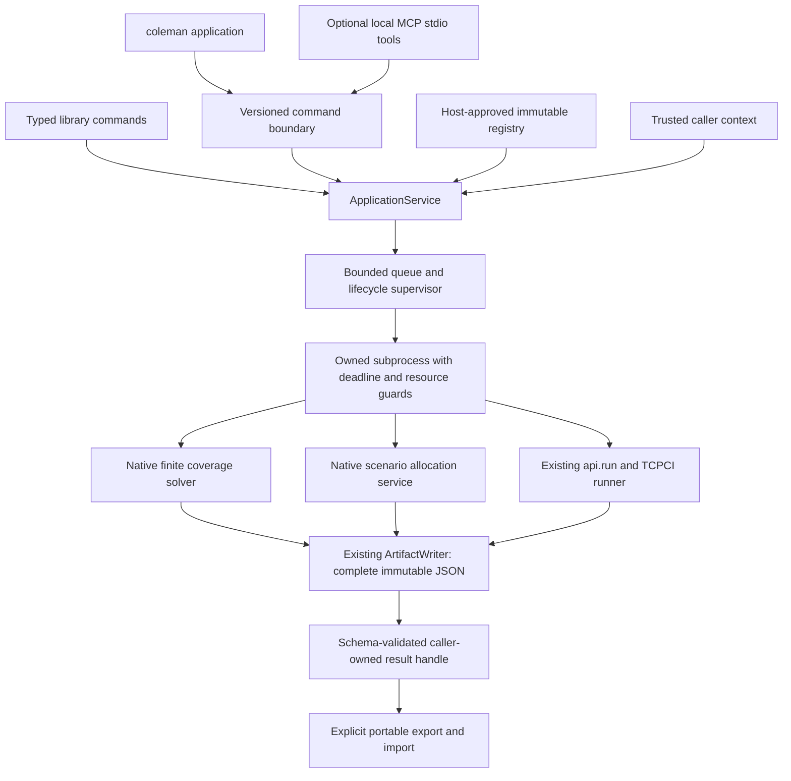
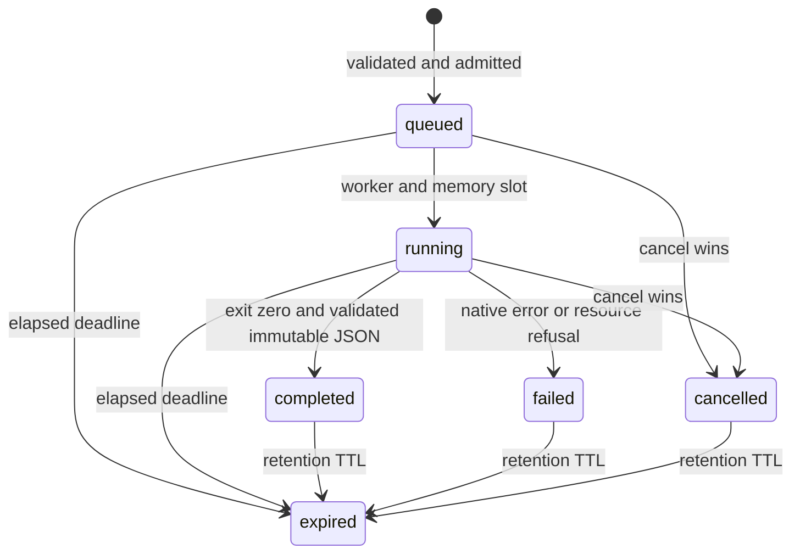

# Bounded CI application API and optional MCP

This capability is being prepared for COLEMAN 4.0 on `release/4.0`; the published
3.6.1 wheel does not contain it. COLEMAN remains a CI test prioritization and
selection platform. The application layer makes its existing native services
available through reusable, bounded commands. It does not introduce a new runner,
an LLM decision algorithm, or a hosted service.

## Install a reviewed build

Use Python 3.14 on Linux or macOS. From the reviewed checkout:

```bash
uv build
python -m venv /tmp/coleman-application-env
/tmp/coleman-application-env/bin/python -m pip install ./dist/coleman-3.6.1-py3-none-any.whl
```

The branch retains the current package version until the automatic 4.0 release.
For optional tools, install the **same local wheel** with its extra:

```bash
/tmp/coleman-application-env/bin/python -m pip install './dist/coleman-3.6.1-py3-none-any.whl[mcp]'
```

Use the verified GitHub release asset when 4.0 is published. The bare PyPI name
does not identify this repository. Base CLI/library execution requires no MCP
dependency, model, credentials, network service, or client. The optional adapter
is tested against the pinned MCP Python SDK 2.3.0 and its negotiated MCP protocol;
the independent COLEMAN application contract is `coleman-application-v1`.

## Architecture and ownership



Domain packages never import CLI or MCP. Native `run`, sweeps, extensions, sinks,
checkpoints and unrestricted library APIs retain their existing behavior. The
application service owns a unique private session directory under a trusted
host-selected root. Clients select registered IDs; they cannot send a RunSpec,
plugin import, path, shell command, dataset URL or exporter endpoint.

The packaged registry contains three **synthetic smoke fixtures**:

| Spec ID | Native service | Meaning |
|---|---|---|
| `weighted-overlap-3` | Finite coverage | Overlapping A/B/C capabilities, modeled duration in seconds |
| `signed-ci-resource-3` | Scenario allocation | Declared joint scenario model with conservative evidence handling |
| `native-ci-smoke-v1` | TCPCI runner | Two synthetic builds, Random baseline, RNFail, seed 42, fixed-time budget 3 s |

These fixtures validate integration and mathematics; they are not independent
CI observations or evidence of practical time savings. Seeds do not create
independent observations. Native allocation retains its insufficient-evidence
and conservative fallback semantics.

## Complete library example

Run from outside the checkout after installing the wheel:

```python
from pathlib import Path
from tempfile import TemporaryDirectory

from coleman.application import (
    ApplicationService, Caller, Parameters, ResultBundle, Submit, default_registry,
)
from coleman.selection import CoverageResult

caller = Caller(subject="local-analysis")  # supplied by trusted host code
with TemporaryDirectory() as directory:
    with ApplicationService(default_registry(), root=Path(directory)) as service:
        print(service.capabilities().to_json())
        request = Submit(
            schema_version=1,
            request_id="ci-budget-3",
            spec_id="weighted-overlap-3",
            parameters=Parameters(budget=3),
        )
        initial = service.submit(request, caller=caller)
        final = service.wait(initial.job_id, caller=caller)
        assert final.state == "completed" and final.handle is not None
        bundle = service.result(final.handle, caller=caller)
        assert isinstance(bundle.result, CoverageResult)
        assert bundle.result.selected_ids == ("A", "C")
        assert bundle.result.cost.value == 3
        assert bundle.result.objective.value == 1
        assert service.submit(request, caller=caller).job_id == final.job_id
        exported = service.export_result(final.handle, caller=caller)
        Path(directory, "portable.json").write_text(exported, encoding="utf-8")
        assert ResultBundle.from_json(exported) == bundle
        imported = service.import_result(exported, caller=caller)
        assert imported.handle is not None
        assert imported.handle.digest == final.handle.digest
```

Save the export outside a temporary directory to retain it after shutdown.
Coverage budget overrides are exact nonnegative decimals, at most twelve decimal
places, in the registered cost unit and meaning. JSON serializes them as decimal
strings. Zero is valid; null means **no override**. Negative budgets, non-finite
values, unknown keys and implicit unit conversions are rejected. Allocation and
experiment parameters are frozen in their registrations in v1.

One-shot CLI execution uses the same command and services:

```bash
coleman application --request '{"schema_version":1,"request_id":"ci-budget-3","spec_id":"weighted-overlap-3","parameters":{"budget":3}}'
coleman application --request '{"schema_version":1,"request_id":"native-ci","spec_id":"native-ci-smoke-v1"}'
```

CLI output is a canonical JSON envelope. Success contains `ok: true` and `data`;
errors contain `ok: false`, a stable `error` and safe human `message`. A failed or
expired one-shot job returns its typed state and exits with status 2. Existing
`coleman run --config ...` remains available.

## Native experiment registration by trusted hosts

For your own approved local dataset, create a normal RunSpec in host code, set
one sequential worker, one to sixteen executions and an explicit seed; use the
Random baseline, one or two RNFail/TimeRank rewards, and one to eight budgets.
Disable checkpoints, telemetry, hooks and extensions; use the local Parquet sink.
Call `register_experiment("approved-ci", spec)` and pass the returned immutable
`Configuration` to `ApplicationService`. Registration snapshots up to eight
`<datasets_dir>/<dataset>/features-engineered.parquet` files, totaling 1 MiB, with
at most 10,000 rows per dataset and 1,000 candidates per build. Dataset IDs use
the conservative application ID alphabet. This bounded adapter deliberately
supports a smaller surface than unrestricted native RunSpec execution.

Inputs are copied into an owned worker directory; original files are never
reread during execution. Normalized relative input/output paths make the native
resolved run ID independent of temporary directories. Configuration fingerprints
bind complete input bytes and normalized RunSpec. Work units are total builds ×
executions × rewards × budget values. An over-limit experiment is rejected before
queue admission; work-limited decisions can return an explicitly limited native
result. V1 does not resume application jobs through native checkpoints. Existing
direct checkpoint APIs remain available separately.

Registration recomputes build/candidate dimensions from the snapshotted bytes.
The bounded adapter requires integer build IDs and binary verdicts, unique
testcase names per build, numeric finite nonnegative durations in seconds and
non-null native required columns. Invalid rows are rejected; this adapter never
invokes the legacy loader's null-duration-to-zero coercion. The direct legacy
loader remains compatible with its existing callers. Algorithm overrides are
outside the approved Random baseline registration surface in v1.

Experiment bundles contain the original resolved specification, provenance and
native artifact bytes with logical filenames, byte counts, SHA-256 and canonical
base64. Import never extracts these files. Existing Parquet fields retain their
legacy meanings; unavailable metrics are not invented or converted to zero.
Runtime observations, timestamps and native shard filenames can differ across
equivalent executions. Mathematical results and approved-source provenance are
compared separately from runtime metadata and complete artifact digests.

## Limits, states and failures

`Limits` requests are reduced componentwise by `ServerPolicy.caps` before work.
Default caps are 30 elapsed seconds including queue/startup, 10,000 native work
units, 100 candidates, 512 MiB worker peak RSS/solver allocation ceiling and
256 KiB portable result JSON. Native solver working-memory estimates cap at
1 GiB even if a host permits larger worker RSS. Native proof/dimension ceilings
still apply. The service defaults to one active worker, eight pending jobs,
64 retained job identities, 16 MiB reserved results and 2 GiB reserved active
worker memory. Limits count bytes, seconds and documented native work units;
they are not calibrated probabilities or scientific quality guarantees.

Admission reserves each job's maximum output until expiry and sums admitted
worker memory before starting processes. Registry snapshots are bounded to 32
configurations of 1.5 MiB each. Parent/interpreter overhead, input snapshots,
protocol frames and temporary serialization buffers add bounded local overhead
outside worker RSS. Worker RSS and native-file output are checked before/after
calculation and sampled every 20 ms; transient overshoot is possible. Unsupported
RSS measurement fails closed. This is a guard for trusted local native code,
not a hard memory allocator or hostile-code sandbox. The underlying SDK stdio
framing is for a trusted local client and is not an untrusted network ingress
limit. Hosted deployment needs its own authenticated, size/concurrency-limited
gateway and process/resource isolation; v1 provides none.



Cancellation and completion commit under the same lock: the first terminal state
wins. Cancelling a completed job returns completion unchanged; cancelling queued
or running work terminates/reaps its worker and exposes no partial result. A
complete native incumbent with a work-limit status is valid evidence, not an
optimality claim. Native failures never become fabricated negative scientific
results. Only exit zero plus valid, matching native result JSON permits completion.

Retention starts at a terminal state, defaults to one hour, and deletes result
bytes on expiry. Status retains an `expired` tombstone; retrieval returns the
stable expiry error. Request IDs are scoped by trusted caller: identical retries
reuse the same job, changed commands conflict, and expired IDs never silently
start new work. Tombstones count toward the finite session job limit. After that
limit, start a new service session deliberately. `close()` cancels work and removes
session files. Restart loses job handles; orphaned crash directories require
trusted operator cleanup. Export/import is the explicit portable continuation,
not a claim to resume an interrupted native calculation.

| Error | Meaning |
|---|---|
| `invalid_input` | Invalid schema/version/parameter, changed request ID or wrong issued digest |
| `unknown_spec` | No such approved configuration |
| `not_found` | Job absent from this service session |
| `forbidden` | Existing job belongs to a different trusted caller |
| `expired` | Deadline or result retention expired |
| `resource_limit` | Input, native workload, queue, job, output or memory limit |
| `unavailable_result` | No completed result, corrupted artifact, worker failure or closed session |

Status is inspectable before a handle exists. A handle includes schema version,
job ID and content digest. Ownership is checked independently **before** exposing
its result. A digest proves integrity, not producer identity or authorization.
Imports recheck decision mathematics and opaque experiment-file hashes, then issue a fresh local
handle to the importing caller; they do not attest the claimed producer or run
any imported content. Imported experiment observations remain producer claims,
not independently rerun evidence. Bundle v1 requires integer version 1; missing, future and
unknown versions fail closed. Legacy native artifacts keep their existing readers;
there is no automatic migration or reinterpretation.

## Configure MCP once, then use tools

After installing the optional wheel extra, point an MCP-capable local client at
the absolute executable `/tmp/coleman-application-env/bin/coleman-mcp`, with no
arguments. This starts a local stdio server with the packaged registry. A trusted
custom host can instead call `create_server(service, caller=...)` with its own
approved registry. Each process has one host-owned local principal; caller fields
inside requests are rejected. There is no HTTP listener or hosted authentication.

Once configured, the client can discover configurations, submit a bounded CI
request, poll status, cancel, retrieve and export/import results through tools.
The user does not run a shell command for each request. No model is required to
exercise these operations; a natural-language client is only another consumer.

| Tool | Argument | Response |
|---|---|---|
| `discover` | none | IDs, kinds, fingerprints, budget units/meaning, policy and submit JSON schema |
| `submit` | `request_json` | Versioned `JobView` in success envelope |
| `status` / `cancel` | `command_json`: `{"schema_version":1,"job_id":"..."}` | Job state |
| `result` / `export_result` | `handle_json`: exact issued handle | Portable bundle in `data` |
| `import_result` | `bundle_json`: serialized exported `data` | New local completed job and handle |

Commands have a 16 KiB cap before JSON parsing; imports use the server output
cap. MCP JSON framing and escaping add overhead to the bundle byte cap. Unknown
fields, duplicate JSON keys, traversal/import/URL attempts and future versions
fail before execution. Standard SDK protocol/schema failures remain MCP errors;
valid tool invocations return the versioned COLEMAN success/error envelope.

The no-model tests use the actual optional SDK client both in process and over
stdio, then repeat the stdio lifecycle from an installed noneditable wheel outside
the checkout. They also verify base installation without MCP, real two-build
native execution, CLI/library/tool mathematics, caller isolation, races, immutable
publication, golden fixtures, portability, expiry, malicious inputs and saturation.
