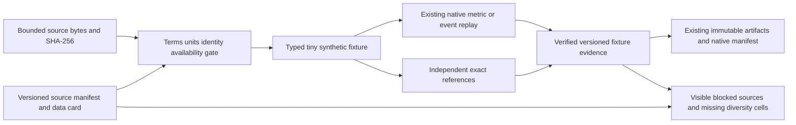

# Versioned CI benchmark corpus: foundation

This is the first implementation slice of
[#261](https://github.com/jacksonpradolima/coleman/issues/261), prepared on the
**4.2 integration line**. It implements source manifests, a typed registry and data
cards, bounded independent correctness references, local validation and native
integration. The diversified benchmark program is **not complete**.

The registry contains two small repository-authored MIT-licensed CI fixtures and
an inventory of ten existing public example Parquet artifacts. Historical sources
remain **blocked for evaluation** until their data-specific terms, duration units,
availability semantics, adapter and conversion evidence are verified. The code
repository's license is never inferred to license third-party datasets.

Both tiny sources share one constructed build/test family. They are not independent
CI observations. All seven required diversity regimes remain uncovered, including
the broad adversarial simulation regime: a three-test fixture is not a stress lab.
No policy effectiveness, state-of-the-art, production savings or commercial claim
follows from passing these checks.

## Installed commands

Until 4.2 is published, build a wheel from the reviewed integration source and
install that wheel in a Python 3.14+ environment. The published 4.1 wheel does not
contain this new module. Copy examples to a directory outside the checkout.
No optional dependency, provider subscription, credential or network access is
needed during these operations.

```bash
python -m coleman.corpus list
python -m coleman.corpus show ci-serial-boundary-v1
python -m coleman.corpus schema
python -m coleman.corpus validate ci-serial-boundary-v1 --output corpus-artifacts
python -m coleman.corpus validate ci-parallel-occupancy-v1 --output corpus-artifacts
```

`list` returns registered IDs, explicit blocked reasons, verified fixture IDs
(empty until validation evidence is supplied), and all missing minimum regimes.
`show` returns the complete typed card. `schema` emits the manifest's structural
JSON schema; semantic cross-field checks still require the library validator.
`validate` writes a deterministic immutable report and returns its path/source
digest. Exit 0 means the requested metadata or tiny correctness operation passed;
it does not mean corpus diversity is satisfied. Invalid/blocked sources, unknown
IDs, future schemas, unsupported adapters, bad bytes or output failures return 2.
CLI output must remain within the current workspace; existing symlinked report
parents are resolved and checked before publication. This local path check assumes
no concurrent hostile filesystem mutation; it is not an OS sandbox. Library callers
supply their own trusted `ArtifactWriter` root, independently of CLI/MCP transports.

These are the implemented commands. Fetch/cache/extraction, real-source conversion,
large stress generation, baseline matrices, dependence-aware statistical profiles
and confirmatory run/report commands belong to subsequent slices of #261.

## Source contract and admission

`CorpusManifest` schema v1 binds:

- source URI/version/citation, SHA-256, byte count and verified local availability;
- specific data license ID, terms URI/digest/review time and redistribution rule;
- adapter/version and its actual implementation state;
- logical observation/group dimensions and shared source dependence group;
- event, outcome and feature availability fields, timestamp origin and timezone;
- explicit verdict mapping, failing-test versus genuinely mapped fault unit,
  duration units/meaning and unknown-outcome policy;
- intended evaluation purpose, temporal boundaries when available, budget units,
  budgets, seed labels, metrics and source resource limits;
- input/output row counts and unique primary exclusion reasons with conservation;
- validity limitations that remain visible in human and machine reports.

Registration is not admission. `blocking_reasons` exposes unresolved prerequisites;
`require_ready()` checks metadata only. `validate_fixture_source()` additionally
checks real bytes, canonical source grammar, actual row counts, declared field
semantics and native correctness. A metadata declaration is a producer attestation,
not cryptographic proof of legal rights, completeness or statistical independence.

The phase-one adapter supports only `ci-fixture-json`, version `1`, for constructed
synthetic correctness inputs. It never imports an adapter from a user-provided
name or follows its URI. Other formats remain visible registrations with planned
adapters. In particular, native Parquet inputs are not silently routed through
legacy missing-value coercions: the new admission gate must establish semantics
before those inputs can enter a corpus evaluation. Direct native behavior is
unchanged.

Data cards retain facts separately from claims: observed footer row counts and
source byte counts are available in the inventory; unverified duration profiles
are unavailable. Null language/execution axes are unverified; empty axes are
explicitly inapplicable to a purely numerical fixture. Constructed/control
histories cannot be labeled observed CI, and synthetic fixtures cannot be labeled
real faults. Seeded-fault and controlled-real-fault layers must retain matching
seeded/real origins or explicitly unverified origin; contradictory classifications
fail when registering or serializing cards. Context/variant artifacts retain shared
dependence groups rather than becoming additional independent projects.

The initial inventory pins the exact public source revision
`b743f51d5ba444410b32f2c0e318b2587b882c43`; every file's SHA-256, byte size and Parquet
footer row count were checked against that Git object. It contains 1,386,730
source rows across ten artifacts, **not** that many independent observations.
Full duration/churn/availability/provider profiles remain unverified, not zero.

## Independent known answers

The serial source has t1=1 s/pass, t2=2 s/fail, t3=4 s/fail, base order t1/t2/t3.
Every excluded known failing test stays in the denominator.

| Budget | Selected | Failing-test recall | NAPFD | APFDc | First failure | Runner work |
| --- | --- | --- | --- | --- | --- | --- |
| 3 runner-s | t1, t2 | 1/2 | 1/4 | 5/14 | 3 elapsed-s | 3 runner-s |
| 7 runner-s | t1, t2, t3 | 1 | 1/3 (full-suite APFD) | 1/2 | 3 elapsed-s | 7 runner-s |

APFDc here names the native **full-universe cost** convention, including excluded
failures and full-suite duration. It is a normalized ordering/selection measure,
not financial cost. It cannot be substituted for an unrelated selected-only cost
formula. No unique-fault recall is inferred from binary test verdicts.

The parallel fixture dispatches all three tests at zero on three distinct workers:
**7 runner-seconds, 4 elapsed-seconds, first failure at 2 seconds**. No serial
APFD/APFDc value is inferred for that schedule. Queue, shared setup and overhead
are not modeled or claimed saved.

Hand-declared source answers are checked against separate exact `Fraction`/tick
references, then the real native `NAPFDVerdictMetric` or existing event replay is
checked against those answers. The exact oracle imports no production metric or
scheduler. Its scope is at most 16 complete binary tests. The native fixture
projection uses integer seconds <=1,000,000 to preserve exact input costs in
Float32/Float64; this is a fixture restriction, not a generic unit conversion.
Actual scalar checking declares binary64 absolute tolerance `1e-12`, with zero
relative tolerance. Exact rational answers remain authoritative in the source.

Zero is real. No failure detected gives null/right-censored time; a failure at
time zero remains 0/detected. No failing tests makes recall/ranking ratios
inapplicable, without rewriting native legacy default rows. Unknown/timeout
outcomes cannot enter the complete-binary oracle. A zero-work failing serial suite
is explicitly unsupported by the legacy native APFDc checker, rather than receiving
a fabricated finite score. Nonfinite quantities/ratios and incompatible units fail.
Rational text has <=128 characters, no exponent, and numerator/denominator <=256
bits; decimal precision/scale are bounded to 64 before conversion, preventing tiny
exponent strings from triggering unbounded integer allocation.

## Complete library workflow

```python
from pathlib import Path

from coleman.artifacts import ArtifactWriter
from coleman.corpus import (
    CorpusFixtureReport, fixture_readiness, load_registry,
    publish_fixture_report, publish_fixture_readiness, validate_bundled_source,
)

registry = load_registry()
reports = tuple(
    validate_bundled_source(source_id, registry)
    for source_id in ("ci-serial-boundary-v1", "ci-parallel-occupancy-v1")
)
writer = ArtifactWriter("corpus-library-artifacts")
for report in reports:
    path = publish_fixture_report(report, writer)
    assert CorpusFixtureReport.from_json(path.read_bytes()) == report
readiness = fixture_readiness(registry, reports)
assert len(readiness.validated_fixture_sources) == 2
assert len(readiness.fixture_dependence_groups) == 1
assert len(readiness.uncovered_required_regimes) == 7
assert readiness.evidence_status == "insufficient_diversity"
publish_fixture_readiness(readiness, writer)
```

Readiness artifacts embed the frozen registry and verified fixture reports. Reads
and publication rederive registered/blocked source IDs, validated sources and
actual dependence-group identities from that evidence. A fabricated summary cannot
turn the two related fixtures into independent groups. Reordered identical retries
canonicalize to the same identity; conflicting reports for one source fail.

To author a derived owned fixture without touching the runner, obtain its typed
`CIReferenceFixture`, change its explicit fixture identity/cases, serialize with
`fixture_bytes()`, and create a new reviewed `CorpusManifest`. Update the source
URI/version/SHA-256/byte count, intended budgets/metrics and actual conversion
counts. Supply data-specific license evidence; keep the history constructed and
related dependence group intact. Call `validate_fixture_source(manifest, payload)`
before publishing. A changed reference, swapped verdict mapping, false timestamp
field, unsupported metric, broken row conservation or mismatched source fails.
A real provider needs a separately implemented/verified adapter; marking it
“implemented” in JSON cannot make the fixture-only validator execute it.

## Real native execution and artifact recovery

Copy [`ci.py`](https://github.com/jacksonpradolima/coleman/blob/release/4.2/examples/corpus-foundation/ci.py)
and run `python ci.py native-output` from an installed development wheel. It uses
`api.run()` with native Random/RNFail and a full seven-second budget, verifies each
actual native ranking's NAPFD/APFDc against the independent oracle, and publishes
both source checks plus the insufficient-diversity inventory through existing
artifacts/manifests. Two explicitly constructed copies exercise the runner's
initial shuffle and next-build path; neither real CI history nor independence is
claimed. The example requires a fresh output directory for each complete native
invocation and rejects an existing directory before writing, including pre-existing
symlinked input/native descendants. Direct native runs retain their existing append
behavior. Native learning checkpoints remain the runner's responsibility; this adds no second runner/checkpoint store.

Corpus validation/readiness publication is deterministic and idempotent for the
same input. Concurrent identical retries share the same content address. Existing
`ArtifactWriter` hard-link/fsync publication prevents partial completed JSON;
conflicts and I/O failures propagate. The same existing local filesystem and
power-loss limits apply. Native manifests discover these corpus artifacts and
pilot reports; no source archive or large generated experiment result is committed.

Unknown/future/missing schema versions, duplicate JSON keys and incompatible
protocols fail closed. Unverified extra source-revision claims in fixture
observations are rejected on reads and publication. Older native artifacts keep
their existing readers and meanings; there is no automatic migration. The new fixture JSON format requires
canonical UTF-8 JSON plus one newline and a hard 128 KiB cap, independent of a
larger future-source metadata limit.


