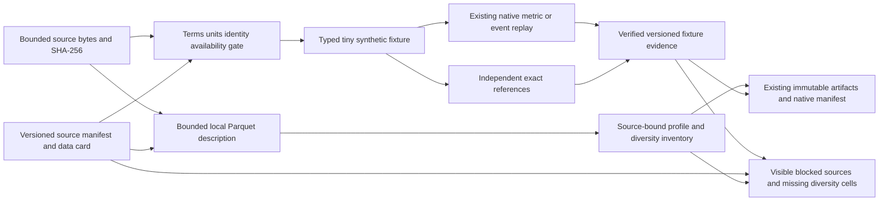

# Versioned CI benchmark corpus: foundation and local profiles

This is the first implementation slice of
[#261](https://github.com/jacksonpradolima/coleman/issues/261), introduced in
**COLEMAN 4.2**. It implements source manifests, a typed registry and data
cards, bounded independent correctness references, local validation and native
integration. COLEMAN **4.4** adds bounded local native-Parquet profiles, a reproducible diversity
inventory and [licensed source-package materialization](corpus-materialization.md).
The diversified benchmark program remains open.

**4.15** adds a separate [source-admission and production-reality audit](corpus-admission.md)
using this same registry/card model and explicit verified source bindings. Its
published qualification covers three narrow functional/mechanism regimes and
leaves four historical/HCS regimes uncovered. Original registrations and
phase-one fixture readiness keep their meanings; they are not silently upgraded.

**4.17** adds the [comparable baseline matrix](comparable-baselines.md): twelve
internal native/heuristic candidates, explicit incompatibilities, raw per-build
evidence, stable source budgets and checkpoint recovery. It prepares development
evidence; source admission and protected confirmation remain separate gates.

**4.16** adds [metric references and repeated CI observations](corpus-evaluation.md):
a frozen complete build/seed grid, explicit native metric conventions and one
paired mean per reviewed repository family. This preparation preserves raw
attempts and source-admission blockers; it does not create independent projects.

For the separate source-specific ETL workflows, see [Karaf](lrts-parquet-etl.md),
[RTPTorrent](rtptorrent-parquet-etl.md) and the published 4.17 [ActiveMQ/Log4j stage
views](lrts-stage-views.md). Those exports preserve their own provenance and
admission blockers; they do not silently add admitted registrations to this registry.

The current source revision also adds [original Westermo analytical Parquet](westermo-parquet-etl.md):
explicit pinned sessions, all four original outcomes, session-envelope seconds and
unverified per-test units. Build this revision's wheel; the previously published
4.17 wheel does not include it. An export does not change source admission or the
four uncovered historical/HCS regimes.

For controlled Java sources, the published 4.17 wheel includes a separate [CLI/Codec
matrix](java-fault-matrix.md) using the existing controlled/JUnit producer.
Its typed index preserves all selected outcomes and incomplete evidence. It does
not silently change this registry's admission or diversity coverage.

The separate [Python source producer](python-source-capture.md) adds an unchanged
PySnooper fault/fixture pair in two predeclared locale contexts, with whole-wheel
component terms, real exception evidence and offline/interruption recovery.
Its ASCII error-to-pass pair remains inconclusive under the strict generic
classifier; the UTF-8 contrast passes in both roles. These share one curated fix
and do not silently add independent observations or admitted registry entries.

The published 4.17 wheel also includes a [constructed C function slice](c-seeded-source-capture.md)
from NIST Juliet 1.3. Its source/component terms were reviewed before acquisition;
one original template/function pair and six correlated inputs remain explicitly
synthetic. SIR permission remains unresolved. This workflow adds no registry
default registry entry or admitted diversity regime by itself.

The published 4.17 wheel includes a separate [LibSSH HCS ETL](hcs-parquet-etl.md): original
pipeline/job identities, reversible variant aliases, explicit projected test
costs and native WTS/VTS checkpointed runs. Sparse/absent cells and source
exclusions remain visible. The installed qualification verifies all 208 declared
cells and 416 native WTS/VTS results against the original CSV/JSON. Six known
job labels have metadata only; they do not become observed test configurations
or fabricated native runs. This workflow does not add an admitted registry entry.

The registry contains two small repository-authored MIT-licensed CI fixtures and
an inventory of ten existing public example Parquet artifacts. Historical sources
remain **blocked for evaluation** until their data-specific terms, duration units,
availability semantics, adapter and conversion evidence are verified. The code
repository's license is never inferred to license third-party datasets.

Both tiny sources share one constructed build/test family. They are not independent
CI observations. All seven required diversity regimes remain uncovered, including
the broad adversarial simulation regime: a three-test fixture is not a stress lab.
No policy effectiveness, state-of-the-art, production savings or commercial claim
follows from passing these checks.

## Installed commands

Install the wheel attached to [COLEMAN 4.17](https://github.com/jacksonpradolima/coleman/releases/tag/v4.17.0)
in a Python 3.14+ environment, or build a development wheel from the reviewed source.
Copy examples to a directory outside the checkout. Once installed, these local
operations need no optional dependency, provider subscription, credential or
network access.

```bash
python -m coleman.corpus list
python -m coleman.corpus show ci-serial-boundary-v1
python -m coleman.corpus schema
python -m coleman.corpus validate ci-serial-boundary-v1 --output corpus-artifacts
python -m coleman.corpus validate ci-parallel-occupancy-v1 --output corpus-artifacts
```

`list` returns registered IDs, explicit blocked reasons, verified fixture IDs
(empty until validation evidence is supplied), and all missing minimum regimes.
`show` returns the complete typed card. `schema` emits the manifest's structural
JSON schema; semantic cross-field checks still require the library validator.
`validate` writes a deterministic immutable report and returns its path/source
digest. Exit 0 means the requested metadata or tiny correctness operation passed;
it does not mean corpus diversity is satisfied. Invalid/blocked sources, unknown
IDs, future schemas, unsupported adapters, bad bytes or output failures return 2.
CLI output must remain within the current workspace; existing symlinked report
parents are resolved and checked before publication. This local path check assumes
no concurrent hostile filesystem mutation; it is not an OS sandbox. Library callers
supply their own trusted `ArtifactWriter` root, independently of CLI/MCP transports.

The profile commands below and [source-package fetch/cache/validation](corpus-materialization.md)
are also available in 4.4. Source-specific conversion, large stress generation,
baseline matrices, dependence-aware statistical profiles and confirmatory run/report
commands remain subsequent slices of #261.

## Source contract and admission

The [RTPTorrent source assessment](rtptorrent.md) in COLEMAN 4.5 adds a
bounded raw-class reader and an owned isolated native replay. It preserves repeated
class executions and missing CI clocks; it does not admit an external source or
change the registry's diversity inventory.

The [LRTS source assessment](lrts.md) preserves processed metadata alongside raw
Jenkins method/suite/node identities. Its bounded owned replay checks native
compatibility; missing availability, stage mapping and expected-suite evidence
keep real-source temporal evaluation blocked.

`CorpusManifest` schema v1 binds:

- source URI/version/citation, SHA-256, byte count and verified local availability;
- specific data license ID, terms URI/digest/review time and redistribution rule;
- adapter/version and its actual implementation state;
- logical observation/group dimensions and shared source dependence group;
- event, outcome and feature availability fields, timestamp origin and timezone;
- explicit verdict mapping, failing-test versus genuinely mapped fault unit,
  duration units/meaning and unknown-outcome policy;
- intended evaluation purpose, temporal boundaries when available, budget units,
  budgets, seed labels, metrics and source resource limits;
- input/output row counts and unique primary exclusion reasons with conservation;
- validity limitations that remain visible in human and machine reports.

Registration is not admission. `blocking_reasons` exposes unresolved prerequisites;
`require_ready()` checks metadata only. `validate_fixture_source()` additionally
checks real bytes, canonical source grammar, actual row counts, declared field
semantics and native correctness. A metadata declaration is a producer attestation,
not cryptographic proof of legal rights, completeness or statistical independence.

Fixture reports embed their parsed source data. Their validation, reads and
publication therefore require `redistribution="permitted"`. Verified `recipe_only`
terms can support metadata registration or future download recipes, but cannot
authorize an embedded-source fixture report through the library API.

The phase-one adapter supports only `ci-fixture-json`, version `1`, for constructed
synthetic correctness inputs. It never imports an adapter from a user-provided
name or follows its URI. Other formats remain visible registrations with planned
adapters. In particular, native Parquet inputs are not silently routed through
legacy missing-value coercions: the new admission gate must establish semantics
before those inputs can enter a corpus evaluation. Direct native behavior is
unchanged.

Data cards retain facts separately from claims: observed footer row counts and
source byte counts are available in the inventory; unverified duration profiles
are unavailable. Null language/execution axes are unverified; empty axes are
explicitly inapplicable to a purely numerical fixture. Constructed/control
histories cannot be labeled observed CI, and synthetic fixtures cannot be labeled
real faults. Seeded-fault and controlled-real-fault layers must retain matching
seeded/real origins or explicitly unverified origin; contradictory classifications
fail when registering or serializing cards. Context/variant artifacts retain shared
dependence groups rather than becoming additional independent projects.

The initial inventory pins the exact public source revision
`b743f51d5ba444410b32f2c0e318b2587b882c43`; every file's SHA-256, byte size and Parquet
footer row count were checked against that Git object. It contains 1,386,730
source rows across ten artifacts, **not** that many independent observations.
Physical duration/churn/availability/provider semantics remain unverified, not zero.
The local profiling recipe below describes raw fields without resolving those gates.

## Local profiles and the first diversity matrix (4.4)

These additions are available in the 4.4 wheel; 4.3 and older wheels retain their
previous commands. The profiler is a separate descriptive recipe, **not** an implemented corpus evaluation adapter.
It does not change registry v1, cards, fixture/readiness v1, old native result
rows, source licenses or admission blockers.

```bash
# SOURCE is a local copy of the exact registered file, not a download URL.
python -m coleman.corpus profile native-example-e970afe1686d7fe6 source.parquet --output profiles
# Copy examples/corpus-profiles/inventory.py outside the checkout first.
python inventory.py /absolute/path/to/coleman corpus-inventory
```

The inventory example reads the ten existing files from the explicit checkout,
checks every frozen digest/size, and publishes ten profiles plus one complete
inventory. It fetches nothing, copies no source data and runs no evaluation.
A missing, changed or oversized source prevents publication of a complete new
inventory. Existing completed inventories remain content-addressed evidence of
their original inputs; failed later invocations do not erase them.

The pinned source snapshot produces this matrix. Contextual files and separately
stored variants can share the same executions; these rows must not be added as
independent projects. Execution groups retain `Variant` when present, whereas
logical builds count `BuildId` among rows with complete group identity.

| Registered artifact | Raw rows | Logical builds | Execution groups | Repeated identity rows | Conflicting identities | Failed rows | Raw Duration median |
| --- | ---: | ---: | ---: | ---: | ---: | ---: | ---: |
| Druid | 308998 | 168 | 168 | 0 | 0 | 237 | 0.002 |
| Druid contextual | 308998 | 168 | 168 | 0 | 0 | 237 | 0.002 |
| Retrofit | 71238 | 2711 | 2711 | 0 | 0 | 161 | 0.196 |
| Retrofit contextual | 71238 | 2711 | 2711 | 0 | 0 | 161 | 0.196 |
| Dune Debian 10 | 119316 | 1029 | 1029 | 4433 | 3237 | 1417 | 0.07 |
| Dune Ubuntu 20.04 | 44052 | 367 | 367 | 1408 | 1031 | 532 | 0.09 |
| Dune Debian 11 | 35140 | 290 | 290 | 1291 | 886 | 193 | 0.03 |
| Dune total | 229213 | 2186 | 2186 | 6689 | 4858 | 3094 | 0.3 |
| Dune variants | 198508 | 1036 | 1686 | 7132 | 5154 | 2142 | 0.07 |
| Synthetic example | 29 | 5 | 5 | 0 | 0 | 14 | 0.134 |

Raw `Duration` medians have **unverified source units**, not seconds. They are not
comparable across sources and cannot be used to infer runner work, parallel wall
time or savings. Failed rows use only the explicitly declared binary failing-test
mapping with exact native-type comparisons, without rounding decimal labels to
binary64; they are not unique faults. Repeated identity rows count rows beyond
the first complete declared observation key. A conflicting identity has multiple
`(Duration, Verdict)` pairs. These are integrity findings, not deduplicated or
resolved outcomes. Different context values alone are outside that conflict test.

Every profile includes all source column names/null counts, raw duration finite,
null, nonfinite, negative and zero counts, min/median/p95/max, raw verdict categories,
missing identity/group counts, and the distribution of raw rows per execution
group. The latter includes duplicates and is not a count of distinct runnable
tests. Quantiles use the inverse empirical CDF `ceil(p*n)-1`, without interpolation,
over finite binary64 values. Quantile ranks use integer arithmetic; signed zeros
normalize to positive zero in statistical projections while source bytes/digests
remain unchanged. All-null/nonfinite or empty distributions have null
quantiles and unavailable measurements; observed zero stays zero. Negative raw
numbers remain visible and do not certify valid physical execution durations.
A declared duration unit/meaning is retained when supplied; it is never guessed.

Chronology is explicitly **not evaluated** by this recipe. `LastRun`, numeric
`BuildId`, file order and repeated seeds cannot establish event order, UTC,
feature/outcome availability, time span, adjacent-build churn, flakiness, retries
or independent observations. These facts and provider/language axes remain
unverified where their original cards lack evidence. All **seven regimes remain
uncovered**; profiles cannot promote a source or weaken that diversity matrix.

This complete library example uses the same exact local synthetic file as the CLI:

```python
from pathlib import Path
from coleman.artifacts import ArtifactWriter
from coleman.corpus import (
    CorpusProfileInventory, NativeSourceProfile, load_registry,
    profile_native_source, publish_profile_inventory, publish_source_profile,
)

registry = load_registry()
card = registry.card("native-example-e970afe1686d7fe6")
profile = profile_native_source(card, Path("source.parquet"))
assert profile.rows == 29 and profile.logical_builds == 5
assert profile.raw_duration.zero_count == 3
assert profile.duration_median.unit == "source-unit-unverified"
assert profile.card == card  # No admission metadata is rewritten.
writer = ArtifactWriter("library-profiles")
path = publish_source_profile(profile, writer)
assert NativeSourceProfile.from_json(path.read_bytes()) == profile
inventory = CorpusProfileInventory(
    schema_version=1, registry=registry, profiles=(profile, profile),
    uncovered_required_regimes=registry.required_regimes,
)
assert len(inventory.profiles) == 1  # Identical retries are idempotent.
assert len(inventory.uncovered_required_regimes) == 7
publish_profile_inventory(inventory, writer)
```

The default ceiling is 16 MiB compressed input, two million rows, 64 columns and
256 MiB declared uncompressed row-group bytes; tighter manifest bounds also apply.
One bounded byte snapshot is hashed before decoding. Footer limits precede native
Parquet decoding, but are not measured peak-memory guarantees or a sandbox for
malicious codecs. Inputs are explicit trusted local files. Source URI strings
never trigger downloads or dynamic imports. Numeric summaries are descriptive
producer attestations: reading validates conservation, membership, sign counts
against inverse-CDF quantile ranks, equality at shared ranks, and integral
group-count quantiles consistent with the total rows. Nonempty complete group
rows require logical builds and execution groups. Key-column null counts bound
missing identities/groups, and
duplicates require original identities covering the known build/group grain.
Observed source-row/byte declarations must agree with the profile; the declared
row/source-byte resource ceilings also apply on reads. Without `Variant`, logical
builds and execution groups are equal. Missing group/observation identities retain
their subset relationships and extra-column null bounds. Reproducing the
producer's observations still requires the matching source and recipe.

New `NativeSourceProfile` and `CorpusProfileInventory` schema-v1 artifacts use
`corpus-profiles/` and `corpus-profile-inventories/`; native manifests discover both.
Missing, duplicate-key, future or unknown versions fail closed. There is no implicit
migration from old native artifacts/cards into profile evidence. Recompute from
reviewed source bytes and preserve the old artifact alongside the new family.
Identical publication and interrupted retry reuse existing immutable artifacts;
a completed profile is published only after its complete source scan. Profiling
has no incremental learning state and needs no second checkpoint store.

## Independent known answers

The serial source has t1=1 s/pass, t2=2 s/fail, t3=4 s/fail, base order t1/t2/t3.
Every excluded known failing test stays in the denominator.

| Budget | Selected | Failing-test recall | NAPFD | APFDc | First failure | Runner work |
| --- | --- | --- | --- | --- | --- | --- |
| 3 runner-s | t1, t2 | 1/2 | 1/4 | 5/14 | 3 elapsed-s | 3 runner-s |
| 7 runner-s | t1, t2, t3 | 1 | 1/3 (full-suite APFD) | 1/2 | 3 elapsed-s | 7 runner-s |

APFDc here names the native **full-universe cost** convention, including excluded
failures and full-suite duration. It is a normalized ordering/selection measure,
not financial cost. It cannot be substituted for an unrelated selected-only cost
formula. No unique-fault recall is inferred from binary test verdicts.

The parallel fixture dispatches all three tests at zero on three distinct workers:
**7 runner-seconds, 4 elapsed-seconds, first failure at 2 seconds**. No serial
APFD/APFDc value is inferred for that schedule. Queue, shared setup and overhead
are not modeled or claimed saved.

Hand-declared source answers are checked against separate exact `Fraction`/tick
references, then the real native `NAPFDVerdictMetric` or existing event replay is
checked against those answers. The exact oracle imports no production metric or
scheduler. Its scope is at most 16 complete binary tests. The native fixture
projection uses integer seconds <=1,000,000 to preserve exact input costs in
Float32/Float64; this is a fixture restriction, not a generic unit conversion.
Actual scalar checking declares binary64 absolute tolerance `1e-12`, with zero
relative tolerance. Exact rational answers remain authoritative in the source.

Zero is real. No failure detected gives null/right-censored time; a failure at
time zero remains 0/detected. No failing tests makes recall/ranking ratios
inapplicable, without rewriting native legacy default rows. Unknown/timeout
outcomes cannot enter the complete-binary oracle. A zero-work failing serial suite
is explicitly unsupported by the legacy native APFDc checker, rather than receiving
a fabricated finite score. Nonfinite quantities/ratios and incompatible units fail.
Rational text has <=128 characters, no exponent, and numerator/denominator <=256
bits; decimal precision/scale are bounded to 64 before conversion, preventing tiny
exponent strings from triggering unbounded integer allocation.

## Complete library workflow

```python
from pathlib import Path

from coleman.artifacts import ArtifactWriter
from coleman.corpus import (
    CorpusFixtureReport, fixture_readiness, load_registry,
    publish_fixture_report, publish_fixture_readiness, validate_bundled_source,
)

registry = load_registry()
reports = tuple(
    validate_bundled_source(source_id, registry)
    for source_id in ("ci-serial-boundary-v1", "ci-parallel-occupancy-v1")
)
writer = ArtifactWriter("corpus-library-artifacts")
for report in reports:
    path = publish_fixture_report(report, writer)
    assert CorpusFixtureReport.from_json(path.read_bytes()) == report
readiness = fixture_readiness(registry, reports)
assert len(readiness.validated_fixture_sources) == 2
assert len(readiness.fixture_dependence_groups) == 1
assert len(readiness.uncovered_required_regimes) == 7
assert readiness.evidence_status == "insufficient_diversity"
publish_fixture_readiness(readiness, writer)
```

Readiness artifacts embed the frozen registry and verified fixture reports. Reads
and publication rederive registered/blocked source IDs, validated sources and
actual dependence-group identities from that evidence. A fabricated summary cannot
turn the two related fixtures into independent groups. Reordered identical retries
canonicalize to the same identity; conflicting reports for one source fail.

To author a derived owned fixture without touching the runner, obtain its typed
`CIReferenceFixture`, change its explicit fixture identity/cases, serialize with
`fixture_bytes()`, and create a new reviewed `CorpusManifest`. Update the source
URI/version/SHA-256/byte count, intended budgets/metrics and actual conversion
counts. Supply data-specific license evidence; keep the history constructed and
related dependence group intact. Call `validate_fixture_source(manifest, payload)`
before publishing. A changed reference, swapped verdict mapping, false timestamp
field, unsupported metric, broken row conservation or mismatched source fails.
A real provider needs a separately implemented/verified adapter; marking it
“implemented” in JSON cannot make the fixture-only validator execute it.

## Real native execution and artifact recovery

Copy [`ci.py`](https://github.com/jacksonpradolima/coleman/blob/v4.4.0/examples/corpus-foundation/ci.py)
and run `python ci.py native-output` from the installed 4.4 wheel or a source build. It uses
`api.run()` with native Random/RNFail and a full seven-second budget, verifies each
actual native ranking's NAPFD/APFDc against the independent oracle, and publishes
both source checks plus the insufficient-diversity inventory through existing
artifacts/manifests. Two explicitly constructed copies exercise the runner's
initial shuffle and next-build path; neither real CI history nor independence is
claimed. The example requires a fresh output directory for each complete native
invocation and rejects an existing directory before writing, including pre-existing
symlinked input/native descendants. Direct native runs retain their existing append
behavior. The 4.4 example sets a checkpoint interval of one build and reopens the
same run before validating that exactly two native rows remain. It profiles the
exact constructed native input, preserving fixture lineage, declared seconds and
the constructed-history label, then publishes both new artifact families. Native
learning checkpoints remain the runner's responsibility; this adds no second runner/checkpoint store.

Corpus validation/readiness publication is deterministic and idempotent for the
same input. Concurrent identical retries share the same content address. Existing
`ArtifactWriter` hard-link/fsync publication prevents partial completed JSON;
conflicts and I/O failures propagate. The same existing local filesystem and
power-loss limits apply. Native manifests discover these corpus artifacts and
pilot reports; no source archive or large generated experiment result is committed.

Unknown/future/missing schema versions, duplicate JSON keys and incompatible
protocols fail closed. Unverified extra source-revision claims in fixture
observations are rejected on reads and publication. Older native artifacts keep
their existing readers and meanings; there is no automatic migration. The new fixture JSON format requires
canonical UTF-8 JSON plus one newline and a hard 128 KiB cap, independent of a
larger future-source metadata limit.




The next [controlled fault observation adapter](controlled-faults.md) retains
same-test buggy/fixed comparisons, exact elapsed-counter units and negative or
inconclusive outcomes. It verifies producer bytes through the existing source
cache and publishes through the same artifact writer. It does not grant source
admission or convert collection clocks into historical CI chronology. Direct
upstream Java/Python reproductions are documented separately from the owned
synthetic installed example; required diversity cells remain uncovered.
