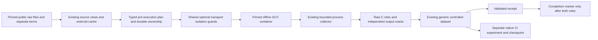

# Reproduce a constructed C weakness

Compare two original Juliet C functions against a frozen checked-arithmetic
oracle. COLEMAN compiles unchanged public source in a pinned GCC container,
retains every raw observation, and reopens completed evidence offline.

This is a bounded **synthetic** source workflow for CI/TCPCI research: one
2017 template-generated weakness and six correlated boundary inputs. Juliet was
created for assurance-tool evaluation. It is not a real regression history,
a representative application suite or evidence that a prioritization policy wins.
The [corpus admission and comparison gates](roadmap.md) remain separate.

## Install outside checkout

The SDK requires Python 3.14+, uv and POSIX. This optional preset additionally
requires a native Linux arm64 Docker engine and the pinned GCC image. Other
architectures need separate recipes and qualification.

Install the published **4.13 wheel** into a fresh external environment. The
SHA-256 fragment verifies the release bytes before installation; no checkout is
required. Runtime preparation remains a separate, explicit operator action:

```bash
uv venv /tmp/coleman-c-env --python 3.14
uv pip install --python /tmp/coleman-c-env/bin/python "https://github.com/jacksonpradolima/coleman/releases/download/v4.13.0/coleman-4.13.0-py3-none-any.whl#sha256=bbe2f3cf8954fc27fc8f5a44e3713519aa30bcf2cfdd2aad140f4bcc1ae45abc"

# Explicit preparation; the producer never pulls an image.
docker pull --platform linux/arm64 docker.io/library/gcc@sha256:e55a45ec94b8f1dc59f08e3b25b8e7f23b96220235da707ae2cc0dce47f6b46c
mkdir -p /tmp/coleman-c-workspace
cd /tmp/coleman-c-workspace
/tmp/coleman-c-env/bin/python -m coleman.transports.c \
  --preset juliet-uint32-add-v1 --trial seeded-c-trial-1 \
  --cache /tmp/coleman-c-source-cache \
  --output /tmp/coleman-c-observations --fetch > summary.json

# Same recipe/trial/installed producer: verify and reopen, without new execution.
/tmp/coleman-c-env/bin/python -m coleman.transports.c \
  --preset juliet-uint32-add-v1 --trial seeded-c-trial-1 \
  --cache /tmp/coleman-c-source-cache \
  --output /tmp/coleman-c-observations
```

Only `--fetch` permits the individually pinned public files to be acquired.
Source views reuse the existing verified cache and HTTPS transport. No foreign
source, binary, test pool or build system is bundled in COLEMAN. Cache, output
and system temporary directories must be outside Git and use separate roots.
The SDK never invokes the host C compiler or installs subject dependencies.

Exit 0 means both observation protocols completed, including failed assertions.
Exit 2 means incomplete collection: retained evidence has no completion marker.
Invalid state, schema, digest or runtime raises. The summary lists dataset,
state/receipt paths, statuses, unobserved pairs and classifications.

## Source selection and terms

[Public source assessment](https://github.com/jacksonpradolima/coleman/issues/306#issuecomment-6236007670)
preceded subject execution. The SIR site is archived; its retired license says
it is no longer in force. Current component/data permission for the original
Siemens sources, modified faults and test pools was not established. No SIR
archive was acquired or counted as admitted coverage.

The selected equivalent is [NIST SARD suite 112, Juliet C/C++ 1.3](https://samate.nist.gov/SARD/test-suites/112),
submitted 2017-10-01. NIST declares US public-domain status and CC0 1.0 for foreign
rights. The complete official ZIP was independently verified outside Git:
**152,957,342 bytes**, SHA-256
`ada9d7e1c323d283446df3f55bdee0d00bda1fed786785fe98764d58688f38eb`.

The ZIP has 106,316 entries, exceeding the existing bounded archive-selection
contract. Acquisition instead uses four individually pinned original files from
[a public mirror at immutable revision `f88433e3443648a17671398797a04ea1f8e1a274`](https://github.com/arichardson/juliet-test-suite-c/tree/f88433e3443648a17671398797a04ea1f8e1a274),
plus its NIST public-domain/CC0 LICENSE. All four selected files were verified
byte-identical to the official ZIP. The mirror's additional build system and its
other source changes are outside this recipe. Existing archive limits remain intact.

| Original member under `C/` | Decoded bytes | SHA-256 |
| --- | ---: | --- |
| `testcases/CWE190_Integer_Overflow/s05/CWE190_Integer_Overflow__unsigned_int_fscanf_add_01.c` | 2854 | `e7dd00c5433bc4368d32b4ff5b899422e248979a421d763810d98f81fb4180ac` |
| `testcasesupport/std_testcase.h` | 4004 | `a78aaf3a54a6210260ad70123c09c3c283c6edf7808b6244205e00b8f2d9b8d0` |
| `testcasesupport/std_testcase_io.h` | 1457 | `6459df50d22697bb61619e2effd688ebb98915db25f7eb1bdbb767f888066fb6` |
| `testcasesupport/io.c` | 5429 | `50ace91d0f9cd9f281d5d8ff3a9ca879ee2779d737030ae84e8e4be3df5b299c` |

Role source views contain the same original subject bytes, aliased `subject.c`,
and LICENSE. The common fixture contains the three unchanged support files and
LICENSE. Their terms/digests remain separate from COLEMAN's authored observer,
metadata and the GCC image's independently licensed components. A source license
or image digest is not an umbrella component license or a security audit.

## Frozen roles, input pool and independent oracle

The authored driver includes the unchanged C file and calls either original
`CWE190_Integer_Overflow__unsigned_int_fscanf_add_01_bad` or original static
`goodB2G`. Both consume the same decimal input; the latter checks the addition.
All original functions remain compiled, but original `goodG2B` (hardcoded input)
and the time-seeded `INCLUDEMAIN` are not invoked. Role version labels explicitly
identify these function selectors, not fabricated upstream revision commits.

The driver checks the uint32 ABI and supplies each validated decimal argument
through a private temporary stdin stream. This intervention is recorded in
provenance. The independent oracle expects mathematical `n+1` below UINT32_MAX,
and exactly `data value is too large to perform arithmetic safely.` plus LF at
the maximum. Exit must be zero and child stderr empty. Neither role's observed
output is used to construct the oracle.

| Input | Required complete stdout, before LF | Observed bad | Observed goodB2G |
| ---: | --- | --- | --- |
| 0 | `1` | pass | pass |
| 1 | `2` | pass | pass |
| 2 | `3` | pass | pass |
| 2147483647 | `2147483648` | pass | pass |
| 4294967294 | `4294967295` | pass | pass |
| 4294967295 | explicit safety message above | assertion failure: `0` | pass |

The initial installed qualification retained **12 role observations / six pairs**:
five `both_pass`, one `expected`. This is one constructed template/function pair,
not six independent faults. [Unsigned C arithmetic wraps modulo its width](https://www.gnu.org/software/c-intro-and-ref/manual/html_node/Unsigned-Overflow.html);
the last mismatch does not rely on undefined signed overflow. Signed, malformed
and out-of-range scanf inputs are outside this v1 oracle's scope.

The [pre-execution protocol](https://github.com/jacksonpradolima/coleman/issues/306#issuecomment-6236145420)
records the source, selectors, pool, oracle and observer pins before qualification.
The first attempt compiled but could not execute in Docker's default noexec tmpfs;
its raw errors and zero-case incomplete result were preserved. The explicit
[executable-scratch amendment](https://github.com/jacksonpradolima/coleman/issues/306#issuecomment-6236219189)
preceded the first observed cases. A subsequent canonical-order validation fix
compares normalized observations in the generic domain's established logical-key
order; it changes no raw packet or outcome and also fixes multi-case Python replay.

## Runtime, guards and units

The pinned official image provides GCC **15.2.0**, target `aarch64-linux-gnu`,
glibc **2.41**, observer Python **3.13.5** and 32-bit unsigned int. The observer
verifies these facts before case promotion. LC_ALL/LANG are C, timezone UTC.
Compilation uses `-std=c11 -O0 -Wall -Wextra`, the common support include path,
original `io.c` and authored driver. No upstream setup or build script runs.

Compilation occurs in an atomically allocated mode0700 directory inside the
bounded **executable** tmpfs (`private-executable-tmpfs-v1`). Native C binaries need
this explicit exec permission. Root and staged inputs stay read-only; the container
is non-root, networkless, cap-drop-all/no-new-privileges, with two CPUs, 64 PIDs,
1 GiB memory and 128 MiB tmpfs. The observer uses the existing bounded process
collector for every compiler/probe and subject process.

| Interval | Deadline | Combined raw stdout/stderr bound |
| --- | ---: | ---: |
| Compiler or version probe | 20 seconds | 1 MiB |
| Each subject input | 5 seconds | 64 KiB |
| Whole Docker role | 60 seconds | 1 MiB |

An individual nonzero exit or negative POSIX signal is `test_error`; a deadline is
`timeout`; output-limit termination is `test_error`. Only a normal completed child
with wrong output is `assertion_failed`. Complete bounded child streams and actual
exit codes remain in the case record; unsupported non-ASCII bytes fail the observer
protocol instead of being silently replaced.

Case elapsed is exact integer monotonic **nanoseconds**, including process startup.
Zero is observed; unavailable elapsed after an uncommitted interruption is null
with explicit status. The parent role's separate nanoseconds include compilation
and Docker overhead. UTC collection clocks have microsecond precision. None is
historical CI time, removable scheduling work or a prospective saving.
The parent guard excludes acquisition, staging and separate cleanup commands.
These are trusted-source experiments, not a hostile-code sandbox certification.

## API, immutable artifacts and recovery

```python
from coleman.artifacts import ArtifactWriter
from coleman.corpus import SourceCache
from coleman.transports.c import load_c_recipe
from coleman.transports.c_capture import capture_c_source, validate_c_capture
from coleman.transports.c_contracts import CCapturePlan

cache = SourceCache("/tmp/coleman-c-source-cache")
writer = ArtifactWriter("/tmp/coleman-c-observations")
result = capture_c_source(load_c_recipe(), cache, writer, "seeded-c-trial-1")
plan = CCapturePlan.from_json((result.state_directory / "plan.json").read_bytes())
validate_c_capture(result.receipt, plan, result.dataset, cache)
assert capture_c_source(plan.recipe, cache, writer, plan.trial_id) == result
print(result.dataset_path, result.receipt.status)
```

The package exposes typed v1 recipe, bootstrap, case, raw-role, ownership, plan
and receipt contracts. Missing/old/future versions reject; no implicit migration
rewrites source truth. Existing generic controlled artifacts keep their schema
and meaning. To reopen an older producer-specific capture, retain its original
reviewed wheel: conservative package/version identity changes the output generation.



One local POSIX producer lock owns each recipe/trial/implementation generation.
Physical container names additionally bind the resolved output namespace, so
independent output roots cannot collide or clean each other's containers.
This physical ownership scope does not change logical observation identity.
The C, Python and JUnit transports share container isolation arguments, while
each producer retains its own runtime, observer, oracle and wire contracts. C
alone explicitly requests executable scratch for its bounded compilation. C and
Python also share CLI parsing and accounting presentation; these optional
transport helpers introduce no dependency from the controlled domain to a CLI.
The plan precedes execution; role ownership precedes spawning; immutable raw role
packets follow owned cleanup. Receipt and completion are written last. Identical
retries revalidate source/context/raw bytes without duplicating observation or
execution. This local filesystem lock is not a distributed execution ledger.

If a process stops after ownership but before a role packet, same-trial recovery
records that role as interrupted with unavailable elapsed and no invented cases.
A missing other role may run only in the original runtime context. Completed roles
replay without Docker. Fresh physical observation requires a **new trial ID**.
Incomplete receipts have no completion marker. Hash-consistent metadata rewrites
still reject when they disagree with the original raw records and frozen oracle.
These checks prove consistency, not authenticated execution truth.

Native TCPCI experiments continue through the existing API, RunSpec, policies,
Parquet sinks and learning checkpoints. Keep their modeled CI inputs and costs
independently declared; do not convert observer ns into Duration. The installed
qualification separately exercises the [owned controlled/native CI example](controlled-faults.md)
and checkpoint continuation twice. Controlled source records remain
`constructed` / `not_evaluated` / `insufficient_evidence`; temporal admission raises.
No source-collection result closes the broader benchmark program in #261.
