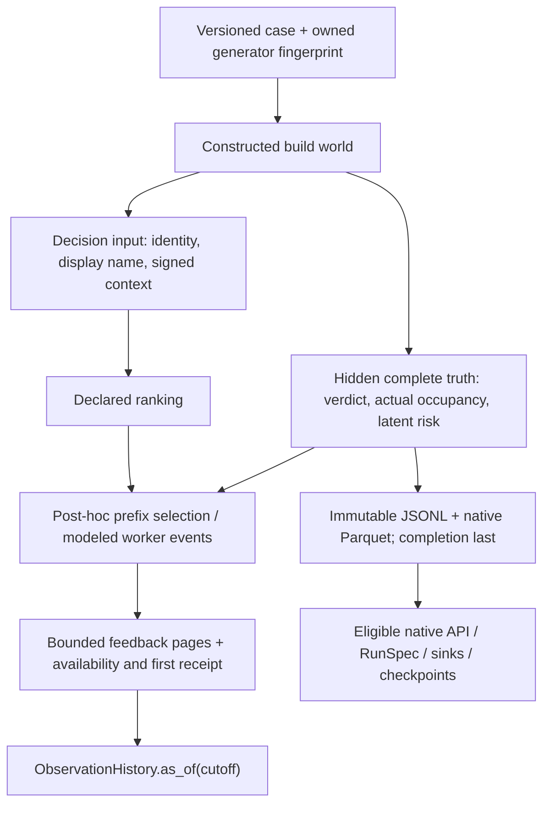

# Deterministic CI stress laboratory

The stress laboratory lets you reproduce a difficult CI decision with known
truth: an abrupt shift, a name collision, late feedback, a long all-pass window,
or a 50,000-test suite. It complements the real-source workflows with controlled
mechanism checks. It does not establish real-project generalization, empirical
corpus admission, independent faults or an algorithm winner.

This workflow ships in the published **4.17** wheel. Its installed qualification
checks the complete authored package against the release tag, runs actual native
agents outside the source checkout and verifies process-interruption recovery.

## Install and run one case

Install the published base wheel into a fresh environment. Python 3.14 and `uv`
are required; Docker, MCP and third-party benchmark downloads are unnecessary.
The URL pins the verified release SHA-256. Outputs stay outside the repository.

```bash
export COLEMAN_STRESS_HOME="$(mktemp -d "${TMPDIR:-/tmp}/coleman-stress.XXXXXX")"
uv venv "$COLEMAN_STRESS_HOME/installed" --python 3.14
uv pip install --python "$COLEMAN_STRESS_HOME/installed/bin/python" "https://github.com/jacksonpradolima/coleman/releases/download/v4.17.0/coleman-4.17.0-py3-none-any.whl#sha256=e5a272ddc0edf72bd909a743fa2b3bc0dfeb8a02871c487ab22683cddeea40ca"
cd "$COLEMAN_STRESS_HOME"
```

Run the following complete example with the installed environment's Python. It
generates constructed truth and native Parquet, verifies the export by regenerating
its bytes, then runs actual Random/UCB agents through the existing API and
checkpoint machinery. Repeating the call resumes the same native run.

```python
from pathlib import Path

from coleman.application.stress import run_stress_replay
from coleman.artifacts import ArtifactWriter
from coleman.corpus.stress_artifacts import export_stress, validate_stress
from coleman.corpus.stress_contracts import StressCase, StressFactors, StressReceipt
from coleman.corpus.stress_design import covering_design
from coleman.corpus.stress_replay import schedule_build

design = covering_design()
assert len(design.rows) == 32
case = StressCase(
    schema_version=1,
    seed=11,
    builds=4,
    factors=StressFactors(
        failures="rare",
        duration="heavy_tail",
        churn="collisions",
        variants="changing",
        workers="bounded",
        feedback="censored",
        budget="severe",
    ),
)
completion = export_stress(case, ArtifactWriter(Path("exports")))
receipt = StressReceipt.from_json(completion.read_bytes())
validate_stress(receipt, completion.parent)
result = run_stress_replay(completion, Path("native-runs"))
again = run_stress_replay(completion, Path("native-runs"))
assert again.run_id == result.run_id
trace = schedule_build(case, 0)
print(result.run_id, result.artifacts_dir)
print(trace.runner_work, trace.modeled_elapsed, trace.recall)
```

The native run is serial. `workers="bounded"` declares a separate four-worker
**modeled post-hoc list schedule** for a supplied ranking; it does not launch
parallel tests. `schedule_build(case, build, ranking)` requires every current
execution name exactly once. Its default uses constructed source order, so it
does not describe either native agent's ranking. The native Parquet records full
agent rankings for independent replay/accounting. The installed qualification
also runs an actual 50,000-test Random-policy history with rare failures and sparse
variants; generating a large build
alone is not called a native scale qualification.

## Declared covering design

The fixed v1 design has strength two over eleven factors. All pairs of levels
from distinct factors appear. A deterministic greedy construction followed by
reverse deletion leaves 32 rows, each with a private pair witness. Removing any
row breaks coverage: **inclusion-minimal**, with no claim of globally minimum
cardinality. No full Cartesian experiment is generated or launched.

| Factor | Levels and interpretation |
| --- | --- |
| Logical suite size | `tiny`: 8; `medium`: 256; `large`: 50,000 before churn/variants |
| Failures | `zero`, `rare` (one logical failure among current active tests per build), `moderate` (current risk group plus flips), `bursty` (every fourth build) |
| Duration | `constant`, `heavy_tail` (bounded dyadic tail, not a log-normal sample), `failure_correlated`, `changing` |
| Churn | `stable`, `additions`, `removals`, `renames`, `collisions` of display labels |
| Drift | `sudden`, `gradual`, `recurring`, `contextual` |
| Flakiness | `independent` keyed flips, `history` using prior constructed verdicts, `environment` shared build flips |
| Feedback | `full`, `censored`, `delayed`, `missing`, `corrected` |
| Budget | `severe`: 1/16 of total runner occupancy; `full`: entire suite |
| Context | `informative`, `noisy`, `missing`, `adversarial` |
| Variants | `stable`: three dependent copies; `sparse`: one of three per logical test; `changing`: rotating current variant |
| Workers | `serial`: one; `bounded`: four, earliest-free-worker ties by worker index |

Static factor pairs are distinct from temporal/state or event-subsequence coverage.
Some axes deliberately have no effect under specific regimes: zero failures
override flips, and rare failures retain their one-failure constraint. These are
not evidence that all high-order interactions have been tested. See the primary
[NIST SP 800-142](https://nvlpubs.nist.gov/nistpubs/legacy/sp/nistspecialpublication800-142.pdf),
[covering-array definitions](https://math.nist.gov/coveringarrays/coveringarray.html)
and [NIST CSWP 26](https://nvlpubs.nist.gov/nistpubs/CSWP/NIST.CSWP.26.pdf).

`adversarial_cases()` separately declares seven named sequences: long zero-failure,
rename/display collision, delayed abrupt drift, late correction, missing feedback
with adversarial context, shared-flaky parallel replay and large heavy-tail suites.
They supplement the static certificate; they do not add independent projects.
The design and adversarial APIs return specifications, never start all runs.

## Truth, decisions and feedback



`decision_inputs` exposes no current verdict, actual duration or latent risk.
Context values -1, 0 and 1 are covariates, not calibrated probabilities; `None`
means missing. Test `t00000` has genuine zero-second occupancy. Renames preserve
logical identity; two identical display labels retain distinct logical keys.
Stable variant copies deliberately share truth and costs; execution recall
counts dependent variant executions, never unique faults.

Keyed counters separate context/duration/outcome channels. History flakiness
uses previous **constructed truth**, independent of which tests a policy selected.
Its bounded recurrence is not learner access to unselected history. Correlated
actual duration is hidden scoring truth, not automatically a known scheduling
feature. Seeds select constructed realizations; they do not establish independent
observations, projects or fault families.

Feedback follows a supplied/default ranking's exact prefix. Full mode reports all
truth; other modes report selected executions, leaving unselected outcomes absent.
Delayed reports arrive two constructed decision intervals later. Missing reports retain typed unknown/null
measurements. Corrected reports intentionally start wrong and publish a correction
three constructed decision intervals later; earlier views retain the wrong report.
Availability is one hour after each modeled execution completes, with first receipt
one minute later. `decision_time(case, build)` spaces decisions using declared
size/variant/duration upper bounds plus reporting/receipt, never future realized
labels or durations. Immediate reports therefore arrive before the next decision;
delayed and corrected reports remain pending across decisions. These UTC clocks
may span years for large cases and never represent observed CI time spans.

Full feedback at severe budget is explicitly tagged `counterfactual-full-suite`:
its reports follow a full-suite modeled schedule and exceed the selection budget.
It is an unattainable full-information mechanism channel, not an eligible native
candidate or budget-feasible feedback claim. Other pages carry
`selected-modeled-execution` scope; `target_end` records each modeled completion.

```python
from coleman.corpus.stress_contracts import StressCase, StressFactors
from coleman.corpus.stress_feedback import decision_time, feedback_pages, visible_feedback

late = StressCase(
    schema_version=1,
    builds=4,
    factors=StressFactors(feedback="corrected", budget="full", variants="changing"),
)
pages = tuple(feedback_pages(late, 0))
assert all(not s.observations for s in visible_feedback(pages, decision_time(late, 0)))
early = visible_feedback(pages, decision_time(late, 1))
corrected = visible_feedback(pages, decision_time(late, 4))
assert early[0].fingerprint != corrected[0].fingerprint
```

Each page contains at most 2,048 whole lineages and 4,096 revisions. Collect every
page before calling `visible_feedback`: it verifies indices, bindings, disjoint
canonical membership and the complete membership digest, then reuses the existing
bounded point-in-time reader per page. Reordered delivery is accepted; missing,
duplicate or conflicting pages fail. Do not silently aggregate only the first
page of a large history.

The rare regime chooses its failing test after determining the current logical
population. Additions and removals therefore retain exactly one active logical
failure per build; dependent variant copies do not create new faults.

The immediate-reward native qualification supports Random/UCB with `censored`,
or `full` at full budget. Delayed, missing and corrected modes fail before native
output creation. Cases whose declared churn leaves only the zero-cost logical
test also reject: native APFDc has no positive cost denominator. The minimum
population check uses only declared bounds, never sampled future labels or costs.
These cases remain valid in the typed stress replay, with genuine zero work and
zero-time detection retained. Their typed feedback channels are usable for mechanism checks;
they are not silently scored by agents unable to consume those channels. Native
RNFail zero is nondetection reward, including unselected tests, not a passing
label. Broader candidate eligibility belongs to the comparable baseline protocol.

## Artifacts, compatibility and recovery

`export_stress` uses the existing immutable `ArtifactWriter`. Its namespace binds
case, actual owned producer code and pinned Polars/PyArrow writers. Each build
has canonical UTF-8 JSONL; the native file has exact integer-second durations,
binary complete truth and injective variant/test names. The receipt conserves
truth/native counts and hashes every complete file. It is published last.

`validate_stress` regenerates expected bytes, so changing both data and its
self-signed digest cannot certify truth. Validation is offline, performs no
repair and never starts a runner. Interrupted exports may retain completed
individual files; identical concurrent retries converge, while conflicts reject.
Same-run native attempts use existing serialization and checkpoint reconciliation.
Run different native cases sequentially or in isolated processes; the existing
runner's process-global RNGs do not provide thread isolation.
Tests exercise a process terminating between flushed results and checkpoint commit.
Power-loss durability and a hostile concurrently mutated filesystem are outside
the existing local storage contract.

A case has 2–16 builds, at most 50,000 logical tests and three variants: at most
150,000 executions per build and 2.4 million total. Truth is generated one build
at a time; each JSONL build is capped at 64 MiB and native bytes at 512 MiB.
The generator does not run or retain all covering scenarios simultaneously.
Native scale qualification uses rare failures; it is not a performance
qualification of every large/high-failure combination. Existing cost-aware
metric processing can be expensive on those cases. Row/byte limits are not a
wall-time guarantee; comparable resource profiles remain a later benchmark gate.
Tiny exact oracles stay limited to 16 tests; large event/truth representations
do not relax existing pilot, resource replay or observation bounds.

Version 1 readers reject missing/future versions. Legacy result/source/checkpoint
readers keep their meanings and bytes; no legacy artifact is automatically
migrated or relabeled. To validate an older stress producer/writer, retain its
recorded package. A deliberate new case or producer creates a new namespace.
Native result metrics retain legacy no-failure conventions; the separate typed
stress trace reports no-failure recall as not applicable and no detection as
right-censored/null. A detected failure at zero seconds stays observed zero.
Unknown setup and observed wall time stay null. Runner work, modeled elapsed,
selection overhead and observed latency remain distinct quantities.

The laboratory is one owned constructed family under COLEMAN's MIT license.
It vendors no benchmark data or external implementation. Source admission,
production-reality coverage, protected statistics, comparable baselines and
confirmatory corpus execution remain separate #261 gates. A synthetic stress
case cannot fill an uncovered real-evidence cell.
