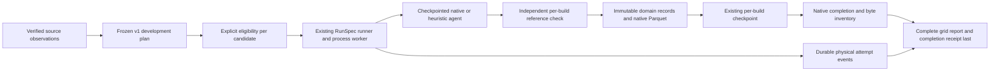

# Comparable CI baseline matrices

**Development feature for #311; unavailable in the published 4.16 wheel.**
Execute a frozen candidate matrix through COLEMAN's existing RunSpec runner,
policies, Parquet results and per-build checkpoints. The application API retains
raw complete rankings, selected prefixes, failed attempts and incompatible methods.
It grants no protected test access, source admission or algorithm promotion.

## Execute and inspect

Use the complete [constructed CI example](https://github.com/jacksonpradolima/coleman/blob/main/examples/comparable_baselines.py)
with the package built from this development branch. From outside the repository:

```bash
python /path/to/coleman/examples/comparable_baselines.py /tmp/ci-baseline-evidence
```

The script's `__main__` guard is required for native spawned workers. It freezes
three causal builds, three tests per build, one seed, one native-work budget and
all thirteen method declarations. Twelve execute; the external DANTE candidate
remains incompatible with an explicit reason. This constructed example is one
family, not independent evidence from three projects.

Use the matrix API for execution and replay. A saved native RunSpec contains the
typed binding plus a legacy factory placeholder; plain `coleman.api.run` does not
load extension callbacks and cannot reproduce a qualified matrix cell.

The reusable application interface is:

```python
from coleman.application.baselines import run_baseline_matrix, read_baseline_matrix

# plan is a validated BaselinePlan assembled from verified source observations.
report = run_baseline_matrix(plan, "/tmp/ci-baseline-evidence")
# Locate the printed/returned plan/runtime scope before inspecting complete.json.
verified = read_baseline_matrix("/tmp/ci-baseline-evidence/baseline-matrices/PLAN_HASH/RUNTIME_HASH")
assert verified == report
```

`BaselinePlan` requires version 1, an interpreted source with its URI, original
content fingerprint, license declaration, complete test membership and explicit
clock/evidence basis. It freezes one **development** fold, candidate IDs, seeds,
ratios and common cooperative resource bounds. Rows and dimensions canonicalize;
duplicate identities reject. Every candidate gets identical source membership,
RNFail budget-censored feedback and declared budgets. Source references record
provenance; source-specific verification and [admission](corpus-admission.md)
remain separate prerequisites for empirical claims.

## Candidate behavior

| Method ID | Decision inputs and fixed behavior |
| --- | --- |
| `seeded_random_v1` | Actual native Random policy, seeded per cell |
| `original_order_v1` | Producer-attested full base order; unavailable if absent |
| `shortest_prior_v1` | Predecision cost estimate, otherwise own observed selected history |
| `recent_failure_v1` | Most recent actually observed failure first |
| `failure_frequency_v1` | Failures divided by actually observed executions |
| `recency_duration_v1` | Frequency plus reciprocal failure distance, divided by prior duration with a declared 1 ns floor |
| `ucb_c1_v1` | Native UCB, exploration constant 1 |
| `thompson_beta11_v1` | Native Thompson sampling, Beta(1,1) prior |
| `discounted_ucb_095_c1_v1` | Native discounted UCB, discount .95 and exploration 1 |
| `linucb_alpha05_v1` | Native contextual LinUCB, alpha .5; complete consistently defined prior features required |
| `portfolio_random_ucb_v1` | Native Random/UCB portfolio, exploration 1 and window 20 |
| `unattainable_failure_first_v1` | Current failures first, then actual cost and ID; explicitly unattainable complete-truth reference |
| `external_dante_prioritization` | Not qualified; primary-artifact investigation below |

Deterministic heuristics break remaining ties by stable test ID. Missing cost or
history sorts after known inputs and increments an explicit fallback count.
Unknown outcomes never become passing feedback. Noncontextual native learners retain their
existing seeded initial shuffle; LinUCB evaluates native contextual scores from
the first build. Original-order, heuristic and oracle candidates
apply their declared rule from the first build. Scores, rewards and observed
failure frequencies do not become calibrated probabilities. The oracle label
claims neither a deployable algorithm nor global mathematical optimality.

Native policy RNG state is owned by each matrix agent and included in its native
checkpoint. Binding to the existing process-global policy RNG lasts only through
serialized policy calls and restores the prior binding even after errors. This
adapter requires process isolation; it does not claim thread safety or change the
legacy runner's checkpoint format or random behavior.

## Quantities and clocks

Reported source duration is additive test work in seconds. This projection does
not prove whole-runner occupancy or CI elapsed savings. The native bandit projects
costs to binary32; the source budget remains binary64 source work times the frozen
ratio. This matrix's loader computes source work with `math.fsum` in canonical
source order before constructing the native bandit. Parallel reduction order
cannot change its budget or mathematical digest; legacy native loaders retain
their existing sums. Selection reproduces native sequential binary64 prefixes. Independent
rational arithmetic checks NAPFD, midpoint-cost APFDc, recall, selected work and
first-failure work against that exact projection. Any projected-work excess over
the declared budget is a separate measurement.

Quality uses the full test/failure universe. Zero-failure ratios are unavailable;
the unchanged legacy Parquet fallback remains 1. Nondetection is right-censored
with null time; an observed failure at zero work remains observed zero. Unknown,
unavailable and nonfinite source truth cannot execute; negative physical costs
reject. Signed finite contextual features retain their own allowed minimum.
No target duration or outcome is passed to an ordinary heuristic's decision view.

Real preparation, inference and learning elapsed seconds are recorded separately
from modeled test work. Native-process elapsed/CPU seconds are cumulative within
an invocation; peak RSS is MiB for that executable. Host invocation elapsed includes
bootstrap and publication. These are variable observations, not deterministic
mathematical result identity. Missing interrupted costs remain unavailable.

Source-point-in-time execution requires original decision and label clocks;
features must be available at the decision. Known labels arriving after the next
decision make synchronous replay incompatible. Missing historical clocks may be
explicitly declared `assumed_order_only` for post-hoc simulation; no timestamps
are invented and no historical admission follows. Original order and context
cannot be inferred from a loader's lexical sort or today's target.

## Artifacts, recovery and compatibility



Artifacts live under `baseline-matrices/<plan hash>/<installed runtime hash>`.
The runtime includes complete SDK resource identity, Python/platform and active
base-dependency versions. It excludes unrelated host packages and optional tools;
it does not attest hardware, every native binary or upstream honesty. A runtime
change creates a new scope, preventing accidental cross-runtime checkpoint reuse.
Each raw observation carries `attempt_id` separately from data provenance.
`record.provenance.source_revision` identifies the original frozen source
content; `spec_fingerprint` hashes the typed native binding stored in the resolved
RunSpec extension. It is not the hash of the entire path-dependent RunSpec.
Logical cell identity excludes output paths and attempt IDs. Mathematical identity
excludes physical timing and native run paths; raw record identity retains them.

The matrix lock serializes local orchestration. Each native child separately owns
its execution lock through completion, including when its parent dies. These are
POSIX advisory locks on a trusted local filesystem, not distributed locks. The
same elapsed, peak-memory and output limits apply per invocation. Checks happen
between phases and can overshoot during an operation; they are not an OS sandbox.
Earlier attempts remain in the cost ledger after checkpoint continuation.

A started attempt publishes before native execution. An interrupted start without
a terminal event stays visible with unknown costs. Failed cells remain terminal
results on retry; they are not silently rerun until favorable. Completed cells
verify their actual bytes without re-execution. Incomplete cells resume through
native checkpoints, preserving the first immutable per-build evidence. An aborted
or unavailable cell prevents a matrix completion receipt. After recording the
partial grid and terminal attempt, a graceful KeyboardInterrupt/SystemExit is
re-raised so the caller actually stops. A terminal failed cell
can complete the inventory without pretending its execution succeeded.

Strict readers reject missing/old/future schema versions, changed evidence,
missing native rows/checkpoints and incompatible units. There is no implicit
migration of old artifacts. Existing native results remain readable through their
existing readers; they do not acquire baseline provenance retroactively.
`read_baseline_matrix` verifies a moved completed directory without following its
old recorded input paths or unpickling checkpoints. Resume requires the original
compatible execution scope; it does not automatically relocate checkpoint state.

V1 snapshots are bounded to 512 builds, 10,000 tests/build, 100,000 total test
cells, 64 seeds, 16 budgets and 65,536 native result cells. Strict JSON artifacts
are at most 16 MiB; native input Parquet is at most 64 MiB. These are qualification
bounds, not permission to drop inconvenient source rows. Larger sources require
an explicitly reviewed complete snapshot or a later streaming contract.

## External baseline investigation: DANTE

Primary sources are the [ICST 2026 paper](https://doi.org/10.1109/ICST69053.2026.00080)
and the immutable [author artifact 18900675](https://zenodo.org/records/18900675).
The complete `ML_TCSP.zip` was downloaded read-only: 3,590,599,893 bytes,
author MD5 `b268b21616f6ceb396e8df89d382f298`, SHA-256
`a99ffc38d0caf0c9362f6b762483e6bd453fe45ed4f6b981a6dca4464495748d`.
Its root MIT license and bundled LRTS MIT license were inspected separately;
these do not automatically establish every upstream project's source-code terms.
No external source or dataset is vendored or executed by this adapter.

The archive's complete ZIP64 directory has 417,906 entries. This read-only study
does not qualify it for COLEMAN's smaller bounded source-selection profiles.
Inspected component bytes were matched to the fully verified archive, including
`run_prioritization.py` SHA-256
`3b06f6020caba91faae6617180530ac48ced9744c0deaa09bf23e1ebf7765a20`.
The paper was read from the PDF included in that same verified archive.

Qualification remains explicitly blocked:

- DANTE prioritizes test classes; the existing LRTS method projection uses test
  methods. A reviewed common unit and complete universe are required.
- Original code excludes missing-source and nonpositive-duration cases. These
  exclusions cannot silently shrink a shared comparison universe.
- The paper's confidence-weighted sticky relevance and the inspected code's
  inverse-window weighting require a precisely named variant and validation.
- Configuration selects BM25 while the paper discusses TF-IDF. Pinning a source
  archive alone does not identify an equivalent experiment.
- The priority implementation's APFDc adds a correction unlike this adapter's
  declared midpoint-cost reference. All rankings need evaluation with one common
  metric, rather than copying external aggregate scores.
- Runtime, historical feature availability, cost inputs, missing-history handling
  and same-universe equivalence have not been qualified.

The incompatible result is an honest outcome of the investigation, not evidence
against the method. No superiority, paper reproduction or algorithm-equivalence
claim follows. Independent comparisons and reporting continue in #312/#313;
the four historical admission gaps documented in #309 remain open.
