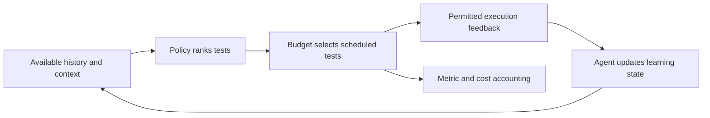

# Understand the prioritization loop

A CI suite often contains more tests than its current time budget permits.
**Prioritization** chooses their order; **selection** determines which fit the
budget. COLEMAN studies both, with adaptive test ranking as its central workflow.

## A small example

Suppose three tests cost one, two and four seconds. With a three-second budget,
putting the four-second test first has different consequences from starting
with the two smaller tests. A policy chooses a ranking from the information it
has. The environment applies the budget, observes permitted feedback and computes
metrics. The next build can contain different tests or configurations.

This is the feedback loop studied by the
[original COLEMAN paper](https://doi.org/10.1109/TSE.2020.2992428).
The [first-run tutorial](getting-started.md) executes a tiny authored example
through the actual runner.

## Policy, agent, reward and metric

| Concept | Its job | A common misunderstanding |
| --- | --- | --- |
| Policy | Choose a ranking, balancing accumulated information and exploration | A ranking score is not automatically a calibrated failure probability |
| Agent | Maintain policy state and update it from feedback | A seed fixes randomness; it does not create an independent project |
| Reward | Transform observed feedback into a learning signal | A larger reward is not a scientific effect estimate |
| Metric | Describe the ranking or scheduled subset against a declared universe | A metric average alone does not establish generalization |
| Budget | Limit modeled scheduled work or count | A sum of test durations is not parallel wall-clock occupancy |
| Context | Supply features available before a decision | The current test's eventual verdict or duration is not pre-decision context |

See [policies and rewards](policies.md) for choices and
[evaluation](evaluation-guide.md) for interpretation.

## Historical replay and live CI answer different questions

The native runner reads recorded outcomes and simulates budgeted decisions.
It does not invoke your application's test commands. Source adapters prepare
inputs and retain the assumptions made during that projection.

A live integration needs additional evidence about when test inventories,
features and outcomes became available, along with attempt identity and actual
resource use. The [integration guide](integration-guide.md) connects those
requirements to the operational pilot and shadow evaluation.

## Learn the terms in context

1. Create and inspect a run in [getting started](getting-started.md).
2. Map your columns using the [input guide](input-data.md).
3. Choose a policy family in [policies and rewards](policies.md).
4. Interpret results using the [evaluation guide](evaluation-guide.md).

Use the [glossary](glossary.md) when a contract name or acronym is unfamiliar.
