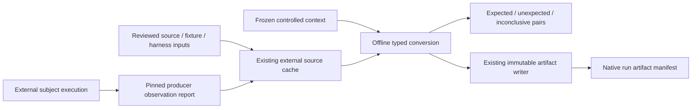

# Controlled real-fault observations

Controlled buggy/fixed pairs answer a narrow question: does the same selected
assertion fail against one source revision and pass against the corrected revision
under the declared execution conditions? COLEMAN can retain that evidence,
including unexpected and inconclusive results, without presenting a reconstructed
sequence as historical CI.

The offline typed observation adapter retains this controlled evidence.
Source admission, fault diversity, baseline comparisons and cross-corpus
evaluation require additional evidence. The registry's seven required diversity
cells remain uncovered. Source assessments for
[RTPTorrent](rtptorrent.md) and [LRTS](lrts.md) remain separate.

The optional [pinned JUnit3 producer](junit-source-capture.md) now provides a
reproducible public Java source recipe, with bounded execution and raw-role recovery.

The optional [Python source capture](python-source-capture.md) uses the same domain
contracts for a pinned upstream PySnooper pair. Its two declared locales preserve
actual exception-to-pass and both-pass results, with separate component terms,
typed provenance and real process-interruption recovery.

## Architecture and trust boundary



The core reads and verifies cached bytes. It never starts a subject process,
container, compiler, CLI or network transport. A receipt proves byte correspondence,
not that a producer executed those bytes. Runtime and command descriptions remain
producer attestations. Review and execution of external subjects belong outside
this adapter, with their own component terms and resource limits.

`ControlledContext` freezes project, curated fault label, language, fault origin,
source revisions, fixture revision, dependence group, declared test IDs, input
receipts and runtime conditions. Exactly one buggy source, fixed source, common
test fixture and harness input is required. Dependency inputs are separate. Source
versions must match the declared revisions. Input names and test IDs are unique;
permuting those declarations preserves context identity. Opaque source archives
can be cached as raw packages; this adds no TAR or ZIP64 extraction capability.

`ControlledReport` binds observations to the context fingerprint. Each observation
has a trial ID, role, test ID, explicit outcome, capture instants, nullable diagnostic
digest and monotonic elapsed counter. A non-null diagnostic digest must match a
separate regular member of the validated report package; absent references reject.
Diagnostics are not predecision features. Capture instants are collection clocks, not
historical event or feature availability. No observed CI chronology is inferred.

Execution identity hashes the context and `(trial_id, test_id, role)`, excluding
outcomes and capture values. A retry of the same collection retains its trial ID;
a genuinely new execution gets a new trial ID. Both remain in the same declared
dependence group. These IDs do not establish independent bugs or projects.

## Outcomes, units and missingness

| Buggy observation | Fixed observation | Comparison |
| --- | --- | --- |
| Assertion failed | Passed | Expected |
| Passed | Passed | Both pass |
| Assertion failed | Assertion failed | Both fail |
| Passed | Assertion failed | Reversed |
| Missing role, test error, skipped, timeout, cancellation, infrastructure error or unavailable | Any | Inconclusive |

The same inconclusive rule applies when the fixed role has a non-assertion outcome.
Only actual test/trial groups are compared. An empty report has no comparisons;
missing observations are never fabricated. Unexpected and inconclusive results
are valid evidence and remain in the dataset.

Elapsed values are strict nonnegative integer **nanoseconds**, at most `2**63-1`,
with meaning `observed-test-harness-monotonic-elapsed-v1`. Zero is observed. Null
requires `unavailable` or `not_applicable`; an observed null or absent-state zero
rejects. Negative, fractional, boolean, nonfinite and incompatible-unit values
reject. Counter resolution establishes no physical measurement accuracy.

Elapsed harness time includes whatever that harness times. It is not independently
removable runner work, shared setup cost, queue delay or developer-visible CI
latency. It must not be substituted for native scheduling costs. This contract
does not claim that all negative numbers are invalid in other result families;
negative signed measurements remain governed by their existing contracts.

## Installed package workflow

Build and install the working branch's wheel in a separate environment. The
released 4.5 wheel predates this adapter. From the checkout:

```bash
wheel_dir=$(mktemp -d /tmp/coleman-controlled-wheel.XXXXXX)
uv build --wheel --out-dir "$wheel_dir"
uv venv /tmp/coleman-controlled-installed --python 3.14
uv pip install --python /tmp/coleman-controlled-installed/bin/python "$wheel_dir"/*.whl
mkdir -p /tmp/coleman-controlled-workspace
cp examples/controlled_faults/ci.py /tmp/coleman-controlled-workspace/ci.py
cd /tmp/coleman-controlled-workspace
/tmp/coleman-controlled-installed/bin/python ci.py owned-ci /tmp/coleman-controlled-source-cache
```

The example's pairs are **newly authored synthetic schema fixtures**, not external
real faults or measured executions. Their constructed capture instants and
unavailable elapsed counters are explicit. A separate complete owned serial CI
fixture runs real native Random/RNFail with budget 7 seconds, independently checked
NAPFD/APFDc and a second call through the learning checkpoint. No counter from the
controlled observations is projected into that serial fixture's costs.

Re-running the command preserves the controlled artifact and committed native
result. The output includes the frozen `spec`, converted `dataset`, classifications
(`expected`, `inconclusive`), native directory and explicit insufficient-evidence
status. This demonstrates integration and recovery, not external effectiveness.

The following complete SDK example reopens that specification offline. It runs
from the same external workspace and requires no CLI or MCP imports:

```python
from pathlib import Path

from coleman.artifacts import ArtifactWriter
from coleman.corpus import SourceCache
from coleman.corpus.controlled import convert_controlled_source, publish_controlled_dataset
from coleman.corpus.controlled_contracts import ControlledSpec

cache = SourceCache("/tmp/coleman-controlled-source-cache")
spec = ControlledSpec.from_json(Path("owned-ci/controlled-spec.json").read_bytes())
dataset = convert_controlled_source(spec, cache)
assert [pair.classification for pair in dataset.pairs] == ["expected", "inconclusive"]
path = publish_controlled_dataset(dataset, cache, ArtifactWriter("offline-assessment"))
assert dataset.admission == "not_evaluated"
assert dataset.history == "constructed"
print(path)
```

For another cache location, replace the SDK path with the same location supplied
to `ci.py`. Input/report materializations use the existing reviewed-license,
source-digest, bounded-byte and offline validation contracts. Reports have an
8-MiB ceiling and at most 20,000 physical observations; contexts permit at most
10,000 test IDs and 64 input packages. Every report is checked against the bytes
actually parsed, including EOF size/digest, after cache validation.

## Compatibility, duplication and publication

All new interchange models require integer `schema_version: 1`, reject unknown
fields, and reject missing, legacy and future versions. Existing native results,
source manifests, checkpoints and historical artifacts keep their existing
meaning. No migration or automatic reinterpretation occurs. A future converter
must declare any migration separately and preserve original bytes.

Conversion conserves physical rows: `input_rows = observations + duplicates_excluded`.
Identical role/test/trial repeats are counted and excluded; conflicting repetitions
reject. Output observations are sorted by logical key. Permuting physical report
rows preserves normalized observations but changes the pinned source report bytes
and therefore the complete artifact fingerprint. This is deliberate provenance,
not an input-order-dependent policy comparison.

Publication re-converts the actual cache before writing one
`corpus-controlled/<fingerprint>.json` artifact. Identical concurrent publication
is idempotent through the existing immutable writer. Partial work is never a
completed experiment or learning checkpoint. A failed publication can be retried;
recipe-only content must remain local. Artifact metadata alone does not establish
source integrity, execution truth, scientific admission or independence.

## Primary-source investigation and fresh local evidence

The [Defects4J paper](https://homes.cs.washington.edu/~mernst/pubs/bug-database-issta2014.pdf)
and [pinned documentation](https://github.com/rjust/defects4j/tree/8c16da8230843cdc918eaf4ddb449637f02b83c6)
describe isolated buggy/fixed subjects, including reconstructed revisions.
The current documentation requires Java 11 and `America/Los_Angeles`; its current
corpus differs from the paper's original snapshot. Framework MIT terms do not
license every subject or dependency. Broad initialization downloads unrelated
repositories and tools; it was not used for the bounded case below.

The [BugsInPy paper](https://arxiv.org/html/2401.15481v1) describes selected real
source revisions and common exposing tests, with manual isolation review. A later
[independent reproduction study](https://mir.cs.illinois.edu/~marinov/publications/AguilarETAL23ReproducingBugsInPy.pdf)
demonstrates why declared metadata is insufficient: dependency installation and
runtime selection can prevent paired reproduction, and both-pass/both-fail
outcomes must remain visible. Its corpus snapshot and results are that study's
observations, not COLEMAN measurements.

At BugsInPy revision `11c5f1eea954a42132cfd06bf257766a7963e0fd`, no verified
framework license was found. The existing [upstream license question](https://github.com/soarsmu/BugsInPy/issues/94)
remains unresolved. The paper's license and a subject's license do not clear that
framework. No BugsInPy framework code or data is admitted by this increment.

Two **direct upstream** selected-test pairs were freshly executed on 2026-10-16:

| Subject | Buggy revision | Fixed / common test revision | Observed result |
| --- | --- | --- | --- |
| Apache Commons CLI, CLI-13 | `8f46f467a33ace44ccd9f394910940b6c48a3827` | `b0e1b80b6d4a10a9c9f46539bc4c7a3cce55886e` | One assertion failure / one pass; zero errors or skips |
| Black, process-pool fallback | `26c9465a22c732ab1e17b0dec578fa3432e9b558` | `c0a7582e3d4cc8bec3b7f5a6c52b36880dcb57d7` | One assertion failure / one pass; zero errors or skips |

Commons CLI used the [official Apache fixed commit](https://github.com/apache/commons-cli/commit/b0e1b80b6d4a10a9c9f46539bc4c7a3cce55886e),
Git-verified source blobs and its Apache-2.0 LICENSE/NOTICE,
common fixed-revision `BugCLI13Test.testCLI13`, Commons Lang 2.1 and JUnit 3.8.1
(Maven Central bytes and checksums). It compiled directly with Java 11.0.32.1,
linux/arm64 Temurin manifest
`sha256:e4b3ff0f1a427efb2deb02b092ff8316d58573480260720d767d6ecdd69999d8`.
This was a direct source-pair experiment, not the complete Defects4J reconstruction
or a full original-suite reproduction. JUnit's component terms are CPL-1.0;
Commons Lang retains its own Apache terms.

Black used the [official upstream fallback fix](https://github.com/psf/black/commit/c0a7582e3d4cc8bec3b7f5a6c52b36880dcb57d7),
MIT source notices, CPython 3.8.3 and 16 pinned offline wheels.
The common fixed-revision
`BlackTestCase.test_works_in_mono_process_only_environment` explicitly injects
`ProcessPoolExecutor` initialization `OSError`. Both roles use the same declared
derived SCM version label `controlled-upstream-source-v1`. The linux/amd64 image
manifest `sha256:13af390c7ababf48b675e151c354de224f2ae6ec17ee08fe04ad3df8d0736501`
was emulated on an arm64 host. Its elapsed counters are not native performance
measurements. This direct upstream experiment does not resolve BugsInPy licensing.

Both used read-only subject/fixture/harness mounts, execution without network,
non-root UID, bounded memory/CPU/processes and per-case timeout. All source/dependency
bytes and raw observations remain outside Git. No third-party test code or rows
are bundled. These are two selected functional reproductions, not a randomized
sample, full corpus admission, fault-localization matrix, historical CI evidence
or an algorithm comparison. The typed reader does not independently certify this
external execution. A distributable pinned producer recipe, component-by-component
admission dossier and broader fresh test/fault matrix remain necessary before
claiming that the Java/non-Java diversity criteria are satisfied.

## Constructed C source observations

The [optional Juliet C producer](c-seeded-source-capture.md) uses these same generic
contracts and existing source cache/artifacts. It collects a deliberately bounded
synthetic function pair with an independent arithmetic oracle, retaining process
errors, negative outcomes and incomplete recovery. Compiler/runtime acquisition
and execution remain in optional transports; no C, Docker, CLI or MCP import is
introduced into this domain. Its elapsed ns never become native CI Duration.

## Continue the workflow

Collect an actual [Java matrix](java-fault-matrix.md) or [Python pair](python-source-capture.md),
then assess the retained scope with [source admission](corpus-admission.md).
