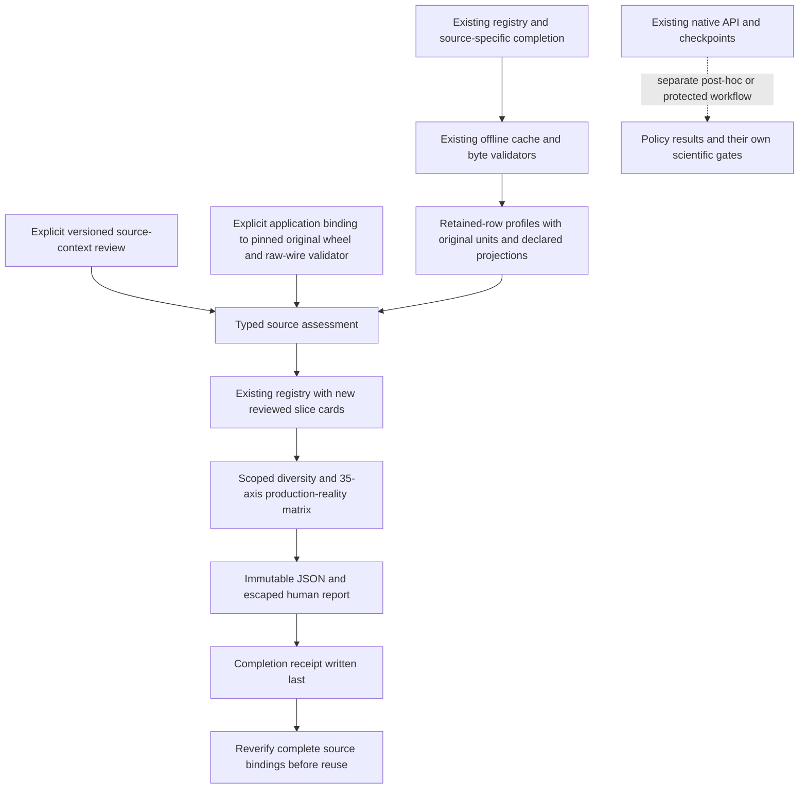

# Source admission and production reality

COLEMAN can audit an existing source workflow and explain what its evidence
supports: controlled functional reproduction, constructed mechanism checks or
an explicit refusal of protected historical evaluation. The report connects
versioned receipts, source-specific terms, analytical profiles and the existing
registry. A successful ETL or a large suite is not scientific admission.

This workflow is new in the development source for **4.15**. The published 4.14
wheel retains its documented workflows; build the reviewed source below to use
these APIs before their release. The development qualification below is source-purpose
evidence, not a completed cross-corpus policy comparison or a published 4.15 wheel.

## Install and audit a source

From the COLEMAN checkout, build a base wheel and install it outside the
repository. Python 3.14 and uv are required. Docker and MCP are unnecessary for
this audit. Source data, controlled observations and generated reports stay
outside Git, with separate cache, ETL and audit directories.

```bash
export COLEMAN_CI_HOME="$(mktemp -d "${TMPDIR:-/tmp}/coleman-ci-audit.XXXXXX")"
uv build --wheel --out-dir "$COLEMAN_CI_HOME/dist"
uv venv "$COLEMAN_CI_HOME/installed" --python 3.14
uv pip install --python "$COLEMAN_CI_HOME/installed/bin/python" "$COLEMAN_CI_HOME"/dist/*.whl
cd "$COLEMAN_CI_HOME"

export COLEMAN_CI_CACHE="$COLEMAN_CI_HOME/source-cache"
"$COLEMAN_CI_HOME/installed/bin/python" -m coleman.transports.lrts_etl \
  --cache "$COLEMAN_CI_CACHE" --output "$COLEMAN_CI_HOME/etl" --fetch \
  > "$COLEMAN_CI_HOME/source-summary.json"
export COLEMAN_CI_COMPLETION="$("$COLEMAN_CI_HOME/installed/bin/python" -c \
  'import json; from pathlib import Path; print(json.loads(Path("source-summary.json").read_text())["completion"])')"
```

The source command reuses the [eight-build Karaf workflow](lrts-parquet-etl.md).
It downloads pinned public data, verifies bytes and exports analytical/native
Parquet. To reuse a complete verified cache offline, omit `--fetch`. It does not
run a policy here. All subsequent audit operations remain offline.

Run this complete example with the installed Python. `SourceReview` records a
conscious review of the exact source payload. Its history must agree with any
existing source declaration. Review references are descriptive; the audit never
opens them. Freeze the true review instant once; the explicit example date below
is part of the reproducible review declaration, not a live timestamp inserted by
the core. The example retains the source's missing availability/continuity gates.

```python
import os
from datetime import UTC, datetime
from pathlib import Path

from coleman.artifacts import ArtifactWriter
from coleman.corpus.admission import SourceEvidence, audit_corpus, publish_corpus_admission
from coleman.corpus.admission_contracts import SourceReview
from coleman.corpus.lrts_etl_contracts import LRTSETLReceipt
from coleman.corpus.materialization import SourceCache
from coleman.corpus.registry import load_registry

source_path = Path(os.environ["COLEMAN_CI_COMPLETION"])
cache = SourceCache(Path(os.environ["COLEMAN_CI_CACHE"]))
payload = LRTSETLReceipt.from_json(source_path.read_bytes())
review = SourceReview(
    schema_version=1,
    payload_fingerprint=payload.fingerprint,
    status="reviewed",
    reviewed_at=datetime(2026, 10, 18, tzinfo=UTC),
    history=payload.recipe.history,
    reference=payload.recipe.metadata.source.uri,
    fault_reference=None,
    subject_language=None,
    limitations=(
        "Source reproduction only; source event/outcome/feature availability and test continuity remain unverified.",
    ),
)
review_writer = ArtifactWriter(Path("review"))
review_writer.write_immutable(review_writer.run_root / "source-review.json", review.to_json() + "\n")
binding = SourceEvidence(payload, review, source_path.parent, cache)
report = audit_corpus(load_registry(), (binding,))
completion = publish_corpus_admission(report, (binding,), ArtifactWriter(Path("audit")))
assert report.assessments[0].scope == "blocked"
assert len(report.uncovered_regimes) == 7
Path("audit-completion.path").write_text(str(completion) + "\n")
print(completion)
print(report.observed_source_models, report.uncovered_regimes)
```

The JSON contains the exact registry, source receipts, context reviews, profiles,
35-axis reality matrix, covered/uncovered regimes and historical blockers. The
human `report.md` retains the same distinctions. This single-source audit leaves
the other registrations visibly unbound. It does not erase their earlier
fixture/profile reports or silently upgrade a planned native adapter.

## Verify and continue offline

This second complete example reopens the frozen review and completion, checks
every source/output byte again and repeats publication idempotently. Keep all
source bindings; a report's self-declared file hashes cannot replace them.

```python
import os
from pathlib import Path

from coleman.artifacts import ArtifactWriter
from coleman.corpus.admission import load_source_evidence, publish_corpus_admission, validate_admission_completion
from coleman.corpus.admission_contracts import SourceReview
from coleman.corpus.materialization import SourceCache

source_path = Path(os.environ["COLEMAN_CI_COMPLETION"])
review = SourceReview.from_json(Path("review/source-review.json").read_bytes())
binding = load_source_evidence(
    "lrts",
    source_path,
    review,
    cache=SourceCache(Path(os.environ["COLEMAN_CI_CACHE"])),
)
completion = Path(Path("audit-completion.path").read_text().strip())
report = validate_admission_completion(completion, (binding,))
again = publish_corpus_admission(report, (binding,), ArtifactWriter(Path("audit")))
assert again == completion
assert report.generalization == "insufficient_evidence"
print(report.fingerprint, again)
```

The [existing native replay](lrts-parquet-etl.md) remains a separate, explicitly
post-hoc simulation with its existing RunSpec/checkpoints. Source qualification
does not change its rewards, metrics, results or eligibility semantics. The new
audit does not implement another learning runner.

## Contracts, units and missing evidence

All new records require integer schema version 1. Missing/coerced/future versions,
unknown fields and duplicate JSON keys reject. Old registry, card, fixture,
profile and source-receipt readers retain their own contracts. There is no
automatic migration or relabeling of old data. Verification of another producer
or Parquet writer requires the recorded installed package; readable metadata is
not verified evidence. Preserve original artifacts when deliberately producing
a new reviewed snapshot.

`ObservationProfile` describes retained source rows and their original identity
dimensions. It keeps unique/duplicate/conflicting/missing identities, execution
groups, binary known/unknown counters and duration distributions. Source/exclusion
conservation remains separately visible in the existing manifest. Primary source
terms do not clear other embedded data, dependency, fixture, harness or runtime
components. Reviews and source receipts remain producer attestations; checking
bytes cannot prove legal rights or that a process consumed those bytes.

- Genuine zero remains observed. Null duration is unavailable. Native invalid
  negative/nonfinite raw values remain explicit category counts; they are not
  repaired into zero or passing tests.
- Duration quantiles reuse the existing inverse empirical CDF. Analytical decimal
  seconds and integer harness nanoseconds remain exact in their original
  source records. New summary meaning `binary64-description:<source meaning>`
  declares the distribution's projection, including possible nanosecond rounding
  above `2**53`. These summaries never become native runner costs.
- Binary-label fractions describe known retained source labels. They are not
  calibrated probabilities, unique-fault prevalence or independent trials.
  An empty known-label denominator is unavailable, distinct from an observed
  zero-failure fraction.
- HCS's upstream binary nonpass label can collapse unsupported statuses. Its new
  card keeps that mapping and an unverified failing-test outcome unit; it does not
  rewrite old native results or reinterpret every nonpass as an assertion failure.
- RTPTorrent class-level labels retain their explicit `class_outcome` mapping.
  The new card's failing-test outcome unit stays unverified: a failed class does
  not establish a failing-test count. Existing class/native results are unchanged.
- Historical CI span and continuous test churn remain unavailable without
  verified source chronology/continuity. For constructed histories they are
  explicitly not applicable. No numeric build/job order becomes an observed
  timeline. Logical test additions in a stress factor remain synthetic facts.
- Source execution groups and declared project/fault families remain separate
  from genuinely independent projects or mapped unique faults. Log4j stage
  views, variant copies, locales, trials and seeds never acquire independence
  by being separate files or rows.
  Counted `execution_group_fields` stay separate from the original manifest's
  declared grouping. Native variant profiles count `BuildId`/`Variant` execution
  groups while preserving the old card's `BuildId` group declaration unchanged.

Every production-reality axis is observed, reconstructed, missing, synthetic or
not applicable, with a source locator and limitation. The matrix includes
language/build systems, source CI structures, triggers/test levels, setup/shared
fixtures/order dependence, serial/parallel/matrix/shard/rerun execution,
runner/queue/concurrency/cancellation, retries/quarantine/flakiness/timeouts,
infrastructure failures, vendor/monorepo/rename/change-to-test traceability,
protection/mandatory suites/overrides, partial/delayed/corrected outcomes,
retention and decision availability. A report label does not certify actual
runner OS, concurrency, a trigger or physical savings.

## Admission purposes and required coverage

| Evidence | Narrow purpose | Historical confirmation |
| --- | --- | --- |
| Existing native profiles | Descriptive, original cards unchanged | Blocked; profiles do not establish terms, availability or a protected protocol |
| LRTS/RTPTorrent/HCS receipts | Verified source conversion and reported execution structure | Blocked while source-specific clocks, universe/continuity, topology and protocol remain unresolved |
| Complete controlled observations | Original raw-producer verification plus explicit source/language/runtime review and curated reference for declared real faults | Constructed history; capture clocks are not CI chronology |
| Constructed/seeded functional observations | Separate constructed functional purpose | Cannot fill a real-fault or historical regime |
| Stress receipts | Constructed mechanism qualification of the verified case | Cannot fill observed historical CI cells |

Real-fault functional admission does not require favorable outcomes: both-pass,
both-fail, reversed and test-error/inconclusive pairs remain visible. Missing
roles, unavailable/cancelled/infrastructure-aborted execution or a constructed
executor block that qualification. Language and curated source review are not
inferred from which tests fail. A curated fault reference remains distinct from
a genuine unique-fault mapping.

Controlled reports without an explicit original raw-producer verifier remain
blocked with `original_raw_producer_verification_missing`. The generic normalized
converter checks bytes/accounting but does not reparse producer-specific raw
packets. Source-review metadata alone cannot clear that gate.

The application adapter `coleman.application.admission.OriginalCaptureVerifier`
implements the domain's typed `ControlledSourceVerifier` protocol. Supply the
original installed `python`, the original `wheel` and reviewed `wheel_sha256`
(with `sha256:` prefix), a descriptive `package_uri` and the original capture
`receipt`. Choose `family="python"` or `"c"` and supply its separate `plan`;
for `family="junit_matrix"`, supply `output` containing the matrix's original
controlled datasets and leave `plan=None`. Pass this explicit object as
`SourceEvidence(..., controlled_verifier=verifier)` or the same keyword to
`load_source_evidence`. Paths belong to local verification bindings, not report
identity. Neither source fields nor a stored adapter name can select executable
code, an interpreter or a transport.

The adapter invokes a fixed script in the original installed interpreter's
isolated mode, verifies every authored SDK resource/version against the pinned
wheel and reuses that package's existing source/context/raw-wire validators.
It performs no installation, acquisition, Docker or subject execution. Original
validators may republish identical owned source-cache metadata. Source capture
producers conservatively hash **all SDK bytes and the package version**; adding
unrelated modules or changing release version does not authorize relabeling old
captures. Preserve the original interpreter/wheel/receipt/plan, use its original
validator and keep its identity in the new proof. Do not migrate old evidence
implicitly.

`ProducerVerification` records the original wheel/version/producer, raw packet
digests, capture receipt/plan identity, verifier implementation, Python and
dependency versions. The audit re-invokes the supplied verifier on publication
and completion validation. Reading a portable proof is inspection, not source
verification. This establishes byte/protocol correspondence; it still cannot
prove authentic physical execution, legal rights or independent faults.

An isolated stress export cannot cover the broad adversarial regime. The audit
requires the complete default eight-build, seed-11 set for the existing 32-row
covering design and all seven named adversarial cases, deduplicated by actual
case identity. Each needs its own verified completion binding. This checks the
declared family; seeds do not create independent projects. Pair coverage does
not prove event-sequence coverage, a globally minimum design or policy efficacy.

All seven original diversity regimes stay in the report. Uncovered cells remain
uncovered. Jenkins single/stage views are one source model; reviewed observed
GitLab pipeline/job/variant reports provide a different structure without
flattening identities. At least two are required; constructed capture runtimes
and synthetic workers cannot satisfy this gate. Model presence alone does not
grant historical admission or close [#261](https://github.com/jacksonpradolima/coleman/issues/261).

## Add a source without changing the runner

1. Use an existing adapter to produce a typed completion, or supply an existing
   registered native card and its actual `NativeSourceProfile`. Keep input
   component terms, source revisions/digests and observation/group dimensions.
2. Freeze a `SourceReview` bound to that exact payload fingerprint. Preserve
   declared history; HCS v1 has no history field, so its origin needs conscious
   review. A required reviewed subject language and curated real-fault reference
   are separate from runtime outcomes. Unknown language is null, not a claimed
   non-Java language.
3. Supply `SourceEvidence(payload, review, root, cache)`. Native `root` is the
   original Parquet file and has no cache; stress uses its export directory
   without a foreign-source cache. Other adapters require their existing offline
   cache; roots and cache locations never enter portable report identity.
   Controlled-functional admission additionally requires the explicit original
   raw-producer verifier described above; generic reports remain inspectable and
   blocked without it.
4. Call `audit_corpus` with your frozen existing registry and complete bindings.
   New slice cards reuse `CorpusRegistry`/`DataCard`; original cards cannot be
   silently overwritten. Unsupported source families require an explicit adapter
   contract; a metadata adapter name never selects an import or executable.
5. Publish and validate using the two examples above. Reassess deliberately from
   the original registry snapshot when changing a review; existing embedded
   registry snapshots and source artifacts remain unchanged. Run policy/native
   experiments separately under their actual eligibility and protection gates.



## Limits and recovery

An audit supports at most 64 registry cards/source bindings and two million
retained observations per source profile. This is narrower than the stress
generator's largest sixteen-build case; all default eight-build design cases
fit. Limits bound records and encoded bytes, not an OS sandbox or a guaranteed
memory/time budget. Profiling/regenerating large sources can be expensive.
Canonical JSON and human report roles are each limited to 16 MiB; the completion
receipt is limited to 16 KiB. Evidence is rejected rather than truncated.

Publication revalidates every actual source before writing. It uses the existing
immutable ArtifactWriter: concurrent identical attempts converge; conflicting
bytes reject. If execution stops after JSON or Markdown but before `complete.json`,
the partial files are not a completed audit. Retry verifies/reuses them and
publishes completion last. Completion validation also rederives the human output;
a forged matching file digest cannot certify a false report. Original source,
cache, result and learning-checkpoint bytes are never repaired or rewritten.
Trusted local filesystem parents and existing artifact durability limits apply;
this does not claim protection from concurrent hostile filesystem mutation.

## Development source qualification

The installed development wheel was exercised outside the checkout with all 306
authored SDK files checked against the source, MCP absent and a domain transport
import guard active. The audit verified 61 actual source bindings in the existing
registry, producing 63 cards; the two owned tiny fixtures remained visibly unbound.
Publication, complete-artifact validation and repeated publication reverified all
bindings offline and preserved every report byte.

| Source bindings | Count | Result |
| --- | ---: | --- |
| Existing bundled native artifacts | 10 | Original cards preserved; descriptive only |
| Karaf single-view, ActiveMQ and two shared Log4j stage views | 4 | Actual retained source/stage profiles; historical gates blocked |
| RTPTorrent HikariCP class history | 1 | 46,995 retained observations; logical build/availability gaps remain |
| LibSSH HCS slice | 1 | 885 analytical rows including 29 other-attempt rows; 208 sparse cells remain distinct |
| Controlled CLI/Codec fixes and two PySnooper locales | 5 | Narrow controlled-functional purpose; negative/inconclusive results retained |
| Constructed Juliet C slice | 1 | Constructed functional purpose; cannot fill a real-fault regime |
| Default covering design and named adversarial cases | 39 | Complete constructed mechanism family, 3,670,252 dependent observations |

All six controlled bindings were rechecked with their original published **4.13**
wheel, SHA-256 `bbe2f3cf8954fc27fc8f5a44e3713519aa30bcf2cfdd2aad140f4bcc1ae45abc`,
and original whole-SDK producer. A separate original environment was reconstructed
from that wheel and the same 31 recorded dependency versions after its earlier
temporary environment failed to import Pydantic. Source/capture bytes were not
rewritten, recollected or relabeled to the development package.

The result covers `controlled_java_real_faults`,
`controlled_non_java_real_faults` and `deterministic_adversarial_simulation` for
their stated purposes. `small_volatile_historical_ci`, `medium_historical_ci`,
`long_running_large_suite_ci` and `highly_configurable_systems` remain uncovered.
Reviewed Jenkins and GitLab report structures satisfy the two-source-model count
while preserving job/stage dimensions; this does not clear historical blockers.
Generalization remains `insufficient_evidence`. Source/stage copies, locales,
variants and seeds must not be added as independent projects or faults.

The development report fingerprint is
`sha256:5563f81230ec34c15d31e8bb6d416ea5236489ee5f092af5d437d7f7ffdaffb4`.
It identifies this frozen source/review snapshot, not a universal dataset or an
efficacy result. Full reports stay outside Git because embedded controlled
observations retain their recipe-only component restrictions. Original phase-one
fixture readiness still leaves all seven regimes uncovered; this separate scoped
audit does not rewrite that artifact or close #261.
