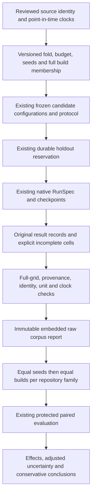

# Corpus metrics and repeated CI observations

Compare one paired repository-family mean per candidate while retaining every
build, seed and original result. A large history contributes more observations
inside its unit, not more independent repositories. This library preparation
feeds [protected evaluation](protected-evaluation.md); it adds no runner,
scheduler, fitting service or statistical test.

Introduced in 4.16, this workflow is also available in the verified published **4.17** wheel. The complete
example below runs outside the repository with that package.
Historical source admission and the four remaining uncovered regimes retain
their [documented limits](corpus-admission.md).

## Freeze the estimand before inspecting outcomes

`RepetitionDesign` is a strict version-1 contract for **one fold and one budget**.
Declare the source snapshot fingerprint, reviewed source-admission fingerprint,
temporal plan, warmup end, exact budget ratio, seeds, complete build membership,
source revisions, metric unit/meaning and native cost projection. Constructed
mechanism fixtures explicitly use `evidence_basis="constructed_mechanism"` and
may have null admission evidence. An empirical plan requires a source-admission
fingerprint; that reference does not itself verify or admit the source.

Each `CorpusBuild` separates three identities:

| Identity | Purpose |
| --- | --- |
| `member_id` and source `observation_id` | One complete logical build, after reviewed sibling/variant/retry handling |
| `metadata.group_id` | Source build leakage group; sibling jobs cannot become separate members |
| `project_id` and `unit_id` | Stable source project and its reviewed independent repository family |

One project cannot belong to several inference units. Several related projects
can share one unit. Renaming a test does not rename its project; renaming an
observation or project string cannot establish independence. The producer must
justify actual identities, full test universes, grouping, point-in-time revision
selection and dependencies against original source evidence. Hashes record those
declarations; they do not prove them.

Warmup ends within training. Freeze preprocessing and its train-only fit inputs,
candidate hyperparameters and learned state. Validation chooses candidates;
protected test outcomes never choose folds, normalization, exclusions, budgets,
seeds or thresholds. Use the existing `TemporalPlan.split` on source metadata
before choosing revisions. Late labels stay in their original partition and
corrected labels never overwrite an earlier point-in-time revision. Every selected
build must have eligible test metadata. Missing clocks require reproducible
exclusion or source rejection, not inferred job-finish timestamps.
Aggregation does not control policy updates. Verify their actual feedback frontier
with the existing shadow admission rules or justify the sequential replay clock.
Eligibility at a fold cutoff does not make a label available to an earlier decision.

Freeze the design fingerprint under `corpus_repetition_design` in **every**
`FrozenCandidate` configuration, together with all resolved runs. The existing
`FrozenEvaluation` must match its data and temporal plan. Its metric keeps the
original unit and appends `:equal-build-seed-mean-binary64-v1` to the raw meaning.
Set `independent_unit="reviewed_repository_family"`. Changing a budget, membership,
seed, source, preprocessing declaration or aggregation changes this binding.

## Preserve complete evidence

`CorpusRepetition` contains a candidate/member/seed identity, execution state and
the original `DomainRecord`. `RepeatedCorpusReport` embeds the full design, freeze
and raw grid. It validates frozen fingerprints, source/result availability, metric
unit/meaning/direction and distinct raw logical keys. Every declared cell must
exist exactly once. An absent cell fails validation; an interrupted or missing
execution needs an explicit unavailable record from its producer.

Each immutable raw key must bind the cell: `record.decision_id == member_id` and
`record.execution_id == repetition_execution_id(candidate_id, seed)`, using the
helper from `coleman.corpus.repeated_contracts`. This prevents unchanged records
from being swapped between compatible builds, families or seeds. Row metadata
and candidate-level provenance alone do not establish this binding. A producer
with different original keys must create an explicit projection retaining source
provenance; never rewrite the original artifact to satisfy the new contract.

`completed` means the execution completed, including test failures and valid
negative metrics. `failed`, `aborted` and `skipped` require a null `unavailable`
metric. A completed run may still have an undefined or unavailable metric.
Observed zero remains zero. Any null input makes that candidate's entire unit mean
unavailable. No build, seed, zero-failure window or unfavorable attempt disappears
through complete-case selection. Raw states explain why the mean is unavailable.

`report.paired_observations()` averages seeds equally within each build, then builds
equally within each unit. It retains all units and emits one paired observation
per candidate/unit. Arithmetic uses exact fractions of the supplied binary64
values followed by one binary64 rounding, independent of row order and without
intermediate floating-point sum overflow. This does **not** recover original
decimal durations or establish exact physical accounting.

The explicit `assembled_at` is derived availability. It cannot precede any source
label, target interval or result, or exceed the frozen test cutoff. Historical
source event/label clocks remain separate. A historical study must predeclare a
cutoff that includes analysis assembly, retain its fixed selected source snapshot,
and never backdate newly computed means to historical label time.

Call the preparation inside the existing `evaluate` outcome loader so durable
protected access is reserved first. Publish raw evidence with
`publish_repeated_corpus(report, ArtifactWriter(root))` before saving its comparison.
Derived records reference the embedded raw report digest. Reading validates its
full grid again; unknown versions reject. Identical concurrent publication is
idempotent. Interrupted writes leave no partly completed JSON; resume uses the
same access history and cannot claim an untouched holdout. Native checkpoints,
old result records and their legacy readers retain their existing meanings.



## Metric definitions and independent checks

The existing tiny reference uses integral ticks and rational arithmetic for at
most sixteen tests, complete binary outcomes and a full unique ranking. Serial
selection stops at the first nonfitting test. Its APFD-like outcome unit is a
**failing test**, not a unique mapped fault. Missing/timeout outcomes reject this
reference. Production unknown outcomes remain explicit in the operational APIs.

For the owned ordered suite `(pass:1s, fail:2s, fail:4s)`, full execution gives
APFD = NAPFD = `1/3` and APFDc = `1/2`. At a three-second budget it selects the
first two tests: recall `1/2`, native NAPFD `1/4`, APFDc `5/14`, work `3s` and
observed first failure at `3s`. APFDc retains the full seven-second universe and
both failing tests in its denominator, including the excluded failure.

The [original NAPFD paper, section 4.4](https://cse.unl.edu/~myra/papers/quICSM.pdf)
uses a declared execution horizon when comparing incomplete suites. Horizon
choice matters: normalizing the preceding partial example to two executed tests
would yield `1/8`, a different estimand. COLEMAN's existing native verdict NAPFD
uses the **full input suite count**. Legacy artifacts and the independent native
reference retain that convention; neither is silently relabeled as the paper's
selected-horizon calculation. The paper's fault matrix also differs from a
binary failing-test indicator.

The [cost-aware metric's author-maintained abstract](https://digitalcommons.unl.edu/cseconfwork/135/)
identifies the limitations of uniform test costs and fault severity. Its full
paper is unavailable at that repository; the native algebra above is verified
against COLEMAN's actual implementation, not presented as a replication of every
cost/severity model in that paper. Error counts, verdicts, unique faults and
severity weights are not interchangeable.

The native bandit stores durations in binary32, whereas direct source/metric
paths may use binary64. Independent checks exercise the real bandit at `0.1`,
`0.2`, `0.3` and `37.11` seconds. A source-decimal full budget can omit a projected
test whose binary32 duration is slightly larger. Report both quantities and the
selection discrepancy. A declared `cost_projection` records a reviewed choice;
the aggregation API neither converts durations nor certifies that choice. The
[HCS recipe](hcs-parquet-etl.md) already projects its native costs explicitly;
old sources are not rewritten.

Zero-work and zero-failure windows retain their meanings: undefined APFDc or
recall is null/not-applicable, and a censored first failure is unavailable rather
than a detected failure at zero. Legacy fallback scores remain in legacy rows.
Parallel work is a sum of occupancies; elapsed time comes from worker events.
Serial APFD formulas do not measure parallel time. Queue delay, shared setup,
partial/failed/cancelled attempts and retries use the existing
[resource ledger](resource-replay.md) and [shadow evidence](prospective-shadow.md),
where unmeasured setup remains unavailable and shared occupancy is charged once.

## Statistical scope

Predeclare the full candidate/baseline family, metric objective, raw-unit practical
margin, independent units, uncertainty method, minimum units and family error
budget in the existing protocol. Its paired Student procedure requires explicitly
assumed normal **unit differences** and independent units. Aggregating dependent
builds/seeds does not prove independent families or normal differences. Serial or
clustered units and undeclared normality reject before loading outcomes.

The current source revision also supports [bounded paired means](bounded-paired-evaluation.md)
with predeclared metric limits and independent repository-family units, without
normality. The complete installed native example accepts `--bounded` with this
revision's wheel. The published 4.17/default Student-t workflow below is unchanged.
Neither protocol turns repeated builds/seeds into independent families or clears
unverified source-admission/availability evidence.

[SciPy's paired test](https://docs.scipy.org/doc/scipy-1.17.0/reference/generated/scipy.stats.ttest_rel.html)
compares related observations; its
[Kruskal-Wallis test](https://docs.scipy.org/doc/scipy-1.17.0/reference/generated/scipy.stats.kruskal.html)
requires independent samples. The existing protocol's fixed method cannot be
replaced with iid tests or Kruskal-Wallis on seed/build repetitions. The
[Arcuri/Briand practical guide](https://homes.cs.washington.edu/~rjust/courses/CSEP590/readings/stats_guide.pdf)
also discusses censoring and effect-size interpretation. Algorithmic seed
variation on one artifact does not supply independent projects for generalization.

Existing inference applies Holm correction to the entire frozen family and
simultaneous Bonferroni intervals, retaining unavailable hypotheses. For several
fold/budget/endpoint families, preallocate a **global** error budget before access
(for example `study_alpha / K` to each of `K` fixed families). Separate default
0.05 families do not provide global control. Repeated folds of the same project
remain dependent; this API supplies no pooled cross-fold significance test.

Declare the practical margin in raw metric units. An interval within the margin
may be described against that predeclared tolerance, but v1 provides no formal
equivalence test or equivalence conclusion. A nonsignificant result is not proof
of equality. Insufficient, inconclusive and harmful outcomes remain reportable.
Normal null/known-effect simulations validate machinery under their stated model;
they do not establish calibration or efficacy on an empirical CI population.

## Run the complete installed example

With Python 3.14+ and `uv`, install the published wheel and download the example
from the same immutable release tag. Run both outside the repository:

```bash
task_corpus_env="$(mktemp -d)"
uv venv "$task_corpus_env/installed" --python 3.14
uv pip install --python "$task_corpus_env/installed/bin/python" "https://github.com/jacksonpradolima/coleman/releases/download/v4.17.0/coleman-4.17.0-py3-none-any.whl#sha256=e5a272ddc0edf72bd909a743fa2b3bc0dfeb8a02871c487ab22683cddeea40ca"
curl --fail --location --output "$task_corpus_env/ci.py" \
  https://raw.githubusercontent.com/jacksonpradolima/coleman/v4.17.0/examples/corpus-evaluation/ci.py
cd "$task_corpus_env"
"$task_corpus_env/installed/bin/python" -I ci.py ./output
# Resume the native run; fresh analysis metadata does not grant fresh holdout access:
"$task_corpus_env/installed/bin/python" -I ci.py ./output
```

The complete [example](https://github.com/jacksonpradolima/coleman/blob/v4.17.0/examples/corpus-evaluation/ci.py)
freezes two owned CI histories, two builds each, Random/UCB with explicit `c=1.0`,
seeds 11/42 and a 0.5 native-work budget, including test rename/churn in build two.
Build one labels are available before the replay's second decision. Source clocks
remain separate from actual metric/mean assembly time. It reserves access before native execution,
checks every actual NAPFD/APFDc against the rational reference, embeds sixteen raw
cells and publishes two candidate means for **one constructed family**, with
**insufficient evidence**. The two copied histories share that family; different
project labels do not establish independent sources. A protected retry is not confirmatory. Rerunning the
example resumes native checkpoints while preserving existing Parquet/checkpoint
bytes; its fresh assembly/freeze metadata and shared access history remain visible.
New analysis projections use the frozen comparison in their logical identity and
retain the native source-row digest; they do not overwrite earlier projection records.
Native RunSpecs also bind the source data fingerprint, so changed source rows do
not resume a previous source's checkpoints at the same input path.
This is installed TCPCI mechanism qualification, not a published historical study.

Tests additionally retain versioned goldens, legacy artifacts, finite signed/zero
values, missingness, row-order/scale metamorphisms, real mutation failures and
normal unit simulations. They forbid domain imports of CLI/MCP/transports and
exercise offline installation, immutable publication and checkpoint continuation.

The qualification reuses existing adversarial foundations rather than replacing
their contracts:

| Boundary | Evidence |
| --- | --- |
| Concurrent sibling/variant/revision pseudoreplication | New repeated-grid guards; existing HCS sparse-cell and source-attempt references |
| Late/future/corrected labels | Existing protected temporal/revision tests and new source/assembly cutoff guards |
| Renamed/new tests | Installed native example's second build, with unchanged source-family identity |
| Zero-failure/zero-work/censored first failure | Existing exact CI fixture tests; native integer-boundary and mutation checks |
| Flaky retries, partial/failed/cancelled runs, shared setup | Existing shadow admission and resource replay suites; new incomplete-grid propagation |
| Null/known effects and multiplicity | Existing protected simulations/full-family tests plus repeated-unit simulations |

This validates bounded mechanisms. It does not fill missing temporal/source
evidence in a historical corpus or turn constructed cases into independent
empirical observations.

## Published 4.16 qualification

The actual signed 4.16.0 wheel was installed outside the checkout and all 308 SDK
files were checked against its release tag. The base environment has no MCP;
domain imports pass a guard rejecting CLI, transport and MCP dependencies.
The tagged example retains sixteen raw cells and one constructed family;
repeating it preserves all 24 native result/checkpoint files. The published
contract rejects unchanged records swapped between builds or seeds.

A separate original Karaf replay checks all sixteen Random/UCB rows across eight
builds against independent rational references on the actual binary32 cost
lattice. Full rankings retain 734–844 tests per build. Four zero-failure rows keep
the native legacy fallback while their scientific reference ratios remain
undefined. Repeating that run preserves checkpoint step 8 and all 25 protected
files. Continuing the actual published 4.15 run with 4.16 preserves its 28
nonoperational files across resume and retry; operational manifests may refresh.
Missing original source clocks still block protected historical admission.

The same wheel revalidates the original admission report against 61 actual source
bindings and all six original controlled producers, without changing its digest
or four uncovered historical/HCS regimes. Original 4.13 captures retain their
original package identity. The release's wheel/source signatures, six asset
sizes/digests, SBOM and version-only automatic bump were verified separately.
These checks establish bounded reproducibility and compatibility; they do not
establish independent empirical families or policy superiority.

## Current 4.17 compatibility

The actual published 4.17 wheel also executes the complete tagged repeated-CI
example outside checkout. All 322 installed SDK files match the tag; sixteen raw
cells retain one constructed family and insufficient evidence. The immutable
member/seed swap guards reject, and retry preserves all 24 native files. The
original 4.16 qualification above remains historical evidence.

## Continue the workflow

Choose [bounded paired inference](bounded-paired-evaluation.md) or the supported [protected
protocol](protected-evaluation.md) according to the declared assumptions. The [evaluation
guide](evaluation-guide.md) connects the full path.
