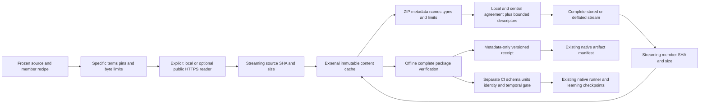

# Verified source packages for CI benchmarks

This development slice of [#261](https://github.com/jacksonpradolima/coleman/issues/261)
targets **COLEMAN 4.4**. It adds bounded, restartable acquisition and offline
integrity validation for explicitly licensed, pinned raw files and ZIP packages.
It reuses the existing immutable artifact writer and native runner/checkpoints.
Install a wheel built from this reviewed source; released 4.3 wheels do not have
these commands.

A successful materialization means **source integrity only**. It does not admit a
source for evaluation, verify its CI chronology/units/identity semantics, establish
independent observations or demonstrate policy effectiveness. The ten existing
native registrations retain their admission blockers and all seven minimum
corpus diversity regimes remain uncovered. Real-source adapters/conversion,
row-level exclusions and confirmatory studies remain later phases.

## Complete installed library example

Run outside a Git checkout. This uses one tiny repository-authored MIT fixture,
not a third-party archive. No network or optional MCP SDK is required.

```python
import io
from pathlib import Path

from coleman.artifacts import ArtifactWriter
from coleman.corpus import (
    MaterializationSpec, MaterializationReceipt, PackageMember, SourceCache,
    bundled_fixture_bytes, load_registry, materialize_source,
    publish_materialization, validate_fixture_source, validate_materialization,
)

card = load_registry().card("ci-serial-boundary-v1")
payload = bundled_fixture_bytes(card.manifest.benchmark_id)
member = PackageMember(
    name="fixture.json", sha256=card.manifest.source.sha256,
    size_bytes=card.manifest.source.size_bytes,
)
spec = MaterializationSpec(
    schema_version=1, package_id="owned-ci-raw-source-v1", archive="raw",
    source=card.manifest.source, license=card.manifest.license, members=(member,),
)
cache = SourceCache(Path("external-source-cache"))
receipt = materialize_source(spec, cache, lambda: io.BytesIO(payload))
assert receipt.admission == "not_evaluated"
assert materialize_source(spec, cache) == receipt  # Verified cache hit: no source reader.
validate_materialization(receipt, cache)          # Offline, no repair/network.
checked = validate_fixture_source(card.manifest, cache.member_path(receipt, "fixture.json").read_bytes())
assert len(checked.observations) == 2              # Real native metric/oracle checks.
path = publish_materialization(receipt, cache, ArtifactWriter("integrity-artifacts"))
assert MaterializationReceipt.from_json(path.read_bytes()) == receipt
Path("owned-package.json").write_text(spec.to_json() + "\n", encoding="utf-8")
Path("owned-source.json").write_bytes(payload)
```

`SourceArtifact` and `LicenseReview` are the same typed metadata contracts used
by the corpus registry. Acquisition requires a digest, exact source byte count,
version/citation, verified data-specific terms and a permitted/recipe-only rule.
Pending, prohibited or incomplete terms fail before opening a source reader.
Source URIs are descriptive; models and the core never follow them or dynamically
import an adapter. Source availability declarations remain frozen; the receipt
records its separate integrity scope.

## Installed commands

The preceding example creates the metadata/source used by these commands:

```bash
python -m coleman.corpus materialization-schema
python -m coleman.corpus fetch owned-package.json \
  --source owned-source.json --cache external-source-cache --output cli-integrity
python -m coleman.corpus fetch owned-package.json \
  --cache external-source-cache --output cli-integrity
python -m coleman.corpus validate-cache \
  cli-integrity/corpus-materializations/RECEIPT_FINGERPRINT.json --cache external-source-cache
```

Use the actual receipt path returned in `artifact`; the fingerprint filename has
no `sha256:` prefix. `fetch` with no source option is cache-only. An explicit
`--source` is always rechecked, even on a cache hit. A changed local source cannot
hide behind previously cached bytes. `validate-cache` rehashes the complete source,
archive-to-member relation and cached members without downloading or repairing.
Exit 0 means integrity verification, never scientific admission; invalid/unknown
metadata, missing/corrupt bytes or I/O/publication failures return 2.

The cache defaults to `~/.cache/coleman/corpus`. The physical root must be outside
Git worktree markers. Supply an explicit external cache for automation/tests.
Spec/receipt JSON paths must resolve within the current workspace, including
symlink targets; SDK callers retain explicit filesystem control. Cache and
published artifact trees cannot overlap, keeping recipe-only source
bytes out of exported artifacts. CLI and native example check this before cache
creation or acquisition. SDK workflows that acquire and publish must call
`validate_cache_separation(cache_root, output_root)` first; publication also
rechecks the roots. The physical materialization-family path must remain within
its output root; a symlink to a sibling cache or other external tree rejects
before acquisition. Output paths/family parents must remain within
the current workspace. These checks assume trusted private parent directories;
concurrent hostile filesystem mutation is outside the local-file contract.

## Frozen ZIP recipe and provenance

A `MaterializationSpec` schema v1 declares:

- source identity/version/citation/SHA-256 and entity byte count;
- specific terms evidence and redistribution policy;
- `archive="raw"` or `archive="zip"` with the fixed `bounded-source-package-v1` recipe;
- every expected regular member's canonical logical name, SHA-256 and decoded bytes;
- source/member/total decoded bytes, archive-entry and ZIP metadata limits.

Member order canonicalizes by name. Duplicates/conflicts reject. Raw recipes must
name exactly the unchanged source hash/size; they cannot silently convert bytes.
ZIP requires exactly the declared regular files; extra or missing members reject.
Directories are checked but never created as output paths. All decoded member
streams are hashed even on cache hits, so an unrelated cached blob cannot certify
that an archive actually contains it.

Defaults are 64 MiB source entity bytes, 128 MiB per member, 256 MiB total decoded
bytes, 128 archive entries and 1 MiB central-directory metadata. Tighter declared
limits apply. Source/member/total limits can be explicitly raised up to 8 GiB;
streaming publication never loads full large bodies for comparison. Source-plus-
members and one member verification temporary file can coexist; existing cached
packages and interrupted-process temporaries consume additional disk. This is a
per-operation bound, not a global cache eviction/quota or measured peak-memory
promise.

Source digest verification precedes ZIP metadata/decoding. End-record bounds are
checked before central-directory allocation. A streaming fixed-header pass also
checks actual record counts, variable-field lengths and every entry's disk reference
before the standard ZIP reader allocates metadata objects; false footer counts
cannot bypass the entry limit. V1 supports single-disk, non-ZIP64
stored/deflated ZIP with required extraction version at most 2.0. The
[PKWARE ZIP specification](https://pkware.cachefly.net/webdocs/casestudies/APPNOTE.TXT)
describes these metadata fields; v1 intentionally supports this bounded subset. Encrypted files, links, devices, unsafe/ambiguous paths,
unsupported compression, duplicate names and inconsistent sizes/CRC reject.
Local names, required versions, flags and compression methods must agree with
central entries. Local CRC/compressed/decoded byte counts must match too, except
that descriptor-mode headers may use zero placeholders. Signed and unsigned
32-bit descriptors must match central counts/CRC and fit before the next record.
All local records pass this preflight before any member decoding. Both extra-field
sections are checked for valid framing and prohibited ZIP64 records; legitimate
inert vendor differences are allowed. Encryption and reserved flags reject.
Stored entries require equal compressed/decoded sizes. Deflated entries, including
empty directories, receive a bounded first decode pass that requires exactly one
complete stream consuming all declared compressed bytes, without unused tails.
Regular members then pass through the standard ZIP CRC and frozen hash checks;
this intentionally decodes deflated regular members twice with 64 KiB chunks.
Logical names are conservative portable ASCII relative names. Materialized bytes
are stored under digest filenames; archive names never become filesystem output
paths. Tar, ZIP64 and additional compression/provider formats require separately
reviewed support before those sources can be used.

The standard library documents [ZIP decompression and interruption pitfalls](https://docs.python.org/3.14/library/zipfile.html#decompression-pitfalls).
The core avoids `extract()`/`extractall()` and implicit overwrites.

## Explicit public HTTPS transport

`--public-https URL` opts into the separate HTTPS adapter. V1 permits only
`raw.githubusercontent.com`; provider expansion requires reviewed source-specific
integration. Credentials, query/fragment, non-HTTPS origins, redirects, partial
responses, transfer/content compression and inconsistent Content-Length reject.
The adapter uses verified TLS and no ambient proxy/cookie/authentication state.
The frozen digest remains authoritative, regardless of transport.

For example, the owned serial fixture is available at the pinned public source
revision below; its content is checked against the same package metadata:

```bash
python -m coleman.corpus fetch owned-package.json \
  --public-https https://raw.githubusercontent.com/jacksonpradolima/coleman/fd50ef4bc5c13123217d578dcfcf26dcaa7928d6/coleman/corpus/resources/ci-serial-boundary-v1.json \
  --cache external-source-cache --output cli-integrity
```

The reader factory is lazy on a verified cache hit. A cache miss performs the
explicit public request. Socket inactivity defaults to 15 seconds, with elapsed
checks between reads against a 60-second budget. These are not a hard OS deadline
for DNS/header processing or accounting of packet/TLS/header overhead. Automated
tests use local owned bytes and protocol doubles; they make no network calls.
Python's [HTTP client](https://docs.python.org/3.14/library/http.client.html) and
[TLS context](https://docs.python.org/3.14/library/ssl.html#ssl.create_default_context)
document the underlying transport behavior.

## Recovery, compatibility and native CI

`SourceCache` creates a versioned small format marker and stores immutable SHA-256
blobs. Every accessed blob is size/hash verified; a filename or receipt alone is
never proof. Identical concurrent publications converge. Changed/corrupt bytes
reject rather than silently repairing or relabeling an old artifact. A refresh
verifies supplied input even when cached source bytes already exist.

The existing `ArtifactWriter` now accepts bounded binary streams while preserving
its UTF-8 immutable API. The complete iterator must finish, including its final
checksum check, before hard-link publication. Normal exception unwinding removes
temporaries. SIGKILL/power loss can leave uncommitted temporary files; they never
count as completed blobs. A retry reuses only verified completed source bytes and
repeats member verification. Source/member files can survive an interruption
without a completed package receipt. No learning checkpoint store is duplicated.

`publish_materialization` verifies actual offline source/member bytes before
publishing a deterministic metadata-only receipt under `corpus-materializations/`.
Native manifests discover that family. A manually constructed/deserialized receipt
is metadata, not an assertion that cached files still exist. Missing/future/legacy
schema versions and unknown cache markers reject; old native/card/profile artifacts
retain their original readers/meaning. No implicit migration or source copying
into public artifacts occurs.

Copy [`ci.py`](https://github.com/jacksonpradolima/coleman/blob/main/examples/corpus-materialization/ci.py)
from this reviewed development source outside the checkout:

```bash
python ci.py owned-ci-output /absolute/path/to/external-source-cache
python ci.py owned-ci-output /absolute/path/to/external-source-cache
```

It builds a tiny owned ZIP containing both existing CI correctness fixtures,
materializes them, verifies their actual JSON/native metrics, and feeds two
constructed copies of the serial fixture through native Random/RNFail. It reopens
the real learning checkpoint, checks both persisted rankings against the independent
oracle, and publishes the integrity and correctness receipts via the native
manifest. Repeated invocation keeps exactly two native rows. The two fixtures
share one dependence group; there is no observed CI history, independent sample
or policy superiority claim. All seven required diversity regimes remain uncovered.


