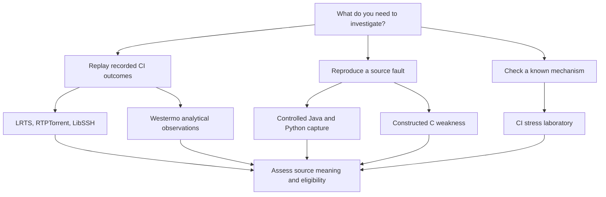

# Choose data for your question

COLEMAN offers several usable data paths. Start by choosing the question you want
the data to answer, then follow that source's workflow. An analytical conversion,
a native replay and an admitted scientific comparison have different requirements.

## Choose an evidence type

| Your goal | Workflow | Preparation and scope |
| --- | --- | --- |
| Start with original CI reports | [LRTS Karaf](lrts-parquet-etl.md) | A bounded eight-build method-level preset, download/cache/Parquet/replay in one command |
| Preserve larger histories and stages | [LRTS ActiveMQ and Log4j views](lrts-stage-views.md) | Acquire the declared archives; retain original nodes/stages and shared groups |
| Study class-level test histories | [RTPTorrent HikariCP](rtptorrent-parquet-etl.md) | Approximately 5 GB original ZIP64 container; full analytical history and a bounded replay preset |
| Study software variants | [LibSSH WTS/VTS](hcs-parquet-etl.md) | Original execution CSV and job JSON; explicit union/variant projections and sparse cells |
| Check original process outcomes | [LibSSH CTest evidence](hcs-trace-evidence.md) | Separately pinned original logs or licensed archive; typed states and exact correspondence |
| Inspect embedded-system outcomes | [Westermo](westermo-parquet-etl.md) | Original ZIP to analytical Parquet; invalid/unmappable outcomes remain distinct |
| Reproduce real Java fixes | [Java fault matrix](java-fault-matrix.md), [single JUnit pair](junit-source-capture.md) | Declared pinned source/runtime and native arm64 Docker profile; controlled source observations |
| Reproduce a Python fix | [Python source capture](python-source-capture.md) | Pinned source, dependencies and locale profiles; controlled process evidence |
| Investigate a constructed C weakness | [C source capture](c-seeded-source-capture.md) | Pinned GCC profile and arithmetic oracle; one constructed template |
| Stress drift, churn or late feedback | [CI stress laboratory](ci-stress-laboratory.md) | Owned deterministic cases with known truth; no external source download |
| Inspect bundled examples | [Native profiles](benchmark-corpus.md) | Druid, Retrofit and Dune inputs in the checkout; descriptive source inventory |

The source guides specify exact byte pins, resource limits, acquisition commands,
component terms and recovery behavior. Review those requirements before downloading
or running an external source. Optional capture runtimes are not required for the
native [first-run tutorial](getting-started.md).

## Follow the data path

1. **Acquire permitted source bytes.** [Materialization](corpus-materialization.md)
   keeps downloads bounded, cacheable and digest-verified. Large archives use
   [selected ZIP64 verification](zip64-source-selection.md).
2. **Retain original meaning.** The [RTPTorrent](rtptorrent.md) and [LRTS](lrts.md)
   source assessments explain granularity, statuses, grouping and missing evidence.
3. **Project explicitly.** Analytical records retain source details; the
   [native input format](input-data.md) contains the narrower replay contract.
4. **Assess what the source supports.** [Source admission](corpus-admission.md)
   connects provenance, units, temporal availability and production-reality facts.
5. **Evaluate at the appropriate scope.** Use the [evaluation guide](evaluation-guide.md)
   to distinguish mechanism checks, controlled observations and historical evidence.

## What the current sources do not establish

The runnable historical workflows retain unverified source availability,
pre-execution test membership or other admission prerequisites. Controlled
captures establish observations under their frozen conditions. Synthetic cases
establish mechanism behavior. None supplies a universal performance claim.

The historical cross-corpus confirmation remains unfinished. Its tracking phase
was [closed with explicit unmet criteria](roadmap.md#historical-corpus-status),
rather than declared complete. The [research guide](research.md#datasets-and-source-studies)
links the source papers; their empirical findings and this platform's later
qualification claims should be read separately.

## Bring another source

Start with the [native input contract](input-data.md) for a local replay. For a
source adapter, follow the [add-source qualification path](corpus-admission.md):
pin original components and terms, retain raw meaning and exclusions, validate
independently, then regenerate the descriptive card. Reuse the source cache,
artifacts and runner. An adapter's successful conversion does not grant admission.
