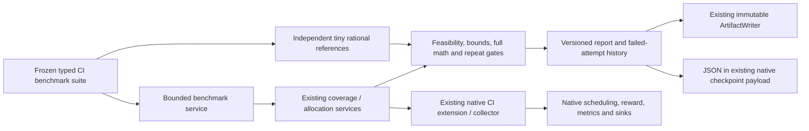

# Independent CI decision benchmarks

Check a CI decision extension's mathematics before interpreting runtime or test
prioritization benefit. COLEMAN's benchmark profiles compare the native finite
coverage and scenario-allocation services with small independent exhaustive
references, retain complete mathematical artifacts, and measure the cost of each
service invocation.

These are **synthetic finite-model checks**, not evidence that an adaptive policy
generalizes to real CI projects. Repeated seeds do not become independent CI
observations. Use the [protected evaluation](protected-evaluation.md) contracts
for eligible empirical comparisons and keep their observation/group assumptions
separate from these microbenchmarks.

## Run from an installed package

Build a wheel from a checkout containing this module, then execute outside the
source root with only the base installation:

```sh
COLEMAN_BENCH_WORKSPACE="$(mktemp -d)"
uv build --out-dir "$COLEMAN_BENCH_WORKSPACE/dist"
uv venv "$COLEMAN_BENCH_WORKSPACE/venv" --python 3.14
uv pip install --python "$COLEMAN_BENCH_WORKSPACE/venv/bin/python" \
  "$COLEMAN_BENCH_WORKSPACE/dist"/coleman-*.whl
mkdir "$COLEMAN_BENCH_WORKSPACE/work"
cd "$COLEMAN_BENCH_WORKSPACE/work"
"$COLEMAN_BENCH_WORKSPACE/venv/bin/python" -m coleman.benchmarks \
  --profile correctness --output artifacts
```

The command prints JSON with `status`, `reproducibility`, mathematical identity,
observation/failure counts and the exact artifact path. A successful correctness
profile contains 18 invocations. JSON and Markdown reports appear in
`artifacts/benchmark-reports/`. Neither a model, MCP client, credentials nor a
network service is used during execution; installing packages is a separate step.

Output stays within the chosen current workspace. Profiles are known package
resources, not arbitrary plugin names, paths or provider URLs. Exit codes are
0 for a complete checked protocol, 1 for a failed/interrupted attempt with a
report, and 2 for invalid input or publication failure.

## Complete library workflow

```python
from pathlib import Path

from coleman.artifacts import ArtifactWriter
from coleman.benchmarks import (
    BenchmarkExecution,
    BenchmarkReport,
    collect_environment,
    load_suite,
    publish_benchmark_report,
    run_benchmarks,
)

suite = load_suite("correctness")
# Unknown source metadata remains null. When known, supply the actual 40-character
# source commit and whether the code used to build the package had local changes.
environment = collect_environment(source_commit=None, source_dirty=None)
report = run_benchmarks(suite, execution=BenchmarkExecution(environment=environment))
assert report.status == "complete"
assert report.reproducibility == "verified_repeated_labels"

weighted = report.observations[0]
assert weighted.summary.selected_ids == ("A", "C")
assert weighted.summary.objective == 1
assert weighted.summary.absolute_regret == 0
print(weighted.work_used, weighted.work_unit)
print(weighted.elapsed_ns, weighted.python_peak_bytes)

path = publish_benchmark_report(report, ArtifactWriter(Path.cwd() / "artifacts"))
restored = BenchmarkReport.from_json(path.read_bytes())
assert restored.mathematical_identity == report.mathematical_identity
assert restored.to_json() == report.to_json()
print(restored.markdown())
```

Every observation retains canonical native result JSON, including the complete
problem, units, selected IDs, costs/payoffs, constraints, proof/counter fields,
solver status and bounds. Readers recompute independent references and native
proof/forecast checks. They do not invoke a production selector, but their bounded
reference enumeration and replay overhead are real; reading is more than parsing
an unchecked summary.
Every case's declared reference is checked, including cases with no observation
in interrupted or failed reports.

## Frozen manifests and independent answers

The installed `coleman/benchmarks/cases/` resources are self-contained version-1
manifests. A `BenchmarkSuite` declares its cases, methods, work limits and ordered
seed occurrences. `CoverageCase` and `AllocationCase` embed the actual native
problem contracts and an explicit `ReferenceAnswer` with unit/meaning metadata.
Unknown fields are rejected. Inputs and expected values are validated before a
new solver starts.

The concrete `weighted-overlap-3` case contains:

| Candidate | Modeled duration, seconds | Capabilities |
| --- | --- | --- |
| A | 2 | x, y |
| B | 2 | y, z |
| C | 1 | z |

Weights are x = 0.5, y = 0.3 and z = 0.2; the budget is 3 seconds. The independent
answer is A,C, cost 3 and union objective 1. Coverage weights are capability
weights, not calibrated failure probabilities. Overlapping outcomes count once.
A duplicate membership/outcome identity is rejected; overlapping coverage across
candidates cannot inflate utility.

The correctness profile also declares:

- signed joint payoffs `[0,0]`, `[2,2]`, `[10,-8]` with equal weights: expected
  payoffs 0, 2, 1 and variances 0, 0, 81;
- all-negative alternatives where unchanged allocation is optimal;
- quadratic target utility evaluated on the distribution: the variable plan's
  mean 3 becomes utility 1.2, so the stable plan's utility 2 wins;
- a deliberately work-limited allocation with a feasible no-action incumbent,
  objective 0 and independent regret 2, without a false optimality claim.

The reference code uses `Fraction` arithmetic and combinations. It consumes
validated input contracts, never production search, objective, forecast or
feasibility helpers. Allocation variance uses direct weighted deviations, separate
from the production second-moment formula. Complete signed outcomes, terminal
balances, gross/net/fee accounting, variance, target shortfall and utility are
checked rather than only an argmax or rounded objective.

All primary comparisons have **zero rational tolerance** (`numeric_tolerance:
"0"`). Finite decimal inputs become exact rational quantities; JSON uses rational
strings. Expected numbers reject binary64/boolean coercion and non-finite values.
No display projection or rounded float establishes a passing mathematical gate.

### Evidence and method classes

| Field | Meaning |
| --- | --- |
| `method_class=exact_search` | Finite enumeration/search that can establish an optimum when its completion conditions hold |
| `method_class=heuristic` | A heuristic procedure; reaching the oracle on one case does not make its method exact |
| `evidence=exact` | A checked full-scope optimum or independently confirmed infeasibility |
| `evidence=bounded` | A feasible result with a checked maximizing upper bound dominating the independent optimum |
| `evidence=heuristic` | A feasible partial result without an admitted optimality bound |
| `evidence=unavailable` | No incumbent; objective/regret remain null rather than fabricated zeros |
| `sampled` | A distinct classification, never silently upgraded to exact; current supported finite adapters produce no sampled claims |

Coverage still requires its native certificate for an optimal claim. A case may
require a declared exact method to complete, in which case an incomplete result
fails that protocol even if its incumbent is valid. Performance cases can permit
bounded completion. Benchmark `status=complete` means every declared invocation
ran and passed its applicable gates; inspect each native solver status/evidence.

Scenario probabilities in these mathematical profiles must be **assumed**. Learned
weights require protected evidence and retain the conservative decision behavior
of the [allocation API](scenario-payoffs.md); they are not converted into an
assumed-model optimum for a benchmark table. No learning reward, ranking,
calibration or inferential confidence claim is created.

## Repetition and metamorphic checks

The profiles declare labels `[11,11,29]`. Current finite solvers use no RNG: labels
identify protocol occurrences, not data observations. The two label-11 runs must
match their **entire canonical mathematical artifacts**, including IDs, proofs,
bounds, forecasts, work counters and statuses. Equal rounded objectives are
insufficient. No repeated label means `reproducibility=untested`, even if distinct
labels happen to return the same objective.

`mathematical_identity` hashes the frozen suite and ordered native mathematical
artifacts. Timing, environment, availability and failed-attempt metadata are
excluded. The complete report's content fingerprint includes them. Re-running a
measurement may produce a new report identity while preserving its mathematical
identity; publishing the same complete report object is idempotent.

CI tests include input-order invariance, unique-optimum candidate relabeling,
budget monotonicity and duplicate coverage. A joint payoff/target shift preserves
variance and shortfall while translating expected utility. Those properties are
applied under their stated assumptions; arbitrary renaming of tied optima or
changing a payoff without its relevant risk target is not claimed invariant.
Deliberately faulty solvers prove that invalid bounds, budget overruns, false
optimal status and order-dependent streams fail the gates.

## Timing, memory and compute budgets

`elapsed_ns` measures elapsed `perf_counter_ns` time around the native service,
including its own validation/result construction. Import/setup, independent
reference checks and report serialization are excluded. `python_peak_bytes` is the
process-wide `tracemalloc` peak during that call, not RSS, total native allocation
or an isolated per-thread measurement. Unrelated background allocations can affect
it. Overlapping benchmark instrumentation is rejected; pre-existing tracing is
never reset or stopped by this API.

`work_used` retains its explicit `work_unit`:

- coverage: candidate examination or branch-node pop, sharing the native counter;
- allocation: attempted whole-action evaluation.

Equal counters are not equal CPU budgets across algorithms. Each case fixes its
native limits, methods and problem before comparison. Correctness protocols require
`deadline_seconds=None` and use deterministic work limits so machine speed cannot
change a mathematical assertion. Runtime and memory are reported observations,
not universal performance thresholds or evidence of algorithm superiority.
Deadline termination is rejected in native adapter results, serialized mathematical
observations and interrupted-attempt histories: it contradicts this deadline-free
protocol, even when a case permits a bounded or heuristic outcome.
A `work_limit` stop must have consumed its declared work cap; stopping below that
cap cannot be reported as exhausted computation.
Completed-observation gates also reject native `cancelled` and `interrupted`
artifacts. Live execution retains them as aborted attempts; replay cannot promote
them into successful observations, even for cases permitting nonexact completion.

Local `adapter=` callables execute as trusted Python code. Bundled execution makes
fresh native service calls. Artifact gates verify supplied mathematics and budget
consistency; measurement authenticity and disclosure of external precomputation
remain responsibilities of custom adapter authors.

The `performance` profile adds a 12-candidate overlap instance under a shared
500-work-unit cap and a 32-action/64-joint-state allocation. Run it explicitly:

```sh
python -m coleman.benchmarks --profile performance --output artifacts
```

The `Decision performance observations` workflow runs on manual dispatch. Its
weekly schedule is disabled unless the repository variable
`ENABLE_DECISION_PERFORMANCE` is explicitly `true`. It builds a noneditable wheel,
runs outside the checkout root and preserves JSON/Markdown evidence, including
failed reports. Ordinary correctness CI has no wall-clock pass/fail threshold.
No calibrated hardware-specific regression threshold is supplied in this version.

### Committed observed comparison

The repository includes a [JSON observation](https://github.com/jacksonpradolima/coleman/blob/3f306af66e6b45984111c5498d78aadeb9c04098/examples/decision-benchmarks/observations/benchmark-reports/b8c35d14627d94f1c871203e5f9ea25083214dd2f611543f8c3c0dbca85c45a4.json)
and its [human report](https://github.com/jacksonpradolima/coleman/blob/3f306af66e6b45984111c5498d78aadeb9c04098/examples/decision-benchmarks/observations/benchmark-reports/b8c35d14627d94f1c871203e5f9ea25083214dd2f611543f8c3c0dbca85c45a4.md).
These are actual measurements from a noneditable base wheel built at
`38f94a9d65fe59605e3309a2c0ef2b45a38134e2`, running outside the checkout.
The self-contained suite fixes the weighted-overlap fixture, both coverage methods,
labels `[11,11,29]`, no deadline and a 100,000-unit per-attempt cap. Both methods
choose A,C with objective 1; greedy uses 6 counter units and branch search 13.
The report records individual nanoseconds and Python peak bytes, rather than an
aggregate winner or inferred confidence interval. Six calls on one synthetic
instance and one environment do not establish a general performance advantage.

To repeat the exact protocol, obtain that JSON artifact from the public repository
and run with the installed package from its containing workspace:

```python
from pathlib import Path
from coleman.artifacts import ArtifactWriter
from coleman.benchmarks import (
    BenchmarkExecution, BenchmarkReport, collect_environment,
    publish_benchmark_report, run_benchmarks,
)

source = next(Path(".").glob("b8c35d14627d94f1c871203e5f9ea25083214dd2f611543f8c3c0dbca85c45a4.json"))
previous = BenchmarkReport.from_json(source.read_bytes())
observed = run_benchmarks(
    previous.suite,
    execution=BenchmarkExecution(environment=collect_environment()),
)
assert observed.mathematical_identity == previous.mathematical_identity
publish_benchmark_report(observed, ArtifactWriter(Path("artifacts")))
```

Supply actual source metadata when known. Unknown metadata stays null; copying
the earlier environment onto a new execution would falsely attribute measurements.
The versioned golden test fixtures use explicitly synthetic metadata and zero
placeholder timings; they are serialization fixtures, separate from this measured
observation.

## Interruptions, failed attempts and checkpoints

```python
from coleman.benchmarks import (
    BenchmarkCheckpoint, BenchmarkExecution, collect_environment, load_suite,
    run_benchmarks,
)
from coleman.checkpoint import LocalCheckpointStore
from coleman.checkpoint.state import CheckpointPayload

suite = load_suite()
environment = collect_environment()
partial = run_benchmarks(
    suite, execution=BenchmarkExecution(environment=environment, max_new_invocations=1)
)
store = LocalCheckpointStore("checkpoints")
store.save(CheckpointPayload(
    run_id="ci-benchmark-example", step=1,
    extra={"benchmark_v1": partial.checkpoint().to_json()},
))
saved = store.load("ci-benchmark-example", 0)
if saved is None:
    raise RuntimeError("Expected a saved benchmark checkpoint")
checkpoint = BenchmarkCheckpoint.from_json(saved.extra["benchmark_v1"])
resumed = run_benchmarks(
    suite, checkpoint=checkpoint, execution=BenchmarkExecution(environment=environment)
)
assert resumed.status == "complete"
assert resumed.observations[0] == partial.observations[0]
```

Store JSON in the existing native checkpoint payload; no second checkpoint system
is introduced. The local store uses trusted local pickle state. Complete cached
observations are reverified before new work, including zero-work resumes. Source,
protocol or environment changes reject the checkpoint. Cancellation is still
polled when every invocation is cached.

`BenchmarkRunError` retains a typed failed report and the original exception
cause. Interrupted and failed attempts are distinct from successful mathematical
rows. `report.checkpoint()` carries prior failed/aborted attempts forward, so a
later successful resume cannot silently erase their timing, known work or unknown
costs. Instrumentation rejection records zero solver work and unavailable timing;
a solver exception may have unknown work rather than zero. Histories retain
only null work for solver/verification failures; readers reject invented counters
in both reports and checkpoints. Histories also retain
stable attempt indices and explicit aware availability timestamps. Unavailable
future history is rejected before new work. Any known interrupted-work counter
must fit its matched case's declared work budget, both in current reports and
in resumed histories, including zero-work resumes.
Solver, verification and interrupted failures require their measured runtime and
Python peak bytes on replay; only an instrumentation rejection can leave both
measurements unavailable.
Native `cancelled`/`interrupted` attempts retain a required integer work counter,
including known zero. Exception interruptions such as `KeyboardInterrupt` retain
null work because their interrupted call supplied no trustworthy counter.

An operator interrupt during post-solver verification also returns an interrupted
report: the verified prefix remains intact, and the interrupted attempt retains
its measured solver time and memory. The unverified row is not completed evidence.
Resuming its checkpoint retries that slot and preserves the prior attempt history.
Repeated interrupts while constructing or validating the interrupted report itself
can still abort the call; report publication remains an explicit caller action.

A chunk can be persisted after each complete invocation. Process death before that
checkpoint may require repeating an invocation; cached timings are never called
new independent samples. A native interrupted partial search is a recorded aborted
attempt and restarts with the frozen per-attempt budget. Failed/aborted overhead
remains visible and is not a free warm start. Unexpected cancellation-callback
errors propagate; they are not mathematical insufficiency results.

## Persistence, limits and compatibility

Reports use the existing immutable `ArtifactWriter`. Markdown is written first;
complete JSON is written last and is the publication authority. A Markdown-only
interruption is not a completed JSON report. Identical concurrent publication is
idempotent; conflicting bytes are rejected. Existing manifests add a
`benchmark_report` entry without changing native result or scheduling meanings.

Manifest caps are 16 cases, 16 seed occurrences and 128 declared invocations.
References allow at most 12 coverage candidates, 256 outcomes and 4,096 memberships,
or 32 allocation actions and 64 joint scenarios. Failed-attempt histories are
capped at 128; another retry is refused before solver work once exhausted.
Publication defaults to 32 MiB across JSON and Markdown, with a maximum configurable
limit of 64 MiB. Verification/serialization have bounded but repeated overhead;
these caps are not a hard process-isolation or RSS guarantee.

Schema version 1 is required. Missing, future and unknown versions fail closed,
as do duplicate JSON keys. This is the first benchmark format: there is no legacy
benchmark migration to guess. Existing native, domain, coverage, allocation and
protected-evaluation artifacts retain their versions and interpretation. Versioned
golden report/checkpoint fixtures preserve exact identities and producer metadata.

## Real native TCPCI integration

The existing `examples/finite-coverage/ci.py` now independently benchmarks its real
coverage decision before scheduling the second synthetic CI build. It retains
native agents, first-build shuffle, reward, metrics, sinks and extension callbacks.
The actual scheduled prefix must be A,C before the collector publishes the
coverage and benchmark artifacts. The adapter remains specific to this fully
budget-consuming fixture; it does not implement arbitrary subset scheduling.

Run that script with the installed package as documented in
[finite coverage selection](finite-coverage.md). The installed-wheel test runs it
twice outside the checkout, without mocking the principal runner or solver, and
checks both actual schedules and repeated mathematical artifacts. Modeled coverage
objectives stay separate from measured NAPFD/APFDc and learning rewards. A positive,
negative or inconclusive model result is not a policy promotion.


