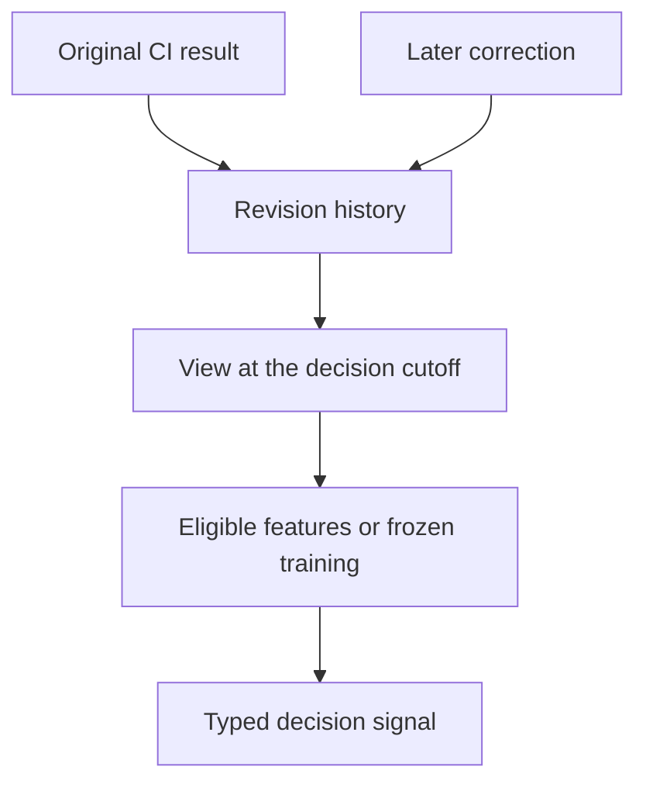

# Why CI histories retain late results and corrections

A policy should rank tests using information that was available when the decision
was made. CI systems often publish results late, correct a duration or attach a
final outcome after an earlier report. If an experiment simply reads the latest
row, it can give a past decision information from the future.

COLEMAN retains the revisions and their availability so that you can reconstruct
the decision's actual input. This matters when preparing contextual features,
replaying a history and auditing an experiment after its source has changed.

## A correction must not rewrite an earlier decision

Suppose a test ran at 10:00 UTC. The source first reports a duration of three
seconds, then corrects it to nine seconds five minutes later:

| Event | UTC time | What the local experiment can use |
| --- | --- | --- |
| Test execution occurs | 10:00:00 | No duration observation has arrived |
| Source publishes the first duration | 10:00:02 | Three seconds is public, but not yet received locally |
| Local collector receives it | 10:00:04 | Three seconds becomes eligible |
| Policy makes a decision | 10:00:05 | The eligible duration is three seconds |
| Corrected duration is received | 10:05:01 | Nine seconds becomes eligible for later decisions |

A query at 10:00:03 still has no locally available duration. Repeating the
10:00:05 query after the correction must still return three seconds. A query
after 10:05:01 can use nine seconds. Event time, source availability and first
local receipt answer different questions; none substitutes for the others.

This example assumes comparable UTC clocks. A provider with contradictory clock
information must resolve its source contract before producing an eligible history.
COLEMAN does not invent an offset to make a record appear available earlier.

## How the data reaches a decision

Each logical observation has an immutable revision lineage. A correction names
its predecessor, retains the source identity and units, and records when it became
available. Repeated delivery preserves the first receipt. Out-of-order delivery
can be accepted when the complete lineage is supplied; missing predecessors,
forks and conflicting duplicates are rejected.

The selected view identifies only the revisions eligible at its cutoff. A
whole-history digest can change when later evidence is appended while the earlier
selected view remains stable. Retain both identities when you need to explain
which source was stored and which information a particular decision actually used.

## What this changes in an experiment

- **Contextual features:** the current execution's eventual verdict or duration
  cannot become a pre-decision input merely because it exists in today's export.
- **Training:** eligible history is selected at the training boundary and model
  evidence is frozen before use. A later correction does not silently refit it.
- **Freshness:** a newly delivered correction does not make an old execution
  recent. The declared age rule uses the source event time.
- **Missing information:** no eligible observation remains explicitly missing;
  it does not become a duration or score of zero.
- **Interpretation:** a duration estimate, priority score, calibrated probability
  and statistical comparison have different meanings. Signals retain the declared
  unit, meaning, producer and input/model identities.

The supplied quantity-mean helper is a transparent baseline for nonnegative
physical quantities. It retains its eligible inputs and rounding rule. More
elaborate forecasting can use the same observation boundary, but needs its own
assumptions and evaluation.

## Connect your CI source

A source adapter supplies stable observation and execution-group identities,
original units, source availability, first receipts and complete bounded lineages.
The core validates and queries these records offline. Provider authentication,
network collection and source-specific clock normalization belong to the adapter.

The native runner, result sinks, artifact writer and checkpoints remain the
execution path. An extension can publish typed signals and their provenance
beside native results before checkpoint advancement. The installed example uses
owned synthetic CI data to demonstrate that integration.

An eligible historical view establishes which supplied data a decision could
use. Independent project/grouping evidence, source completeness and the protected
evaluation protocol still determine which scientific conclusions are justified.

## Read the implementation as a user

[Point-in-time observations](../point-in-time-observations.md) provides the complete
installed example, exact fields, rounding, revision limits and recovery behavior.
[Contextual policies](../policies.md#contextual-policies) explains feature use;
[protected evaluation](../protected-evaluation.md) explains temporal splits,
group boundaries and frozen comparisons.

For the research motivation, see Kaufman, Rosset, Perlich and Stitelman,
[*Leakage in data mining*](https://doi.org/10.1145/2382577.2382579),
ACM Transactions on Knowledge Discovery from Data 6(4), 2012. Their analysis
explains why information unavailable at prediction time can compromise an
experiment. The [research guide](../research.md) connects this problem to CI
prioritization and evaluation.
