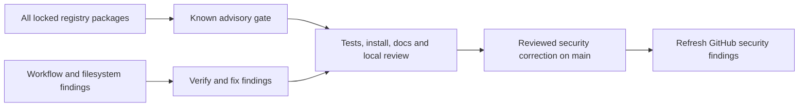

# Dependency security maintenance

COLEMAN audits the complete committed `uv.lock`, including development,
documentation, notebook, release, telemetry, ClickHouse and MCP extras, plus packages
that only install on another operating system. The base installation remains
independent of optional tools.

The lock file pins distribution versions and hashes. An advisory audit answers
whether those versions have **known reported vulnerabilities** at the time of the
query. A clean result does not prove that software has no undisclosed defects or
that every possible deployment is secure.

## Reproduce the audit

From a checkout with Python 3.14 and uv:

```sh
python scripts/audit_lock.py > /tmp/coleman-audit-requirements.txt
uv sync --frozen --only-group security --no-build --no-install-project
uv run --frozen --no-sync pip-audit \
  --strict --no-deps --disable-pip \
  --requirement /tmp/coleman-audit-requirements.txt \
  --format json --output /tmp/coleman-audit.json
```

The generated pins are **advisory lookup input**, not installation requirements.
The script reads every registry entry rather than filtering for the current
platform. It skips only COLEMAN's root editable entry; an unknown package source
fails with an actionable error instead of escaping the audit. No project
dependency is installed or executed by this lookup. Install from the hashed
`uv.lock` with `uv sync --frozen` as usual.

The `Locked dependency security audit` GitHub workflow runs on dependency PRs,
main dependency updates, weekly and on manual dispatch. It retains the queried
pins and JSON results as workflow artifacts. Known vulnerabilities, advisory
collection failures and unsupported sources fail the job; there is no blanket
ignore list. Advisory services require network access. Unit tests cover the
inventory and fail-closed source handling offline.

## Updating dependencies

1. Inspect open Dependabot PRs and alerts, including aliases and affected version
   ranges. Counts from different advisory services may differ or contain aliases.
2. Update vulnerable transitive packages in the lock. If a direct pin prevents a
   patched transitive version, update the direct package after checking its
   compatibility and release notes.
3. Re-run the complete audit, native CI tests, installed-package examples, strict
   documentation and the repository quality gates. Notebook/documentation/server
   extras need checks too; they are not exempt because the base API is offline.
4. Merge reviewed corrections before closing superseded bump PRs. Confirm GitHub's
   alert state after its dependency graph refreshes. Explain any actual blocker;
   do not dismiss an alert merely to reduce a counter.

## October 2026 maintenance baseline

The pre-update GitHub inventory contained 106 open Dependabot alerts: 2 critical,
58 high, 42 medium and 4 low, all attached to `uv.lock`. The initial pip-audit
export reported 166 vulnerability occurrences in 17 packages; aliases and
platform/extra representations mean this is not a second count of unique GitHub
alerts.

The update refreshes affected registry packages, including GitPython, Pillow,
Starlette, AnyIO, Authlib, Bleach, Cryptography, IDNA, Mistune, MkDocs Material,
nbconvert, PyMdown Extensions, SoupSieve, Tornado, urllib3 and virtualenv. Zensical
and Marimo direct pins also advance so their supported transitive dependency
ranges admit patched versions. Native numerical dependencies are not upgraded
without a compatibility or security reason.

The all-platform lock audit is the authoritative reproducible check for this
maintenance change; its output is attached to the PR and retained in CI. Future
advisories may change the result and require another update.

## Workflow and documentation boundaries

The same review inventories code-scanning findings separately from dependency
advisories. The October baseline additionally contained 33 SonarCloud alerts,
mostly about installation in GitHub workflows, plus a documentation path warning.

CI pins the setup action and uv version, verifies the Linux archive checksum,
installs registry dependencies from the frozen lock with source builds disabled,
and installs the reviewed local project with the locked build backend. This
explicit local editable build is separate from third-party source distribution
builds; it retains normal development imports. Release/build/audit tools are also
locked. CI checks run without silently synchronizing another dependency set.

Linux CI and DevContainers have a wheel-only installation path. On macOS, the
existing Watchdog 6.0.0 documentation dependency has no wheel: local full-extra
setup may need its hash-pinned source build. The Linux preflight must not be
presented as proof of wheel availability on every platform.

The documentation generator refuses symlink sources and output, checks resolved
source containment, reads the checked path, and atomically replaces complete
output. Tests demonstrate that outside files remain untouched and interruption
preserves the previous complete file. This protects normal repository generation;
it is not an isolation boundary against an adversary concurrently rewriting the
filesystem with the process's own permissions.



## Release distribution inventory

With Syft 1.42.3 installed on PATH, the release SBOM catalogs the wheel's
distribution metadata, requires the expected COLEMAN version, and binds the root to the complete wheel's
SHA-256. The package identifier is bound explicitly to this GitHub repository;
inferred PyPI coordinates and guessed CPEs are removed because the PyPI name
belongs to another project. It does not claim that unbundled dependencies are
installed in the wheel.
The complete lock advisory audit above covers those version pins separately.

```sh
python scripts/release_sbom.py \
  --wheel dist/coleman-4.0.0-py3-none-any.whl \
  --version 4.0.0 --output dist/sbom.json
```

The helper reads only the fixed METADATA member; it does not extract archive paths
or execute package code. Empty/mismatched inventories fail before publication.
Host file metadata is excluded, so local extraction paths do not become public
components. Tool timestamps/serial numbers remain observations. Output replaces
atomically after validation; a failed tool or interrupted write retains prior bytes.
