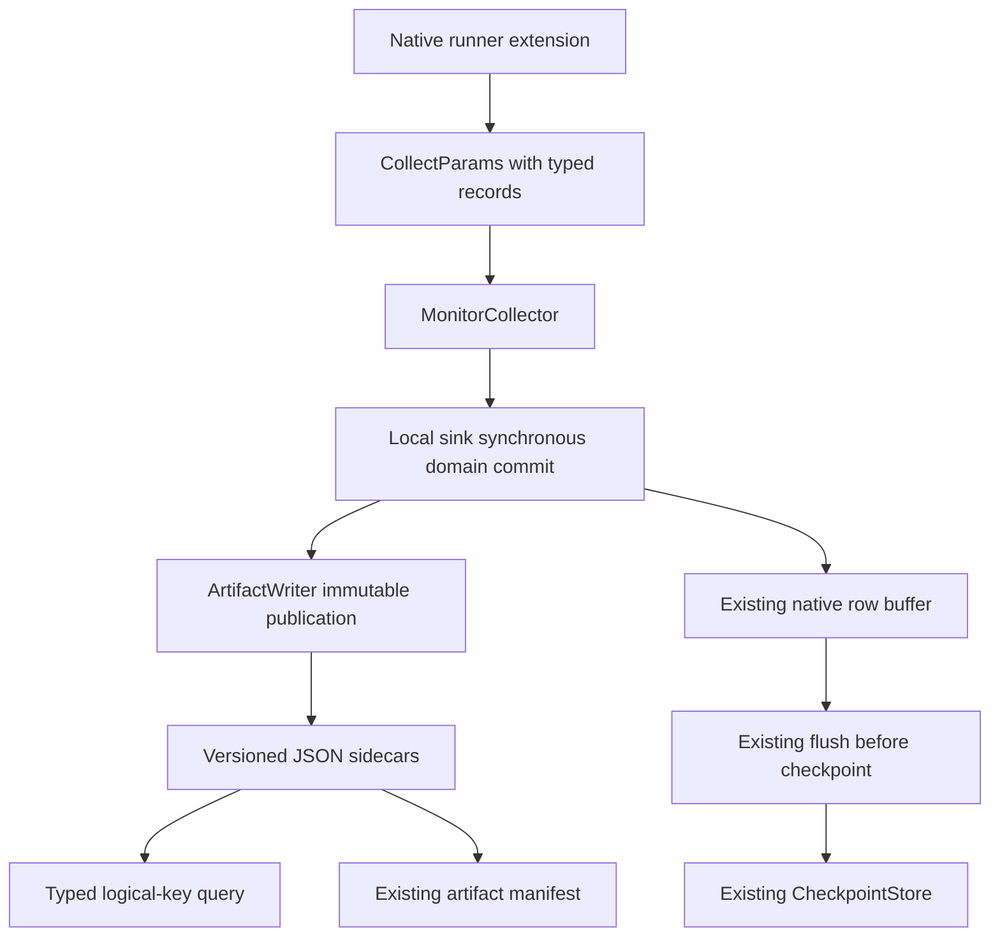

# Versioned result records for CI intelligence

COLEMAN keeps its existing TCPCI scheduling output, including NAPFD (`fitness`)
and APFDc (`cost`). Extensions can now add **typed, immutable domain records**
without changing those columns or interpreting a learning reward as an outcome.
A negative or inconclusive outcome remains a valid result. These records supply
metadata for future evaluation methods; they do not establish calibrated
probabilities, independent observations, statistical significance or promotion.

## Contract version 1

Import from `coleman.results.domain`. Constructors validate inputs; models are
frozen, measurements are tuples, and all unknown fields are rejected. Use the
validated constructors or `DomainRecord.from_json`, rather than Pydantic's
unchecked `model_construct`/`model_copy(update=...)` APIs. Local sinks revalidate
records at their persistence boundary.

| Field | Meaning and invariant |
|---|---|
| `schema_version` | Required integer `1`; booleans and strings are rejected. |
| `namespace` | Extension-owned identifier; `coleman` and `coleman.*` are reserved. |
| `run_id` | Logical run identity, normally the existing RunSpec run ID. |
| `execution_id` | Logical independent execution; stable across worker placement and retries. |
| `decision_id` | Logical observation bundle; distinguish build, policy, reward and variant. |
| `data_fingerprint` | `sha256:` plus 64 lowercase hexadecimal characters, over canonical input data. |
| `available_at` | Explicitly zoned outcome availability, normalized to UTC; never inferred from ingestion time. |
| `provenance` | Producer/version, resolved spec fingerprint and evaluation-context fingerprint; optional source revision. |
| `measurements` | Nonempty tuple of unique named `Measurement` objects, serialized as a sorted array. |
| `learning_reward` | Optional separate finite signal with output unit and versioned transformation ID. |

Names, units, meanings and producer identifiers are nonempty, case-sensitive
strings. Unit `s` means seconds in the examples; `1` denotes a dimensionless
scale. Custom unit identifiers are allowed. Producers must document their
interpretation through a versioned `meaning`, such as
`full-suite-serial-duration-v1`. There is no implicit unit registry, currency
conversion or metric inference. For a physically nonnegative quantity, declare
`minimum=0.0` in that same unit. Signed raw outcomes have no implicit lower bound.

Each measurement requires `name`, `value`, `unit`, `meaning`, `direction` and
`status`. Direction is `minimize`, `maximize` or `none`. The value field cannot be
omitted, even when it is null. NaN, infinities, numeric strings and booleans are
rejected, including in rewards and declared minima.

| Representation | Interpretation |
|---|---|
| `value=0.0, status="observed"` | A measured zero. |
| `value=-2.0, status="observed"` | A valid signed result, unless below a declared minimum. |
| `value=None, status="unknown"` | Outcome/cost is not known. |
| `value=None, status="unavailable"` | Measurement is unavailable under this protocol. |
| `value=None, status="not_applicable"` | This measurement does not apply. |
| Measurement name omitted from bundle | No declaration about that measurement; querying raises `KeyError`. |

Non-observed states require null; observed states require a finite number.
Optional fields omitted at construction remain absent in JSON; an explicitly
supplied optional null stays null. They therefore have different content digests.
Native column names such as `fitness`, `cost` and `rewards` cannot be measurement
names. Use distinct extension names such as `napfd` and `apfdc`, with their own
explicit meaning. Both outputs can coexist; the legacy table is never overwritten.

## Complete installed-package example

Install the package from the reviewed wheel (`pip install path/to/coleman.whl`).
The following can run from any directory. Its credits are synthetic CI runner
accounting units, with no claim of operational savings.

```python
from datetime import UTC, datetime

from coleman.results.domain import (
    DomainRecord, LearningReward, Measurement, ResultProvenance, fingerprint,
)
from coleman.results.duckdb_sink import DuckDBSink

inputs = {"runner_slots": 2, "jobs": ["unit-tests", "integration-tests"]}
record = DomainRecord(
    schema_version=1,
    namespace="ci.runner_allocation",
    run_id="run-example",
    execution_id="execution-1",
    decision_id="decision-7",
    data_fingerprint=fingerprint(inputs),
    available_at=datetime(2026, 1, 2, 12, tzinfo=UTC),
    provenance=ResultProvenance(
        producer="synthetic-ci-allocation", producer_version="1",
        spec_fingerprint=fingerprint({"allocation": inputs}),
        evaluation_fingerprint=fingerprint({"protocol": "synthetic-runner-credit-v1"}),
    ),
    measurements=(
        Measurement(name="duration", value=3.0, unit="s", direction="minimize",
                    meaning="serial-job-duration-v1", status="observed", minimum=0.0),
        Measurement(name="net_value", value=-2.0, unit="credit", direction="maximize",
                    meaning="synthetic-net-runner-credit-v1", status="observed"),
        Measurement(name="unknown_cost", value=None, unit="credit", direction="minimize",
                    meaning="synthetic-runner-cost-v1", status="unknown"),
    ),
    learning_reward=LearningReward(value=0.25, unit="1", transform_id="bounded-v1"),
)
sink = DuckDBSink(out_dir="./ci-results")
try:
    sink.write_domain_record(record)
    sink.flush()
    restored = sink.read_domain_record(
        "run-example", "execution-1", "decision-7", namespace="ci.runner_allocation",
    )
    assert restored == record
    assert restored.measurement("net_value").value == -2.0
    sink.write_domain_record(record)  # identical replay does not duplicate
    assert len(list(sink.domain_records())) == 1
    print(record.to_json())
finally:
    sink.close()
```

Two standalone examples are maintained and tested against a non-editable wheel:

- [Native TCPCI example](https://github.com/jacksonpradolima/coleman/blob/main/examples/domain-results/tcpci.py)
  generates a tiny synthetic test dataset, uses `run_with_extension`, the native
  environment, Greedy policy, RNFail reward and NAPFD/APFDc evaluation, then
  queries observations and verifies their fingerprint against `spec.resolved.json`.
- [Runner-slot accounting example](https://github.com/jacksonpradolima/coleman/blob/main/examples/domain-results/allocation.py)
  persists the signed/null acceptance fixture through DuckDB and queries it.
  This accounts for a declared allocation; it does not implement a solver.

Copy the scripts into a directory outside the repository and execute:

```bash
python tcpci.py ./tcpci-output
python tcpci.py ./tcpci-parallel-output 2 2  # two logical executions, two workers
python allocation.py ./allocation-output
```

The TCPCI example declares outcome availability from its synthetic build calendar,
not execution time. It reconstructs logical execution identity from scenario,
budget and experiment, and decision identity from build, policy, reward and
variant. Those same native fields provide the join back to scheduling rows;
the physical worker's random execution UUID is not a retry identity. Its
fingerprinted evaluation context includes the budget. Different independent
executions must have different logical execution IDs even with the same seed.

## Integration, commits and recovery

`ParquetSink` and `DuckDBSink` expose the same typed `write_domain_record`,
`read_domain_record` and `domain_records` APIs. Records are additive JSON sidecars
under `<out_dir>/domain-records/<identity-sha256>.json`, shared across native shards.
This deliberately avoids altering Parquet/DuckDB native schemas. Query by logical
key or iterate records and inspect named measurements. Domain sidecars are not
part of the existing native SQL `results` view. ClickHouse, NullSink and existing
third-party sinks raise `NotImplementedError` for unsupported domain operations;
their legacy row interface remains compatible. DuckDB `base_name` must be a single
nonempty filename without directory or drive components; invalid names raise
`ValueError` before filesystem side effects. Unicode basenames remain supported.



Attach a tuple to `CollectParams.domain_records`, or call
`monitor.collect_domain_record(record)` from an extension before the checkpoint
advances. `ResultsWriter.write_domain_record` is also synchronous: it propagates
errors directly instead of leaving failures in a background thread. Its native
queue still needs `stop()` to drain. Domain commits do not increment the native
row counter. A bundle with several records is not a multi-record transaction.

The logical key is `(namespace, run_id, execution_id, decision_id)` and excludes
schema version. An identical canonical replay succeeds; any different content at
that key raises `ValueError`. A change to measurements or provenance requires an
explicit new decision/revision identity; schema changes cannot bypass conflicts.
Version 1 records are immutable rather than updated in place.

The writer fsyncs a unique temporary file, atomically hard-links it to the final
name without overwriting, then fsyncs the containing directory. Threads and
processes compete on the same publication operation. Readers and manifests ignore
`.tmp` files, including leftovers after process termination. A crash before
publication exposes no complete record; a crash after publication recovers through
identical replay. A successful synchronous write precedes checkpoint publication.
A resumed execution can encounter records ahead of its checkpoint without creating
duplicates. Failures are propagated, and an uncertain post-publication I/O failure
must be retried. This requires local hard-link/directory-fsync support; unsupported
filesystems raise `OSError`. Full power-loss durability of newly created parent
directories, network filesystems and object stores is outside this contract.

Domain records and native rows are **not jointly atomic**. Legacy native rows
remain append-only and may repeat on a resumed execution; this feature guarantees
idempotence for domain records only. The existing checkpoint/runner is reused.
Exactly-once native output, RNG-state recovery and global snapshot isolation are
not added here. Iteration scans a filename snapshot and concurrent new records may
appear on the next scan. One JSON file per decision favors auditability over
large-scale analytical throughput; a future indexed backend can implement the same
contract without weakening conflict rules.

## Comparisons, fingerprints and evolution

`record.require_comparable(other, "duration")` validates namespace, schema,
unit, meaning, objective direction, declared lower bound, dataset fingerprint and
evaluation fingerprint, and requires observed values. Incompatibility raises
`ValueError`; an undeclared name raises `KeyError`. It performs no statistical
analysis. Different candidate specs may share an evaluation context; the producer
must fingerprint all relevant protocol definitions, grouping, data interpretation
and comparison semantics. Seeds alone do not supply independent evidence.

`fingerprint` accepts JSON values with string object keys. COLEMAN JSON v1 uses
sorted object keys, compact separators, UTF-8, finite numbers and significant
array order. Measurement declaration order is normalized by name; timestamps are
normalized to UTC. There is no rounding, automatic `str()` coercion, Unicode
normalization or promise of RFC 8785 cross-language canonicalization.
`identity_digest` hashes the logical key; `digest` hashes serialized content.
Native RunSpec run-ID derivation is unchanged. Fingerprint the actual public
resolved spec used for audit, not a private configuration or credentials. Producers
choose input observations explicitly; this API does not collect or redact secrets.

Readers dispatch strictly on `schema_version`; currently only integer 1 is
supported. Missing, older, future and unknown versions fail closed. Duplicate JSON
keys and unknown fields also fail. A legacy native file is read through its existing
Parquet/DuckDB APIs, unchanged; missing domain sidecars return `None`/empty iteration.
There is no automatic legacy-to-v1 migration because old data does not establish
units, availability, objective meaning or provenance. To annotate legacy output,
explicitly declare these from verified external metadata and write new sidecars
with an auditable producer/version, leaving the source artifact intact. If this
metadata is unavailable, keep the legacy result without inventing a v1 record.
A future schema must add an explicit reader and migration with versioned fixtures;
rewriting v1 files at the same logical key is never an implicit migration.

::: coleman.results.domain
