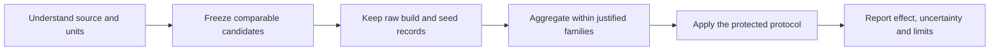

# Turn experiment output into evidence

A working replay answers whether an experiment can run. An evaluation asks what
its observations justify. Begin with the smallest claim you need and retain the
source assumptions, missing outcomes and costs that could change the answer.

## Follow the evidence path

| Question | Guide |
| --- | --- |
| What does this source actually support? | [Source admission and reality matrix](corpus-admission.md) |
| Did candidate methods receive the same conditions? | [Comparable baseline matrices](comparable-baselines.md) |
| Are the metric calculations correct? | [Independent metric references](corpus-evaluation.md), [decision benchmarks](decision-benchmarks.md) |
| How do builds, seeds and projects enter aggregation? | [Repeated CI observations](corpus-evaluation.md) |
| Was information available at decision time? | [Point-in-time observations](point-in-time-observations.md) |
| Is the comparison protected against tuning and leakage? | [Protected evaluation](protected-evaluation.md) |
| Does a bounded metric support conservative inference? | [Bounded paired means](bounded-paired-evaluation.md) |
| How do I inspect outputs and plots? | [Analysis playbook](analysis-playbook.md) |

## Read native results

| Native field | Interpretation | Important limit |
| --- | --- | --- |
| `fitness` | NAPFD prioritization quality | Depends on the declared test/failure universe and censoring semantics |
| `cost` | APFDc prioritization quality | Despite the legacy name, this is not elapsed seconds or money |
| `tests_ran`, `tests_not_ran` | Scheduled and unscheduled test counts | Unscheduled tests are not passes |
| `ttf`, `ttf_duration` | Native first-failure summaries | No observed failure needs an explicit censoring interpretation |
| `prioritization_time` | Time spent producing a ranking | This is algorithm overhead, not test-execution savings |
| Process CPU/memory and wall-time fields | Observations made by the runner | Measurement availability and process scope matter |

For definitions and independently checked edge cases, use
[corpus metrics](corpus-evaluation.md). New extension measurements belong in
[versioned result records](domain-results.md), with explicit units, meaning and
missingness. Do not reinterpret old native columns during a migration.

## Keep the inference unit honest

Several seeds on one build remain several algorithm runs on the same build.
Several builds from one repository remain related observations. Variants, jobs,
stages, retries and controlled contexts can share the same underlying evidence.

The repeated-observation contract retains raw cells, averages declared seed/build
repetitions within reviewed repository families, and exposes missingness. The
protected protocol checks its declared assumptions. It can return **insufficient
evidence**. A bound or statistical test cannot repair missing source eligibility
or manufacture independent projects.

The [bounded paired method](bounded-paired-evaluation.md) avoids a normal-difference
assumption for a predeclared bounded metric, while still requiring independent
paired inference units. The older normal paired method retains its own explicit
assumption. See the [research reading path](research.md#evaluation-and-interpretation).

## Separate kinds of evidence

- **Observed historical CI:** recorded source executions, with source-specific
  eligibility and temporal requirements.
- **Controlled real-fault observations:** buggy/fixed source under declared runtime
  conditions, including negative or inconclusive outcomes.
- **Constructed/seeded observations:** deliberately authored faults or histories.
- **Synthetic mechanisms:** known-answer cases that test mathematical or system behavior.

Report these separately. State practical-equivalence thresholds, uncertainty,
heterogeneity, failed/aborted runs and resource observations before promoting a
candidate. The [current evidence status](roadmap.md) records the unfinished
historical confirmation; it is not hidden by the administrative issue closure.

## Move toward an operational decision

Use the [operational pilot](operational-pilot.md) to inspect scheduling intent and
[resource replay](resource-replay.md) for explicit costs. Use
[shadow evaluation](prospective-shadow.md) to record recommendations while required
CI still runs. The [integration guide](integration-guide.md) connects these steps.
