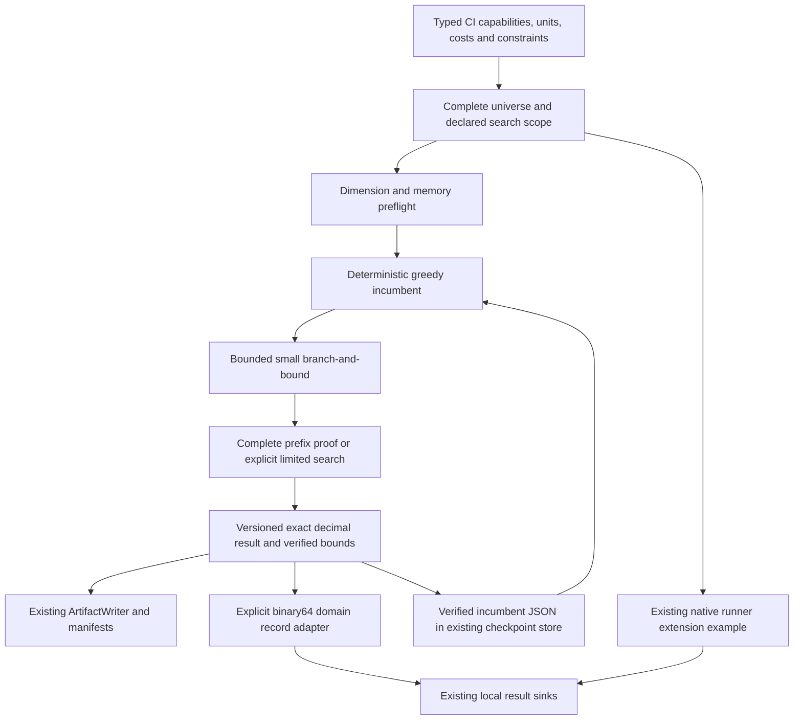

# Finite coverage selection for CI

COLEMAN can select a finite set of overlapping test capabilities under an explicit
budget. This library API is separate from bandit learning: it optimizes declared
nonnegative coverage weights, without inventing a learning reward, a calibrated
probability or evidence that a policy improves production CI.

Existing ratio, fixed-time and subset-size scheduling behavior is unchanged. The
API reuses [versioned domain results](domain-results.md), `ArtifactWriter`, local
sinks, manifests and the existing checkpoint store. It has no CLI/MCP dependency.

## Complete small CI example

```python
from decimal import Decimal

from coleman.results.domain import fingerprint
from coleman.selection import (
    CoverageCandidate, CoverageConstraints, CoverageOutcome, CoverageProblem,
    CoverageResult, Quantity, SearchLimits, UnitSemantics, solve_coverage,
)

duration = UnitSemantics(unit="s", meaning="modeled-serial-test-duration-v1")
capability = UnitSemantics(unit="1", meaning="weighted-test-capability-v1")

def amount(value, semantics):
    return Quantity(value=Decimal(value), semantics=semantics)

definitions = [
    {"id": "A", "duration": "2", "covers": ["x", "y"]},
    {"id": "B", "duration": "2", "covers": ["y", "z"]},
    {"id": "C", "duration": "1", "covers": ["z"]},
]
weights = {"x": "0.5", "y": "0.3", "z": "0.2"}
problem = CoverageProblem(
    schema_version=1,
    data_fingerprint=fingerprint({"candidates": definitions, "weights": weights}),
    objective_semantics=capability,
    candidates=tuple(
        CoverageCandidate(
            candidate_id=item["id"],
            cost=amount(item["duration"], duration),
            covers=tuple(item["covers"]),
        )
        for item in definitions
    ),
    outcomes=tuple(
        CoverageOutcome(outcome_id=name, weight=amount(weight, capability))
        for name, weight in weights.items()
    ),
    constraints=CoverageConstraints(budget=amount("3", duration)),
)
result = solve_coverage(
    problem, method="branch_bound_v1",
    limits=SearchLimits(deadline_seconds=None),
)
assert result.status == "optimal"
assert result.selected_ids == ("A", "C")
assert result.cost.value == Decimal("3")
assert result.objective.value == result.upper_bound.value == Decimal("1")
assert result.absolute_gap.value == Decimal("0")
assert CoverageResult.from_json(result.to_json()) == result
```

`x/y/z` denote synthetic test capabilities. A capability contributes its weight
once to the union, even when multiple tests cover it. With budget 2 the proven
selection is `("A",)`, objective 0.8. No external dataset/service is needed.

## Inputs, units and exact arithmetic

Every cost, budget and weight is a `Quantity(value, semantics)` with an explicit
unit and versioned meaning. Costs must match budget semantics exactly; weights
must match `objective_semantics`. Seconds/milliseconds or different meanings are
rejected, including for zero values. No implicit conversion is performed.

The objective is additive nonnegative union coverage. Negative costs/weights,
nonfinite numbers, null/unknown quantities, duplicate IDs/memberships, and unknown
candidate/outcome references fail validation. A missing cost requires an explicit
upstream modeling/exclusion decision; it never becomes a free test. An empty
universe/outcome set is valid. Budget zero permits genuinely zero-cost candidates.

Use `Decimal` or decimal strings at the input boundary. At most twelve fractional
places are accepted, with each input cost/weight/budget at most `10^12`. Computation
uses integral `10^-12` ticks, exact sums and rational density comparisons,
independently of the process Decimal precision. **Decision tolerance is zero.**
A floating expression already containing rounding error can therefore fail the
precision check; it is never silently rounded into a feasible budget.

JSON quantities use canonical decimal strings (`"0"`, `"0.3"`), preserving finite
values and normalized equivalent spellings. Signed zero normalizes before hashing
and binary64 projection. Aggregate quantities allow up to
`10^24` and 37 decimal digits; accepted problem dimensions keep actual aggregate
weights below that ceiling. Cost/coverage declarations are modeled inputs, not
automatically measured performance, unique faults or calibrated probabilities.

`CoverageConstraints` adds `required_ids` and optional `maximum_selected` to the
inclusive budget. Mandatory costs/cardinality exceeding their ceiling prove
infeasibility. Cardinality zero permits the empty selection when nothing is
mandatory. No arbitrary nonlinear/group constraint is implied by this v1 API.

## Full and restricted scope

`CoverageProblem.candidates` is the complete declared universe. `search_ids=None`
resolves canonically to every candidate; an explicit subset produces a restricted
scope. Candidate/outcome/membership/constraint ordering does not change identity.
The full problem and normalized search IDs determine `scope_fingerprint`.

An optimum in a restricted scope makes no optimality claim about excluded
candidates. A mandatory candidate excluded from search makes that **scope**
infeasible, even when the full universe could work. Input fingerprints and scope
proofs cannot certify completeness of an undisclosed external universe. Producers
must retain the full source definitions, availability and selection/exclusion rules.

## Solvers and verifiable certificates

`greedy_density_v1` repeatedly selects positive marginal coverage per unit cost,
prioritizing free positive coverage. Exact density ties use ascending candidate
IDs; zero-gain optional candidates are omitted. A resumed feasible hint is never
worsened. This implementation declares **no approximation guarantee** under its
budget/cardinality/mandatory constraints and never labels greedy completion optimal.

`branch_bound_v1` shares the same overall work budget with its greedy warm start,
then explores binary include/exclude prefixes in sorted optional-ID order.
Nonnegative union coverage bounds the remaining objective. Equal bounds are not
pruned, preserving the globally smallest selected-ID tuple among equal objectives;
cost is a constraint, not an undeclared tie-break objective.

A completed search retains a bounded prefix certificate. Each prefix represents a
subtree: `0` excludes an optional candidate and `1` includes it. On reading a result,
the independent verifier checks that prefix intervals are disjoint and cover the
entire binary search cube, then verifies that each subtree is infeasible, strictly
dominated by a union bound, or a complete assignment no better under the objective
and lexicographic tie rule. It does not run the optimizer or the test-only
combinations oracle. A missing, overlapping, incomplete or unjustified certificate
cannot establish optimality.

Version 1 exact verification is deliberately small: at most **20 scoped candidates,
256 touched outcomes, 4096 scoped memberships and 1024 certificate prefixes**.
These caps cannot be increased by a request. If a complete proof cannot be retained,
the feasible incumbent remains visible with `certificate_limit`, not `optimal`.
The independent exhaustive test oracle is capped at ten candidates and is not
imported by production code. No local-improvement algorithm or unmeasured
performance superiority is claimed.

## Results and stopping behavior

`CoverageResult` embeds the complete problem, method/version, limits, preflight
counts/estimated bytes, scope/fingerprint, selected IDs, exact cost/objective,
feasibility, status, termination reason, work used, upper bound, absolute gap and
optional completed proof. Reading/serialization revalidates quantities and evidence.

| Status | Meaning | Selection and bound |
| --- | --- | --- |
| `optimal` | Complete verified scoped proof | Feasible selection; bound=objective; gap=0 |
| `feasible` | Greedy completed or search stopped with an incumbent | Feasible selection; entire scoped coverage union bounds the objective |
| `infeasible` | Mandatory budget/cardinality/scope proof | Null selection, quantities, bound and gap |
| `limited` | Resource preflight refused search | Null incumbent; no claim of mathematical infeasibility |

An empty selected tuple is a real feasible choice with zero cost/coverage. Null
selected IDs mean no incumbent was produced. Bounds/gaps are null when unavailable.
A feasible result can have gap zero without a completed tie-aware search proof;
this does not silently change its status to optimal.

`SearchLimits` bounds candidate/outcome/membership dimensions, estimated additional
working bytes, `max_work`, `deadline_seconds` and proof size. One search-work unit
is one examined greedy candidate or popped branch node. Warm start and exact
search share the counter and the timer; no phase resets a budget. The timer starts
at API entry, including setup. Cancellation/deadline polls occur between bounded
search operations; `KeyboardInterrupt` during search returns the last complete
incumbent. Unexpected callback/validation errors propagate.

The deadline is cooperative, **not a hard real-time process limit**. Initialization,
validated output, serialization and bounded certificate verification add overhead;
these phases cannot be interrupted into a falsely completed artifact. Memory
preflight is a conservative sparse-working-allocation estimate, not measured RSS;
it excludes the already supplied input, interpreter and artifact payload. No dense
candidate/outcome matrix is allocated. Input tuples themselves are capped at
10,000 candidates/outcomes and 10,000 memberships per candidate. Apply byte-level
request limits at an external transport boundary when exposing this library.

## Checkpoints, artifacts and installed examples

`result.checkpoint()` produces versioned JSON containing a feasible incumbent and
the full problem fingerprint. Persist it using existing infrastructure:

```python
from coleman.checkpoint import LocalCheckpointStore
from coleman.checkpoint.state import CheckpointPayload
from coleman.selection import CoverageCheckpoint

partial = solve_coverage(problem, method="branch_bound_v1", limits=SearchLimits(max_work=3))
store = LocalCheckpointStore("./trusted-local-checkpoints")
store.save(CheckpointPayload(
    run_id="coverage-ci", step=partial.work_used,
    extra={"coverage_v1": partial.checkpoint().to_json()},
))
saved = store.load("coverage-ci", 0)
checkpoint = CoverageCheckpoint.from_json(saved.extra["coverage_v1"])
resumed = solve_coverage(problem, method="branch_bound_v1", checkpoint=checkpoint)
```

Checkpoint identity and selection feasibility are checked even when preflight
would refuse work or the problem is infeasible. Resume restarts search at the root
with the verified incumbent. It does not trust a discarded frontier, saved bound
or prior completion flag. This favors a small auditable contract over preserving all search work;
repeated tiny budgets may repeat work. Existing pickle-based checkpoints are for
trusted local state. Preflight rejection never modifies a supplied checkpoint.

`publish_coverage_result(result, ArtifactWriter(root))` stores deterministic exact
JSON under `coverage-results/<content-digest>.json`. Existing atomic immutable
publication makes identical retries/concurrent publication idempotent and rejects
conflicts; incomplete temporary files are not completed artifacts. Manifests list
these results. Local hard-link/fsync and power-loss limitations are unchanged.

`coverage_record(result, run_id=..., available_at=...)` creates #251 measurements
for existing sinks. Exact decimal JSON remains authoritative. The scalar adapter
explicitly projects to binary64, names measurements `selection_cost`,
`coverage_objective`, `coverage_upper_bound`, `coverage_absolute_gap`, and suffixes
their meanings with `binary64-projection-v1`. It neither replaces native `cost`
(APFDc) nor feeds projected values back into verification. No learning reward is
fabricated. Supply actual zoned availability after calculation and retain that
timestamp on retries; null incumbent quantities become unavailable measurements.

The standalone installed-package examples need only base dependencies:

```bash
pip install path/to/coleman.whl
python ci.py ./ci-output
python resources.py ./resource-output
```

Copy [ci.py](https://github.com/jacksonpradolima/coleman/blob/main/examples/finite-coverage/ci.py)
or [resources.py](https://github.com/jacksonpradolima/coleman/blob/main/examples/finite-coverage/resources.py)
outside the repository before running. Example output stays within the invocation
directory. The CI example runs both solvers through
the actual runner, agent, RNFail reward, metric and Parquet sink. Build 1 retains
the native initial shuffle; build 2 exercises selection. Its fixture-only ranking
adapter verifies that the selected prefix consumes the entire modeled fixed-time
budget and that native scheduling matches. It does not claim arbitrary subset
constraints can be enforced by any full ranking. The resolved RunSpec records
the complete typed inputs, method and adapter version in `extensions`. On an
identical rerun, it reuses a committed domain record's availability timestamp and
revalidates its content, keeping the pure result and sidecar publication idempotent.
Legacy native row retry semantics are unchanged. The resource
example reserves synthetic CI runner slots for overlapping capabilities; it is not
a measurement of financial return or an argument for a new learning algorithm.



## Compatibility and limits

Problem/result/checkpoint artifacts require integer `schema_version=1` and
`coverage-v1` solver semantics. Missing/old/future versions, duplicate JSON keys,
unknown fields and invalid certificates fail closed. No migration invents missing
units, source data, constraints or proof coverage. Legacy native results and
protected-evaluation artifact bytes retain their existing contracts; their strict
JSON base is shared without changing serialization.

Use the [independent decision benchmarks](decision-benchmarks.md) to check mathematics
and bounded performance under declared profiles. Temporal claims
about learned cost/coverage models need the [protected evaluation](protected-evaluation.md)
protocol, justified independent observations and conservative insufficient-evidence
handling. Passing the finite fixture proves its declared mathematical decision,
not effectiveness on a broad CI corpus or commercial value.

::: coleman.selection

## Continue the workflow

Validate mathematical behavior with [independent decision benchmarks](decision-benchmarks.md). For
adaptive ranking rather than finite selection, return to [policies](policies.md).
