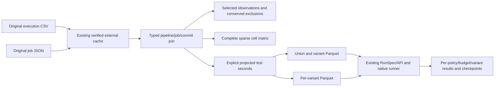

# LibSSH: original CI data to variant-aware Parquet and native replay

Use a pinned public historical LibSSH slice to exercise **Whole Test Set (WTS)**
and **Variant Test Set (VTS)** evaluation. Preserve pipeline/job identity, inspect
sparse configurations, compare their native result denominators and resume both
strategies through COLEMAN's existing runner and checkpoints.

This workflow is new in the source checkout; the published **4.12 wheel does not
contain it**. Build this checkout's wheel for the commands below. Other workflows
continue to use their documented published packages. Source integrity and a
successful replay do not establish scientific admission or a winning policy.

## Install the checkout's wheel outside the repository

With Python 3.14+ and uv available, run from the checkout:

```bash
uv build --wheel --out-dir /tmp/coleman-hcs-dist
uv venv /tmp/coleman-hcs-env --python 3.14
uv pip install --python /tmp/coleman-hcs-env/bin/python /tmp/coleman-hcs-dist/coleman-*.whl
mkdir -p /tmp/coleman-hcs-downloads
cd /tmp/coleman-hcs-downloads
```

Keep source files, cache and outputs outside Git. No Docker, compiler, MCP,
benchmark subject execution or upstream extractor installation is required.

## Download the two reviewed original files

The source is Prado Lima, Jackson (2021), *LIBSSH Mirror – Testing Results
(GitLab CI) – Version 2*, Harvard Dataverse, version 2.0,
[doi:10.7910/DVN/I1XAVR](https://doi.org/10.7910/DVN/I1XAVR).
The [released metadata](https://dataverse.harvard.edu/api/datasets/:persistentId/versions/2.0?persistentId=doi:10.7910/DVN/I1XAVR)
explicitly dedicates these unrestricted data to **CC0-1.0**. The package records
the metadata digest, review date, source/file version, exact byte counts and
SHA-256 pins. No third-party data or implementation is bundled with COLEMAN.
Data permission does not grant permission to copy or execute upstream code.

```bash
curl --fail --location --user-agent 'COLEMAN/corpus-integrity-v1' \
  'https://dataverse.harvard.edu/api/access/datafile/4378418?format=original' \
  --output executions.csv
curl --fail --location --user-agent 'COLEMAN/corpus-integrity-v1' \
  'https://dataverse.harvard.edu/api/access/datafile/4378387?format=original' \
  --output jobs.json
```

| Role | Original bytes | SHA-256 |
| --- | ---: | --- |
| Parsed execution CSV | 32,898,759 | `ba50a92a4571fec2b520f1155f1f8a8377236d44d95f3d6c683726bd9a2968c6` |
| Original job JSON | 33,004,397 | `19b8652f902c20706fb32b7e9bcf3cb4859c701b6a900cd3954152c563454cd0` |

The CLI verifies both hashes and sizes before conversion. Dataverse's default
ingested **TAB is different from the original semicolon CSV**: `format=original`
is required. The publisher's TAB MD5 is not a checksum of the original CSV.
The original JSON's published MD5 was independently verified. The CSV SHA-256
and byte count are explicit reproducibility pins, not a claimed publisher SHA.

## Convert, execute both strategies and resume

```bash
/tmp/coleman-hcs-env/bin/python -m coleman.transports.hcs_etl \
  --executions executions.csv --jobs jobs.json \
  --cache /tmp/coleman-hcs-cache --output /tmp/coleman-hcs-output --run

# Identical offline retry: reuse verified sources and existing native checkpoints.
/tmp/coleman-hcs-env/bin/python -m coleman.transports.hcs_etl \
  --cache /tmp/coleman-hcs-cache --output /tmp/coleman-hcs-output --run
```

Use `--strategy wts` or `--strategy vts` to execute only that strategy. Without
`--run`, the command exports and verifies Parquet only. `--recipe path.json`
accepts a compatible bounded typed source recipe; no URL is opened implicitly.
Native logs go to stderr and stdout contains one JSON summary with completion,
accounting, variant aliases and native artifact/run paths. Raw data stay in the
content-addressed source cache.

The frozen first-sixteen-pipeline slice has these descriptive counts:

| Evidence | Count |
| --- | ---: |
| Complete source CSV rows | 278,950 |
| Selected physical rows | 885 |
| Rows outside the slice, retained in original cached bytes | 278,065 |
| Other-attempt rows explicitly excluded | 29 |
| Retained native variant test executions | 856 |
| Surrogate union test rows | 320 |
| Original variant names in the slice | 7 |
| Declared pipeline × variant cells | 112 |
| Cells with retained parsed tests | 44 |
| WTS result rows, including union and per-variant results | 240 |
| VTS result rows | 176 |

The two policies are Random and UCB/RNFail, at ratio budgets 0.5 and 1.0 with
seed 42. These are functional reproduction counts, not independent observations
or evidence of policy superiority. The complete raw file has **44 observed
variant names**, including all-pass variants. The publisher summary's 34 variants
that failed at least once are not the full universe; this bounded preset does not
claim to exercise all 44.

## Contract, identities and explicit costs

The execution reader joins each original `(pipeline_id, job_id, test_name)` to its
job's pipeline, commit and untouched variant label. A pipeline cannot have
contradictory commit bindings. Numeric pipeline order defines modeled rounds,
not verified chronological outcome availability. Repeated commits remain
different pipelines; shared variants, labels, trials and the earlier overlapping
LibSSH dataset are not independent projects or faults.

Variant aliases are portable digests with an explicit reverse mapping in the
receipt. `linux.x` and `linux_x`, case differences, slashes and original Unicode
names are preserved as distinct identities. No configuration feature or true
rename relationship is inferred from punctuation.

Identical repeated content at a source execution key gets an explicit duplicate
disposition; conflicting content rejects. For multiple parsed completed jobs with
one variant/pipeline, select the **lowest job ID**, independently of outcome or
duration, and retain the other rows as exclusions. Unsupported job status,
unavailable outcome and unavailable duration have separate primary dispositions.
Every physical row is conserved; an excluded attempt is not silently max-merged.

The new recipe requires the cost model
`additive-binary32-rounded-reported-test-seconds-v1`. Original decimal seconds
and their spelling remain in `observations.parquet`; native projected seconds
and their meaning are separate columns. The existing bandit stores float32
duration. Explicitly rounding all new native inputs to that precision before
deriving budgets aligns the loader, bandit and variant evaluator; the projected
values are carried exactly in binary64 Parquet columns. This changes neither
legacy inputs nor the existing bandit schema. It models test costs; it does not
measure CI occupancy or promise exact decimal arithmetic at arbitrary scales.
V1 also requires each projected suite's total coefficient on its finest binary
cost lattice to fit 53 bits. Then all nonnegative partial sums are representable
in binary64 regardless of ranking order. Unsupported dynamic ranges reject
before export completion; no tolerance silently omits or promotes a boundary test.

WTS learns on one declared surrogate per pipeline: maximum projected duration
and any reported nonpass for each shared test label. Its ranking projects onto
each actual variant suite. VTS uses separate policy state for each variant.
Per-variant budgets and outcome denominators use that variant's own tests.
The union is not another set of observed executions and its time is not the sum
of all variant work. Native RNFail is budget-censored: zero nondetection reward
for an unscheduled case is not an observed pass.

Observed zero duration remains zero. Empty source duration/outcome stays null
and is excluded from native input; negative/nonfinite time and unsupported units
reject. Upstream extraction interprets reported time as seconds, collapses all
nonpass statuses into binary one and omits whole jobs with zero total test time.
Its linked historical parser is methodology evidence, not a verified historical
producer revision. The native legacy result columns `detected` and `missed`
therefore count this source's **reported nonpass test executions**, including
potentially timeout/skipped/not-run/exception states already collapsed upstream.
They cannot be interpreted as unique faults or independently verified failures.

`cells.parquet` preserves absent and fully excluded cells. A missing parsed cell
does not become a passing test, verified missing configuration, zero setup cost
or completed run. Job start/finish labels remain source metadata; neither proves
when the prioritizer received a label or feature. Setup seconds, shared runner
occupancy, outcome/feature availability and upstream exclusion counts remain
unavailable. Use the existing [resource ledger/replay](resource-replay.md) for
separately supported observations; do not add dummy setup tests or equate summed
test seconds with physical work saved. Protected temporal admission is blocked.

## Files, compatibility and interrupted execution



Export identity binds the full recipe, actual converter/storage code and Polars
writer version. Fixed-profile Parquet and a canonical versioned receipt permit
deterministic offline verification. Tables commit through the existing immutable
writer; `complete.json` is written last. Interrupted export can retain verified
individual tables, and identical concurrent retries converge. Validation rebuilds
expected bytes from the source; editing a Parquet file and re-signing its receipt
does not certify source truth.

The native API persists the exact receipt in its manifest. Multi-budget native
checkpoints use `checkpoints/budget-v1/<mode-value-digest>/<dataset>/`; close ratio
values that round to the same percent remain distinct. Single-budget checkpoint
paths and payloads are unchanged. An old unscoped multi-budget progress marker
is ambiguous and **rejects before loading it**. Retain the original package and
output; explicitly start a fresh output tree rather than guessing a migration.

Missing/future schema versions or a missing explicit native cost declaration
reject. Old native Parquet, corpus profiles, source readers and their artifacts
retain their original APIs/meaning. Unknown producer or writer versions require
the recorded package/version; there is no silent conversion. In particular, the
publisher's prepared commit-factorized CSVs remain unchanged: their duplicate
identities are why this adapter uses raw pipeline/job records instead.

## Library API and inspection

After downloading the originals, the same workflow uses the core contracts and
existing application API without a CLI or network transport:

```python
from functools import partial
from importlib.resources import files
from pathlib import Path

import polars as pl

from coleman.application.hcs import run_hcs_replay
from coleman.artifacts import ArtifactWriter
from coleman.corpus.hcs_contracts import HCSRecipe, HCSReceipt
from coleman.corpus.hcs_etl import export_hcs_parquet, validate_hcs_etl
from coleman.corpus.materialization import SourceCache, materialize_source

recipe = HCSRecipe.from_json(
    files("coleman.corpus.resources").joinpath("libssh-first16-pipelines-v1.json").read_bytes()
)
cache = SourceCache("/tmp/coleman-hcs-cache")
downloads = Path("/tmp/coleman-hcs-downloads")
for package, name in ((recipe.executions, "executions.csv"), (recipe.jobs, "jobs.json")):
    materialize_source(package, cache, partial((downloads / name).open, "rb"))
completion = export_hcs_parquet(recipe, cache, ArtifactWriter("/tmp/coleman-hcs-output"))
receipt = HCSReceipt.from_json(completion.read_bytes())
validate_hcs_etl(receipt, cache, completion.parent)
print(pl.read_parquet(completion.parent / "cells.parquet"))
for strategy in ("wts", "vts"):
    result = run_hcs_replay(
        completion, cache, Path("/tmp/coleman-hcs-output/native") / strategy, strategy=strategy
    )
    rows = pl.read_parquet(str(Path(result.artifacts_dir) / "results/**/*.parquet"), hive_partitioning=True)
    print(rows.select("scenario", "variant", "step", "policy", "budget_value", "detected", "missed"))
```

Independent raw-source reference checks validate the retained cohort, exclusions,
surrogate union, projected budgets and per-cell denominators. The qualification
also checks differences against original decimal quantities; it is not a new
metric implementation or a protected policy comparison. Scientific source
admission, repeated-measures inference and cross-corpus claims remain with the
[remaining public roadmap](roadmap.md).
