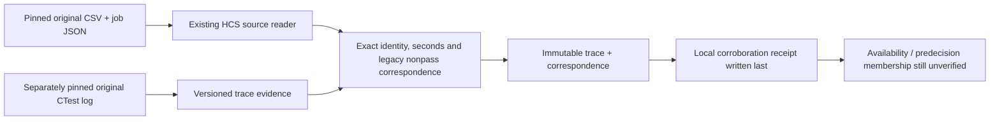

# Corroborate original CTest logs with HCS data

COLEMAN can compare an original CTest job log with the archived HCS execution
CSV and job metadata. It retains passed, failed, timeout, exception, skipped and
not-run states separately. A successful comparison verifies this correspondence;
it does not supply missing historical availability or predecision test membership.

This workflow requires a wheel built from this source revision after **4.18.0**.
It is an optional source-qualification step alongside the existing
[LibSSH Parquet and WTS/VTS workflow](hcs-parquet-etl.md). Old receipts, raw verdicts,
Parquet and native checkpoints retain their existing meaning.

## Install outside the checkout

Run these commands from the COLEMAN checkout, with Python 3.14 and uv available:

```bash
export COLEMAN_TRACE_HOME="$(mktemp -d "${TMPDIR:-/tmp}/coleman-ctest.XXXXXX")"
uv build --wheel --out-dir "$COLEMAN_TRACE_HOME/dist"
uv venv "$COLEMAN_TRACE_HOME/installed" --python 3.14
uv pip install --python "$COLEMAN_TRACE_HOME/installed/bin/python" \
  "$COLEMAN_TRACE_HOME"/dist/coleman-*.whl
cd "$COLEMAN_TRACE_HOME"
```

No MCP, Docker, provider credentials or source checkout is needed after installation.

## Read and verify a complete owned example

Save this complete example as `inspect_trace.py` outside the checkout and run
`"$COLEMAN_TRACE_HOME/installed/bin/python" inspect_trace.py`:

```python
from coleman.corpus.hcs_contracts import HCSJob
from coleman.corpus.hcs_trace import parse_hcs_ctest_trace, validate_hcs_ctest_trace
from coleman.corpus.hcs_trace_contracts import HCSTraceEvidence

raw = b"""Test project /owned/ci/build
1/3 Test #1: unit ................ Passed 0.00 sec
2/3 Test #2: integration .........***Failed 2.00 sec
3/3 Test #3: system ..............***Not Run 0.00 sec
33% tests passed, 2 tests failed out of 3
Total Test time (real) = 2.04 sec
"""
job = HCSJob(
    job_id=1,
    pipeline_id=101,
    commit_id="a" * 40,
    variant="owned-linux",
    status="failed",
    started_at="2026-01-01T00:00:00Z",
    finished_at="2026-01-01T00:01:00Z",
)
trace = parse_hcs_ctest_trace(raw, job)
validate_hcs_ctest_trace(trace, raw)
assert HCSTraceEvidence.from_json(trace.to_json()) == trace
run = trace.runs[0]
assert run.state == "complete"
assert [row.binary_verdict for row in run.executions] == [0, 1, None]
assert run.executions[0].elapsed.value == 0
assert trace.predecision_membership == "unverified"
assert trace.outcome_availability == "unverified"
print(trace.fingerprint)
for row in run.executions:
    print(trace.execution_id("owned-ci", run.ordinal, row.index), row.status, row.elapsed.value)
```

These dates and tests are authored mechanism examples, not observed CI history.
A complete **CTest invocation** is distinct from a complete CI job or an admitted
benchmark source. Job metadata is an explicit source declaration; a log cannot
authenticate its own job identity.

## Compare with original archived observations

First materialize the original CSV and job JSON using the
[existing LibSSH instructions](hcs-parquet-etl.md). Keep their verified cache
outside Git. A log needs its own complete-byte SHA-256/size pin, source version,
citation and component-terms record. Do not copy the archived CSV's CC0 terms
onto an upstream log without reviewing that component.

The following example uses `/tmp/coleman-hcs-cache`, the cache in that guide.
Return to the new installed example's working directory and fetch this separately
pinned original public log, outside Git:

```bash
cd "$COLEMAN_TRACE_HOME"
curl --fail --silent --show-error --location --max-time 30 --max-filesize 2097152 \
  'https://gitlab.com/libssh/libssh-mirror/-/jobs/63565028/raw' --output job.log
```

Save this complete metadata as `log-spec.json`:

```json
{
  "schema_version": 1,
  "job_id": 63565028,
  "source": {
    "uri": "https://gitlab.com/libssh/libssh-mirror/-/jobs/63565028/raw",
    "version": "job-63565028-content-sha256-bae05293a3a9a134",
    "citation": "LibSSH public GitLab CI job 63565028 original CTest log; pinned snapshot",
    "sha256": "sha256:bae05293a3a9a134b1893cd17b02f6d7cd562790c9f7c773916e2e599eb3dbce",
    "size_bytes": 32780,
    "availability": "verified_local"
  },
  "terms": {
    "status": "pending",
    "license_id": null,
    "terms_uri": null,
    "terms_sha256": null,
    "reviewed_at": null,
    "redistribution": "unverified"
  }
}
```

The specification
is an `HCSLogSpec` v1 JSON record: `job_id`, `source` (`SourceArtifact`) and `terms`
(`LicenseReview`). Its locator is descriptive and is never fetched by this API.
Terms marked pending remain pending; explicitly prohibited use rejects. No raw
log is redistributed by the export.

```python
from importlib.resources import files
from pathlib import Path

from coleman.artifacts import ArtifactWriter
from coleman.corpus.hcs_contracts import HCSRecipe
from coleman.corpus.hcs_trace_artifacts import (
    HCSLogSpec,
    publish_hcs_trace_evidence,
    validate_hcs_trace_completion,
)
from coleman.corpus.materialization import SourceCache

recipe = HCSRecipe.from_json(
    files("coleman.corpus.resources").joinpath("libssh-first16-pipelines-v1.json").read_bytes()
)
spec = HCSLogSpec.from_json(Path("log-spec.json").read_bytes())
raw = Path("job.log").read_bytes()
cache = SourceCache(Path("/tmp/coleman-hcs-cache"))
writer = ArtifactWriter(Path("corroboration"))
completion = publish_hcs_trace_evidence(recipe, spec, raw, cache, writer)
receipt = validate_hcs_trace_completion(completion, recipe, raw, cache)
assert receipt.admission == "not_granted"
assert publish_hcs_trace_evidence(recipe, spec, raw, cache, writer) == completion
print(completion)
```

Both original cache files are reverified on every validation/retry. The parser
and source/storage implementation digest selects the export namespace. Inside
it, `trace.json` retains typed process outcomes and `correspondence.json` records
the exact match, source fingerprints, physical CSV positions and duplicate counts.
`complete.json` is written last, after both immutable files. A stopped process
can leave an evidence file; it cannot establish a completed export without the
receipt. Identical concurrent retries converge; conflicting bytes reject.



## Units, states and compatibility

- Executable durations use `s / ctest-reported-executable-elapsed-seconds-v1`;
  wall envelopes use `s / ctest-reported-run-wall-envelope-seconds-v1`. Their
  sums are not equated. Neither is a whole-runner occupancy measurement.
- Reported zero remains zero. A not-run record may report zero elapsed seconds;
  that does not assert execution. Only Passed and Failed map to binary reported
  executable verdicts. Timeout, exception, skipped and not-run remain null there.
- The archived CSV's separate legacy mapping is explicitly any non-Passed
  status → nonpass 1. Corroboration preserves that collapsed definition; it does
  not rewrite old 1s as assertion failures or turn missing records into passes.
- A printed N/M denominator describes post-execution trace coverage. It is not
  proof of a predecision required-test universe. Missing final summary/wall data
  yields `partial`; missing CTest headers yield no invocations. Repeated
  invocations retain separate ordinals and cannot corroborate an ambiguous
  single-job/test CSV table by choosing a convenient attempt.
- Parallel CTest output has two separate numbers: the completion-position
  counter before `/` and the original test index after `#`. They may differ.
  Both are retained; the original index supplies logical execution identity.
  Filtered invocations may retain sparse original indices larger than the number
  of selected tests; only completion positions must cover the printed denominator.
- Original bytes determine the source digest. Logical execution identity uses
  project/pipeline/job/invocation/index, independently of measurement values,
  formatting, worker or arrival order. The richer evidence digest retains
  physical line provenance and changes when those original bytes change.
- Inputs are bounded to 2 MiB UTF-8, 16 KiB per line, 131,072 physical lines,
  sixteen invocations and 10,000 total results. Finite nonnegative exact decimal
  seconds accept at most twelve fractional places and a 10^12-second bound.
  Unknown result forms, conflicting counts/duplicates and nonfinite values reject.
- All new persisted contracts require integer schema version 1. Missing, coerced,
  future and unknown versions reject. Another producer requires its recorded
  package for verification; derive a new namespace explicitly instead of
  overwriting old artifacts. Core parsing/comparison never imports CLI or MCP.

All **78 original public job logs** in the pinned sixteen-pipeline metadata
snapshot were retrieved and interpreted. The **45 jobs represented in the CSV**
corroborate all **885 selected observations**, including the 29 executions retained
separately as another attempt by the old replay adapter. The logs additionally
contain **187 result lines across six jobs absent from the CSV**: five jobs have
repeated invocations, and one canceled job has a partial invocation. Those lines
remain additional evidence; they do not fill or rewrite the old table. The
remaining 27 logs have no supported CTest project header, which does not prove
that no tests were planned.

Examples include original jobs
[62621051](https://gitlab.com/libssh/libssh-mirror/-/jobs/62621051),
[62771472](https://gitlab.com/libssh/libssh-mirror/-/jobs/62771472) and
[63565028](https://gitlab.com/libssh/libssh-mirror/-/jobs/63565028).
This bounded snapshot does not establish upstream completeness beyond the
released metadata, source-purpose admission or independent-project evidence.
It supplies no policy comparison.
