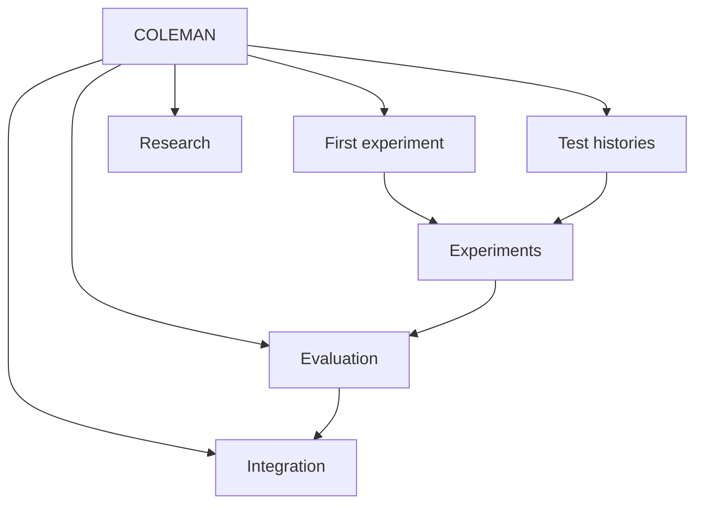

# Make adaptive CI decisions you can explain

**COLEMAN helps you learn which tests to run first under a limited CI budget.**
Run adaptive policies against test histories, inspect what each decision knew,
and evaluate the evidence before changing how your CI runs. The same platform
supports ordinary test suites and highly configurable systems.

Start with a complete local experiment, then follow the branch that matches your
question. Each branch connects a practical workflow to its concepts, contracts
and research background.

[**Run your first experiment →**](getting-started.md)

## Find your path

The links below provide the same routes as the graph, including keyboard access.

| Your question | Start here | Continue with |
| --- | --- | --- |
| What does COLEMAN actually do? | [Core concepts](concepts.md) | [A complete first run](getting-started.md) |
| How do I prepare a suite or history? | [Datasets and evidence types](datasets.md) | [Native input format](input-data.md) |
| How do I choose policies and budgets? | [Experiment guide](experiments.md) | [Policies and rewards](policies.md), [configuration](configuration.md) |
| How do I study configurations? | [WTS and VTS explained](highly-configurable.md) | [LibSSH source workflow](hcs-parquet-etl.md) |
| Can I trust a comparison? | [Evaluation guide](evaluation-guide.md) | [Baselines](comparable-baselines.md), [protected evaluation](protected-evaluation.md) |
| How would this enter a CI pipeline? | [Integration guide](integration-guide.md) | [Operational accounting](operational-pilot.md), [shadow evaluation](prospective-shadow.md) |
| Where is a particular symbol or term? | [API reference](api-reference.md) | [Glossary](glossary.md), [architecture](setup.md) |

## What a run gives you

A typed specification fixes the experiment configuration. The native runner
prioritizes tests, simulates the declared budget, updates learning state and
writes Parquet results. Resolved configuration and provenance accompany the
run; enabled checkpoints support continuation after interruption. You can query
results locally with DuckDB or Polars.

[See the data flow and architecture](setup.md) · [Inspect a complete workflow](workflow.md)

## Research and evidence

The method originates in the [COLEMAN TCPCI study](research.md#adaptive-prioritization)
and its [configurable-system extensions](research.md#configurations-and-variants).
The [research guide](research.md) connects publications to the capabilities here.

A successful data conversion or replay demonstrates that a workflow runs. A claim
about policy effectiveness also needs suitable source evidence, independent
observations and a protected comparison. The [evidence status](roadmap.md)
records what is available and what remains unverified, including the unfinished
historical cross-corpus confirmation.

## Build with us

[Contributing](contributing.md) covers development, documentation and review.
[Maintainability](maintainability.md) records the measured architectural and
docstring priorities. Compatibility history lives in the
[release archive](release-history.md), away from the learning path.
