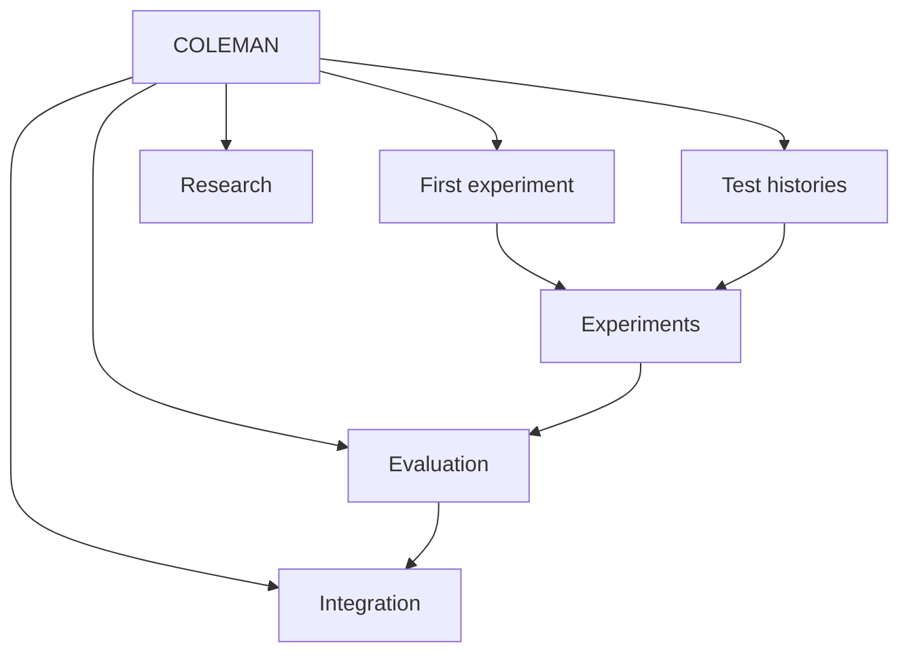

# Make adaptive CI decisions you can explain

**COLEMAN helps you learn which tests to run first under a limited CI budget.**
Run adaptive policies against test histories, inspect what each decision knew,
and evaluate the evidence before changing how your CI runs. The same platform
supports ordinary test suites and highly configurable systems.

Choose among **37 policies**, including Random, UCB, FRRMAB, SlMAB, LinUCB,
Thompson sampling and policy portfolios. Work from original-source data or known
stress cases, retain reproducible outputs, and compare candidates under an explicit
[policy and evidence protocol](policies.md).

Start with a complete local experiment, then follow the branch that matches your
question. Each branch connects a practical workflow to its concepts, contracts
and research background.

[**Run your first experiment →**](getting-started.md)

## Find your path

The links below provide the same routes as the graph, including keyboard access.

| Your question | Start here | Continue with |
| --- | --- | --- |
| What does COLEMAN actually do? | [Core concepts](concepts.md) | [A complete first run](getting-started.md) |
| How do I prepare a suite or history? | [Datasets and evidence types](datasets.md) | [Native input format](input-data.md) |
| How do I choose policies and budgets? | [Experiment guide](experiments.md) | [Policies and rewards](policies.md), [configuration](configuration.md) |
| How do I study configurations? | [WTS and VTS explained](highly-configurable.md) | [LibSSH source workflow](hcs-parquet-etl.md) |
| Can I trust a comparison? | [Evaluation guide](evaluation-guide.md) | [Baselines](comparable-baselines.md), [protected evaluation](protected-evaluation.md) |
| How would this enter a CI pipeline? | [Integration guide](integration-guide.md) | [Operational accounting](operational-pilot.md), [shadow evaluation](prospective-shadow.md) |
| Where is a particular symbol or term? | [API reference](api-reference.md) | [Glossary](glossary.md), [architecture](setup.md) |

## What you can build with COLEMAN

| Your goal | Available workflow |
| --- | --- |
| Compare adaptive CI prioritization policies | The native TCPCI runner, [37 policies](policies.md), RNFail/TimeRank rewards, contextual inputs and [parameter sweeps](configuration.md) |
| Stress a difficult CI decision | [32 deterministic interaction-covering cases](ci-stress-laboratory.md), explicit truth and feedback clocks, native Parquet and resumable agents |
| Audit what a source actually supports | [Source admission](corpus-admission.md): original evidence, explicit units and a 35-axis production-reality matrix |
| Compare repeated CI experiments | [Raw build/seed records and paired repository-family means](corpus-evaluation.md), explicit missingness and protected access |
| Compare metrics with known limits | [Conservative bounded paired means](bounded-paired-evaluation.md), full-family uncertainty and practical equivalence under declared independent-unit assumptions |
| Assess public CI collection | [Bounded public Actions collection](public-ci-feasibility.md), typed receipts and reality-axis accounting that retains missing test and physical-cost evidence |
| Develop comparable baseline matrices | [Frozen native-policy and heuristic matrices](comparable-baselines.md), explicit incompatibilities, raw costs and checkpoint recovery |
| Evaluate configurable software | [Original LibSSH → WTS/VTS Parquet and checkpointed replay](hcs-parquet-etl.md), [CTest corroboration](hcs-trace-evidence.md) and [whole-set/variant strategies](highly-configurable.md) |
| Collect real-fault observations | [Controlled Java matrices](java-fault-matrix.md) and [Python source capture](python-source-capture.md), pinned source/runtime recipes, raw process evidence and offline recovery |
| Inspect a constructed C weakness | [Pinned Juliet/GCC capture](c-seeded-source-capture.md), an independent arithmetic oracle, raw process evidence and interruption recovery |
| Reproduce and inspect an experiment | [Typed RunSpec and the library API](api/experiment-api.md), [configuration identity and provenance](setup.md#identity-and-reproducibility), Parquet results and resumable checkpoints |
| Select finite coverage under a budget | [Coverage selection](finite-coverage.md), explicit costs and solver-specific certificates and limits |
| Allocate resources under declared scenarios | [Scenario-payoff allocation](scenario-payoffs.md), signed outcomes, resource constraints and conservative evidence handling |
| Check a CI decision before adoption | [Independent mathematical benchmarks](decision-benchmarks.md), [protected comparisons](protected-evaluation.md) and [operational accounting](operational-pilot.md) |
| Extend or integrate the platform | [Library API](api/experiment-api.md), [application API and optional MCP](application-api.md), [versioned domain results](domain-results.md), hooks and [runner extensions](extensibility.md) |

The workflows retain their own assumptions: a source conversion, controlled fault,
mathematical check and historical policy comparison answer different questions.
Follow the linked guide for a complete example and the evidence it supports.

## What a run gives you

A typed specification fixes the experiment configuration. The native runner
prioritizes tests, simulates the declared budget, updates learning state and
writes Parquet results. Resolved configuration and provenance accompany the
run; enabled checkpoints support continuation after interruption. You can query
results locally with DuckDB or Polars.

[See the data flow and architecture](setup.md) · [Inspect a complete workflow](workflow.md)

## Research and evidence

The original studies connect the implemented workflows to their research questions:

- **Adaptive CI prioritization:** Prado Lima and Vergilio, [*A Multi-Armed Bandit Approach for Test Case Prioritization in Continuous Integration Environments*](https://doi.org/10.1109/TSE.2020.2992428), IEEE TSE, 2022.
- **Highly configurable software:** Prado Lima et al., [*Learning-based prioritization of test cases in continuous integration of highly-configurable software*](https://doi.org/10.1145/3382025.3414967), SPLC, 2020.
- **WTS/VTS evaluation:** the same authors, [*Cost-effective learning-based strategies for test case prioritization in continuous integration of highly-configurable software*](https://doi.org/10.1007/s10664-021-10093-3), Empirical Software Engineering, 2022.

The [research guide](research.md) connects those studies and the original algorithm,
dataset and statistical-method papers to the corresponding examples.

A successful data conversion or replay demonstrates that a workflow runs. A claim
about policy effectiveness also needs suitable source evidence, independent
observations and a protected comparison. The [evidence status](roadmap.md)
records what is available and what remains unverified, including the unfinished
historical cross-corpus confirmation.

## Build with us

[Contributing](contributing.md) covers development, documentation and review.
[Maintainability](maintainability.md) records the measured architectural and
docstring priorities. Compatibility history lives in the
[release archive](release-history.md), away from the learning path.
