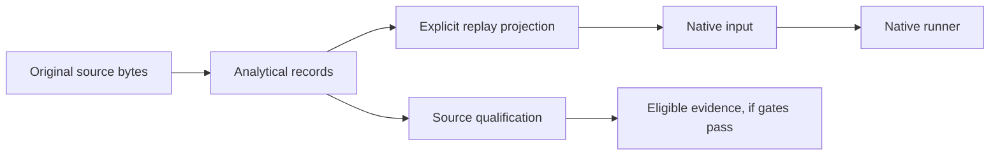

# Prepare a test history

The native TCPCI runner consumes recorded test executions grouped into modeled
builds. Use Parquet for new inputs. If you already have a supported public source,
prefer its [dataset adapter](datasets.md): analytical records retain details that
cannot fit in the native replay projection.

## Native layout

```text
data/
└── example-ci/
    └── features-engineered.parquet
```

Set `experiment.datasets_dir: data` and `experiment.datasets: [example-ci]`.
Each dataset directory represents one replay history. The
[first-run tutorial](getting-started.md) creates a complete file programmatically.

| Column | Meaning for a native replay | Preparation responsibility |
| --- | --- | --- |
| `BuildId` | Numeric modeled round; the loader processes sorted IDs | Assign order explicitly; a provider's numeric ID is not proof of chronology |
| `Name` | Test identity, normalized to text | Keep identity stable and explain renames, collisions and method/class granularity |
| `Duration` | Recorded execution cost used by scheduling | Use finite nonnegative seconds for a seconds-based replay; verify the source unit |
| `Verdict` | Native binary outcome: `1` failed, `0` passed | Keep skipped, cancelled, unavailable and infrastructure outcomes in analytical evidence; define any projection explicitly |
| `CalcPrio` | Mutable priority slot used by the replay | Initialize to zero |
| `LastRun` | Legacy history field | Preserve its declared source meaning; it does not certify feature availability |

Contextual workflows may use additional columns configured under
`contextual_information`. See [policies](policies.md#contextual-policies) before
including current-build features.

The legacy loader accepts semicolon-delimited CSV with a deprecation warning. Its
normalization is intentionally permissive in places: for example, a missing
numeric duration can become zero. That legacy behavior is **not missing-value
validation**. Check input semantics before native projection; use typed
[measurements](domain-results.md) to preserve unknown or unavailable values.

## Keep source records and replay inputs separate

An analytical row can retain a method's original status, source location, stage,
attempt and units. A native row is a deliberately narrower interpretation that
supports the runner. Keep both, along with counts and exclusion reasons.



An exclusion is a recorded decision about the projection. It must not silently
turn an unexecuted test into a pass. Shared jobs, stages, variants and retries
must retain grouping in later evaluation.

## Durations and budgets

The native file does not carry a machine-readable unit alongside `Duration`.
Source-specific adapters and experiment documentation must supply that contract.
A ratio budget is a fraction of the recorded full-suite duration; a fixed-time
budget is expressed in seconds; a subset-size budget is a test count.

Summing recorded test durations yields a serial test-work model. It does not
measure queue time, setup cost or parallel runner occupancy. Use
[resource accounting](resource-replay.md) for explicitly observed or modeled
physical costs.

## Configurable systems

A whole-test-set history also has `data-variants.parquet`, with a `Variant` column
linking executions to configurations. Separate variant histories use their own
folders and learning state. See [WTS and VTS](highly-configurable.md) and the
[LibSSH adapter](hcs-parquet-etl.md) for complete layouts and sparse-cell handling.

## Next steps

Run a prepared file with [configuration](configuration.md), or choose a verified
source workflow in [datasets](datasets.md). For claims that depend on what was
known at decision time, continue with [point-in-time observations](point-in-time-observations.md).
