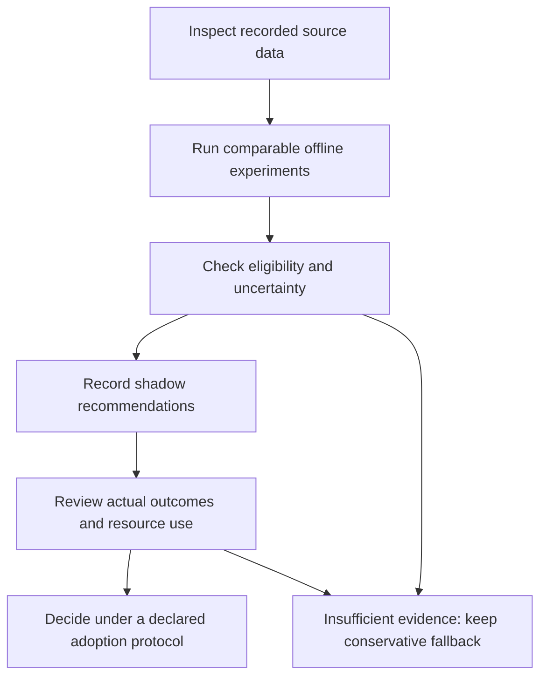

# Connect experiments to a CI workflow

Start by deciding whether you need offline replay, a library integration or a
study of recommendations beside a running CI system. These routes share the
native runner and typed contracts, but collect different kinds of evidence.

## Choose an integration route

| Your need | Start here | What it gives you |
| --- | --- | --- |
| Run recorded test histories | [First experiment](getting-started.md), [library API](api/experiment-api.md) | Native ranking, modeled budgets, results and checkpoint continuation |
| Register bounded application operations | [Application API](application-api.md) | Shared library services and an optional MCP transport |
| Add a policy, hook or artifact | [Extensions](extensibility.md), [artifact API](api/artifacts.md) | Native lifecycle callbacks and typed result publication |
| Inspect a proposed CI schedule | [Operational pilot](operational-pilot.md) | Decision intent, selected work and independent accounting |
| Distinguish serial and parallel costs | [Resource replay](resource-replay.md) | Explicit reservations, occupancy, overhead and released work |
| Record prospective recommendations | [Shadow evaluation](prospective-shadow.md) | Frozen pre-outcome recommendations while the required suite continues |
| Learn what a public provider exposes | [Public CI feasibility](public-ci-feasibility.md) | Bounded Actions metadata collection with explicit missing evidence |
| Monitor an experiment | [Observability](observability.md) | Optional OpenTelemetry, Prometheus, Grafana and ClickHouse setup |

## A conservative adoption path

The public-provider feasibility example does not collect a complete required-test
inventory or physical runner occupancy. A successful provider API response is
therefore not enough to authorize skipping required tests. Use the documented
contracts to retain what is available and what remains unknown.

## Extend at the appropriate boundary

Use `coleman.api` for native experiments. Use `coleman.application` when you need
its bounded registered workflows. HTTP, process execution, CLI and MCP adapters
stay at the transport boundary. Domain measurement, observation, selection and
evaluation contracts remain independent of those transports.

The [architecture guide](setup.md) shows the relationships. The
[API reference](api-reference.md) helps locate a symbol, while
[contributing](contributing.md) explains how to preserve the boundaries when adding one.
