# Run a controlled Java fault matrix

Collect three curated upstream fixes across Apache Commons CLI and Codec with
one frozen plan. Each cell runs buggy and fixed source against the same declared
fixed-tree fixture, retaining every observed pass, failure, test error and
incomplete collection. This is controlled functional evidence for TCPCI research;
it is separate from historical CI and policy comparisons.

The published **4.12 wheel** includes the matrix transport. It reuses the existing
single-pair producer and the generic [controlled-observation
domain](controlled-faults.md). It does not introduce a learning runner or change
existing source recipes, results, checkpoints or raw-capture semantics.

## Install and collect outside checkout

Use Python 3.14+, uv, POSIX and a native Linux arm64 Docker engine. These frozen
recipes pin Temurin `11.0.32.1`, the arm64 image digest and
`America/Los_Angeles`. A different architecture needs a separately reviewed
recipe; changing its label does not validate another runtime.

Install the verified published wheel into a fresh external environment; no checkout
is required:

```bash
uv venv /tmp/coleman-matrix-env --python 3.14
uv pip install --python /tmp/coleman-matrix-env/bin/python "https://github.com/jacksonpradolima/coleman/releases/download/v4.12.0/coleman-4.12.0-py3-none-any.whl#sha256=5802f83dfa4608a979f132e6e00ea3d8a128c88f4b7bbde07afcd416c33df55e"

# Explicit operator preparation; COLEMAN never pulls an image.
docker pull --platform linux/arm64 eclipse-temurin@sha256:e4b3ff0f1a427efb2deb02b092ff8316d58573480260720d767d6ecdd69999d8

mkdir -p /tmp/coleman-matrix-workspace
cd /tmp/coleman-matrix-workspace
/tmp/coleman-matrix-env/bin/python -m coleman.transports.junit_matrix \
  --cache /tmp/coleman-java-source-cache \
  --output /tmp/coleman-java-observations --fetch > matrix-summary.json

# Same plan/trials: validate committed evidence rather than collect it again.
/tmp/coleman-matrix-env/bin/python -m coleman.transports.junit_matrix \
  --cache /tmp/coleman-java-source-cache \
  --output /tmp/coleman-java-observations
```

Only the first acquisition needs `--fetch`; it permits the existing individually
pinned HTTPS source/JAR downloads. Subject execution has no network. Both cache
and output must be outside Git and separate from each other. The system temporary
directory must also be outside Git. No third-party source or raw capture is bundled.

The JSON summary reports the content-addressed receipt, optional completion path,
collection status, two declared project labels and three curated focal-fix labels.
Exit 0 means collection completed, including negative outcomes. Incomplete source
captures publish an index with `completion: null` and exit 2. Infrastructure,
preflight and publication errors exit nonzero and retain earlier durable evidence.
None of these statuses grants scientific admission.

Validate a saved index without Docker or source execution:

```bash
MATRIX_RECEIPT="$(/tmp/coleman-matrix-env/bin/python -c 'import json; print(json.load(open("matrix-summary.json"))["receipt"])')"
/tmp/coleman-matrix-env/bin/python -m coleman.transports.junit_matrix \
  --validate \
  --cache /tmp/coleman-java-source-cache \
  --output /tmp/coleman-java-observations < "$MATRIX_RECEIPT"
```

Offline integrity validation can republish identical source-view cache metadata.
It verifies actual source members, context, raw protocol packets and normalized
observations; it starts no process and fetches nothing. Integrity is correspondence,
not authentication of execution truth or benchmark efficacy.
The CLI reads at most 8 MiB of receipt JSON from stdin; `--validate` accepts no
file path. The operator explicitly supplies the input descriptor. Referenced
controlled datasets remain confined to their declared output tree. The Python
API accepts the already parsed typed receipt.

## Frozen source selection

| Curated fix | Direct upstream revisions | Common fixture | Relationship to framework metadata |
| --- | --- | --- | --- |
| CLI-13 | `8f46f467a33ace44ccd9f394910940b6c48a3827` → `b0e1b80b6d4a10a9c9f46539bc4c7a3cce55886e` | Existing published 95-test recipe, unchanged | Defects4J Cli **1**, not Cli13 |
| CLI-51 | `b0e1b80b6d4a10a9c9f46539bc4c7a3cce55886e` → `2ff9573ffb08dd52ec3a55a49f2d77a1e94efbdf` | Same fixed-tree policy, 96 tests | Defects4J Cli2 |
| CODEC-65 | `9c0cabead7cf075308b11362172ae1a48d41321c` → `52d82d1dfff8c2b2ded9d843e0b03017af6d747c` | Explicit partial fixed-tree fixture, 166 tests | Defects4J Codec1 |

The [CLI-51 fix](https://github.com/apache/commons-cli/commit/2ff9573ffb08dd52ec3a55a49f2d77a1e94efbdf)
changes PosixParser and adds BugCLI51Test. The [CODEC-65
fix](https://github.com/apache/commons-codec/commit/52d82d1dfff8c2b2ded9d843e0b03017af6d747c)
changes locale handling in several encoders. These are direct parent/fix source
reproductions with a common fixed fixture, not a full Defects4J reconstruction.
Framework subject labels do not replace source rights or reconstruction evidence.
Those labels were checked against the pinned Defects4J metadata revision
`8c16da8230843cdc918eaf4ddb449637f02b83c6` for
[Cli](https://github.com/rjust/defects4j/blob/8c16da8230843cdc918eaf4ddb449637f02b83c6/framework/projects/Cli/active-bugs.csv)
and [Codec](https://github.com/rjust/defects4j/blob/8c16da8230843cdc918eaf4ddb449637f02b83c6/framework/projects/Codec/active-bugs.csv).

Codec retains all 25 production Java files per role, 15 fixed fixture Java files,
and original `LICENSE.txt`/`NOTICE.txt`. Fixture selection was recorded in
[#304](https://github.com/jacksonpradolima/coleman/issues/304) **before observing
new source outcomes**:

- `DoubleMetaphoneTest.java` embeds separately noticed aspell data and non-UTF8
  bytes. It is outside the existing homogeneous-terms/UTF8 source-view profile.
- `SoundexTest.java` also contains non-UTF8 bytes and is excluded without transcoding.
- `AllTests.java` references those excluded classes and is excluded as their suite
  aggregator. Per-TestCase discovery does not require it.

All other fixed-tree Java fixture files remain. This includes
`RefinedSoundexTest.java`, a different file. Missing focal-class coverage stays
visible; this is not the complete upstream suite. No outcome-based filtering is
applied after collection.

Source views preserve exact bytes and original notices. Apache-2.0 subject terms,
Commons Lang 2.1 terms and JUnit 3.8.1 CPL-1.0 terms remain separately reviewed and
pinned. The [Codec NOTICE](https://github.com/apache/commons-codec/blob/52d82d1dfff8c2b2ded9d843e0b03017af6d747c/NOTICE.txt)
identifies the omitted third-party test data; COLEMAN does not relabel it as
Apache-2.0. Codec needs only the pinned JUnit JAR; CLI retains its original two
dependencies. The recipe-only policy keeps foreign content in the external cache.

## Observed results and their limits

The initial installed-producer qualification collected **714 role observations**,
or **357 same-test/trial pairs**, under the frozen runtime:

| Fix | Both pass | Both fail | Assertion failed → passed | Reversed | Inconclusive |
| --- | ---: | ---: | ---: | ---: | ---: |
| CLI-13 | 92 | 2 | 1 | 0 | 0 |
| CLI-51 | 93 | 2 | 0 | 0 | 1 |
| CODEC-65 | 163 | 0 | 3 | 0 | 0 |

CLI-51's focal buggy test raises `UnrecognizedOptionException`; the fixed role
passes. The existing strict classifier calls this **inconclusive**, because a
test error is distinct from an assertion failure. The matrix preserves that
classification and raw diagnostic. Both CLI fixtures retain the two assertions
that fail in both revisions. A fixed revision is not presented as wholly correct.

The three Codec assertions belong to Caverphone, Metaphone and RefinedSoundex
`testLocaleIndependence` methods. They concern **one** curated fix. The two CLI
fixes share project history. Tests, trials, seeds and JVM repetitions do not become
independent projects or new faults. These observations are runtime/fixture-specific,
not a guarantee about every future run.

Subsequent source inspection identified unseeded `java.util.Random` inputs in
[Base64Test](https://github.com/apache/commons-codec/blob/52d82d1dfff8c2b2ded9d843e0b03017af6d747c/src/test/org/apache/commons/codec/binary/Base64Test.java#L705),
[HexTest](https://github.com/apache/commons-codec/blob/52d82d1dfff8c2b2ded9d843e0b03017af6d747c/src/test/org/apache/commons/codec/binary/HexTest.java#L118)
and [DigestUtilsTest](https://github.com/apache/commons-codec/blob/52d82d1dfff8c2b2ded9d843e0b03017af6d747c/src/test/org/apache/commons/codec/digest/DigestUtilsTest.java#L40).
Generated bytes and seeds are unavailable in the capture protocol. All 166
selected tests remain; only an explicit limitation was added to the recipes.
Source/dependency/runtime/harness pins and fixture selection are unchanged.
Saved observations replay deterministically, while fresh execution does not
reconstruct identical generated inputs. Source admission must assess that limit.

Each role uses the existing shared JVM and lexical test-ID order. Test-order
independence is unverified. Integer case nanoseconds include setup/teardown; parent
process nanoseconds also include startup/compilation. Observed zero remains zero;
unavailable elapsed values are null with `status: unavailable`. Negative counts,
negative elapsed counters, non-finite values and incompatible units reject. Neither
timer is CI queue time, parallel elapsed time, peak memory or removable runner work.
The existing guards bound each role to 60 seconds, 1 MiB combined output, two CPUs,
64 PIDs, 128 MiB tmpfs and 1 GiB memory in these presets. A resource limit is not
a measured peak. Captures are trusted-source reproductions within those guards.

## Contract, artifacts and recovery

```mermaid
flowchart LR
    plan[Frozen typed Java matrix plan] --> preflight[Matrix storage and all-cell budget preflight]
    preflight --> frozen[Immutable plan.json before source execution]
    frozen --> source[Existing source cache and deterministic views]
    source --> capture[Existing bounded JUnit producer]
    capture --> raw[Durable role start markers and raw packets]
    raw --> controlled[Existing generic ControlledDataset]
    controlled --> verify[Offline context and raw observation validation]
    verify --> index[Content-addressed typed matrix index]
    index --> state{All roles collected?}
    state -->|yes| complete[Atomic immutable complete.json last]
    state -->|no| incomplete[Incomplete index; no completion marker]
    complete --> replay[Offline verified replay; no runtime preflight]
```



Plans require schema version 1 and allow at most 16 cells / 4 MiB. Receipts require
schema version 1 and are bounded to 8 MiB. Canonical JSON and SHA-256 identities
include explicit source recipes, trial IDs, selection protocol and implementation
provenance. Reordering declared cells/roles does not change identity. Different
collected clocks or observations legitimately change a receipt; determinism means
identical captured evidence serializes identically, not that new executions have
identical elapsed time.

Duplicate cell IDs and duplicate recipe/trial collections reject. Counts refer to
observed same-test pairs; `unobserved_pairs` preserves completely absent tests.
One-sided evidence remains inconclusive. The index references separately verified
controlled dataset fingerprints and actual raw packet digests, never arbitrary
transport dictionaries. It does not convert controlled observations into native
CI duration columns or historical builds.

The original source producer owns role recovery. A start marker without a committed
packet recovers as interrupted, with no invented cases or elapsed time. It does
not silently rerun that role. Choose a new trial ID for a new collection; it stays
in the same declared dependence group. Concurrent ownership conflicts reject
without duplicate execution; retry after the owner finishes. A crash before matrix
completion leaves the frozen `plan.json` and committed role/data artifacts usable
for recovery. Unattempted cells remain visible in that plan without invented results.
An incomplete index is retained without `complete.json`; an all-role collected
index acquires that marker only after validation and immutable index publication.

Idempotence uses the retained output/capture tree. A fresh output directory does
not restore another directory's acknowledgments; use new trial IDs for a fresh
physical collection. Copying an index alone is insufficient: offline validation
also needs its controlled datasets and the independently verified source cache.

Existing completion is revalidated before any runtime preflight. Corrupt/unknown
schema or producer versions reject. Missing and older matrix schema versions are
unsupported; there is no implicit migration. The producer identity hashes all
COLEMAN package code and resources without importing those modules. Hidden files,
generated bytecode and interpreter caches are excluded. Any other packaged-byte
change, including an unrelated module or a new resource format, conservatively
selects a new generation; the package version also participates. Previous bytes
remain intact. Explicit offline validation requires the matching reviewed producer.
Existing single-pair
JUnit recipes, source caches, controlled artifacts, native results and learning
checkpoints keep their previous contracts and require no migration.

## Python and verification

The optional producer API is also callable without its command-line parser:

```python
from pathlib import Path
from coleman.artifacts import ArtifactWriter
from coleman.corpus.materialization import SourceCache
from coleman.transports.junit_matrix import (
    capture_junit_matrix, load_junit_matrix, validate_junit_matrix,
)

cache = SourceCache("/tmp/coleman-java-source-cache")
writer = ArtifactWriter("/tmp/coleman-java-observations")
plan = load_junit_matrix()
outcome = capture_junit_matrix(plan, cache, writer)  # Offline acquisition by default.
validate_junit_matrix(outcome.receipt, cache, Path(writer.run_root))
assert outcome.receipt.admission == "not_evaluated"
```

Use `--recipe /absolute/path/matrix.json` for another reviewed typed plan. The
generic controlled domain stays independent of CLI, Docker transports and MCP.
Protected source admission and policy evaluation remain later #261 subtasks.

Normal tests use owned small fixtures with no downloads. With the image prepared
and all three recipes acquired into an external cache, repeat installed real-source
capture, offline matrix validation, import-boundary checks and an independent owned
native CI/checkpoint workflow:

```bash
COLEMAN_JUNIT_REAL_CACHE=/tmp/coleman-java-source-cache \
  uv run pytest tests/corpus/test_installed_junit_matrix.py --no-cov
```

The native CI fixture has its own exact-answer costs and outcomes; Java harness
elapsed counters are not substituted for CI costs. Actual historical-CI ETL/replay
remains available in the [Karaf](lrts-parquet-etl.md),
[ActiveMQ/Log4j](lrts-stage-views.md) and
[RTPTorrent](rtptorrent-parquet-etl.md) workflows.
