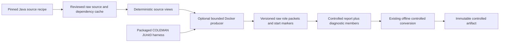

# Reproduce a pinned Java fault pair

COLEMAN's optional JUnit3 producer collects source evidence before benchmark
admission. Its packaged Apache Commons CLI recipe compiles two pinned upstream
revisions against the same fixed-tree test fixture and records all 95 discovered
tests. It reuses the existing source cache, controlled-observation contracts and
immutable artifact writer. Native TCPCI experiments still use the existing runner.

The recipe contains integrity metadata only. Subject sources, dependencies,
container images and raw captures remain outside the repository. It does not
execute Defects4J or claim its complete reconstruction protocol. The generic
[controlled domain](controlled-faults.md) imports no Docker, CLI or MCP adapter.

## Prepare and run

Build and install this branch's wheel as shown in the controlled-observation guide.
The released 4.5 wheel predates this producer. The bundled preset requires POSIX,
Docker, an arm64 host and arm64 Docker engine. It pins Temurin `11.0.32.1` and
`America/Los_Angeles`. Other platforms require a separately reviewed recipe;
changing a platform label does not validate a different image.

Prepare the public image explicitly:

```bash
docker pull --platform linux/arm64 eclipse-temurin@sha256:e4b3ff0f1a427efb2deb02b092ff8316d58573480260720d767d6ecdd69999d8
```

From an external workspace, using the installed environment:

```bash
python -m coleman.transports.junit \
  --cache /tmp/coleman-junit-cache \
  --output /tmp/coleman-junit-results \
  --trial source-001 --fetch
```

`--fetch` permits only the individually pinned public source/JAR downloads from
`raw.githubusercontent.com` and `repo.maven.apache.org`. The HTTPS adapter verifies
TLS and exact entity lengths, and rejects redirects, credentials, queries, partial
responses and encoded transfers. It uses no ambient authentication or proxy
configuration. The producer never pulls an image. Once cached, omit `--fetch` for
offline acquisition; subject execution has no network even during the first run.
Source-cache and output directories must be separate and physically outside
Git worktrees. The producer reuses the cache's shared storage guard to reject
repository directories, linked-worktree marker files and symlink aliases. Provided
output roots are checked before runtime queries/source acquisition; concrete cache
blob, capture-session and staging paths are rechecked before content writes.
Staged members cannot introduce case-insensitive `.git` path components. The system
temporary directory must also be outside Git for source staging. Metadata-only
exports retain their existing publication rules.

The JSON summary includes dataset/state paths, role collection statuses, pair
counts, admission and generalization. Exit 0 means both role protocols completed;
assertion failures remain recorded outcomes. Incomplete collection publishes its
evidence and returns 2. Validation, infrastructure or publication exceptions exit
nonzero. Neither exit status certifies benchmark admission or algorithm efficacy.

To supply another frozen recipe, add `--recipe /absolute/path/recipe.json`.
Recipes are bounded to 2 MiB, require schema version 1 and pin the installed
COLEMAN-authored harness. Missing, future or unknown versions reject. Updating the
harness requires an explicit reviewed recipe update, never silent migration.
Existing native results, learning checkpoints and older source artifacts retain
their meaning and require no migration.

## What the recipe freezes

The [buggy revision](https://github.com/apache/commons-cli/tree/8f46f467a33ace44ccd9f394910940b6c48a3827)
and [fixed revision](https://github.com/apache/commons-cli/tree/b0e1b80b6d4a10a9c9f46539bc4c7a3cce55886e)
are the selected public CLI-13 pair. Each production view includes all `src/java`
blobs plus `LICENSE.txt` and `NOTICE.txt`; the common fixture includes all fixed-tree
`src/test` blobs plus those notices. Every raw file and derived ZIP is separately
size/digest pinned. The deterministic ZIP fixes member order, epoch, regular-file
permissions and stored bytes; it is a COLEMAN-derived view, not upstream archive
bytes. Its contract permits at most 128 homogeneous-license members, 8 MiB per
file, 16 MiB decoded total and 32 MiB output. It adds no TAR or ZIP64 support.

The dependencies are Commons Lang 2.1 and JUnit 3.8.1. Apache subject and Commons
Lang Apache-2.0 terms remain separate from JUnit's CPL-1.0 terms. The version-specific
[JUnit POM](https://repo.maven.apache.org/maven2/junit/junit/3.8.1/junit-3.8.1.pom)
declares CPL-1.0; the recipe records the reviewed [full terms](https://opensource.org/license/CPL-1.0).
Commons Lang's terms digest identifies `META-INF/LICENSE.txt` inside its independently
pinned JAR; its `NOTICE.txt` is retained. The COLEMAN MIT license does not replace
these terms. The recipe-only policy keeps foreign content in the external cache.



Each role uses a fresh non-root, read-only container, four explicit read-only
input mounts, no network, no added capabilities, no privilege escalation, two
CPUs, 64 PIDs, a 128-MiB temporary filesystem and a 1-GiB memory default. The
parent bounds collection to 60 seconds and 1 MiB combined stdout/stderr by default;
recipes may select only the contract's bounded ranges. These guards support
trusted public-source reproduction; they are not a hostile-code security sandbox.

The filtered runtime receipt retains host/Python/package versions, Docker
client/server architecture and versions, kernel and target image config digest
and size. It excludes credentials, context names, unrelated containers, image
tags and hostnames. Actual producer module bytes, recipe and harness are input
receipts, so modified implementation bytes change context identity.

## Evidence and recovery

A fresh local execution collected 190 observations: 92 same-test pairs passed in
both revisions, two failed in both and CLI-13 failed then passed. The two other
failures (`BugsTest::test19383`, `BugsTest::test27635`) remain visible. No causal
explanation or extra unique-fault count is inferred. These are observations of
this runtime and fixture, not a promise that every future run has the same result.

Each case runs in the role's shared JVM in lexical test-ID order, including JUnit
setup/teardown. Independence from test order has not been established. Its strict
integer monotonic nanoseconds mean harness elapsed time, never removable runner
cost or wall-clock CI savings. Zero is observed; unavailable counters are null.
The separate parent timer includes startup and compilation. UTC capture instants
are explicitly quantized by the producer to microseconds; higher-precision input
strings reject rather than silently truncate. No collection clock becomes
historical CI chronology or a predecision feature.

An immutable start marker precedes each role execution. A completed raw packet
replays without executing that role again. A start marker without a committed
packet recovers as `interrupted`: streams and counters remain unavailable, no
partial cases are promoted. Use a new trial ID for a fresh execution. Both trials
remain in the same dependence group. A POSIX advisory lock rejects concurrent
producers for the same context/trial; a process crash releases it. Cleanup targets
only the producer's deterministic container name. A cleanup failure propagates
without committing a role packet; the next call retries cleanup and retains the
interrupted observation state. Source acquisition, staging and
publication failures never certify a completed learning checkpoint.

Successful protocols require the exact discovered test sequence and a final
trailer. Each case declares exactly one run and at most one terminal failure or
error; contradictory counters cause a protocol error rather than a normalized
test outcome. Malformed/partial protocols, timeouts, output limits and process errors
retain bounded raw evidence without promoting partial cases into assertions.
On replay, exited process/protocol error labels are rederived from the stored
exit code and raw protocol; relabeling a valid complete packet cannot silently
discard its observations. Unavailable streams require an unknown exit code and
unavailable parent elapsed counter; observed streams require both observed process
facts. A timeout must reach its declared parent deadline, and an output-limit
packet must retain the complete bounded prefix. These checks reject contradictory
evidence; coherent timeout/output-limit labels remain producer attestations rather
than authenticated proof of which guard fired.
Both role packets are separately digest-pinned report members; normalized
observations reference their diagnostic member digest. An entirely unobserved
trial has no invented pairs. Negative, reversed and inconclusive comparisons
remain valid. All outputs retain `not_evaluated` and `insufficient_evidence`.

## Validate the installed flow

The normal suite exercises owned fixtures without external downloads. To repeat
the actual source flow from a wheel installed outside the checkout, first populate
the source cache with the command above and prepare the pinned image, then run:

```bash
COLEMAN_JUNIT_REAL_CACHE=/tmp/coleman-junit-cache \
  uv run pytest tests/corpus/test_installed_junit.py --no-cov -q
```

This explicit source reproduction checks all 190 observations and the observed
pair counts, then repeats the same trial to verify byte-identical recovery. It
mocks no source compiler, JVM, cache, converter or artifact writer. It establishes
functional reproduction only. Chronological benchmark admission, additional
languages/faults, independent observations, fair baselines and all seven diversity
regimes remain work in [#261](https://github.com/jacksonpradolima/coleman/issues/261).
