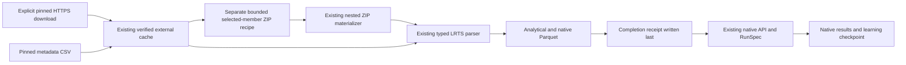

# Download LRTS, convert to Parquet and run COLEMAN

This workflow uses **real public Karaf test reports**, not the owned correctness
fixture. It downloads pinned source bytes, converts eight selected reports into
Parquet, writes a completion/provenance manifest and executes Random and UCB
through the existing native TCPCI runner. Repeating the command reuses verified
inputs and resumes the same native checkpoint.

Use Python 3.14+ and a wheel built from a source revision containing this command.
The published 4.6.0 wheel predates this ETL. From that source checkout:

```bash
uv build --wheel
# Install the wheel just built into your activated experiment environment.
python -m pip install dist/coleman-*.whl
```

Choose cache and output directories outside Git. No Docker, optional MCP SDK,
credentials or provider account is required:

```bash
python -m coleman.transports.lrts_etl \
  --cache /tmp/coleman-lrts-source-cache \
  --output /tmp/coleman-lrts-data \
  --fetch --run

# Reopen the same source/data and continue the same native run, offline:
python -m coleman.transports.lrts_etl \
  --cache /tmp/coleman-lrts-source-cache \
  --output /tmp/coleman-lrts-data \
  --run
```

`--fetch` explicitly permits the two pinned public HTTPS downloads. A verified
cache hit makes no request. Each request has a 15-second inactivity timeout and
a 300-second elapsed budget checked between reads; this is not an OS deadline
for DNS/headers. Failed acquisitions publish no complete source blob. A retry
reuses completed blobs and restarts any incomplete download from byte zero.
Without `--run`, the command only prepares data. Exceptions return nonzero and
never print a successful ETL summary. The final JSON reports the completion path,
analytical table, native datasets directory, exclusions and native run location.

## What the recipe selects

The preset `lrts-karaf-first-eight-v1.json` pins:

- `karaf.zip` from [LRTS raw reports v3](https://zenodo.org/records/15603448):
  16,571,092 bytes, SHA-256
  `d87c5fa06f5b220ca0f719ba4032719396a5da3dd0776994ceaa32cc2fcd5841`;
- the 13,698,468-byte metadata CSV at repository revision
  `2c1b68e9b1d4ec6c4f304869e36af2e3168da889`, previously matched byte-for-byte
  to the [original code artifact](https://zenodo.org/records/12662090);
- eight outer ZIP members and each nested ZIP's decoded JSON, with independent
  SHA-256 and byte counts;
- separately reviewed CC BY 4.0 record evidence for metadata and raw reports.

Credit: Runxiang Cheng, Shuai Wang, Reyhaneh Jabbarvand and Darko Marinov,
[*Revisiting Test-Case Prioritization on Long-Running Test Suites*, ISSTA 2024](https://doi.org/10.1145/3650212.3680307).
Their dataset/component terms remain separate from COLEMAN's MIT license. The
recipe-only disposition keeps downloaded and converted content in external local
storage; COLEMAN bundles metadata/pins, not third-party rows or archives.

The slice contains the first eight Karaf builds when sorting the pinned metadata
by its scheduled label, PR and source build ID. It is a declared bounded slice,
not the entire project/corpus or the authors' confirmatory profile:

| Replay round | Source PR | Source build |
| ---: | --- | ---: |
| 1 | PR-1213 | 3 |
| 2 | PR-1077 | 2 |
| 3 | PR-1213 | 4 |
| 4 | PR-1077 | 3 |
| 5 | PR-1287 | 1 |
| 6 | PR-1287 | 2 |
| 7 | PR-1288 | 1 |
| 8 | PR-1289 | 1 |

## Files you can actually use

The JSON summary points to a content-addressed export directory:

```text
corpus-etl/<export-id>/
  observations.parquet
  builds.parquet
  datasets/karaf/features-engineered.parquet
  complete.json
```

`observations.parquet` preserves **6,876 source method executions**, including
repeated labels, skipped/unknown outcomes, unavailable durations, observed zero,
raw suite/node/enclosure identities and raw suite timestamp spelling. Duration
columns explicitly include seconds, source meaning and availability status.
`execution_id` identifies the actual project/PR/build/suite/case position.
`replay_name` separately identifies an assumed cross-round label correspondence.
Neither identifies a unique fault.

`builds.parquet` maps every modeled round back to its actual source PR/build and
preserves typed metadata as canonical JSON. Scheduled epoch labels remain
separate from `outcome_available_at`, which is null. Per-round replay counts and
eligibility retain rounds with no compatible reported cases.

The native Parquet has **6,567 compatible executions** with the existing
`BuildId`, `Name`, `Duration`, `CalcPrio`, `LastRun` and `Verdict` columns, plus
`SourceExecutionId` for the audit join. The **309 not-run methods** remain in the
analytical table and are explicitly excluded from runnable input. Unknown
outcomes and unavailable durations have separate exclusion reasons; neither is
filled with zero or pass. All 29 reported failed executions remain runnable.

`complete.json` is written last using the existing immutable artifact writer. It
binds the full recipe, actual producer digest, writer version, logical-row digest,
three file digests/sizes/counts, source dataset identities and conserved metadata
and method exclusions. A partial export lacks this receipt. Individual complete
files/cache blobs can survive an interruption and are checked again on retry.
Concurrent identical exports converge; conflicting contents fail closed.

Inspect the result using the exact path printed by the command:

```python
from pathlib import Path
import polars as pl

root = Path("/absolute/export/path/from/the/completion/summary")
observations = pl.read_parquet(root / "observations.parquet")
print(observations.group_by("outcome", "replay_exclusion").len())
print(pl.read_parquet(root / "builds.parquet"))
native = pl.read_parquet(root / "datasets/karaf/features-engineered.parquet")
assert native.height + observations.filter(pl.col("replay_exclusion").is_not_null()).height == observations.height
```

## Meaning of the native run

The default run uses existing Random and UCB (`c=1`) policies, RNFail, seed 42
and a 50% ratio budget, with native Parquet results and checkpoints. Eight rounds
times two policies produce 16 native result rows. Repeating the command resumes
those rows rather than appending another experiment. The exact ETL receipt is
included in the native artifact manifest. Native run parameters/provenance remain
available through the existing RunSpec/API, without a second runner.

This is explicitly a **post-hoc serial simulation**:

- rounds follow scheduled source labels, not verified completion/availability;
- costs add reported method seconds, not measured runner occupancy or CI latency;
- feedback uses `budget-censored-native-RNFail-zero-nondetection`: detected
  failures within budget earn reward 1; all other prioritized cases, including
  unscheduled ones, earn reward 0. Zero reward means nondetection, not an observed
  pass or a calibrated failure probability. Source verdicts remain unchanged;
- matching suite/context/class/method labels and occurrence order are an assumed
  correspondence, not verified stable cross-build identities;
- `CalcPrio=0` is a neutral native input and empty `LastRun` retains unavailable
  history, without creating a wall-clock date;
- verdicts count reported failing executions, never independently mapped faults.

The [source assessment](lrts.md) remains in force. Admission stays
`blocked_source_evidence`, generalization stays `insufficient_evidence` and
protected temporal evaluation remains unavailable. The generated files are usable
for inspection and this declared simulation; results cannot establish policy
superiority, prospective savings or confirmatory cross-corpus generalization.
Seeds, PRs and repeated executions do not become independent projects/faults.

Legacy receipts declaring `full-reported-labels-after-modeled-round` remain
readable and their analytical Parquet remains verifiable. New exports, downloads
and native execution reject that declaration: the existing RNFail learner never
provided full-label feedback. To opt into the corrected model, explicitly create
a recipe with `feedback="budget-censored-native-RNFail-zero-nondetection"` and
export again. This creates a new recipe/export/run identity; retain the old
receipt unchanged for audit. Missing/unknown feedback declarations reject rather
than acquiring an implicit meaning. Existing results must not be silently relabeled.

## Architecture and compatibility



The old complete-package v1 ZIP contract still allows at most 128 entries and
rejects ZIP64. The **separate selected-member recipe** allows an explicitly
bounded directory of up to 4,096 entries and 2 MiB metadata. It validates every
name/type/local header before decoding only the declared members (at most 128,
64 MiB selected total). Unselected payloads are not decoded/certified. Full
container SHA-256 and selected/nested digests remain mandatory. No archive path
is used as an output filesystem path.

New ETL/selection contracts require schema version 1 and reject missing/future
versions. Existing native Parquet, source receipts, results and checkpoints keep
their meanings. No legacy migration is performed. Fixed Parquet settings and the
recorded Polars version support byte reproducibility; logical-row identities are
independent of physical encoding. `validate_lrts_etl` rechecks actual cached
sources and actual Parquet schema/rows/bytes offline rather than trusting a JSON
declaration. Integrity checks do not authenticate historical producer execution.

## Reproduce package validation

Normal tests use only owned tiny fixtures. For installed real-source verification,
first populate the explicit cache above, then run from the source checkout:

```bash
COLEMAN_LRTS_ETL_REAL_CACHE=/tmp/coleman-lrts-source-cache \
  uv run pytest tests/corpus/test_installed_lrts_etl.py --no-cov -q
```

This installs a wheel outside the checkout, verifies core import boundaries,
converts real source bytes and runs/reopens actual native checkpoints. Network
acquisition remains a separate explicit verification. Other projects, larger
slices, additional baselines and protected confirmatory evidence remain #261 work.
