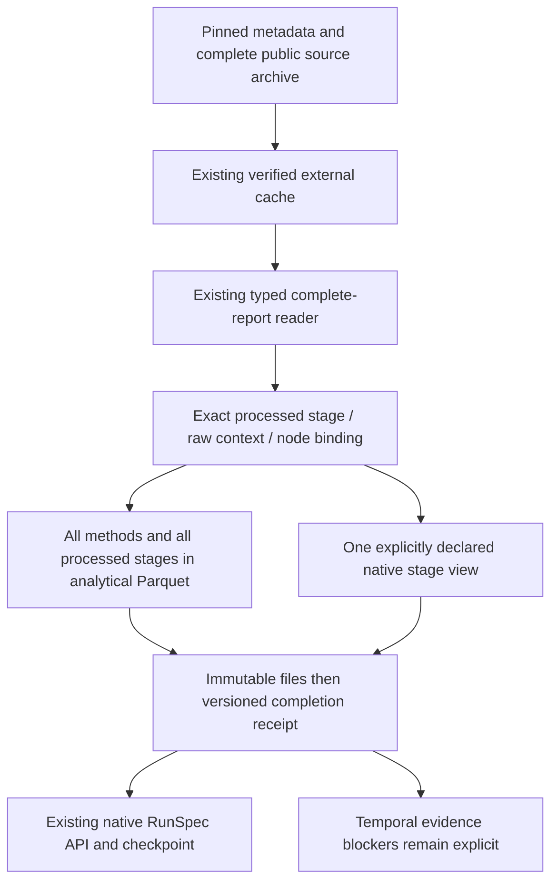

# Run larger LRTS histories without merging their stages

Use four-build ActiveMQ and Log4j source profiles to turn verified public Jenkins
reports into analytical Parquet and checkpointed TCPCI runs. ActiveMQ supplies a
larger single-stage history; Log4j keeps its reported Ubuntu and Windows contexts
separate. Each view runs Random and UCB through the existing native API.

The published **4.17 wheel** includes this stage-view workflow and retains
[Karaf](lrts-parquet-etl.md) and [RTPTorrent](rtptorrent-parquet-etl.md). It contains
the typed contracts and frozen public source recipes; large archives remain
separate operator downloads.

## Install outside checkout and acquire exact bytes

With Python 3.14+ and uv, install the published wheel into a fresh external
environment. Its SHA-256 is verified before installation. Keep sources, cache
and outputs outside any Git repository; no checkout is needed:

```bash
uv venv /tmp/coleman-stage-env --python 3.14
uv pip install --python /tmp/coleman-stage-env/bin/python "https://github.com/jacksonpradolima/coleman/releases/download/v4.17.0/coleman-4.17.0-py3-none-any.whl#sha256=e5a272ddc0edf72bd909a743fa2b3bc0dfeb8a02871c487ab22683cddeea40ca"
mkdir -p /tmp/coleman-stage-sources

# Explicit operator downloads can resume; the ETL separately verifies full hashes.
curl --fail --location --continue-at - \
  https://zenodo.org/records/15603448/files/activemq.zip \
  --output /tmp/coleman-stage-sources/activemq.zip
curl --fail --location --continue-at - \
  https://zenodo.org/records/15603448/files/log4j.zip \
  --output /tmp/coleman-stage-sources/log4j.zip
```

The [authors' raw-report record, v3](https://zenodo.org/records/15603448) declares
CC BY 4.0 for the dataset. The new recipes pin the specific record, reviewed
[CC BY 4.0 terms](https://creativecommons.org/licenses/by/4.0/legalcode.txt),
complete archive bytes, selected nested ZIPs and decoded reports. Data terms do
not establish rights to execute subject code. No subject repository is executed.
Downloaded and converted data stay external; COLEMAN bundles recipes, not rows.

| Complete source | Bytes | SHA-256 |
| --- | ---: | --- |
| `activemq.zip` | 161,568,227 | `5fe63b10167fb0e9995484bbc4131e4ab6ece462acc76faf6db7813c9484ab1f` |
| `log4j.zip` | 41,551,352 | `dc6639607b5378451a4a1a558289d4fdf899a3f176e0c9d81a813a18dcdc635c` |

Metadata is the same pinned 57,437-row, 21,255-build paper snapshot used by the
existing reader: repository revision
`2c1b68e9b1d4ec6c4f304869e36af2e3168da889`, 13,698,468 bytes, SHA-256
`49570f8dca753c385f25346f8aaaded3a841b0e67dabf36fbb67260a79b02987`.
It is distinct from the later collection described by the authors' README.
Credit: Runxiang Cheng, Shuai Wang, Reyhaneh Jabbarvand and Darko Marinov,
[*Revisiting Test-Case Prioritization on Long-Running Test Suites*, ISSTA 2024](https://doi.org/10.1145/3650212.3680307).

## Convert, run and resume

```bash
/tmp/coleman-stage-env/bin/python -m coleman.transports.lrts_stage_etl \
  --preset activemq --archive /tmp/coleman-stage-sources/activemq.zip \
  --fetch-metadata --cache /tmp/coleman-stage-cache \
  --output /tmp/coleman-stage-activemq --run

/tmp/coleman-stage-env/bin/python -m coleman.transports.lrts_stage_etl \
  --preset log4j-ubuntu --archive /tmp/coleman-stage-sources/log4j.zip \
  --cache /tmp/coleman-stage-cache --output /tmp/coleman-stage-log4j-ubuntu --run

/tmp/coleman-stage-env/bin/python -m coleman.transports.lrts_stage_etl \
  --preset log4j-windows --cache /tmp/coleman-stage-cache \
  --output /tmp/coleman-stage-log4j-windows --run

# Reverify and resume the identical ActiveMQ run, with no network or archive path.
/tmp/coleman-stage-env/bin/python -m coleman.transports.lrts_stage_etl \
  --preset activemq --cache /tmp/coleman-stage-cache \
  --output /tmp/coleman-stage-activemq --run
```

Only `--fetch-metadata` enables network access, for the pinned CSV through the
existing bounded public HTTPS adapter. Its inactivity/elapsed limits are
unchanged. Alternatively supply the exact local CSV with `--metadata PATH`.
`--archive` always checks the explicitly supplied complete archive, even when
verified cache blobs already exist. Download failures or partial files do not
become complete source artifacts. Both archives use the existing ordinary ZIP
selection profile, not a widened legacy ZIP policy or the ZIP64 reader.

Omit `--run` to prepare data only. The final JSON identifies the analytical files,
completion receipt, native run, conserved exclusions and temporal blockers.
Runner logs go to stderr; JSON goes to stdout. Invalid source, unknown versions,
ambiguous mapping or unsafe destinations fail nonzero. Repeating the same
arguments reuses the same immutable export and native checkpoint.

Actual source/installed-package checks produced:

| Native view | Analytical methods | Native cases | Outside stage | Not run in selected stage | Native result rows |
| --- | ---: | ---: | ---: | ---: | ---: |
| ActiveMQ | 18,901 | 18,668 | 0 | 233 | 8 |
| Log4j Ubuntu | 30,066 | 14,957 | 15,014 | 95 | 8 |
| Log4j Windows | 30,066 | 14,906 | 15,052 | 108 | 8 |

Each view has four modeled rounds and two policies. Unknown-outcome and
unavailable-duration exclusions are zero in these particular slices, not
globally assumed absent. The two Log4j analytical row sets overlap completely;
do not add their row counts as if they were independent source observations.

## Frozen source selection and stage correspondence

Candidates are selected by reported scheduled label, PR and source build ID,
without conditioning on failures. Labels order modeled rounds; they are not
verified outcome chronology. The four-build slice keeps each project under
50,000 methods and each decoded report under 16 MiB.

| Project | Selected PR/build keys | Processed stages per build |
| --- | --- | ---: |
| ActiveMQ | PR-644/1, PR-656/1, PR-669/3, PR-679/1 | 1 |
| Log4j | PR-441/2, PR-442/1, PR-392/9, PR-443/1 | 2 |

The three recipes are `lrts-activemq-first-four-stage-v1.json`,
`lrts-log4j-ubuntu-first-four-stage-v1.json` and
`lrts-log4j-windows-first-four-stage-v1.json`, inside `coleman.corpus.resources`.
The last two select different native views of the **same full source reports**.

Every binding explicitly pins source PR/build, processed `stage_id`, the **exact
ordered** `enclosingBlockNames` array and complete raw node-ID set. ActiveMQ's
`single` maps to `[Tests]` / node `92` in the selected reports. Log4j bindings are:

| PR/build | `Ubuntu_Test` → `[Ubuntu, Test]` node | `Windows_Test` → `[Windows, Test]` node |
| --- | --- | --- |
| PR-441/2 | 79 | 67 |
| PR-442/1 | 78 | 66 |
| PR-392/9 | 67 | 73 |
| PR-443/1 | 78 | 66 |

All selected metadata stages and all raw suites, including empty suites, must
match the relation exactly. Extra, missing, conflicting or ambiguous bindings
reject. There is no underscore concatenation, substring matching or automatic
slug inference. `[a_b, c]` and `[a, b_c]` are distinct contexts. Raw
`enclosingBlocks` remains a separate array; it need not have the same length as
the name array. Node IDs are local to a build and do not establish test continuity.
Reported Ubuntu/Windows labels do not certify runner OS or machine topology.

## Files, identities and explicit semantics



Each content-addressed export contains exactly three Parquet roles followed by
`complete.json`:

```text
corpus-etl/<recipe-producer-writer-identity>/
  observations.parquet
  builds.parquet
  datasets/<explicit-dataset-id>/features-engineered.parquet
  complete.json
```

`observations.parquet` retains every original project/PR/build/suite/case identity,
raw status, outcome, node/context arrays, raw timestamp spelling and duration.
Seconds carry their source meaning and availability status. Observed zero is
zero; unavailable duration remains null; skipped and unknown outcomes never
become passes. Negative, NaN and infinite durations reject under the existing
nonnegative source-seconds contract. Distinct processed class/method counts and
raw outcomes are never substituted for one another.

A primary `replay_exclusion` conserves each row: `outside_stage` first, then
`not_run`, `unknown_outcome`, `unavailable_duration`, or null for native eligibility.
Outside-stage rows retain their original outcome and duration, even if skipped.

`builds.parquet` retains **all** processed stage DTOs in canonical `metadata_json`,
stage counts and original source keys. Repeated build-level metadata must agree
across stages. Stage-specific filtered class/method counts and cost sums remain
separate. `outcome_available_at` is null. `source_build_group` is stable over the
same project/PR/build labels; both Log4j views share it and source dataset digests.
Those views are correlated observations, not two independent projects or faults.

Native `Name` includes the explicit stage and suite/class/method occurrence;
occurrences are assigned before eligibility. `SourceExecutionId` joins the exact
raw execution; it is stable across views and is distinct from assumed cross-round
identity. Native `Duration` is additive reported method seconds. Native `BuildId`
is a local modeled round. No native quantity means observed parallel CI savings.

Native RNFail feedback is budget-censored: prioritized cases without detected
failure receive zero nondetection reward, including unscheduled cases. Zero
reward does not mean a reported pass, calibrated probability or full-label update.
The profile does not reproduce the paper's All, DeConf or FirstFail class filters.

## Typed API and compatibility

```python
from pathlib import Path

from coleman.application.corpus import run_lrts_stage_replay
from coleman.artifacts import ArtifactWriter
from coleman.corpus.lrts_stage_contracts import LRTSStageRecipe, LRTSStageReceipt
from coleman.corpus.lrts_stage_etl import export_lrts_stage_parquet, validate_lrts_stage_etl
from coleman.corpus.materialization import SourceCache
from importlib.resources import files

recipe = LRTSStageRecipe.from_json(
    files("coleman.corpus.resources").joinpath("lrts-log4j-ubuntu-first-four-stage-v1.json").read_bytes()
)
cache = SourceCache("/tmp/coleman-stage-cache")  # Acquired with the command above.
completion = export_lrts_stage_parquet(recipe, cache, ArtifactWriter("/tmp/coleman-stage-api"))
receipt = LRTSStageReceipt.from_json(completion.read_bytes())
validate_lrts_stage_etl(receipt, cache, completion.parent)
result = run_lrts_stage_replay(completion, cache, Path("/tmp/coleman-stage-api-native"))
print(result.run_id, receipt.admission, receipt.temporal.model_dump())
```

The new `lrts-stage-parquet-replay-v1` family requires integer `schema_version=1`.
Missing, coerced, unknown or future versions reject. Canonical recipe metadata is
at most 1 MiB; transport recipe/receipt reads are capped at 2 MiB. Native aliases
also reject Windows device names, including case variants and dotted extensions,
on every host before acquisition. Fixed Parquet settings and the recorded Polars
version bind physical bytes; canonical rows
separately bind logical meaning. Validation regenerates source-derived expected
bytes and rejects forged/self-signed Parquet without decoding it.

The actual producer digest binds conversion/contract/storage code. Unknown
producer or writer versions require their recorded implementation; regeneration
under changed code produces a different namespace. Old single-stage recipes,
receipts, producer semantics and RunSpec identities remain unchanged. They use
`export_lrts_parquet`, `validate_lrts_etl` and `run_lrts_replay`; the old exporter
continues to reject multistage reports. **No automatic artifact migration occurs.**
To opt in, create a new explicit stage recipe and export into its own namespace;
retain old artifacts and their pinned environment when reproducing old results.

The immutable writer publishes all three bounded files before the completion
receipt. Interrupted writes may leave individual files; they never certify a new
completed export. Identical concurrent retries converge, byte disagreements
reject, and existing checkpoints resume without duplicate committed results.
Cache/output/native destinations are preflighted before acquisition, including
symlinks and nested Git repositories. These are trusted-local cooperative
filesystem guarantees, not an OS sandbox or a distributed transaction.

## Source-specific admission decision

All new profiles remain `blocked_source_evidence` /
`posthoc-serial-simulation` / `insufficient_evidence`. Exact stage correspondence
is resolved for these reports. Other necessary evidence is still unavailable:

| Required evidence | Source finding and decision |
| --- | --- |
| Executor start | Metadata provides a truncated scheduling label; no certified executor-start event. |
| Outcome availability | Raw suite timestamps are null in these selected reports; schedule plus duration cannot identify outcome availability. |
| Feature availability | Processed/retrospective metadata has no certified decision-time feature publication log. |
| Expected test universe | Reported methods do not establish tests expected but absent from a build. |
| Cross-round correspondence | Stage/suite/class/method occurrence is an explicit matching assumption, not verified stable source test identity. |
| Concurrency topology | Raw node/context links and duration sums do not supply executor overlap, queueing or physical runner occupancy. |

`receipt.temporal.require_temporal_evaluation()` rejects with these blockers.
The selected archives contain raw test reports, not independent build/executor
logs. The [pinned extraction code](https://github.com/lrtsuser/LRTS/blob/2c1b68e9b1d4ec6c4f304869e36af2e3168da889/artifact/extract_test_result.py)
normalizes contexts, filters methods, drops duplicate labels and constructs
class outcomes; that behavior does not make its results available before a
historical decision. See the [original source assessment](lrts.md) for snapshot,
filtering and clock boundaries. No author baseline, algorithm win, independent
fault count or prospective production improvement is claimed.
