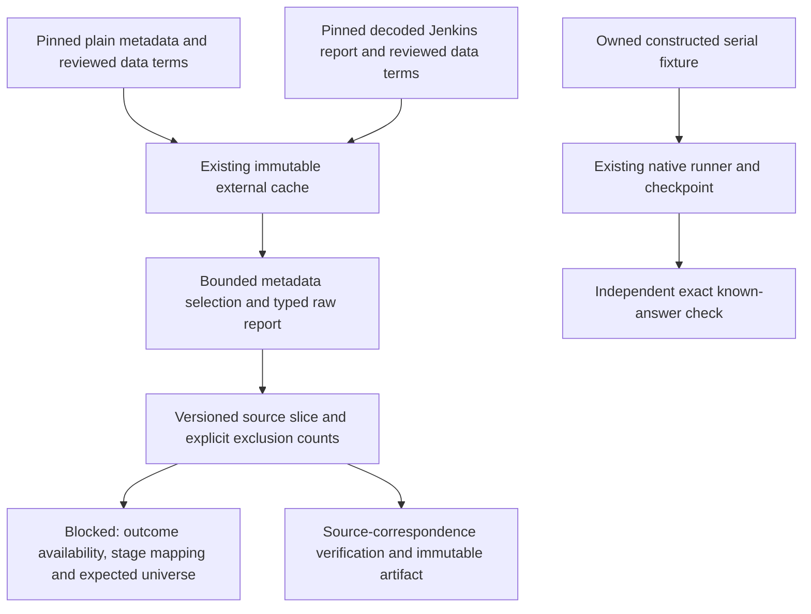

# LRTS: preserve raw method evidence and processed metadata

COLEMAN 4.5 includes an offline LRTS source-assessment reader. It joins one
selected project/PR/build from pinned metadata with a separately pinned raw
Jenkins JUnit report. It retains raw suites, node/enclosing-block links and every
method execution, including repeated labels. Install the verified 4.5 release
wheel to run these examples.

**Admission remains blocked.** Scheduled build time is not executor start or
outcome availability. Processed stage labels are not an automatic mapping to raw
Jenkins nodes. Reported methods do not establish the complete expected CI suite.
No inferred clock, stage-name normalization, deduplication or reconstructed
history enters protected evaluation through this reader.

## Source assessment and snapshot boundaries

This is a focused primary-source compatibility assessment, not a completed
systematic literature review or an effectiveness experiment. Sources checked on
2026-10-16 UTC include:

- [The authors' ISSTA 2024 paper](https://doi.org/10.1145/3650212.3680307)
  ([author PDF](https://shuaiwang516.github.io/pub/longRTS.pdf)). Its evaluation
  snapshot has 21,255 builds and 57,437 suite runs. All, DeConf and FirstFail are
  different outcome definitions. The paper uses serial sums when discussing
  suite durations; those sums are not observed parallel CI latency.
- [Pinned LRTS repository revision](https://github.com/lrtsuser/LRTS/tree/2c1b68e9b1d4ec6c4f304869e36af2e3168da889).
  Its metadata CSV still has the paper-sized snapshot, while its README describes
  a later 32,199-build / 108,366-run collection. These counts must not be pooled.
- [Original artifact record 12662090](https://zenodo.org/records/12662090):
  `LRTS-main.zip`, 288,151,681 bytes, provider MD5
  `be5b2c0c83e46e20453acab18c2a6da7`, independently computed SHA-256
  `9e3ca483a7ed075cc532364ca5b58cc3651d4a622ec5fd58efdefd945b3853d0`.
- [Raw-report record 15603448, v3](https://zenodo.org/records/15603448): its
  `karaf.zip` is 16,571,092 bytes, provider MD5
  `6f0d45a08644d19594692c11e5508300`, computed SHA-256
  `d87c5fa06f5b220ca0f719ba4032719396a5da3dd0776994ceaa32cc2fcd5841`.
  The earlier raw record 15580600 is v2, not this same version declaration.

Both complete downloaded archives passed size/provider-checksum comparison.
The decoded `LRTS-main/artifact/metadata/dataset.csv` is byte-identical to the
pinned Git file: 13,698,468 bytes, SHA-256
`49570f8dca753c385f25346f8aaaded3a841b0e67dabf36fbb67260a79b02987`.
This correspondence supports reviewing the specific artifact's data terms,
rather than inferring data rights from the repository's MIT code license.
The checked Zenodo records declare CC BY 4.0; keep specific terms/version/digest
evidence and use recipe-only disposition when preparing local converted rows.

The original code artifact has 2,037 ZIP entries; the Karaf raw archive has 1,256.
Both exceed the existing materializer v1's hard 128-entry ceiling. A real call
through the published 4.4.1 package rejects the Karaf ZIP with
`ZIP metadata exceeds declared resource limits`. This reader accepts already
pinned **decoded plain members**, not those unsupported archive containers.
Their acquisition/extraction needs a separately reviewed capability or tool;
relabeling an archive as an already validated ZIP would bypass the contract.
No archive policy or automatic fetch command is silently widened here.

### A bounded real-source check

The metadata has 620 Karaf builds, all with the processed label `single`.
All 620 have corresponding paths in the v3 raw archive, which contains another
106 reports. This establishes path coverage, not equivalence of the snapshots
or proof that any stage/test observations are independent.

The separately decoded report
`karaf/PR/PR-1581/testReport_build1.json.zip!testReport_build1.json`
has 508,512 bytes and SHA-256
`351f0bc92ad8659b170750eea61091689ae7258fbbd99b4b0f0d3f33be8f935b`.
The real reader produced:

| Fact | Result |
| --- | ---: |
| Metadata rows read | 57,437 |
| Rows outside the selected build | 57,436 |
| Selected processed metadata stages | 1 |
| Raw suites | 228 |
| Reported method executions | 931 |
| Repeated class/method labels retained | 4 |
| Reported passed / failed / skipped methods | 892 / 0 / 39 |

This one descriptive slice is not a large-suite performance study, independent
verification of whole-build success, or a complete LRTS admission. The metadata
and raw count/duration declarations match for this pair. A source change must
still pass the actual correspondence checks; a filename alone proves no join.

The pinned extraction code filters skipped methods, rewrites some class names,
drops selected duplicates and rounds method sums to three places. Those processed
class values remain distinct from this reader's raw method outcomes. Retrospective
flaky labels, full-history outlier filters and FirstFail labels must not silently
become features available before a decision. Author baseline results are not
reproduced COLEMAN results.

## Units, clocks and compatibility



`LRTSSpec` and `LRTSDataset` require integer `schema_version=1` and recipe
`lrts-source-assessment-v1`. Missing/legacy/future versions and unknown fields
reject. There is no automatic migration from native Parquet, RTPTorrent,
filtered LRTS outcome tables or arbitrary JUnit XML. The exact 23-column paper
metadata header and Jenkins `hudson.tasks.junit.TestResult` layout are required.

The reader reuses `Measurement` for explicit binary64 projections and units.
All five metadata quantities remain separate: truncated build execution seconds,
truncated scheduled Unix-epoch seconds, reported JUnit duration, suite-duration
sum and processed-class-duration sum. No sum is labeled physical runner occupancy
or parallel elapsed savings. Numeric literals must round-trip through canonical
binary64 spelling; nonfinite, negative, underflowed or overprecise values reject.
Genuine signed zero canonicalizes to zero; blank metadata quantities and JSON
null durations retain `value=null`, `status=unavailable` and their declared units.
Null counters remain unavailable integers, never zero. Unsupported not-applicable
encodings reject instead of being invented.

The original `ts_duration`, `passcount`, `failcount` and `skipcount` columns are
build-report aggregates repeated across processed stage rows. They are checked
against the one selected build report. Processed stage sums and `num_*` counts
retain their own scope and may differ across stages. This check establishes no
mapping from processed stages to raw suite/node identities.

[Jenkins Run documentation](https://javadoc.jenkins.io/hudson/model/Run.html)
distinguishes scheduled time from executor start after queueing. The pinned LRTS
code truncates scheduled milliseconds and execution duration to seconds. Adding
those fields cannot certify completion when queue delay is unknown. The source's
`build_date` is also an uninterpreted producer label; its generating code used a
local-time conversion. Raw suite timestamp strings, node IDs and enclosing links
are retained without assigning them outcome-availability semantics.

Source execution identity includes project, PR, build, suite position, method
position and class/method labels. It is stable for the same declared source
executions, not a cross-build logical test mapping. Metadata sorts by processed
stage ID for serialization; raw arrays retain their positions. Identical selected
metadata duplicates have explicit exclusion counts; conflicts reject. Repeated
raw method labels remain separate executions and never become independent faults.
Only the selected build's numeric metadata is interpreted. Other physical rows
are counted as outside the selection after shape/identity checks, not certified
as fully validated observations.

PASSED/FIXED mean reported pass; FAILED/REGRESSION mean reported failure;
SKIPPED means not run. A null status remains unknown unless the source explicitly
says skipped. Contradictory skipped/status flags reject. ABORTED/NOT_BUILT and
other metadata build results remain visible. Neither passing cases nor aggregate
counters promote an unknown method into a pass or establish complete feedback.
The Jenkins exported `empty` flag must agree with the reported method count;
contradictions reject rather than being repaired or published.
Diagnostic text, plugin actions, age and failed-since hints are not decision features.

Limits are 32 MiB for metadata, 16 MiB for one decoded report, 100,000 physical
metadata rows, 16 KiB per CSV line, 1,024 characters per CSV field, 64 characters
per numeric CSV literal, 64 selected metadata stages, 5,000 raw suites and 50,000
reported methods. Limits may be lowered in the frozen spec where exposed.
These are bounded inputs, not an OS memory/CPU sandbox or global cache quota.

## Complete owned CI example

Install the verified 4.5 release wheel in an activated Python 3.14+ environment.
Copy the complete [owned CI example](https://github.com/jacksonpradolima/coleman/blob/main/examples/lrts/ci.py)
to `ci.py` outside the checkout. It authors both sources, uses the real cache and
reader, projects only its declared complete serial fixture to native Parquet,
runs Random/RNFail, checks independent exact references and reopens the learning
checkpoint. It downloads no third-party data and creates no observed CI timeline.

```bash
python ci.py owned-ci /absolute/path/outside-git/lrts-cache
python ci.py owned-ci /absolute/path/outside-git/lrts-cache
```

The two calls retain one native result row and the same converted artifact.
With that same copied `ci.py`, this complete SDK example also works outside Git:

```python
from pathlib import Path
from tempfile import TemporaryDirectory

from ci import owned_dataset
from coleman.artifacts import ArtifactWriter
from coleman.corpus import SourceCache
from coleman.corpus.lrts import convert_lrts_source, publish_lrts_dataset, validate_lrts_dataset

with TemporaryDirectory() as temporary:
    root = Path(temporary)
    cache = SourceCache(root / "external-cache")
    owned, _ = owned_dataset(cache)
    dataset = convert_lrts_source(owned.spec, cache)
    assert len(dataset.cases) == 3
    validate_lrts_dataset(dataset, cache)
    artifact = publish_lrts_dataset(dataset, cache, ArtifactWriter(root / "exports"))
    assert artifact.exists()
    try:
        dataset.require_temporal_evaluation()
    except ValueError as error:
        print(error)  # Expected: source availability/stage/universe evidence is missing.
    else:
        raise AssertionError("A source-assessment slice entered protected evaluation")
```

The copied helper and MIT terms apply only to newly authored fixtures. For real
sources, construct `LRTSSpec` from separately verified permitted metadata/report
receipts and the explicit original report label; never reuse an owned fixture's
license for downloaded data. The cache remains outside Git and physically
separate from outputs. Converted recipe-only rows stay local.

`validate_lrts_dataset` recomputes from the actual pinned bytes; JSON reads alone
only check model invariants. Immutable publication reuses existing concurrent
retry, conflict and interrupted-write behavior, without writing a learning
checkpoint or marking an experiment complete. Filesystem durability/process-kill
temporary-file limits remain those of the artifact writer. The registry and its
seven uncovered diversity regimes are unchanged. Controlled faults, stress cases,
comparable baselines, protected confirmation and modern-CI feasibility remain
subsequent work under [#261](https://github.com/jacksonpradolima/coleman/issues/261).
