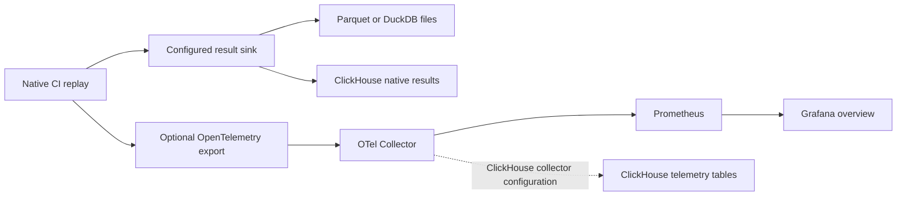

# Follow experiment progress and resource usage

See which experiments are active, how far they have progressed, and how much
CPU time and memory the COLEMAN process uses. Keep results in local Parquet or
DuckDB, or send native result rows to ClickHouse. Add OpenTelemetry, Prometheus
and Grafana when you want a live view of longer experiments and sweeps.

**Start locally:** the [first experiment](getting-started.md) needs none of these
services. Process resource samples are persisted even with telemetry disabled.



Result storage and telemetry export are configured separately. Selecting the
ClickHouse result sink does not enable telemetry; starting the ClickHouse
container does not select either exporter.

## Understand resource measurements

Native result rows contain the following process observations. CPU and memory
instruments also reach the collector when telemetry is enabled.

| Result column | Unit and interpretation |
| --- | --- |
| `process_memory_rss_mib` | MiB of resident memory at the sample; currently read from Linux `/proc/self/statm`; unavailable platforms retain `NULL` |
| `process_memory_peak_rss_mib` | MiB, the process lifetime high-water mark from `getrusage`; supported on Linux and macOS; may include earlier work in a reused worker |
| `process_cpu_utilization_percent` | CPU time / wall time between consecutive samples × 100; can exceed 100% with multiple active threads |
| `process_cpu_time_seconds` | Process CPU seconds accumulated since the execution attempt's tracker was created |
| `wall_time_seconds` | Monotonic elapsed seconds since that tracker was created |

These samples measure **the COLEMAN worker process**, which can execute several
policies. They do not attribute memory or CPU exclusively to an individual
policy, include every child process, or measure the subject's CI infrastructure.
The tracker restarts on a new attempt, including a checkpoint continuation; do
not sum cumulative samples or assume the counters span attempts. A sampled RSS
can miss a short-lived spike; the peak RSS is process-wide rather than a
per-build allocation measurement. Missing readings are `NULL`, not zero.

The legacy `cost` column is **APFDc**, a quality metric; it is not CPU time,
elapsed seconds or a monetary cost. Use [operational accounting](operational-pilot.md)
and [resource replay](resource-replay.md) for declared subject-workload evidence.
For deeper framework profiling, follow [Scalene and py-spy](code-cost.md#2-runtime-cost).
The [energy workflow](code-cost.md#3-energy-cost) is separate developer tooling;
the runner does not emit energy measurements by default.

## Watch a run

### 1. Install the optional client

Use the virtual environment from the [first experiment](getting-started.md).
Install telemetry support from a pinned release wheel:

```bash
python -m pip install "coleman[telemetry] @ https://github.com/jacksonpradolima/coleman/releases/download/v4.19.1/coleman-4.19.1-py3-none-any.whl#sha256=ca470ba2be14ca755952f0bb3bc92615d76b90f95ebdd41dc1cdc9847713cc93"
```

### 2. Start the optional local services

Clone the repository to obtain the Compose and dashboard configuration, then run
this command from the checkout root with Docker Compose available:

```bash
docker compose -f examples/observability/docker-compose.yaml up -d
```

This starts the collector, Prometheus and Grafana. The checked-in configuration
is a local development stack with anonymous Grafana admin access; use it in a
trusted local environment. Deployment authentication, retention and network
access need their own configuration.

The [DevContainer](https://github.com/jacksonpradolima/coleman/tree/main/.devcontainer)
installs the telemetry and ClickHouse extras and attempts to start the services
with the ClickHouse profile automatically. It still requires telemetry to be
enabled in the experiment; its default collector uses the base export routes.

### 3. Enable export for your experiment

Return to the directory containing the tutorial's `first_run.py` and `data/`.
Before its `result = run(spec)` line, add:

```python
spec.telemetry.enabled = True
spec.telemetry.otlp_endpoint = "http://localhost:4318"
spec.telemetry.export_interval_millis = 1000
```

Run `python first_run.py`. For a YAML experiment, set the same `telemetry` keys
in `run.yaml`, then use `coleman run --config run.yaml`. In a repository checkout,
the existing `telemetry/local` [configuration pack](configuration.md) supplies
the endpoint and enable flag. Set the endpoint to a reachable collector address
when the experiment runs in another container or host.

### 4. Inspect the dashboard and final results

| Endpoint | What to inspect |
| --- | --- |
| `http://localhost:3000` | Grafana → Dashboards → **Coleman Overview**, provisioned with a Prometheus datasource |
| `http://localhost:9090` | Prometheus UI and scrape status |
| `http://localhost:8889/metrics` | Collector's Prometheus exporter |

The overview includes active runs, cycle throughput, current cycle, NAPFD/APFDc,
prioritization/evaluation latency, CPU, resident memory and checkpoint save rate.
Filters cover dataset, execution ID, policy and budget value. The progress panel's
`target_steps` is a dashboard input: set it to your intended number of steps.
The panel named “Convergence Signal” summarizes observed NAPFD; it does not
establish statistical convergence or policy superiority.

Allow time for export and Prometheus scraping. A three-build tutorial may finish
before a scrape observes an active run. Several dashboard panels deliberately
filter to currently active experiments and can be empty after completion; use a
longer real workload for live monitoring and query stored rows for final facts.

The public run API retains local files under `runs/<run_id>/`: resolved
specification, provenance, `results/` for local sinks and `checkpoints/` when
enabled. A run directory alone does not certify successful completion.

## Choose result storage

| `results.sink` | Persisted native results | Dependency and concurrency notes |
| --- | --- | --- |
| `parquet` (default) | Compressed partitioned files under `runs/<run_id>/results/` | No service; atomic shard publication and native local checkpoint reconciliation |
| `duckdb` | `coleman_results` in local `.duckdb` files under the same results directory | Embedded dependency; process-parallel executions get separate files by default to avoid writer conflicts |
| `clickhouse` | `coleman_results` in the configured server/database | Requires the `clickhouse` extra and a reachable server; this sink appends rows and does not provide the local Parquet checkpoint reconciliation guarantee |

For embedded DuckDB, add this before `run(spec)` in the tutorial:

```python
spec.results.sink = "duckdb"
spec.results.duckdb = {"file_count": 1, "base_name": "results"}
```

With one sequential execution, inspect `runs/<run_id>/results/results.duckdb`:

```python
from pathlib import Path
import duckdb

for path in sorted(Path("runs").glob("*/results/*.duckdb")):
    with duckdb.connect(str(path), read_only=True) as connection:
        print(path, connection.sql("SELECT policy, step, fitness, cost FROM coleman_results"))
```

Do not assume retries into DuckDB or ClickHouse remove uncommitted/duplicate
native rows. Keep attempts distinguishable and choose Parquet when you need the
native local result/checkpoint reconciliation contract. Typed
[domain records](domain-results.md) have a separate compatibility and publication
contract; ClickHouse does not currently implement that capability.

## Use ClickHouse for native results or telemetry

Install both optional clients if you want both workflows:

```bash
python -m pip install "coleman[telemetry,clickhouse] @ https://github.com/jacksonpradolima/coleman/releases/download/v4.19.1/coleman-4.19.1-py3-none-any.whl#sha256=ca470ba2be14ca755952f0bb3bc92615d76b90f95ebdd41dc1cdc9847713cc93"
```

From the checkout root, start ClickHouse and select the collector configuration
that also stores telemetry in it:

```bash
OTEL_COLLECTOR_CONFIG=otel-collector-config-clickhouse.yaml \
  docker compose -f examples/observability/docker-compose.yaml --profile clickhouse up -d
```

Wait for `http://localhost:8123/ping` to return `Ok.` before running an experiment.
The collector also continues exporting metrics to Prometheus. Grafana provisions
a ClickHouse datasource for querying the server.

To store **native result rows**, add these settings before `run(spec)`:

```python
spec.results.sink = "clickhouse"
spec.results.clickhouse = {
    "host": "localhost", "port": 8123, "database": "default", "secure": False,
}
```

The local Compose server exposes plain HTTP on port 8123, so this example sets
`secure: false` explicitly. For a remote TLS endpoint, use its configured port
and retain the sink's `secure: true` and `verify: true` defaults.

`ClickHouseSink` creates its `coleman_results` table. Query it with a ClickHouse
SQL client or Grafana Explore:

```sql
SELECT policy, count() AS observations,
       max(process_memory_peak_rss_mib) AS process_peak_rss_mib
FROM coleman_results
GROUP BY policy
ORDER BY policy;
```

Telemetry uses separate `otel_*` tables managed by the pinned collector exporter.
Use `SHOW TABLES` and `DESCRIBE TABLE` to inspect its metric-type-specific schema
before querying it. The native runner emits metrics. The telemetry facade also
supports explicit trace instrumentation through `Telemetry.span()`; the runner does not
automatically emit per-step spans. The collector accepts OTLP logs, but the
facade does not automatically ship Python logs.
Starting only the ClickHouse profile with the base collector configuration starts
the database without enabling telemetry persistence.

## Instrument your own integration

To trace an analysis step, save this as `trace_results.py` beside the tutorial's
`runs/` directory and run it as a separate Python process with the telemetry
extra and collector available:

```python
import duckdb
from coleman.telemetry import Telemetry

telemetry = Telemetry(otlp_endpoint="http://localhost:4318")
with telemetry.span("ci.results.inspect", {"scenario": "example-ci"}):
    with duckdb.connect() as connection:
        print(connection.sql("""
            SELECT policy, COUNT(*) AS observations
            FROM read_parquet('runs/*/results/**/*.parquet', hive_partitioning=1)
            GROUP BY policy
        """))
telemetry.flush()
```

The base collector writes traces to its debug output. With the ClickHouse
collector configuration, inspect this span in `otel_traces` or Grafana Explore.
This is explicit integration instrumentation; it does not add per-step spans
to the native runner.

## Stop the local services

From the checkout root:

```bash
docker compose -f examples/observability/docker-compose.yaml --profile clickhouse down
```

This retains the named ClickHouse data volume. The example does not provision a
persistent Prometheus data volume, so recreating that container loses its local
history. Treat result artifacts as the durable experiment output.

## Instrument names and labels

The telemetry facade exports `coleman.run_active`, `coleman.cycles_total`,
`coleman.checkpoint_saves_total`, `coleman.napfd`, `coleman.apfdc`, and latency
histograms `coleman.bandit_update_latency`, `coleman.prioritization_latency` and
`coleman.evaluation_latency` (seconds).

Resource histograms are `coleman.process_memory_rss`,
`coleman.process_memory_peak_rss` (MiB), `coleman.process_cpu_utilization` (%),
`coleman.experiment_wall_time` and `coleman.experiment_cpu_time` (seconds).
Prometheus names are normalized by the collector; inspect its exporter endpoint
for the exact series names and histogram suffixes.

Metrics avoid a per-step label; use explicit span instrumentation for step
detail. Execution/worker IDs remain intentional metric labels for isolation, so cardinality grows with
executions. Limit retained runs and label expansion to match your backend budget.
Continue with the [analysis playbook](analysis-playbook.md) for final result
queries and the [integration guide](integration-guide.md) for CI adoption.
