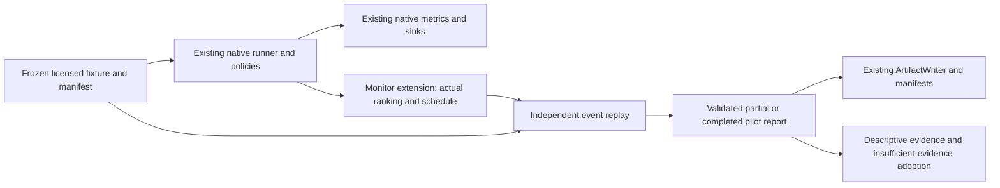

# Budget-aware CI operational pilot

The pilot audits actual native TCPCI rankings and scheduled tests using an
independent event replay. It preserves the existing runner, agents, rewards,
metrics, sinks, manifests and checkpoint infrastructure. It does not rewrite the
legacy `ttf`, NAPFD or APFDc columns or interpret them as new measurements.

## Run from an installed package

Install a [verified COLEMAN release wheel](setup.md), then copy
[`run.py`](https://github.com/jacksonpradolima/coleman/blob/main/examples/operational-pilot/run.py)
to a directory outside the checkout. This example requires a wheel containing
`coleman.pilot` (introduced after 4.0.1; use a locally built development wheel
until 4.1 is published). No optional dependency, network, CI credential or data
subscription is used during execution.

```bash
python run.py pilot-output
python run.py pilot-output  # completed candidate/build pairs are reused
```

The example generates an openly available synthetic fixture under the repository's
MIT license, writes its exact source bytes and SHA-256, freezes `manifest.json`
before running candidates, and produces `report.md` plus immutable
`pilot-reports/<sha256>.json` snapshots. Native outputs, provenance and domain
records remain in each candidate's run directory. No external dataset is copied.
`source.json` is a canonical versioned fixture interpretation, not production CI
history. Its timestamps/splits are synthetic. The example's predeclared protocol
is a replay design; it is not proof that real outcomes were hidden from an analyst.

Inputs are three tests (t1: 1 s/pass, t2: 2 s/fail, t3: 4 s/fail), a fixed
**3 runner-second** execution budget, and **0.01 modeled credit/runner-second**.
A native initial-shuffle warmup build is excluded. Two following builds compare
base order, shortest first, native Random and native Greedy under the same native
seed 42, RNFail reward and budget. This is not two independent real observations.
Shortest first equals base order here; its policy reads only predeclared durations,
never outcomes. There is no genuine coverage mapping, so a coverage candidate is
ineligible. The example does not fabricate capabilities from failure labels.

The native budget uses accumulated prefix durations: stop at the first test that
cannot fit, even if a shorter later test could fit. Zero-duration tests are valid.
This v1 pilot validates that precise policy; it does not add a new scheduler.

## Contract and complete library example

```python
from pathlib import Path

from coleman.artifacts import ArtifactWriter
from coleman.pilot import (
    PilotManifest, PilotReport, PilotRun, OVERHEAD_SECONDS,
    publish_pilot_report, render_pilot_report, serial_events, verify_run,
)
from coleman.selection import Quantity

manifest = PilotManifest.from_json(Path("pilot-output/manifest.json").read_bytes())
build = manifest.builds[0]
run = PilotRun(
    candidate_id=manifest.baseline_id,
    build_id=build.build_id,
    seed=42,
    ranking=build.baseline_order,
    events=serial_events(build, build.baseline_order, manifest.budget),
    # An illustrative explicitly measured overhead, not inferred runner work.
    prioritization_overhead=Quantity(value="0.001", semantics=OVERHEAD_SECONDS),
)
metric = verify_run(manifest, run)
assert metric.failing_test_recall == 0.5
assert metric.runner_work.value == 3
assert metric.first_failure_elapsed is not None
assert metric.first_failure_elapsed.value == 3
assert metric.modeled_variable_cost.value == Quantity(
    value="0.03", semantics=metric.modeled_variable_cost.semantics,
).value
partial = PilotReport(schema_version=1, manifest=manifest).append(run)
assert partial.status == "partial"  # other candidates/builds still missing
path = publish_pilot_report(partial, ArtifactWriter("checkpoint-output"))
restored = PilotReport.from_json(path.read_bytes())
assert restored.append(run) == partial  # identical retry
print(render_pilot_report(restored))
```

`serial_events` is a pure replay helper, not an executor. The native collector
compares its predicted selected identities against the actual native metric's
scheduled identities before accepting a run. `replay_events` independently
reconstructs occupied runner-seconds, explicit elapsed time, first observed
failure and recall from events plus the **complete** source universe. It imports
neither native metric implementations nor transport modules.

For parallel evidence, supply actual worker IDs and start/completion offsets to
`replay_events`. Two overlapping workers can use 7 runner-seconds in 4 elapsed
seconds. That does not validate a parallel candidate against this serial manifest;
`verify_run` rejects that substitution. Wall-clock savings cannot be derived from
runner-seconds. Queue time, shared setup, retries, orchestration and infrastructure
failures require additional observed evidence before deployment claims.

## States, units and accounting

- Recall is **failing-test recall**, not unique-fault recall. Every excluded known
  failing test remains in the denominator. Excluding all failures gives recall 0,
  never improved quality. No known failures gives null, not perfect recall.
- Unknown and timeout outcomes are explicit states, not pass/fail. Their occupied
  duration still counts. Any unresolved outcome makes complete recall unavailable
  and prevents a descriptive safety pass.
- No observed failure gives null/right-censored first-failure time. A genuinely
  instantaneous failure gives 0/detected. Negative durations, null durations,
  NaN and infinity are invalid; unavailable duration needs upstream resolution.
- Durations, budget, elapsed offsets, overhead, price and modeled credits each
  declare unit **and meaning**. Even a zero with incompatible units fails. No
  conversion between seconds/milliseconds or meanings happens implicitly.
- Exact quantities use the existing decimal contract: at most 12 fractional
  places, finite/nonnegative, maximum `10^24`. Products that cannot be represented
  exactly fail validation rather than rounding modeled costs silently. Native
  measured overhead is explicitly rounded **up** to nanoseconds; its meaning
  names that conversion. Timing precision is not claimed to be nanoseconds.
- Modeled credits are variable runner occupancy times the frozen price. Fees,
  fixed costs and overhead are excluded explicitly. Lower modeled credits alone
  never imply detection improvement, net savings or customer demand.

For base order the fixture yields recall 0.5, first failure at 3 s, work 3 s and
0.03 modeled credits. Reversing only t1/t2 gives first failure at 2 s with the same
recall/work/cost. Native Random can spend less by missing both failures; the
predeclared detection gate rejects that apparent advantage. See the
[recorded bounded evidence](https://github.com/jacksonpradolima/coleman/blob/main/examples/operational-pilot/evidence.md).

## Evidence, adoption and recovery

Manifest v1 freezes source identity/license, interpreted-data digest, chronological
split boundaries (reusing `TemporalPlan`), evaluation availability cutoff, baseline
order, candidates, scheduling rule, budget, price and thresholds. It rejects
future/unavailable test outcomes, changed interpretations and duplicate identities.
These validations are not a replacement for protected data access or a justified
independence model. Whole manifests contain evaluation outcomes and must stay
outside policy feature construction.

The default fixture requires at least two distinct builds, recall >=0.5 with no
baseline regression, runner saving fraction >=0 and overhead <=1 s **on every
paired build**. Missing pairs, zero baseline work, unresolved or zero-failure
outcomes, too few builds and synthetic evidence remain visible. A measured safety
regression fails even when cost improves. Otherwise insufficient evidence yields
inconclusive. Per-build ranges show heterogeneity; they are not confidence
intervals. There is no defensible statistical interval from this repeated
synthetic suite. Seeds do not increase the independent sample size.

Adoption always remains `insufficient_evidence` in this bounded v1 report, even
when descriptive observed-CI gates pass. A deployment decision additionally needs
representative authorized CI, justified independent units or temporal blocks,
protected comparative evidence, measured end-to-end overhead and retry/setup/queue
costs, required-suite constraints, human overrides and a conservative full-suite
fallback. This delivery establishes correct replay accounting and a negative or
inconclusive operational finding; it does not establish production value or
commercial demand.

A report's matrix is `partial` until every frozen pair exists. Report snapshots
also serve as validated checkpoints; restore and run only missing pairs. Identical
logical retries deduplicate, while conflicting payloads (including changed seed
or overhead) fail. The installed example reuses completed candidates and retains
completed build records on an interrupted candidate's replay. Reconstructing
learning history can repeat native execution; native checkpoint state remains a
separate runner responsibility. This introduces no second runner or storage layer. The example runs sequentially;
do not launch concurrent native runs against the same output directory. Immutable
report publication itself supports concurrent identical retries. Snapshot recovery
merges all completed pairs and rejects conflicting histories rather than choosing
an arbitrary longest snapshot.

Publication reuses `ArtifactWriter.write_immutable`: complete bytes are fsynced
before atomic create-if-absent, identical concurrent retries succeed and conflicts
raise `ValueError`. An interrupted write cannot expose a partially completed JSON
artifact. Local hard-link and directory-fsync requirements, and power-loss limits,
remain those of the existing writer. I/O errors propagate.

Only explicit integer schema version 1 is accepted. Unknown/future/missing
versions and duplicate JSON keys fail closed. Older native artifacts continue to
use their original readers and meanings; no implicit migration is available or
necessary. Reports embed the manifest/runs and recompute summaries on read. Serialization is
deterministic for identical observations; a fresh timing measurement legitimately
changes report content and its digest.


