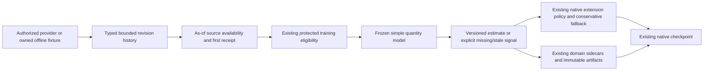

# Point-in-time CI observations and decision signals

This 4.2 integration feature implements
[#258](https://github.com/jacksonpradolima/coleman/issues/258). CI durations/outcomes
retain their original availability and revision lineage, so later corrections do
not rewrite the information used by an earlier decision. The base package needs
no provider SDK, credential, hosted service or optional MCP dependency.

The published 4.1 wheel does not contain this module. Until 4.2 is published, build
and install a wheel from the reviewed integration source. Run the examples outside
the checkout. [ADR 001](decisions/001-point-in-time-observations.md) records the
module/dependency/extension decisions.

## Observation and revision contract

`ObservationRevision` schema v1 contains protected `TemporalObservation` metadata,
a logical entity ID, first local `received_at`, explicit predecessor `supersedes`
and a typed #251 `Measurement`. Event, source availability and first receipt are
separate instants. Effective availability is their later availability/receipt;
receipt cannot precede declared source availability. Source/local clocks must be
comparable; clock disagreement is rejected, never silently adjusted.

`ObservationHistory` holds at most 4,096 supplied revisions per snapshot. Providers
must preserve all build/job/stage/test/variant dimensions needed to prevent logical
collisions. Measurement names/units/meaning, entity, event/group and target interval
stay stable across a lineage. Revisions can change values and missingness, with
explicit availability. Each lineage has one root and one successor per revision;
missing parents, cycles, forks and conflicting duplicates fail. Identical retries
are idempotent, including their unchanged **first** receipt time. Duplicate payloads
are compared by canonical serialized content. COLEMAN JSON v1 preserves signed
float zero: `0.0` and `-0.0` for one revision key are conflicting representations,
not an input-order-dependent choice. Existing domain JSON semantics are unchanged.

`history.as_of(cutoff)` selects one latest eligible member per logical observation.
Cutoffs are inclusive. Explicit lineage orders ties; revision names are never
lexically ranked. A newer revision can arrive before its predecessor; a late
older delivery cannot replace it. Unknown/unavailable values retain their states
rather than reviving an obsolete earlier value.

For the issue's CI fixture, event time is `10:00:00Z`, r1 becomes available at
`10:00:02Z`, and r2 at `10:05:00Z`:

| Query cutoff | Visible revision |
| --- | --- |
| 10:00:01Z | None |
| 10:00:03Z | r1 |
| 10:05:00Z | r2 |

A receipt later than source availability delays visibility further. Adding or
changing a valid future revision cannot change the earlier query or its fingerprint.
Whole-history hashes intentionally change on append; selected-view hashes identify
only the declared source/version, cutoff and selected eligible content.

Providers attest completeness and source identity. An isolated serialized
`ObservationSnapshot` checks one-row-per-observation and availability; it cannot
prove that an upstream provider supplied every revision. `as_of` establishes
selection for the complete bounded history actually supplied. No stream database,
tombstone protocol, multi-parent merge or implicit provider import is introduced.

All instants reuse the existing aware UTC time contract and Python datetime's
microsecond resolution. Providers must declare rounding/rejection for finer source
clocks before normalization. No local timezone, numeric epoch unit or host clock is
inferred. Context/variant observations sharing executions are not independent data.

## Frozen training and honest signals

`prepare_training` queries at **min(information cutoff, declared train_end)**,
selects the named measurement, and reuses `TemporalPlan` eligibility/purging.
Target intervals must also end by this actual information cutoff, even if the
predeclared training window ends later. Serialized training artifacts recheck the
same effective boundary. The model records temporal exclusions without retaining excluded labels. An eligible but
unknown/unavailable training value fails; no mean-zero imputation or silent
complete-case fit occurs. Later validation/test labels and post-training
corrections cannot refit the frozen model.

Fitting only inspects the available past view. The complete later evaluation must
still apply the existing protected cross-fold group gate; future group membership
cannot rewrite a past feature. Seeds and repeated synthetic builds never become
independent observations.

`fit_quantity_mean` implements a simple baseline for nonnegative physical
quantities, not a claim of superior forecasting. Inputs must be finite, between
0 and 10^12, in exactly the declared units/meaning. It sums exact rational forms
of the #251 binary64 inputs and rounds the mean **up to 10^-9 of that unit**,
independently of Decimal context. For example, `(0, 1, 0)` gives `0.333333334`.
Binary64 `0.1` is slightly above mathematical 0.1 and therefore rounds up to
`0.100000001`; this rule does not recover an unknown original decimal spelling.
Exact rounded `Quantity` values remain in the model; signal values declare their
binary64 projection. There is no implicit seconds/milliseconds conversion.

A `QuantityMeanModel` retains eligible training evidence, temporal protocol,
freeze time, means, logical observation counts and latest event times. Reads
rederive those values and reject tampering. Counts describe observations; they
are not confidence estimates or proof of independence.

A `DecisionSignal` carries request/target identity, decision time, information
cutoff, closed future target interval, interpreted measurement, explicit
availability, producer/model versions, eligible-source/model fingerprints and the
freshness rule when used. Its cutoff cannot exceed decision time, its target
cannot precede the decision and its model must already be frozen. Units and
meanings remain explicit for null values too.

| Availability | Measurement status | Value | Meaning |
| --- | --- | --- | --- |
| available | observed | 0 | A real available estimate/score of zero |
| missing | unknown | null | Insufficient eligible history |
| stale | unavailable | null | Source event is too old at the decision |
| unavailable | unavailable | null | Producer declares unavailable information |
| not_applicable | not_applicable | null | Explicitly inapplicable signal |

The mean helper emits available, missing or stale signals. Age is decision time
minus latest **event** time; a newly received correction does not make an old event
fresh. Maximum age uses `EVENT_AGE_SECONDS`, with equality still fresh. The rule
is stored in the signal and enters specification/logical identity. The resolved
cutoff/horizon also enter specification identity, so changing context cannot be
silently treated as an identical domain-record replay. A null generic
freshness rule means unspecified by that producer, not guaranteed fresh forever.

The generic signal supports signed priority scores when their declared lower
bound permits them. A negative score remains negative. A priority score is not a
calibrated probability, reward, causal effect or hypothesis-test result.
Generic readers validate schema/chronology/metadata without executing arbitrary
producer code. For a serialized mean signal, call `model.verify_signal(signal)`
to check the complete canonical value, status, parameters and provenance against
its frozen training evidence before use, including signed-zero representation.

## Complete installed library example

This repository-owned synthetic fixture uses test occupancy seconds. The future
correction cannot influence the earlier query or frozen duration estimate.

```python
from datetime import datetime
from decimal import Decimal

from coleman.artifacts import ArtifactWriter
from coleman.evaluation.protected import TemporalPlan
from coleman.observations import (
    EVENT_AGE_SECONDS, DecisionSignal, ObservationHistory, ObservationRevision,
    SignalRequest, fit_quantity_mean, prepare_training, publish_model, publish_signal,
)
from coleman.selection import Quantity, UnitSemantics

seconds = UnitSemantics(unit="s", meaning="test-runner-occupancy-v1")
r1 = ObservationRevision.model_validate({
    "schema_version": 1,
    "metadata": {
        "observation_id": "build-2:test-a:duration", "revision_id": "r1",
        "group_id": "build-2", "event_at": "2026-01-02T10:00:00Z",
        "available_at": "2026-01-02T10:00:02Z",
    },
    "entity_id": "test-a", "received_at": "2026-01-02T10:00:02Z", "supersedes": None,
    "measurement": {
        "name": "ci_duration", "value": 3.0, "unit": "s", "meaning": seconds.meaning,
        "direction": "none", "status": "observed", "minimum": 0.0,
    },
})
r2 = ObservationRevision.model_validate({
    **r1.model_dump(), "supersedes": "r1", "received_at": "2026-01-02T10:05:00Z",
    "metadata": {**r1.metadata.model_dump(), "revision_id": "r2", "available_at": "2026-01-02T10:05:00Z"},
    "measurement": {**r1.measurement.model_dump(), "value": 9.0},
})
history = ObservationHistory(schema_version=1, source_id="owned-ci-demo", source_version="1", revisions=(r1, r2))
assert history.as_of(datetime.fromisoformat("2026-01-02T10:00:01Z")).observations == ()
assert history.as_of(datetime.fromisoformat("2026-01-02T10:00:03Z")).observations == (r1,)
plan = TemporalPlan.model_validate({
    "train_end": "2026-01-02T10:00:03Z", "validation_end": "2026-01-02T11:00:00Z",
    "test_end": "2026-01-04T00:00:00Z",
})
training = prepare_training(
    history, plan, information_cutoff=plan.test_end,
    measurement_name="ci_duration", input_semantics=seconds,
)
model = fit_quantity_mean(training, frozen_at=datetime.fromisoformat("2026-01-02T10:00:04Z"))
request = SignalRequest.model_validate({
    "schema_version": 1, "decision_id": "build-3", "entity_id": "test-a",
    "decided_at": "2026-01-03T10:00:00Z", "information_cutoff": "2026-01-03T10:00:00Z",
    "target_start": "2026-01-03T10:00:00Z", "target_end": "2026-01-03T10:01:00Z",
})
signal = model.signal(request, maximum_event_age=Quantity(value=Decimal(86400), semantics=EVENT_AGE_SECONDS))
assert signal.measurement.value == 3.0
assert signal.availability == "available"
writer = ArtifactWriter("point-in-time-library-artifacts")
publish_model(model, writer)
path = publish_signal(signal, writer)
assert model.verify_signal(DecisionSignal.from_json(path.read_bytes())) == signal
```

To add an authorized provider, implement `ObservationProvider.load_history()` in
an external adapter package and return typed `ObservationHistory`. Establish
source-specific identities, units, clock resolution and immutable first receipts;
retain complete bounded lineage and bound raw payloads before decoding. The core
never loads a provider from a name, URI or credential. `OfflineObservationProvider`
revalidates an already supplied owned history without I/O.

## Real native TCPCI and recovery

Copy [`ci.py`](https://github.com/jacksonpradolima/coleman/blob/release/4.2/examples/point-in-time/ci.py)
outside the checkout and run `python ci.py native-observation-demo` from the
installed development wheel. It fits owned historical quantities at a frozen
training cutoff before decisions, then runs three constructed native CI copies using
`run_with_extension`, native Parquet results, RNFail and existing checkpoints.

The native first-build shuffle remains a warmup. On the next two builds, fresh
estimates produce t2/t3/t1; stale estimates retain the full base order t1/t2/t3.
The policy reads logical test names and frozen historical signals, without using
current realized durations/verdicts as predecision estimates. The historical and
current durations intentionally differ. No required test is removed by fallback.
This is functional offline replay, with no prospective execution, savings,
calibration or superiority claim.

Models/signals use existing immutable `ArtifactWriter` publication in
`observation-models/` and `decision-signals/`. Matching named domain sidecars enter
the existing sink before checkpoint advancement. Native manifests discover those
families. Signal paths use the stable logical ID: identical retries succeed and
changed content for that ID conflicts. Models use their content fingerprints.
Logical identity derives from dataset/policy/reward/experiment, excluding
native runtime attempt suffixes, retry clocks and worker IDs. Content digests are
deterministic. A changed freshness policy changes specification identity. Domain
sinks retain their existing conflicting-logical-record checks.

The same owned output can resume with `python ci.py native-observation-demo`.
Immutable input/configuration/actual RunSpec proofs must match before loading a
checkpoint. Checkpoints live in the existing native run directory; only trusted
local checkpoints created by the example may be loaded. Unknown output roots,
changed inputs/parameters/specs and pre-existing symlinks fail before native use.
Local path checks assume no hostile concurrent filesystem mutation, not an OS
sandbox. Concurrent native invocations must use separate output roots: the existing
checkpoint store does not coordinate simultaneous writers of one logical execution.
Existing native pickle/checkpoint durability limits remain unchanged.

Regression tests interrupt after signal publication, after a synchronous domain
record commit, and after checkpoint commit, then resume through the real store. Accepted
signals remain complete; retry reuses the same logical signal path/content digest
and domain records are not duplicated. Reopened/concurrent Parquet writers now use distinct per-flush
filenames even within one PID/second, preserving previously committed native rows.
Legacy Parquet filenames were already operational/non-deterministic; deterministic
mathematical identities belong to versioned models/signals/domain records.

Unknown/future/missing versions and duplicate JSON keys fail closed. Existing
native artifacts keep their readers/meaning; there is no automatic migration or
silent conversion to observation histories. Same-content publication is
idempotent; conflicts/I/O errors propagate and incomplete temporary files never
become completed artifacts. There is no additional checkpoint or stream store.


