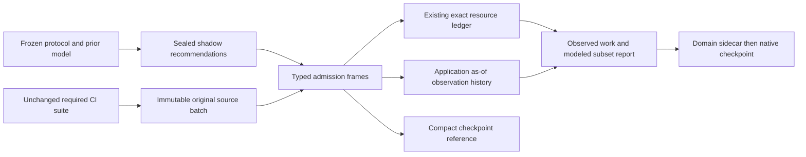

# Frozen CI shadow evaluation

`coleman.shadow` records pre-outcome recommendations while required CI continues
running its full test suite. It separates raw CI observations, application receipt,
actual resource accounting, counterfactual subset costs, operational health and
research conclusions. It reuses [point-in-time observations](point-in-time-observations.md),
[resource accounting](resource-replay.md), [domain records](domain-results.md),
immutable artifacts and native runner/checkpoint interfaces.

This compatible feature targets 4.3. The published 4.2 package does not contain
it; build this revision for the examples below. No credentials, hosted service,
external CI trigger or optional MCP package is needed.

## Complete typed library example

This owned synthetic fixture declares one failing required test and two identical
predeclared candidates. It demonstrates contracts and recovery, not improvement
or prospective evidence. All source UTC instants are synthetic. Host monotonic
nanoseconds are explicit inputs, not inferred from UTC:

```python
from datetime import datetime, timedelta
from tempfile import TemporaryDirectory
from coleman.artifacts import ArtifactWriter
from coleman.evaluation.protected.temporal import TemporalObservation, TemporalPlan
from coleman.observations import ObservationRevision
from coleman.resources import RUNNER_MS, ResourceAmount, ResourceEstimate, ResourceRequest, TestEstimate
from coleman.results.domain import Measurement, fingerprint
from coleman.shadow import (
    BuildClosed, BuildOpened, CandidateDecision, FrozenCandidate, HostClock,
    ShadowProtocol, ShadowReport, ShadowSource, ShadowState, SourceStatus,
    TestFeedback, load_shadow_state, publish_shadow_state, verify_shadow_checkpoint,
)

def at(value):
    return datetime.fromisoformat(value)

def amount(ms):
    return ResourceAmount(value=ms, semantics=RUNNER_MS)

start = at("2026-01-02T10:00:00Z")
source = fingerprint({"owned": "single-test-contract-example-v1"})
plan = TemporalPlan(train_end=at("2025-12-31T00:00:00Z"),
                    validation_end=at("2026-01-01T00:00:00Z"),
                    test_end=at("2026-01-09T00:00:00Z"))
candidates = tuple(FrozenCandidate(
    candidate_id=name, policy_version="fixed-order-v1", model_fingerprint=source,
    feature_fingerprint=source, selection_version="serial-prefix-v1",
    fallback_version="no-action-v1", budget=amount(1001), shared_setup_reserve=amount(0),
) for name in ("base", "candidate"))
protocol = ShadowProtocol(
    schema_version=1, experiment_id="owned-single-test", source=ShadowSource(
        source_id="owned-ci", source_version="1", schema_fingerprint=source,
        authorization_reference="urn:coleman:owned-example", license_id="MIT",
        clock_assumption="synthetic-source-and-host-fixture-v1", evidence_basis="functional_offline",
    ), benchmark_fingerprint=source, frozen_at=plan.validation_end, temporal_plan=plan,
    candidates=candidates, baseline_id="base", independent_groups=(), independence_justification=None,
    minimum_observation_days=7, minimum_builds=2, minimum_independent_groups=2,
    minimum_recall=1.0, minimum_net_saving_ms=1, actual_build_capacity=amount(2000),
    maximum_silence_ns=60 * 10**9, maximum_source_lag_seconds=60, maximum_pending=4,
    maximum_events=64, maximum_event_bytes=65536, maximum_journal_bytes=1048576,
)
cost = ResourceEstimate(amount=amount(1000), source_fingerprint=source,
                        observed_at=plan.train_end, available_at=plan.validation_end,
                        valid_until=plan.test_end)
state = ShadowState(schema_version=1, protocol=protocol)
heartbeat = SourceStatus(event_id="connected", available_at=start, connected=True)
state = state.ingest(heartbeat, HostClock(session_id="process-a", tick_ns=0, utc_at=start))
decisions = tuple(CandidateDecision(
    candidate_id=c.candidate_id, model_fingerprint=c.model_fingerprint,
    request=ResourceRequest(schema_version=1, decision_id="build-2",
        configuration_fingerprint=fingerprint(c.model_dump(mode="json")), decided_at=start,
        capacity=c.budget, tests=(TestEstimate(test_id="test-a", estimate=cost),), ranking=("test-a",)),
    decision_overhead=amount(1), shared_setup_reserve=c.shared_setup_reserve,
    overhead_interpretation="occupied_runner",
) for c in candidates)
opened = BuildOpened(event_id="build-2:opened", build_id="build-2", logical_build_id="build-2",
    group_id="owned-project", decided_at=start, target_end=start + timedelta(seconds=60),
    required_ids=("test-a",), actual_estimate=cost, decisions=decisions)
state = state.ingest(opened, HostClock(session_id="process-a", tick_ns=1, utc_at=start))
finished = start + timedelta(seconds=1)
feedback = TestFeedback(event_id="build-2:test-a:completed:r1", build_id="build-2", test_id="test-a",
    revision=ObservationRevision(schema_version=1, entity_id="test-a", supersedes=None,
        received_at=finished, metadata=TemporalObservation(observation_id="build-2:test-a",
            revision_id="r1", group_id="owned-project", event_at=finished, available_at=finished),
        measurement=Measurement(name="ci_failure", value=1.0, unit="1",
            meaning="ci-test-failure-indicator-v1", direction="none", status="observed")),
    occupancy=amount(1000))
receipt = HostClock(session_id="process-a", tick_ns=2, utc_at=finished)
state = state.ingest(feedback, receipt)
closed = BuildClosed(event_id="build-2:closed", build_id="build-2", available_at=finished,
    dispatch_occupancy=amount(1), shared_setup_occupancy=amount(0), queue_elapsed=None, setup_elapsed=None)
state = state.ingest(closed, HostClock(session_id="process-a", tick_ns=3, utc_at=finished))
assert state.ingest(feedback, receipt).to_json() == state.to_json()
with TemporaryDirectory() as directory:
    writer = ArtifactWriter(directory)
    checkpoint = publish_shadow_state(state, writer)
    assert verify_shadow_checkpoint(checkpoint, protocol, writer).fingerprint == state.fingerprint
    assert load_shadow_state(protocol, writer).to_json() == state.to_json()
report = ShadowReport(schema_version=1, state=state)
assert report.evidence().outcome == "inconclusive"
assert report.evidence().forward_logical_builds == 0
assert report.evidence().actual_known_required_runner.value == 1001
assert all(row.net_saving.value == 0 for row in report.findings())
```

Persist each returned state before acknowledging the upstream source. In an actual
consumer, publish the opening before requesting any feedback; the compact example
above keeps transitions in memory to show the complete contract. Fingerprints bind
reviewed configurations; they do not prove that arbitrary producer code computed
an honest model or used the declared features.

## Real native full-suite workflow

Build and install the wheel in a separate Python 3.14 environment. Copy
[`examples/prospective-shadow/ci.py`](https://github.com/jacksonpradolima/coleman/blob/main/examples/prospective-shadow/ci.py)
to an empty workspace and run it twice:

```bash
python ci.py shadow-output
python ci.py shadow-output
```

The example uses `run_with_extension`, `build_environment`, the native policy and
monitor hooks, actual scheduling/evaluation, domain sidecars and
`LocalCheckpointStore`. Warmup plus two required suites execute all three tests
in base order. Shadow selections never change that order. The optional final
forecast creates no extra evidence build.

The model is an actual frozen `QuantityMeanModel` fitted through protected
`prepare_training` to prior failure indicators. Signals are verified against that
model. Only test IDs, historical model and prior duration estimates enter the
candidate; current durations/verdicts cannot affect its sealed recommendation.
A historical binary mean is not asserted to be a calibrated failure probability.
The complete future Parquet input is bound separately to native input provenance;
its digest is not a candidate feature or future-outcome protocol component.

Each candidate has the same 4,000 ms nominal budget. The selector deducts its
measured inference cost and the frozen shared-setup reservation first. The fixture
explicitly declares zero shared setup; it does not assume that real CI setup is
free. Whole-native prioritization elapsed and per-candidate inference elapsed are
rounded upward to integer milliseconds and labeled one-runner occupancy proxies.
They are not provider bills. Whole-native dispatch includes shadow journal/model
work; storage and monitoring overhead are not attributed separately to each
candidate. The subset comparison is therefore not a complete operational cost
comparison. Actual test work is 7,000 ms per required suite, plus
the native dispatch proxy. Counterfactual subset cost is selected source work plus
one actual shared setup plus candidate inference. Shared setup is never removed
per test. Queue/setup elapsed remain separately unknown.

The first measured native source batch is immutable before event publication.
Restart reuses its timing even when the runner checkpoint did not advance.
Subsequent admissions and domain records precede native checkpoint advancement.
The completed rerun has identical report/source artifacts and logical record
counts. Timing varies between fresh executions; replay preserves the first actual
measurement rather than pretending that wall time is reproducible.

The report remains **inconclusive**: two synthetic builds on one day, seven days
required, zero genuine forward builds, no justified independent groups. Repeating
the fixture, retrying builds or changing synthetic dates cannot establish value.

## Source admission, clocks and containment

- `HostClock.utc_at` is first validated application admission. `tick_ns` is a local
  monotonic witness scoped to `session_id`. UTC receipts cannot reverse; ticks
  cannot reverse within a session, including when a previously admitted session
  recurs after another session or checkpoint restoration. A new process requires a fresh source status
  before new recommendations. Never subtract monotonic ticks across sessions.
- Original provider `received_at`, event time and availability remain untouched
  in `TestFeedback.revision`. The derived `ObservationHistory` has a distinct
  `:shadow-admission-v1` source identity and uses application admission as its
  usable receipt. Late validation cannot make a label available retrospectively.
- Freshness requires a new, ordered, connected source status whose UTC lag is
  within policy, plus bounded local monotonic silence. Duplicate payloads refresh
  neither clock nor evidence. Old heartbeats cannot roll back the source watermark.
- Missing causal parents, unknown builds/tests, conflicting lineages, changed
  occupancy and invalid frozen bindings enter bounded typed quarantine and stop
  recommendations. Rejected malformed inputs, clock reversals, byte/event limits
  and same-ID changed payloads raise `ValueError` without changing prior state.
  Unsupported causal repair requires a reviewed new experiment; v1 does not
  silently reorder parents or auto-release quarantined observations.
- Out-of-order independent physical completions are supported. Application order
  books work; original source chronology remains available. Corrections require
  the existing lineage contract, preserve original as-of history and never charge
  work twice. V1 allows label changes with identical occupancy only. Unknown-to-known
  occupancy is also an unsupported accounting correction, not a free adjustment.
- An explicit closure with missing feedback or unknown occupancy keeps reservation
  and accounting pending. Late required feedback can finish it. Unknown labels can
  settle known work but cannot score complete quality evidence. No closed build is
  assumed successful merely because its job ended. Closures before upstream start
  or known physical completion, and physical completion after upstream closure,
  are quarantined; late admission and label corrections with consistent original
  event times remain supported.
- Actual resource overruns are retained without clipping. Recall/resource breaches
  stop further recommendations; actual upstream required work is still observed.
  Observation-only openings have empty decisions and cannot manufacture candidate
  results. This analytical consumer cannot cancel or enforce external CI jobs.
- Operational states are `healthy`, `stopped`, `recovering`. Research outcomes are
  `pass`, `fail`, `inconclusive`; adoption remains `insufficient_evidence`.
  `ShadowReport` describes the last committed receipt. Query
  `state.operational(current_host_clock)` for current health after silence/restart.

## Evidence and limits

Freeze the source/schema/authorization, benchmark identity, temporal windows,
candidate/model/features/selection/fallback definitions, identical budgets/setup
reservations, trial registry, outcome definition, minimum days/builds/groups,
independence justification, quality/practical thresholds and stopping policy before
collection. Changes produce another experiment fingerprint and cannot inherit old
protected outcomes as untouched evidence.

Only complete required labels support membership recall. Zero failures makes
recall `not_applicable`, not one. A passed test has observed zero, an unknown or
unavailable label has null with its status, and missing work remains null. Negative
net savings remain valid adverse results. All quantities reject nonfinite values;
occupied time requires bounded nonnegative integer milliseconds and exact unit
semantics. No conversion between elapsed queue/setup and runner occupancy occurs.

Days/builds use distinct logical CI identity and the first attempt's decision date;
seeds, retries and corrections add no independent units. Source groups count only
when predeclared with an external justification. Even sufficient descriptive gates
provide no IID inference, confidence interval, causal saving or automatic promotion.
Positive practical savings must be demonstrated; zero savings cannot pass. Partial,
censored, quarantined or insufficient evidence stays inconclusive.

V1 is bounded to 4,096 admissions, 256 required tests per build, 16 candidates,
128 quarantined events, 256 signals per decision, 256 KiB source events and 16 MiB
admitted journal payload, with stricter frozen per-experiment limits. Protocols are
limited to 1 MiB at publication and portable serialized state to 20 MiB. Frame
wrappers and compact checkpoint references add bounded per-event storage overhead.
The API revalidates/replays bounded state, so it is a small auditable consumer,
not an unbounded stream processor. Rotate to a newly predeclared experiment when
retention is exhausted; v1 does not evict deduplication history.

## Atomic artifacts, concurrency and compatibility



`ArtifactWriter` atomically publishes immutable protocol headers and ordinal,
hash-linked `shadow-journals/<protocol-digest>/frames/NNNN.json`. A complete frame
is the event commit point. A compact `checkpoints/NNNN.json` verifies its prefix;
recovery also reads committed later frames after a crash before checkpoint-ref
publication. Temporary files and incomplete references are never completed events.
Identical concurrent writers converge; different payloads for an ordinal conflict.
The caller reloads and reconciles its durable source after a conflict. There is no
mutable latest pointer, distributed leader election or transaction across native
rows, source batches and domain sidecars. Local artifact filesystem assumptions and
ancestor-directory power-loss limits remain those of the existing writer.

The existing manifest inventories shadow headers, frames, checkpoint references,
source batches and reports. A frame records an admission, a checkpoint records a
prefix, and neither asserts that a study has completed or evidence has passed.
Reports live in `shadow-reports/<content-digest>.json`; logical experiment identity
is the complete frozen protocol fingerprint, distinct from changing state digests.
JSON serialization is canonical, finite and deterministically hashed.

All new portable contracts require explicit integer `schema_version=1`; missing,
future/unknown versions, extra fields and duplicate JSON keys fail closed. There
is no implicit migration. Legacy native scheduling rows, v3.2 artifacts and older
domain records retain their existing readers and meanings. They have no prospective
protocol or first admission provenance, so cannot be relabeled as shadow evidence.
Future migration must be explicit, versioned and preserve the original bytes and
provenance; unsupported occupancy corrections remain an explicit v1 limitation.

## Forward-run protocol and empty report template

Before an actual authorized forward run, record and review:

1. Source owner permission/reference, public redistribution license, retention
   policy, source schema, stable build/test/retry IDs and correction guarantees.
2. Provider event/availability/first receipt mapping, host UTC synchronization
   assumption, process session/tick generation, lag/silence limits, disconnect and
   backlog behavior, partial/censored feedback and collection failure procedure.
3. Frozen candidates and actual executable/configuration/model hashes, feature
   availability audit, historical training/validation cutoffs, complete baseline,
   trial registry, equal resource budget/setup reservation and independent source
   groups with defensible dependence analysis.
4. Untouched future window, minimum distinct days/builds/groups, required-label
   visibility, practical thresholds, stopping rules, immutable artifact roots,
   source acknowledgments and native checkpoint/fault-recovery rehearsal.
5. Independent required-CI execution: collection errors and containment cannot
   suppress required jobs. Start collection only after protocol freeze. Record
   all trials, failures, negative findings, costs and missing observations.

Deliver the following report with **uncollected fields left unavailable**:

| Field | Before collection |
| --- | --- |
| Frozen protocol/source/model digests | Record reviewed digests |
| Owner permission/license/clock references | Record reviewed references |
| Planned and actually observed windows | Planned window; actual unavailable |
| Required/scored/partial/quarantined logical builds | 0 / 0 / 0 / 0 |
| Genuine forward builds and distinct decision days | 0 / 0 |
| Justified independent groups and dependence caveats | Unavailable until verified |
| Actual runner work, setup/queue elapsed, inference cost | Unavailable; do not enter zero |
| Baseline/candidate recall and modeled signed savings | Unavailable |
| Operational source state and recovery incidents | Record current state/incidents |
| Research outcome / adoption | Inconclusive / insufficient evidence |
| Raw artifacts, missingness, exclusions and limits | Link complete audit; explain gaps |

This template and the offline native fixture are the deliverables here. They do
not claim that any live prospective CI observations have already been collected.
