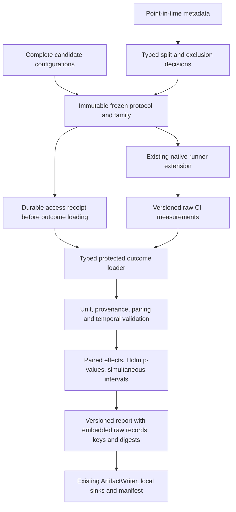

# Protected evaluation for CI decisions

Existing COLEMAN analysis reports summarize native TCPCI output. A ranking or an
average over repeated seeds is descriptive; it does not establish independent
scientific evidence. This additive library API separates chronological eligibility,
frozen candidate/protocol declarations, recorded holdout access and paired inference.
It uses the [versioned result contract](domain-results.md), existing native runner
extensions, sinks, artifacts and manifests. No scheduling algorithm or legacy
result meaning is replaced.

## Temporal eligibility

```python
from coleman.evaluation.protected import TemporalObservation, TemporalPlan

plan = TemporalPlan.model_validate({
    "train_end": "2026-01-02T23:59:59Z",
    "validation_end": "2026-01-04T23:59:59Z",
    "test_end": "2026-01-06T23:59:59Z",
})
late = TemporalObservation.model_validate({
    "observation_id": "repository-a/build-1",
    "group_id": "repository-a",
    "event_at": "2026-01-02T12:00:00Z",
    "available_at": "2026-01-03T12:00:00Z",
})
assert not plan.training_eligible(late)
assert plan.decide(late).reason == "outcome_not_available"
```

Train is `(-infinity, train_end]`, validation `(train_end, validation_end]`, and test
`(validation_end, test_end]`. Cutoffs must increase strictly. Zoned ISO timestamps
are normalized to UTC; naive/date-only times and numeric epochs/strings fail.
Event time fixes the nominal partition: late labels never move training events
into validation/test. Both label availability and the entire closed target interval
must be within that partition's cutoff. This conservative purge excludes a training
target extending into validation or test, even if an early outcome is already known.

`TemporalPlan.split(tuple_of_metadata)` returns sorted typed decisions with an
eligibility flag and reason (`eligible`, `outside_window`, `outcome_not_available`,
`overlapping_target`). It rejects groups spanning nominal partitions, including late
rows, duplicate revision identities, and revisions changing event/group identity.
Post-cutoff revisions are retained as excluded decisions rather than overwriting
legitimate historical observations. It does not choose or aggregate competing
revisions; a producer must predeclare its point-in-time revision selection.

`plan.observation(mapping)` is a dataset-boundary adapter. Configure `event_field`,
`availability_field`, `group_field`, `observation_field`, `revision_field` and
`target_end_field` for an existing dataset. Required metadata missing from a mapping
raises `KeyError`; invalid values raise Pydantic `ValidationError`. Optional
`target_end` defaults to a point interval at the event, and `revision_id` defaults
to `original`. Other dataset columns stay outside the metadata contract.

## Freeze before protected outcomes

`FrozenCandidate.from_configuration` accepts a complete JSON configuration at the
boundary and stores canonical JSON bytes in an immutable typed object. Include all
hyperparameters, preprocessing/feature definitions, learned-state fingerprints and
external dependency versions used by that candidate. A hash cannot freeze an
undeclared dependency or prove that an external fit did not inspect future labels.

`freeze` takes typed candidates, the canonical dataset fingerprint, the temporal
plan, an `EvaluationProtocol` and a tuple of `ComparisonHypothesis` declarations.
The result is a `FrozenEvaluation`; persist it with `EvaluationAudit.save_freeze`
before running or evaluating the candidates. Changing data, candidates, thresholds,
units, assumptions, plan or family changes its SHA-256 fingerprint. Candidate and
hypothesis declaration order is canonicalized; duplicate/self/reversed/unfrozen
comparisons are rejected. Never add a favorable hypothesis after reading outcomes.

The protocol declares:

- `metric_name`, `unit`, `meaning`, and objective `direction`;
- `independent_unit` and `dependence` (`independent`, `serial`, `clustered`);
- explicit `normal_differences_assumed`, required by the v1 inference method;
- nonnegative `practical_effect` **in the metric's own unit**, family-wise `alpha`,
  and `minimum_units` (default 20, always at least 2);
- a stable `holdout_id`, retained across candidates, protocol revisions and dataset
  revisions exposing the same protected observations.

For NAPFD/APFDc, larger is better and the unit is dimensionless `1`. Native
`cost` is historically named but contains APFDc, not monetary expense. Actual
execution cost needs its own measured unit/meaning and minimization objective.

`named_seed(root_seed, candidate_id, purpose)` hashes canonical named input into
64-bit entropy compatible with NumPy, Polars and Python RNGs. Candidate/worker
ordering does not affect the stream. Use distinct purposes for training, selection,
evaluation or dataset-specific execution. It does not modify existing run IDs,
sweep semantics or legacy native RNG derivation, and does not make repeated seeds
independent evidence. Truncated seeds are reproducibility tools, not unique IDs;
content identities continue to use full SHA-256 fingerprints.

## Access history and interrupted work

`EvaluationAudit(artifact_root)` stores immutable frozen contracts, access receipts
and completed reports through the existing `ArtifactWriter`. `evaluate` reserves
a test/confirmatory access **before invoking the outcome loader**. Every invocation
counts, including attempts whose loader/validation/inference later fails. A retry
after publication cannot claim a previously untouched holdout. Calling
`audit.access` also records train/development, validation/tuning and test/verification
accesses. Any test exposure, including tuning or verification, counts toward reuse.

Keep a **shared durable audit root and stable holdout ID** for every workflow using
the same protected observations. Changing candidates, protocol or dataset fingerprint
does not reset a holdout ID's exposure count. Creating a different root or disguising
the holdout with another ID cannot establish fresh evidence. This is an audit of
calls through these APIs; it is not access control over files, proof of undisclosed
external access, or a cryptographically authenticated tamper seal.

Reservations form a validated ordinal/hash chain. Concurrent processes compete on
atomic create-if-absent publication and retry with a fresh chain snapshot; no lock
file survives interruption. One contender records the first test access. Temporary
files are ignored. Missing internal entries, changed predecessors, corrupt content
and unknown versions fail closed. External removal of an entire history cannot be
detected by that history alone; protect/retain the audit root as part of the research
record. Local hard-link/directory-fsync requirements and power-loss limitations are
the same as [domain artifacts](domain-results.md).

A reservation is an attempted access, not a completed evaluation. `save_report`
requires a matching persisted receipt and frozen contract, then atomically publishes
validated report content. Point estimates must be present for uncertainty or
confirmatory claims, follow the protocol-defined sign (relative tolerance `1e-12`,
zero absolute tolerance) and lie within their reported interval. Report validation
recomputes Holm corrections from the complete frozen raw p-value family (unavailable
tests count as p=1); stored adjusted values must match that deterministic calculation
exactly. Every report embeds its versioned raw records and verifies their logical
keys and content digests. Reading or persisting a report recomputes the complete
frozen method from those records. Scalar agreement permits relative `1e-12` and
absolute `1e-15` numerical variation across compatible libraries; counts, reasons
and conclusions must agree exactly, so a threshold crossing fails closed.
Failed evaluation leaves the attempt and creates no completed report. Replaying
the same report/sink publication is idempotent.



## Paired method and conservative conclusions

`PairedObservation` links a candidate ID, `TemporalObservation` and `DomainRecord`.
The metadata's group is the independent unit. Exactly one result per candidate/unit
is accepted, with the same metadata across the pair. Repeated seeds/revisions on
one unit raise `ValueError`. Raw record logical keys must also be globally unique
across every candidate and unit in the report, even if candidate names, metadata
labels, provenance, values or content digests differ; use a predeclared
upstream aggregation if replicates
are required. The evaluator verifies frozen dataset/configuration/context
fingerprints, observed availability and metric units/meaning/objective before
calculating a comparison. Unpaired units and incompatible measurements fail.

Version 1 provides paired Student-t inference for a **declared normal population of
independent pair differences**. Serial/clustered units or an undeclared normality
assumption raise `NotImplementedError` before loading outcomes. Adjacent builds from
one real repository generally need a justified dependence model; labeling them with
different seeds does not supply one. No automatic normality or independence detector
is provided. Normality/independence declarations are assumptions to justify in a
study, not certifications inferred by the library.

The implementation applies a one-sample t procedure to paired differences,
equivalent to [SciPy's paired t procedure](https://docs.scipy.org/doc/scipy/reference/generated/scipy.stats.ttest_rel.html).
Holm's step-down Bonferroni adjustment controls family-wise p-value error across the
entire frozen family; unavailable comparisons remain in that family as p=1.
See the [reference Holm implementation](https://github.com/statsmodels/statsmodels/blob/main/statsmodels/stats/multitest.py).
Intervals use the conservative simultaneous Bonferroni level `1 - alpha/m`, where
`m` is the full family size. They are not unadjusted individual intervals or Holm
intervals. Cross-hypothesis independence is not required by these corrections.

`raw_mean_difference` is candidate minus baseline, in the original metric unit.
`improvement` reverses its sign for minimization. A confirmatory benefit/harm needs
both a Holm-adjusted p-value within alpha and a simultaneous interval entirely
beyond the signed practical-effect threshold. Otherwise the result is inconclusive.
There is **no automatic policy promotion**. Confidence intervals are conditional on
the declared sampling assumptions; p-values are not calibrated failure probabilities
or learning rewards.

Too few units, incomplete outcomes, identical pair differences or nonfinite
uncertainty yield `insufficient_evidence`, with raw signed means retained where
well-defined and unavailable uncertainty represented as null. Unknown outcomes are
not silently removed for a complete-case test. A negative result remains visible.
On a reused holdout, numerical estimates remain available, but a confirmatory
benefit/harm conclusion is suppressed; inspect `confirmatory_eligible` and the
receipt's `prior_test_accesses`. First recorded access means first **within the
complete declared audit history**, not proof that nobody ever saw those data.

Reports contain the complete freeze, access receipt, independent unit IDs, estimates,
conclusions and each embedded raw record's logical key/content digest plus temporal
metadata. The required UTC `completed_at` records when calculation and source
reference assembly finish, after the protected loader and inference. It cannot
predate the access receipt or consumed outcomes. Exported comparison records use
this completion time as `available_at`, never the earlier access request time.
Use the embedded records to verify results against immutable sink records; reserve a
test/verification access before inspecting protected raw outcomes again.
`FamilyReport.domain_records(run_id)` exports typed #251 measurements with explicit
units/signs/unavailable states and no synthetic learning reward. The full report
retains statistical conclusions and access context that a scalar alone cannot convey.

## Runnable installed-package workflow

Install the reviewed wheel, then copy and run
[ci.py](https://github.com/jacksonpradolima/coleman/blob/main/examples/protected-evaluation/ci.py)
from a directory outside the repository:

```bash
pip install path/to/coleman.whl
python ci.py ./protected-ci-output
```

The standalone script freezes Greedy/Random RunSpecs before invoking
`run_with_extension`. Four synthetic repository units exercise the real native
runner, RNFail reward, NAPFD metric and Parquet sink. It traces candidate fingerprints
to saved specs, publishes a queryable report and #251 records, and generates a
manifest. It intentionally returns `insufficient_evidence` for four units under a
20-unit minimum. A repeated access is recorded as reuse before the final manifest
is generated, so both receipts appear in its inventory. These synthetic repositories
validate plumbing, not production independence, normality, effectiveness or ROI.

## Compatibility and limits

Frozen/access/report artifacts require integer `schema_version=1`. Duplicate JSON
keys, unknown fields and missing/older/future versions are rejected. No automatic
migration invents missing provenance, units or access history. Legacy native results,
RunSpec IDs, sweep APIs and descriptive reports retain their existing readers and
behavior. Existing domain records can be evaluated only if they already carry the
matching frozen context and candidate configuration; never relabel old artifacts
silently to claim protected evidence.

Version 1 intentionally excludes serial/block/cluster inference, robust/nonparametric
intervals, sequential testing/alpha spending, unknown external state verification,
remote artifact transactions and policy activation. Access-history scanning is
linear in scope history, and contention retries are bounded at 1000 publications.
Reports retain the complete consumed record payload and recompute estimates on
validation; their size and verification cost grow with the paired input. Record
hashes and recomputation establish internal consistency, not authenticity of an
externally supplied dataset or proof of independent sampling.
Keep confirmatory access scarce and predeclared. Larger benchmark/corpus methodology
and mathematical/performance validation remain separate roadmap work.

::: coleman.evaluation.protected
