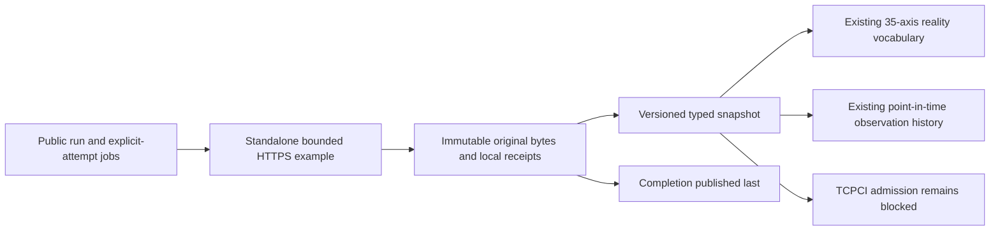

# Public CI collection feasibility

**Observe what public CI actually exposes before designing a TCPCI study.**
This bounded GitHub Actions reference example uses the **published COLEMAN 4.17
base wheel**. The collector is a separate, version-pinned example, not a new SDK
provider, a production ingestion service or a prospective savings experiment.
It makes two explicitly requested anonymous metadata reads for one public run.
It does not trigger workflows, download logs or artifacts, execute source code,
rank tests or change CI decisions.

## Reproduce outside the checkout

In an activated Python 3.14+ environment:

```bash
python -m pip install "https://github.com/jacksonpradolima/coleman/releases/download/v4.17.0/coleman-4.17.0-py3-none-any.whl#sha256=e5a272ddc0edf72bd909a743fa2b3bc0dfeb8a02871c487ab22683cddeea40ca"
curl --fail --location \
  "https://raw.githubusercontent.com/jacksonpradolima/coleman/198ddb3e65d2027f4fd287a0f222a25160677bd4/examples/public-ci-feasibility/ci.py" \
  --output /tmp/coleman-public-ci.py
python /tmp/coleman-public-ci.py \
  --repository jacksonpradolima/coleman --run-id 39170199990 \
  --capture-id public-example-1 --output /tmp/public-ci-evidence --fetch
# Same immutable capture; no network and no restamped receipts:
python /tmp/coleman-public-ci.py \
  --repository jacksonpradolima/coleman --run-id 39170199990 \
  --capture-id public-example-1 --output /tmp/public-ci-evidence
```

The downloaded script SHA-256 is
`f926725a49f62d8cb68dd80596d4fe9b66ade3b90f1331fbfc513f475f4dd2ef`.
Verify that digest before executing the example.

The public run can eventually disappear or become inaccessible. A missing run,
HTTP error, rate limit, redirect or incompatible response fails rather than
substituting fabricated data. Choose a known, canonical, **public** repository/run
and a new `capture-id` for a later poll. Changing the runtime or example bytes
creates another scope. There is no scheduler or automatic retry loop.
The ordinary tests use tiny owned fixtures and require no network.

The JSON summary prints the capture directory, stable logical run/attempt ID,
normalized semantic fingerprint, returned job count and
`insufficient_evidence_for_forward_tcpci`. This is a valid feasibility outcome.
Inspect the typed result by loading that same example module and calling
`read_capture(Path(capture_directory))`; `snapshot.measurements`,
`snapshot.reality` and `snapshot.history()` expose the existing SDK contracts.
No new CLI installation, MCP dependency or core transport API is required.

## What the endpoints establish

The example requests API version `2022-11-28` and records the returned selected
version when present. It reads the
[workflow run](https://docs.github.com/en/rest/actions/workflow-runs?apiVersion=2022-11-28)
and the [jobs for its explicit attempt](https://docs.github.com/en/rest/actions/workflow-jobs?apiVersion=2022-11-28).
Unknown provider fields remain in original response text; only declared fields
enter the typed projection. These endpoints are separate reads, not an atomic
provider transaction. A job may finish between them. Reported run and job
statuses can therefore differ without implying corruption.

| Question | Observable metadata | Remaining boundary |
| --- | --- | --- |
| Logical identity | Repository numeric ID, run ID, attempt, job ID, source SHA | A poll or rerun is not an independent project/build observation |
| Trigger and branch | Reported event and nullable head branch | Branch protection, override authority and policy decisions are unverified |
| Tests, variants and shards | Job names, step ordinals/names and labels | Names do not establish test identities, required membership, shard topology or configuration coverage |
| Completion | Job/step status, nullable conclusion and timestamps | Job success is not a per-test verdict; partial or absent tests remain unknown |
| Timing and costs | Recorded start/end envelope, in seconds | Physical runner occupancy, billed time, queue and shared setup are unavailable |
| Retries and cancellation | Current workflow attempt and explicit job cancellation/timeout conclusions | No test retry, quarantine, cause or cross-attempt correction lineage |
| Availability | Actual local receipt of each complete response | Upstream first availability, a pre-outcome decision seal and missed transitions are unknown |
| Retention | Bytes actually captured now | No historical completeness guarantee; deleted runs/logs/artifacts cannot be reconstructed |

A completed interval with equal timestamps has **observed zero envelope seconds**,
not zero CPU or test work. A completed job missing a clock has `null/unknown`.
An incomplete job has `null/unavailable`. Uncollected physical costs and expected
test count are `null/unavailable`; this observer's policy inference is
`null/not_applicable`. Negative envelope durations reject. Non-finite numeric
JSON, duplicate keys, duplicate job IDs/step ordinals, incompatible units or
fabricated physical measurements reject. Provider timestamps later than their
local receipt reject; the example assumes comparable UTC clocks and does not
correct skew or invent availability estimates.

## Artifacts, recovery and domain boundaries



The capture directory is scoped by pre-data request, installed-runtime and
example-byte fingerprints. `request.json`, `run.json`, `jobs.json` and
`snapshot.json` are committed with the existing `ArtifactWriter`; `complete.json`
publishes last. Completion means this bounded response inventory is materialized,
**not** that CI completed or every expected test/job was observed. A partial or
empty current job inventory may be a valid metadata capture.

Each response envelope commits the original UTF-8 text, its exact SHA-256, URL,
actual local receipt and selected API version together. Normalized contract
fingerprints intentionally ignore outer artifact JSON whitespace. Original
provider text whitespace/order remains covered by its separate byte digest.
The normalized semantic fingerprint excludes collector receipts/runtime; the
logical identity excludes poll IDs. Digests establish consistency, not source
authenticity, authorship, lawful reuse or statistical independence.

The existing trusted-local POSIX process lock rejects concurrent ownership and
releases on process death; callers must serialize threads themselves. Repeating
a completed request verifies and returns its first committed records unchanged.
After interruption, only missing response checkpoints need fetching; existing
receipts are not restamped. A response received but lost before its atomic
commit is unrecorded; recovery may acquire a later response with a later receipt.
The reader fails closed on missing/changed content, source mismatch or future
versions. All new contracts require integer schema version 1. There is no older
collector schema to migrate; native Parquet/results/checkpoints remain untouched.
A future collector migration must be explicit, retaining original bytes and
semantics rather than rewriting a completed v1 capture.

`snapshot.history()` uses the **materialized snapshot as the source producer**:
only observed completed job intervals enter #258 observations, with availability
and receipt at snapshot assembly. The original HTTP receipts remain separate.
This conservative offline projection never asserts when the provider first
exposed a field. An unfinished interval produces no completed observation.
Each poll is a distinct predeclared source; this is not an appendable receiver
with global first-receipt/correction lineage. It does not synthesize #260 build
admissions, feedback or a decision seal.

Every snapshot also supplies all **35 existing production-reality axes**. Source
identities, trigger, current attempt and runner labels can be reported; explicit
cancellation, timeout and partial metadata can be retained when present. Other
axes retain missing values and limitations. Owned fixtures label their positive
facts `synthetic`. This view is not a `NativeSourceProfile`, data card or automatic
entry in the admitted benchmark corpus.

## Permissions, resources and public data handling

The [provider endpoint documentation](https://docs.github.com/en/rest/actions/workflow-jobs?apiVersion=2022-11-28)
permits unauthenticated access to public resources; authenticated production access
requires a separate permission design. This example supplies no token, cookie or
credential lookup and refuses private or unverifiable base/head repositories
before persisting the run response. It never follows redirects or enumerates
repositories. A repository becoming private/inaccessible causes acquisition to
fail; an existing local capture is not automatically revoked or erased.

Each body is capped at **2 MiB**, one complete jobs page at **100 jobs**, and each
job at **256 steps**. Larger/truncated inventories reject; no silent pagination
loss. Socket waits are capped at 10 seconds, with a cooperative 30-second body
window and 64 KiB reads. OS/DNS/socket waits are not a hard wall-time sandbox.
Budget/rate-limit/backoff and scalable pagination are deferred. Use trusted local
storage; there is no hostile-filesystem sandbox or authenticated audit service.

Public metadata can expose account names, email addresses, repository and runner
identifiers in raw fields. Outputs stay outside Git; do not publish raw responses
without a separate disclosure and terms review. Visibility does not grant a
benchmark redistribution license. Preserve component terms, citations and
permission provenance for any future corpus. This study publishes aggregate
facts and source identifiers, not foreign raw payloads. It collects no logs or
artifact bodies. Provider
[retention and limits](https://docs.github.com/en/actions/reference/limits)
and [artifact availability](https://docs.github.com/en/rest/actions/artifacts)
constrain historical recovery; a collector needs its own authorized retention and
deletion policy. Never execute untrusted workflow contents; consult the provider's
[secure-use guidance](https://docs.github.com/en/actions/reference/security/secure-use)
before extending this example.

## Actual bounded study and the next gate

On 2026-10-18 the separate example ran **outside the checkout against the actual
published 4.17 wheel**, through anonymous public HTTPS, on COLEMAN's
[run 39170199990](https://github.com/jacksonpradolima/coleman/actions/runs/39170199990),
attempt 1, job 117801477664. Both fixed-version endpoint reads succeeded; the
reader verified their original byte digests and projection. Offline retry kept
all committed files unchanged. This qualifies acquisition and deterministic
local recovery for that bounded metadata profile, not general provider coverage.

Earlier exploratory reads of the same public run observed in-progress and
terminal metadata separately. The first receipt was **21:59:49 UTC**, after the
job began at **21:58:56** and its test step at **21:59:07**. The run's `updated_at`
was **21:58:56**, which cannot establish availability of that later step. Actual
unfinished `completed_at`/conclusion fields were JSON null. Those exploratory
reads used a different all-attempt endpoint and did not record API-version
selection; they are not relabeled as the pinned example's receipts. They show
why a reconstructed timestamp must not stand in for a sealed decision.

The feasible next path is an explicitly authorized collector that records an
expected test/shard universe and pre-outcome decision seal, first local receipts,
physical cost boundaries, correction lineage and privacy/retention policy while
leaving protected CI decisions unchanged. The current metadata-only path is
**blocked for forward TCPCI evaluation**. Use observation-only collection and
retain the existing CI order until those contracts are satisfied; do not claim
savings, calibrated probabilities, causality or algorithm promotion.

This completes the bounded public collection-feasibility scope. The final
historical confirmation was [closed with unmet criteria](roadmap.md#historical-corpus-status),
without claiming completion. Four required historical/HCS regimes remain unadmitted; the
[corpus admission report](corpus-admission.md) and
[repeated-evaluation protocol](corpus-evaluation.md) remain authoritative. More
polls, seeds or constructed cases cannot fill those independent-evidence gaps.

## Continue the workflow

Use [point-in-time observations](point-in-time-observations.md) for retained metadata, then follow
the [integration guide](integration-guide.md) to identify what a prospective study still needs.
