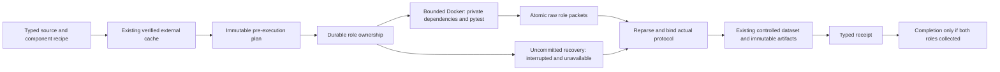

# Reproduce a controlled Python fault

COLEMAN can collect unchanged buggy and fixed PySnooper source against one common
upstream pytest fixture. Two frozen locale profiles show why execution conditions
belong in result provenance: the original Unicode error reproduces under the
declared ASCII locale, while both revisions pass under UTF-8.

This optional producer reuses [controlled observations](controlled-faults.md),
source views, the verified external cache and immutable artifacts. Native TCPCI
experiments continue to use the existing application API, policies and checkpoints.
No historical CI events or scheduling costs are inferred from source execution.

## Install and collect outside checkout

The SDK requires Python 3.14+, uv and POSIX. These presets additionally require a
native Linux arm64 Docker engine. The subject interpreter is separately pinned to
CPython 3.8.1; it does not change the SDK's Python requirement. Other architectures
need independently reviewed recipes and runtime qualification.

Install the published **4.11 wheel** into a fresh external environment. The
SHA-256 fragment verifies the release bytes before installation; no checkout is
required. Runtime preparation is a separate, explicit operator action.

```bash
uv venv /tmp/coleman-python-env --python 3.14
uv pip install --python /tmp/coleman-python-env/bin/python "https://github.com/jacksonpradolima/coleman/releases/download/v4.11.0/coleman-4.11.0-py3-none-any.whl#sha256=d328c0d9bfd9e75658c64e35876c3151fb242c805846835c211a3622d8b75e55"

# Explicit operator preparation; the producer never pulls an image.
docker pull --platform linux/arm64 docker.io/library/python@sha256:ffae7d875975e38d38378ce65d10ab62c2156eb198e2e798664ec6c793015c03

mkdir -p /tmp/coleman-python-workspace
cd /tmp/coleman-python-workspace
/tmp/coleman-python-env/bin/python -m coleman.transports.python \
  --preset pysnooper-1-ascii-v1 --trial python-source-trial-1 \
  --cache /tmp/coleman-python-source-cache \
  --output /tmp/coleman-python-observations --fetch > ascii-summary.json

# Collect the predeclared contrast, sharing the same fault/dependence group.
/tmp/coleman-python-env/bin/python -m coleman.transports.python \
  --preset pysnooper-1-utf8-v1 --trial python-source-trial-1 \
  --cache /tmp/coleman-python-source-cache \
  --output /tmp/coleman-python-observations --fetch > utf8-summary.json

# Same recipe/trial/producer: revalidate and replay, without executing tests again.
/tmp/coleman-python-env/bin/python -m coleman.transports.python \
  --preset pysnooper-1-ascii-v1 --trial python-source-trial-1 \
  --cache /tmp/coleman-python-source-cache \
  --output /tmp/coleman-python-observations
```

Only explicit `--fetch` permits the individually pinned public source, wheel and
notice downloads. Runtime acquisition is separate; subject containers have no
network. Source cache, observations and system temporary directories must be
outside Git, and cache/output roots must be separate. No foreign source, wheel,
fixture or raw outcome is bundled in COLEMAN.

The summary reports dataset, state and receipt paths, role statuses, planned,
unobserved and classified pairs. Exit 0 means both protocols completed, including
negative test outcomes. Incomplete evidence has status `incomplete`, no completion
marker and exit 2. Invalid source/state or infrastructure failures raise instead
of becoming successful tests. The CLI also accepts a bounded versioned recipe via
`--recipe-stdin`; recipe fields cannot supply shell commands.

## Frozen source and environment

The [public pre-execution protocol](https://github.com/jacksonpradolima/coleman/issues/305#issuecomment-6233689817)
was recorded before observing subject outcomes. Both profiles use these inputs:

An explicit [observer hardening amendment](https://github.com/jacksonpradolima/coleman/issues/305#issuecomment-6234316313)
pins the updated harness before its qualification. It changes dependency storage
to an atomically allocated mode0700 temporary directory in container tmpfs.
Subject/fixture/test, wheel, image and locale declarations remain unchanged;
original packets and their original producer are retained without reinterpretation.

| Input | Frozen selection |
| --- | --- |
| Buggy source | PySnooper `e21a31162f4c54be693d8ca8260e42393b39abd3`, the direct parent of the fix |
| Fixed source | PySnooper `56f22f8ffe1c6b2be4d2cf3ad1987fdb66113da2`, upstream issue 124 |
| Production trees | All five original `pysnooper/*.py` files and LICENSE in each revision |
| Common fixture | Unchanged fixed-tree `tests/__init__.py`, `tests/utils.py`, `tests/test_chinese.py`, LICENSE |
| Selected test | Exactly `tests/test_chinese.py::test_chinese`; an explicitly partial suite |
| Runtime | Official CPython 3.8.1, native linux/arm64, image digest in the command above |
| Contexts | `C` / `ANSI_X3.4-1968` / filesystem ascii; `C.UTF-8` / `UTF-8` / filesystem utf-8 |
| Shared flags | TZ=UTC; PYTHONUTF8=0; PYTHONCOERCECLOCALE=0; PYTHONIOENCODING=utf-8; PYTHONHASHSEED=0; no bytecode or automatic pytest plugins |
| Parent guards | 60 seconds and 1 MiB combined stdout/stderr per observed Docker process |
| Container guards | Non-root, read-only, no network/capabilities, no-new-privileges, 2 CPUs, 64 PIDs, 1 GiB memory, 128 MiB tmpfs |

The original unpinned bootstrap is replaced explicitly. Eight exact pure wheels
are installed only inside container tmpfs, with isolated pip, no index, dependency
resolution, source builds, project `setup.py` or compilation. The image supplies
pip 20.0.2, setuptools 45.1.0 and wheel 0.34.2 unchanged. Actual interpreter,
architecture, locale, encoding, distribution versions and selected discovery are
checked against the frozen bootstrap plan before promoting case evidence.

The bootstrap plan declares `private-runtime-tempdir-v1`. Python's temporary
directory API allocates the actual dependency location atomically with mode0700
and removes it after observation; no predictable shared directory is trusted.

The parent deadline covers the observed Docker process, including interpreter and
wheel installation overhead. It does not bound the entire acquisition workflow,
staging or the separate cleanup command. The historical image is a benchmark
condition; SDK dependency audits do not establish its security or support status.

## Component terms and attribution

Every input has independent byte/version/terms pins. The subject and selected
fixture retain their MIT LICENSE. Four production files have explicit MIT headers;
`variables.py` relies on the project LICENSE and is not described as separately
headed. BugsInPy `11c5f1eea954a42132cfd06bf257766a7963e0fd` is a curation reference;
its framework code, patches and fixtures are not copied.

| Wheel | Version | Recorded component terms |
| --- | --- | --- |
| exceptiongroup | 1.3.1 | MIT and copied Python standard-library PSF notice |
| iniconfig | 2.1.0 | MIT |
| packaging | 26.2 | Apache-2.0 OR BSD-2-Clause; both complete texts retained |
| pluggy | 1.5.0 | MIT |
| pytest | 8.3.5 | MIT |
| python-toolbox | 1.3.2 | Component review below; not blanket MIT |
| tomli | 2.5.0 | MIT |
| typing-extensions | 4.13.2 | PSF declaration; complete historical Python license text retained |

PythonToolbox's root MIT notice lists Envelopes (MIT), SortedContainers
(Apache-2.0) and decorator (BSD; its actual header has two clauses). Two unused
GUI files declare the wxPython license. The [official wxPython license page](https://wxpython.org/pages/license/)
identifies wxWindows 3.1; pinned wxWidgets licence, LGPL, GPL and preamble files
are retained separately. SortedContainers' original copyright/license notice and
the full Apache license text are retained separately as well.

The unused `test_python_toolbox/third_party/forked_mapping_tests.py` has no own
notice. Similarity with public CPython 3.3.0 mapping tests suggests copied or
derived code; exact origin is **not established**. The typed component record
labels this attribution as inferred and retains the full pinned CPython LICENSE
conservatively. This remains an explicit source-admission limitation. A recorded
terms review is not proof of legal permission or provenance for unreviewed inputs.

All original wheel bytes remain intact. The producer separately inspects selected
metadata/notices with the existing bounded ZIP reader, while checking every
entry's path/type/local metadata and whole-archive sizes. Unselected member bodies
are bound by the whole-wheel SHA-256, not independently decoded or certified.
PythonToolbox's original Python installation script has its own pin; pip may
install it but does not execute it. No dependencies are silently stripped or
fixtures patched to avoid inconvenient imports.

## Outcomes, units and evidence limits

The first installed qualification collected four role observations across the two
contexts, with identical source/fixture bytes:

| Locale | Buggy | Fixed | Unchanged generic classification |
| --- | --- | --- | --- |
| C / ASCII | `test_error`, `builtins.UnicodeEncodeError` | `passed` | `inconclusive` |
| C.UTF-8 | `passed` | `passed` | `both_pass` |

The ASCII run reproduces the observed failure/fix under its declared conditions.
The generic classifier reserves `expected` for assertion-failure-to-pass pairs;
an exception is never relabeled to increase that count. The UTF-8 contrast is a
valid negative reproduction context. These are one curated fix and one selected
test, not two independent bugs, a full suite or a generalization result.

Case elapsed values are nonnegative integer **nanoseconds** spanning pytest
setup/call/teardown and observation overhead. Parent elapsed values are separately
labeled producer-process nanoseconds. Neither is removable CI runner work,
end-to-end savings or evidence of a faster policy. Actual UTC capture instants
have explicitly declared microsecond precision and are not historical CI clocks.
Observed zero remains zero. Missing/uncommitted observations have unavailable
counters, not imputed zero. Negative process exit codes are valid POSIX facts;
negative elapsed, non-finite quantities and incompatible units reject.

Raw packets retain bounded observer stdout/stderr and actual pytest exception/skip
diagnostics. They are not a complete filesystem or I/O audit of the subject.
Malformed records never promote cases. Valid partial streams can retain completed
cases before interruption; missing cases stay unobserved. Setup/teardown and other
non-assertion exceptions remain test errors. Scientific admission and temporal
evaluation remain separate: `constructed`, `not_evaluated`, `insufficient_evidence`.

## Recovery and offline validation



A nonblocking POSIX lock prevents concurrent producers within the same output
generation from observing the recipe/trial/implementation twice. Separate output
roots do not share a distributed execution ledger; choose meaningful trial IDs
and retain dependence groups when combining evidence. Start markers precede spawning, and role
packets follow cleanup of only that deterministic producer-owned container.
Unconfirmed cleanup leaves recoverable ownership. A crashed, uncommitted role
becomes `interrupted`; fresh observation requires a new trial ID. Completed roles
are reused. A real installed-process kill/recovery test exercises this behavior.

Receipt and completion are written after raw/context/normalized-data validation;
incomplete collection never acquires `complete.json`. Completed replay works
without Docker. A missing role cannot be replaced by a completion marker, and
changed runtime facts cannot be mixed into an unfinished trial.

Use the typed Python API after the collection commands above:

```python
from coleman.artifacts import ArtifactWriter
from coleman.corpus import SourceCache
from coleman.transports.python import load_python_recipe
from coleman.transports.python_capture import capture_python_source, validate_python_capture
from coleman.transports.python_contracts import PythonCapturePlan

cache = SourceCache("/tmp/coleman-python-source-cache")
writer = ArtifactWriter("/tmp/coleman-python-observations")
result = capture_python_source(load_python_recipe(), cache, writer, "python-source-trial-1")
plan = PythonCapturePlan.from_json((result.state_directory / "plan.json").read_bytes())
validate_python_capture(result.receipt, plan, result.dataset, cache)
assert result.receipt.status == "collected"
assert result.dataset.admission == "not_evaluated"
print(result.dataset.pairs[0].classification)  # inconclusive; original exception retained
```

Validation rebuilds the context, reparses original raw packets and compares every
normalized observation and receipt reference. Recomputed hashes do not legitimize
rewritten outcomes. These checks establish consistency, not authentication that a
hostile subject could never forge observer output.

All new records require explicit schema version 1. Missing, old, future or
unknown versions reject without implicit migration. Existing controlled/JUnit
artifacts retain their original contracts and meanings. Generic controlled
datasets remain readable through the unchanged domain API. Transport replay binds
all COLEMAN packaged bytes and version, excluding hidden/cache/bytecode files;
a changed package creates a new generation. To validate an older producer's
transport artifacts, use its original reviewed package. No automatic cross-version
rewrite or copy of old observations into a new identity is performed.

Native CI/checkpoint integration is tested separately with the owned exact-answer
[controlled CI example](controlled-faults.md). Controlled Python timing is never
fabricated into a historical build or native scheduling-cost dataset. Broader
source admission, diversity and comparative evidence remain in the [public
roadmap](roadmap.md) and #261's remaining subtasks.
