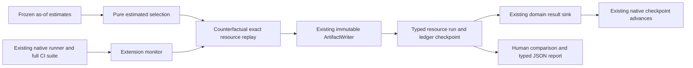

# Exact CI resource accounting and historical replay

`coleman.resources` adds a typed audit of predecision intent, reservations, actual
occupied work, release and overhead. It reuses the native runner, frozen
[CI pilot](operational-pilot.md), [temporal evaluation](protected-evaluation.md),
[domain records](domain-results.md), immutable artifacts and native checkpoints.
Available from COLEMAN 4.3. Build this revision or use the verified 4.4 release
wheel for these examples; the 4.2 wheel does not contain this module.

## Complete accounting example

The ledger uses **integer occupied runner milliseconds**. Equal unit symbols with
different meanings are incompatible. No implicit conversion, clock or external
service is involved:

```python
from datetime import datetime
from coleman.resources import (
    RUNNER_MS, IntentEvent, OccupancyEvent, OverheadEvent, ReserveEvent,
    ResourceAmount, ResourceEstimate, ResourceLedger,
)
from coleman.results.domain import fingerprint

def amount(ms):
    return ResourceAmount(value=ms, semantics=RUNNER_MS)

def metadata(sequence, identity):
    instant = datetime.fromisoformat("2026-01-02T00:00:00Z")
    return dict(event_id=identity, sequence=sequence, event_at=instant, recorded_at=instant)

source = fingerprint({"source": "owned-ci-resource-example-v1"})
estimate = ResourceEstimate(
    amount=amount(1000), source_fingerprint=source,
    observed_at=datetime.fromisoformat("2025-12-30T00:00:00Z"),
    available_at=datetime.fromisoformat("2025-12-31T00:00:00Z"),
    valid_until=datetime.fromisoformat("2026-01-03T00:00:00Z"),
)
ledger = ResourceLedger(
    schema_version=1, ledger_id="build-2:base-order", capacity=amount(2000),
    source_fingerprint=source, configuration_fingerprint=source,
)
ledger = ledger.append(IntentEvent(
    **metadata(1, "intent-a"), execution_id="test-a:attempt-1", estimate=estimate,
))
ledger = ledger.append(ReserveEvent(
    **metadata(2, "reserve-a"), execution_id="test-a:attempt-1", amount=amount(1000),
))
completion = OccupancyEvent(
    **metadata(3, "complete-a"), execution_id="test-a:attempt-1",
    amount=amount(900), terminal="passed",
)
ledger = ledger.append(completion)
ledger = ledger.append(OverheadEvent(
    **metadata(4, "dispatch-a"), component="dispatch", amount=amount(1),
))
assert (ledger.balance.available, ledger.balance.reserved, ledger.balance.consumed) == (1099, 0, 901)
assert ledger.append(completion).to_json() == ledger.to_json()
assert ResourceLedger.from_json(ledger.to_json()) == ledger
```

After reservation: available 1,000, reserved 1,000, consumed 0. Completion charges
900 and releases only the unused 100; reservation is never additional consumption.
The separately observed dispatch overhead charges 1. Initial capacity always equals
available + live reservations + consumed. V1 authorizes **no capacity adjustments**.

An estimate of 900 followed by actual occupancy 1,100 charges all 1,100. Available
capacity can become negative, and exceeding the estimate triggers sticky
`stop_new_reservations` containment even if capacity remains. Existing running
attempts must still report their work. This is accounting and predispatch checking;
it cannot interrupt an external runner or enforce a hard runtime limit.

## States, identity and compatibility

- A zero amount is an observed zero. Null is invalid consumption, but an explicitly
  null `TestEstimate.estimate` is unavailable estimation evidence and prevents dispatch.
- `OccupancyEvent.amount` is an **increment**, not a cumulative counter. `terminal=None`
  retains a live reservation. Terminal passed/failed/unknown/timeout/partial/cancelled
  releases unused reservation; unknown/timeout/partial/cancelled never imply labels.
- A zero terminal cancellation releases the remaining reservation. Retry requires a
  new execution ID with `retry_of` referencing a terminal attempt. Both attempts count.
- Negative consumption, booleans, float quantities, fractional units, nonfinite
  numbers, refunds, top-ups and capacity adjustments fail explicitly. Negative
  available balance and signed comparison savings remain valid observations.
- New events require contiguous sequence 1..n and nondecreasing first receipt times.
  Equal timestamp ties use sequence, never lexical ID. Late source events can have
  earlier event times across different attempts; each attempt and its retry retain
  causal source order. New out-of-order
  deliveries fail; replay the ordered durable source. Exact accepted duplicates may
  arrive anywhere and are ignored. Retrying an already accepted event consumes no
  new slot, including at the 4,096-event limit; raw input arrays are separately bounded.
  Changed canonical payload for an ID conflicts.
- Ledger logical identity is its declared `ledger_id`, independent of contents.
  Full content fingerprint includes schema, provenance and events. Producers own
  globally meaningful IDs and immutable estimation/source/config fingerprints.
- V1 requires explicit integer schema version 1, rejects unknown/future versions,
  duplicate JSON keys and unknown fields, and performs no automatic migrations.
  Existing native Parquet, checkpoints and domain/pilot artifacts keep their schemas
  and meanings. To adopt, create a new ledger with reviewed units and provenance;
  never reinterpret legacy durations as this resource contract implicitly.

## Native CI workflow and comparison

Build/install this revision's wheel, copy
[`examples/resource-replay/ci.py`](https://github.com/jacksonpradolima/coleman/blob/main/examples/resource-replay/ci.py)
into an empty local workspace, then run:

```bash
python ci.py owned-ci
python ci.py owned-ci  # completed native checkpoints and original timing are reused
```

The owned MIT synthetic source has three tests, occupied durations 1/2/4 seconds,
and two protected builds after native warmup. The native runner executes **all
three required tests** for each of two frozen candidates: base order and a simple
prior-estimate order. Prior estimates are a separate frozen 4,000/1,000/2,000 ms
vector, available before the protected period. The resource budget is 5,000 ms.

The monitor checks actual native rankings and full-suite schedules before auditing
the modeled resource selection. A selector receives `ResourceRequest`: identities,
ranking, budget, cutoff and frozen estimates. It receives no current duration or
verdict. It selects a serial stop-at-first-nonfit prefix. Missing/future/expired
estimates yield no-action. A stale/unavailable priority signal can fall back to the
full suite only if all estimates are eligible and the complete estimated cost fits;
otherwise it yields no-action. Actual work reconciliation or estimate expiry may
stop a later hypothetical dispatch even when it was initially planned. Native
required tests remain fully executed regardless of the counterfactual selection.

`ResourceReplayProtocol` reuses the pilot's source identity/digest/license,
`TemporalPlan`, freeze, baseline and complete candidate trial registry. Estimation
availability must precede freeze. Candidates share the same builds, resource
budget and failing-test outcome definition. Seeds do not count as independent
builds. `ResourceReplayRun` embeds the unchanged verified native `PilotRun` and
explicit queue/setup/occupied-setup availability; it recomputes the ledger and
summary instead of trusting supplied totals. `ResourceReplayReport` preserves
missing pairs, signed work/net differences and descriptive quality gates. Gates
retain the frozen pilot recall, runner-saving and overhead thresholds; a missing
or unsafe baseline cannot establish a passing comparison. Minimum build counts
and adoption evidence remain separate from a per-build descriptive gate.

`report.md` and typed JSON keep these quantities distinct:

| Quantity | Meaning and limits |
| --- | --- |
| Runner work | Actual declared occupied work in the modeled selection, whole ms |
| Execution elapsed | Serial selected execution, excludes dispatch/queue/setup |
| Dispatch overhead | Measured native prioritization elapsed, explicitly rounded up to ms and modeled as one occupied runner; less than 1 ms rounding excess |
| Shared setup occupancy | Separately declared resource charge; null makes accounting partial |
| Queue/setup elapsed | Separately declared delays, null when unmeasured; never inferred from work |
| Modeled credits subtotal | Frozen credit/second rate applied exactly to known charged work and overhead, excluding fixed/unmeasured/provider costs; not a bill |
| Recall | Full-source failing-test denominator; unresolved labels yield unavailable, no failures yield not applicable |
| First failure | Execution elapsed to first selected failure; null/right-censored if none, genuine zero remains zero |
| Work/net savings | Baseline minus candidate, signed ms; net includes charged overhead |

A negative or inconclusive comparison is valid. A descriptive gate cannot promote
a candidate; adoption remains **insufficient evidence**. This offline fixture
proves accounting and recovery, not independent CI observations, calibrated
probabilities, production savings or willingness to adopt/pay. Multiple candidate
trials remain visible. Protected statistical claims require a separately justified
comparison using the existing evaluation contracts and representative evidence.

## Publication, interruption and concurrency



`publish_resource_run` uses a stable logical protocol/candidate/build filename;
changed payloads conflict. First committed timing survives replay. `publish_ledger`
writes an immutable header and stable per-sequence event files before a complete
JSON checkpoint. Concurrent identical writers converge, and different branches
conflict on event paths. Interrupted orphan event files do not constitute a completed
checkpoint. `restore_ledger(path)` reads an explicitly acknowledged complete file
and revalidates every event/balance; it never guesses a latest checkpoint from
partial files. Snapshots embed the complete log and can be copied independently.
A caller acknowledges a source event only after successful publication; its durable
ordered source owns replay after a crash.

The native example publishes resource evidence and domain sidecars before native
checkpoint advancement, and verifies immutable source/Parquet/config/spec proofs
before resuming. Only trusted local checkpoints produced by the example may be
loaded. Native execution remains single-writer per output root; use separate roots
for concurrent native runs. The example rejects unknown roots, bounded-tree excess
and existing symlink children. These checks are not an OS sandbox against hostile
concurrent filesystem mutations.

The existing atomic writer requires local hard links and directory fsync. I/O errors
propagate; temporary files are never completed artifacts. Process interruption is
covered; power-loss durability of newly created ancestor directories is outside its
contract. V1 caps each external amount at 10^12 whole units and the ledger at 4,096
deliveries. CI replay caps tests/build at 1,000, rejects fractional-ms native sources
and requires full-suite native evidence. This is a bounded correctness feature, not
a throughput benchmark or a second scheduler. Parallel scheduling, automatic external
unit conversion, billing integration, mutable capacity, live CI cancellation and
prospective evidence collection remain outside this slice.

## Continue the workflow

Connect resource observations to the [operational pilot](operational-pilot.md) and [shadow
evaluation](prospective-shadow.md). Use the [evaluation guide](evaluation-guide.md) to keep modeled
and observed claims separate.
