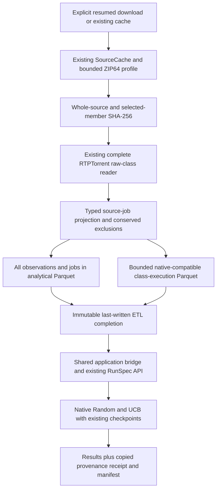

# Turn RTPTorrent CI history into Parquet and native TCPCI replays

**COLEMAN 4.8** provides a complete installed-package HikariCP workflow: verified
real archive → full analytical history → bounded native-compatible Parquet →
Random/UCB → checkpoint recovery. Delivered in
[#315](https://github.com/jacksonpradolima/coleman/pull/315) for
[#302](https://github.com/jacksonpradolima/coleman/issues/302), it uses the
existing native runner. The 4.7 wheel does not contain this ETL API.

The preset keeps **46,995 source class executions and 1,662 source jobs** in
analytical Parquet. It projects **18 executions from eight declared jobs** into
the existing native runner. The other **46,977 executions remain analytically
available**, with a conserved `outside_jobs` projection reason.

## Install and run outside checkout

Use Python 3.14+ and the verified published wheel. No source checkout, Docker or
MCP SDK is needed for this workflow; the URL pins the actual wheel SHA-256:

```bash
uv venv /tmp/coleman-rtptorrent-env --python 3.14
uv pip install --python /tmp/coleman-rtptorrent-env/bin/python "https://github.com/jacksonpradolima/coleman/releases/download/v4.16.0/coleman-4.16.0-py3-none-any.whl#sha256=73fac37fc037d4e5c061f838711371ade5ada2f129917f09ef1b49ce87350116"
mkdir -p /tmp/coleman-rtptorrent-workspace
cd /tmp/coleman-rtptorrent-workspace
```

Download the pinned public archive explicitly. The command supports resuming a
partial operator download; the ETL verifies the complete SHA-256 before parsing:

```bash
curl --fail --retry 3 --continue-at - --max-time 21600 \
  --output rtp-torrent-v11.zip \
  https://zenodo.org/records/4046180/files/rtp-torrent-v11.zip

/tmp/coleman-rtptorrent-env/bin/python -m coleman.transports.rtptorrent_etl \
  --archive rtp-torrent-v11.zip \
  --cache /tmp/coleman-rtptorrent-source-cache \
  --output /tmp/coleman-rtptorrent-data --run > summary.json
```

`--archive` verifies the supplied file even when the expected source is already
cached. Cache and output must be separate and outside Git. Concrete Parquet and
completion destinations are checked before archive acquisition. Source URIs in
the typed recipe are descriptive; the domain opens no URL. The existing small-
source HTTP adapter retains its 300-second cap. The explicit download step keeps
this approximately 5 GB transfer outside that adapter and can resume separately.

Once the cache is populated, repeat the whole conversion/replay **offline**:

```bash
/tmp/coleman-rtptorrent-env/bin/python -m coleman.transports.rtptorrent_etl \
  --cache /tmp/coleman-rtptorrent-source-cache \
  --output /tmp/coleman-rtptorrent-data --run > resumed-summary.json
```

The two invocations return the same completion and native run identity. Existing
immutable tables are verified and committed checkpoints are reopened. With the
default two policies and eight modeled rounds, the persisted native result has
**16 rows**, including after continuation. Source verification scans the large
archive again; account for that I/O when planning preprocessing.

The summary contains `completion`, `observations`, `jobs`, `datasets_dir`,
`native_artifacts`, conserved counts and the evidence labels. Native logs go to
stderr so a fresh CLI process can write its JSON summary to stdout. An ETL
completion certifies its three data files; native execution is a subsequent step
with the existing runner's own checkpoint/completion behavior.

## What the files preserve

| File | Scope and semantics |
| --- | --- |
| `observations.parquet` | Every canonical raw project/job/class/source-position execution; exact decimal duration text, observed/unavailable status, seconds and reported-class meaning; nullable method count/failures/errors/skipped; class outcome and one primary projection exclusion |
| `jobs.parquet` | All 1,662 source job labels, source/eligible counts, selected modeled round and status; unavailable logical build ID, event clock and outcome-availability clock remain null |
| `datasets/rtptorrent-hikaricp/features-engineered.parquet` | The 18 eligible records using existing native `BuildId`, `Name`, `Duration`, `CalcPrio`, `LastRun`, `Verdict` and `SourceExecutionId` fields |
| `complete.json` | Last-written versioned recipe/producer/writer provenance, physical file hashes/sizes/row counts, canonical row digest and complete exclusion accounting |

Source `duration` values are **reported class elapsed seconds**, as documented by
the existing [raw-class reader](rtptorrent.md). Analytical `duration_decimal`
retains their exact normalized decimal value as text. Native `Duration` explicitly
projects eligible values to binary64 seconds. An observed zero stays zero; null
with `duration_status=unavailable` stays unavailable. Unknown/not-run outcomes
remain distinct from passes. Failure/error/skipped method counters remain
separate; native verdicts count failing **class executions**, not unique faults.

The physical CSV accounting is:

```text
input_rows = observed_executions + duplicate_rows_excluded
observed_executions = replay_executions + excluded_outside_jobs
                    + excluded_not_run + excluded_unknown_outcome
                    + excluded_unavailable_duration
```

Exact repeated source rows are explicitly counted/excluded; conflicting duplicate
execution keys reject. Repeated classes at distinct positions remain separate.
For selected jobs, not-run precedes unknown outcome, which precedes unavailable
duration as the primary exclusion. Outside-slice records retain their full raw
values and the `outside_jobs` reason; their raw outcome is still inspectable.

## Explicit replay assumptions

The frozen preset selects the first eight numeric job labels with at least two
raw class executions. This criterion uses record cardinality and labels, without
filtering on failures. Selected labels are:

```text
13471129, 13474093, 13476365, 13476403,
13476405, 13476407, 13505429, 13505431
```

Numeric order is an explicit **post-hoc simulation order**. Source job IDs remain
original labels. Native `BuildId` is a local modeled round; it does not assert an
observed logical CI build or join concurrent jobs. No commit/build number,
duration sum or source order becomes an observed clock.

The native model adds reported class seconds serially. It assumes correspondence
between the same class label and its within-job occurrence ordinal across jobs.
Source project/job/class/position execution IDs remain independently preserved and
joinable through `SourceExecutionId`. Occurrences are assigned before eligibility,
so changing an outcome or missing duration cannot rename later occurrences.

The receipt requires
`budget-censored-native-RNFail-zero-nondetection`: detections within budget receive
the existing native reward; other prioritized entries receive zero nondetection
reward, including unscheduled classes. Zero nondetection does not establish a
passing class or full-label feedback. The default run uses Random and UCB,
budget ratio 0.5, seed 42 and one execution per policy. Seed repetitions do not
create independent observations.

Evidence is `posthoc-source-job-serial-simulation`, admission is
`blocked_missing_temporal_evidence`, and generalization is `insufficient_evidence`.
Use this delivery to prepare and reproduce modeled CI experiments. Protected
temporal evaluation needs verified event/outcome clocks and logical build/job
mapping. The source-admission and confirmatory gates in
[#261](https://github.com/jacksonpradolima/coleman/issues/261) remain open.

## Typed API and a custom bounded slice

The transport loads a metadata-only preset, and the domain exports/verifies it:

```python
from importlib.resources import files
from pathlib import Path

from coleman.application.corpus import run_rtptorrent_replay
from coleman.artifacts import ArtifactWriter
from coleman.corpus import SourceCache
from coleman.corpus.rtptorrent_etl import export_rtptorrent_parquet, validate_rtptorrent_etl
from coleman.corpus.rtptorrent_etl_contracts import RTPTorrentETLReceipt, RTPTorrentETLRecipe

resource = files("coleman.corpus.resources").joinpath("rtptorrent-hikaricp-first-eight-v1.json")
recipe = RTPTorrentETLRecipe.from_json(resource.read_bytes())
cache = SourceCache("/tmp/coleman-rtptorrent-source-cache")
completion = export_rtptorrent_parquet(recipe, cache, ArtifactWriter("/tmp/coleman-rtptorrent-data"))
receipt = RTPTorrentETLReceipt.from_json(completion.read_bytes())
validate_rtptorrent_etl(receipt, cache, completion.parent)
result = run_rtptorrent_replay(completion, cache, Path("/tmp/coleman-rtptorrent-native"))
assert result.run_id
```

For a different reviewed slice, construct an explicit `RTPTorrentETLRecipe` using
one `Zip64SelectionSpec`, its exactly matching existing `RTPTorrentSpec`, a safe
single-component `dataset_id`, at most 16 distinct ascending job labels and the
required feedback declaration. All source observations remain analytical. Unknown
job labels reject. The existing raw-reader limits remain 16 MiB decoded CSV,
50,000 physical rows and 16 KiB per physical line; inputs beyond them reject
without truncation. The published filtered `untreated` baseline is a separate
input and cannot replace the complete raw history.

## Identity, compatibility and recovery

Recipe and completion require integer `schema_version=1` and recipe
`rtptorrent-parquet-source-job-replay-v1`. Missing/future schemas and unknown
assumptions reject. There is no automatic conversion of old native Parquet, LRTS
completions or standalone RTPTorrent datasets into this contract. Existing readers
remain available for those artifacts; create a consciously reviewed new recipe.

The export namespace binds the complete recipe, actual conversion implementation
digest and Polars writer version. Fixed uncompressed Parquet settings bind physical
bytes; `logical_rows_sha256` separately identifies canonical rows. Validation
recomputes actual source membership, conversion, counts and expected physical
bytes. It avoids decoding caller-provided Parquet to certify it. Unknown producer
or writer versions require their recorded implementation and reject certification
under a different one. Metadata-only reading remains distinct from verification.

All three files are immutable before `complete.json` is published last. An
interrupted write may retain individual verified files; retry converges through
the existing writer. Concurrent identical exports converge on the same completion.
Missing/corrupt files or false source/count/provenance claims reject without repair.
Empty native projections remain valid analytical exports and native execution
rejects them explicitly. Trusted local parents and existing filesystem durability
limits apply. No second runner, learning checkpoint or network implementation is
introduced.



## Owned and real installed-package checks

The wheel contains the recipe and owned correctness fixtures. The standalone
example script is a separate repository file: download the exact release-tagged
script and verify its SHA-256, then run twice offline with the installed wheel.
It downloads no foreign dataset:

```bash
cd /tmp/coleman-rtptorrent-workspace
curl --fail --location --output owned-ci.py \
  https://raw.githubusercontent.com/jacksonpradolima/coleman/v4.14.0/examples/rtptorrent-parquet/ci.py
/tmp/coleman-rtptorrent-env/bin/python -c 'import hashlib, sys; from pathlib import Path; sys.exit(0 if hashlib.sha256(Path("owned-ci.py").read_bytes()).hexdigest() == "9b7c8dec20124cefe975d99a2c794a838e791000d3a7cc3046cbcbfaa5c4fd04" else "Example SHA-256 mismatch")'
/tmp/coleman-rtptorrent-env/bin/python owned-ci.py owned /tmp/coleman-rtptorrent-owned-cache
/tmp/coleman-rtptorrent-env/bin/python owned-ci.py owned /tmp/coleman-rtptorrent-owned-cache
```

That example preserves eight constructed records, projects four, accounts for
outside/not-run/unknown/unavailable exclusions, and resumes two native rounds with
four result rows. The test suite compares the two-job native NAPFD/APFDc results
with the existing independent exact tiny oracle under the explicit serial model.
The fresh base-wheel regression also exercises the actual real cache when enabled:

```bash
COLEMAN_RTPTORRENT_ETL_REAL_CACHE=/tmp/coleman-rtptorrent-source-cache \
  uv run pytest tests/corpus/test_installed_rtptorrent_etl.py --no-cov -q
```

Source pins and data terms are documented in the
[ZIP64 integrity guide](zip64-source-selection.md) and the
[RTPTorrent source assessment](rtptorrent.md). The wheel contains metadata recipes
and owned fixtures; standalone example scripts are downloaded separately above.
Third-party archive/rows stay outside the repository. Dataset terms remain
separate from enclosed subject-code rights, and this workflow reads reported CI observations rather than executing the archived subject repositories.
