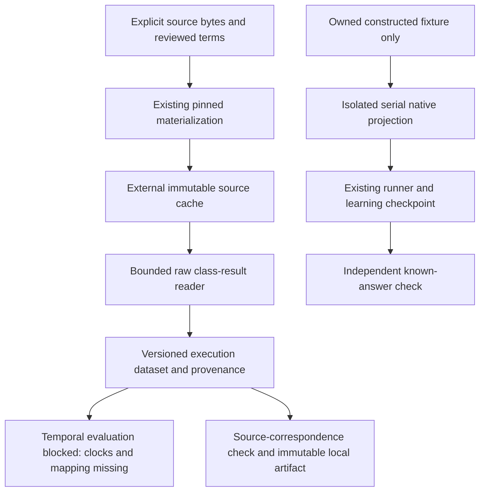

# RTPTorrent: source assessment and bounded class-result conversion

The RTPTorrent adapter in this source revision converts **raw class-result CSV
members**, using the existing licensed materialization/cache contract. The published
4.4.x wheels do not include this adapter; build and install this source revision to
run these examples. It does not admit RTPTorrent to protected temporal evaluation.

An execution is identified by project, job ID, class label and source position.
Repeated class labels remain separate executions. Job IDs are neither logical
build IDs nor timestamps. No commit date, synthetic clock or sum of durations is
substituted for outcome availability.

## Research questions and source decisions

The source audit asks which exact bytes and terms can be pinned, what an observation
means, whether feedback was available before a decision, and which evidence a
baseline table actually retains. It uses the original paper, artifact README and
actual bounded member inspection. This is a focused source-admission assessment,
not a completed systematic literature review or an effectiveness study.

Primary sources checked on 2026-10-15/16 UTC:

- [RTPTorrent 1.1](https://zenodo.org/records/4046180), DOI
  `10.5281/zenodo.4046180`, and its archive README. The provider advertises
  `rtp-torrent-v11.zip`, 5,016,963,482 bytes, MD5
  `1f7fa822b0cf155bd007a94d1a24a336`, and CC BY 4.0 metadata.
- [The authors' MSR 2020 paper](https://doi.org/10.1145/3379597.3387458)
  describes the historical Java/Travis corpus and its limitations. The README
  defines class-level duration in seconds and separate method failure/error/skip
  counts, and warns against using concurrent sibling jobs as prior feedback.
- [TravisTorrent's archive notice](https://testroots.github.io/travistorrent-site/page_access/)
  directs users to [Figshare record 19314170](https://doi.org/10.6084/m9.figshare.19314170)
  and states that raw-log access ended in 2022. The checked record is version 1;
  `final-2017-01-25.csv.gz` has 264,607,174 bytes and provider MD5
  `5d359345fecf0bf47be6edb10b5aae58`.
- [TravisTorrent field documentation](https://testroots.github.io/travistorrent-site/page_dataformat/)
  describes its trigger timestamp. The inspected 66-column CSV header contains
  no explicit completion field. Matching coverage and full dump integrity remain
  unverified. [Travis API documentation](https://docs.travis-ci.com/api/#builds)
  distinguishes start/completion and warns that restarted build duration need
  not equal their difference. These fields cannot silently create outcome times.

The original paper names `travistorrent_8_2_2017.csv` as its metadata join table.
The inspected Figshare dump is `final-2017-01-25.csv.gz`. Their equivalence and
join coverage have not been verified; the accessible snapshot cannot silently
substitute for the one cited in the paper.

The paper also reports 17 negative durations caused by test-runner defects and
notes that clock resolution produces reported zeros. This adapter rejects
negative duration rows rather than repairing them or treating them as unavailable.
A valid reported zero remains zero; it does not prove that execution consumed no
physical time. Changing logging, platforms, components and hardware further
limit cross-job identity and timing comparisons.

The RTPTorrent ZIP64 end record advertises 2,883 entries and 395,312 central-directory
bytes. This exceeds the existing v1 materializer's entry ceiling and ZIP64 policy.
That contract remains unchanged. A future complete-archive recipe needs an explicit,
reviewed capability extension; relabeling an archive as an already validated ZIP
would bypass the existing contract.

### Observed source discrepancy

The following **single-project descriptive check** inspected the HikariCP raw
member and its published `untreated` baseline member. It did not pool projects or
estimate independent observations:

| Source member under `rtp-torrent/brettwooldridge@HikariCP/` | Rows | Jobs | Jobs without reported class failures/errors |
| --- | ---: | ---: | ---: |
| `brettwooldridge@HikariCP.csv` | 46,995 | 1,662 | 1,530 |
| `baseline/HikariCP@untreated.csv` | 4,611 | 125 | 0 |

The raw member has 23,693 distinct job/class pairs but 46,995 distinct
job/class/position keys. Collapsing by class would lose executions. The published
baseline is a filtered slice; it cannot stand in for the complete raw history or
establish a zero-failure regime. Counts of source rows without reported failures
are not independent verification that the entire CI job passed.

The independently computed raw-member SHA-256 is
`0ebc3dd28d09227f6aa56698b76c7a217d034aa83318ffc5a75ff8d2d0632687`
for 2,825,388 decoded bytes. The baseline-member SHA-256 is
`ad162fbdd9786db59a30b7bc5625fab19cbac9d5b11e47ca6c1d79b46e041fa9`
for 339,235 decoded bytes. These are **member identities**, not the archive SHA-256.
Bounded HTTPS ranges, ZIP metadata and member CRC/size/deflate-EOF checks informed
this research. The complete archive was not verified: interrupted acquisition
remains partial. No third-party source rows or archive are committed here.

To reproduce the descriptive counts, obtain the exact 1.1 archive outside Git,
verify its complete bytes against the provider's size/MD5 and compute its SHA-256,
then export the named members with a separately reviewed ZIP64-capable tool. Pin
each decoded member before conversion. Compare raw row counts, distinct job IDs,
distinct job/class and job/class/position keys, and group-level absence of positive
failure/error counts. Do not treat a partial archive or range checksum as proof
of the entire container. Complete archive acquisition/validation is still an
outstanding reproducibility step, not a passing COLEMAN fetch recipe.

**Admission decision: blocked.** The raw layout supplies no event/completion clock
or complete build/job mapping, and repeated class labels lack a disambiguating
module/configuration dimension. A frozen completion/mapping source and explicit
identity/outcome rules are needed before temporal baselines or confirmation. This
is a documented compatibility limit, not a claim that the corpus is permanently
unusable. The registry and all seven uncovered diversity regimes remain unchanged.

## Contract and compatibility



`RTPTorrentSpec` and `RTPTorrentDataset` require integer `schema_version=1` and the
`rtptorrent-class-results-v1` recipe. Missing, legacy, extra-field and future
contracts reject; there is no implicit migration from native Parquet, baseline
CSV, source cards or materialization receipts. Existing artifacts retain their
meaning. `validate_rtptorrent_dataset` recomputes conversion from verified cache
bytes; reading a JSON artifact alone checks invariants, not source correspondence.

The accepted header is exactly:

```text
travisJobId,testName,index,duration,count,failures,errors,skipped
```

| Input | Meaning and behavior |
| --- | --- |
| `duration=0` | Observed zero reported class seconds |
| Empty duration | Null with explicit `duration_status=unavailable`, never zero |
| Negative, nonfinite or more than twelve fractional places | Reject conversion |
| Failure/error count greater than zero | Reported failed class; not a unique fault |
| Complete zero failure/error counts with executed methods | Reported passed class |
| All methods skipped or total count zero | Not run; not a pass |
| Incomplete counts without a known failure | Unknown; not a pass |
| Exact repeated execution row | Explicit duplicate exclusion; conserved input count |
| Same project/job/class/position with different values | Reject conflicting identity |
| Repeated class at different positions | Retain separate executions |

Durations use `s` with meaning `rtptorrent-reported-class-elapsed-v1`. They are not
observed runner work or parallel elapsed CI savings. Counts are nonnegative
integers; known failing/error/skipped counts cannot exceed the total. No unique
fault, calibrated probability, flakiness or independence is inferred.
The frozen spec retains duration units even for null values. Non-null duration
quantities require `duration_status=observed`; this source layout supplies no
not-applicable duration encoding, so that status rejects rather than being invented.

Limits are 16 MiB per selected member, at most 50,000 physical data rows, 16 KiB
per physical line and 1,024 characters per field. Duration literals have a
separate 64-character ceiling before Decimal construction. Lower row/line limits may be
frozen in the spec. UTF-8 comma-separated single-line records are required;
multiline quoted labels, malformed records and filtered baseline headers reject.
These are bounded input dimensions, not an operating-system memory sandbox.

## Complete owned example

Build a wheel from this revision and install it in an activated Python 3.14+
environment. Run this example outside the checkout. The license below applies
only to this newly authored fixture; never reuse it for downloaded data.

```python
import hashlib
import io
from tempfile import TemporaryDirectory
from pathlib import Path

from coleman.artifacts import ArtifactWriter
from coleman.corpus import MaterializationSpec, SourceCache, load_registry, materialize_source
from coleman.corpus.rtptorrent import convert_rtptorrent_source, publish_rtptorrent_dataset
from coleman.corpus.rtptorrent_contracts import RTPTorrentSpec

payload = (
    b"travisJobId,testName,index,duration,count,failures,errors,skipped\n"
    b"101,owned.Test,0,0,1,0,0,0\n"
    b"101,owned.Test,1,2,1,1,0,0\n"
)
digest = "sha256:" + hashlib.sha256(payload).hexdigest()
package = MaterializationSpec.model_validate({
    "schema_version": 1,
    "package_id": "owned-rtptorrent-format",
    "archive": "raw",
    "source": {
        "uri": "urn:coleman:owned:rtptorrent-format",
        "version": "1.1",
        "citation": "Repository-authored format-compatible CI fixture",
        "sha256": digest, "size_bytes": len(payload), "availability": "not_verified",
    },
    "license": load_registry().card("ci-serial-boundary-v1").manifest.license,
    "members": [{"name": "classes.csv", "sha256": digest, "size_bytes": len(payload)}],
})
with TemporaryDirectory() as temporary:
    root = Path(temporary)
    cache = SourceCache(root / "external-cache")
    receipt = materialize_source(package, cache, lambda: io.BytesIO(payload))
    spec = RTPTorrentSpec(schema_version=1, materialization=receipt,
                         member="classes.csv", project="owned/ci", history="constructed")
    dataset = convert_rtptorrent_source(spec, cache)
    assert len(dataset.executions) == 2 and dataset.repeated_class_executions == 1
    artifact = publish_rtptorrent_dataset(dataset, cache, ArtifactWriter(root / "exports"))
    assert artifact.exists()
    try:
        dataset.require_temporal_evaluation()
    except ValueError as error:
        print(error)  # Expected: no source clock or logical-build mapping.
    else:
        raise AssertionError("A clockless source entered temporal evaluation")
```

For native execution, copy the [complete owned CI example](https://github.com/jacksonpradolima/coleman/blob/main/examples/rtptorrent/ci.py)
outside the checkout and run:

```bash
python ci.py owned-ci /absolute/path/outside-git/rtptorrent-cache
python ci.py owned-ci /absolute/path/outside-git/rtptorrent-cache
```

It materializes and converts an owned format-compatible fixture, preserves the
reported green/repeated-class and unknown jobs, and projects only one complete,
unique-class **constructed isolated serial job** to native Parquet. Random/RNFail
run through the existing runner. Independent exact references check its native
metrics, and reopening the learning checkpoint preserves one result row. This
example uses no cross-job learning and claims no observed CI timeline or savings.

Converted JSON contains source rows: keep recipe-only data local, outside public
commits and mirrors. The publisher validates exact cached source correspondence,
cache/output separation and output containment before immutable publication.
Identical concurrent retries converge; interrupted writes produce no completed
JSON. Process-kill temporary-file and filesystem durability limits are inherited
from the existing artifact writer. No separate experiment framework, learning
checkpoint, CLI dependency, MCP dependency or automatic download is introduced.
