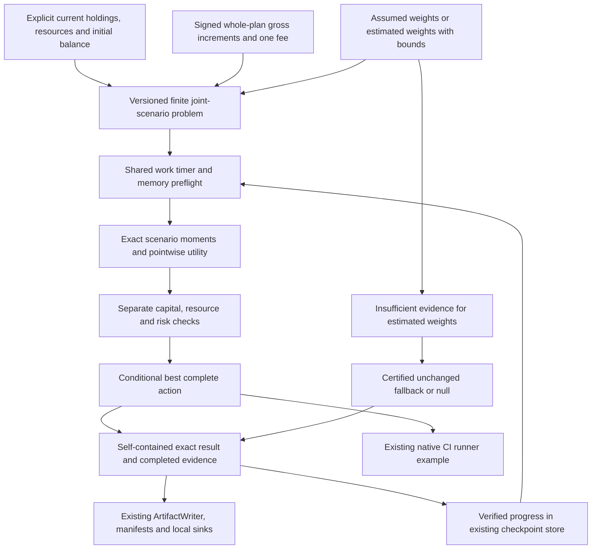

# Signed scenario allocation for CI resources

Finite scenario allocation chooses among explicitly declared CI resource plans.
It is separate from finite coverage selection and from `PortfolioUCB`, which
selects learning policies. Signed modeled returns remain signed; neither a ranking,
a bounded reward nor a scenario weight is interpreted as calibrated evidence.

The API evaluates complete alternatives over shared joint scenarios, checks
resources/risk separately, and returns exact conditional forecasts and an auditable
choice. It executes no allocation and mutates no holdings. Native CI scheduling,
NAPFD/APFDc and RNFail remain unchanged.

## Complete synthetic CI fixture

```python
from decimal import Decimal

from coleman.allocation import (
    AllocationLimits, AllocationProblem, CurrentAllocation, DiscreteAllocation,
    JointScenario, NamedAmount, ProbabilityEvidence, ResourceCapacity,
    RiskConstraints, ScenarioPayoff, SignedPayoff, select_allocation,
)
from coleman.results.domain import fingerprint
from coleman.selection import Quantity, UnitSemantics

credit = UnitSemantics(unit="credit", meaning="synthetic-ci-credit-accounting-v1")
seconds = UnitSemantics(unit="s", meaning="modeled-serial-ci-resource-time-v1")

def amount(value, semantics=credit):
    return Quantity(value=Decimal(value), semantics=semantics)

def signed(value):
    return SignedPayoff(value=Decimal(value), semantics=credit)

states = ("idle", "busy")
gross = {"no_action": ("0", "0"), "stable": ("2", "2"), "variable": ("10", "-8")}
durations = {"no_action": "0", "stable": "3", "variable": "4"}

def action(name):
    return DiscreteAllocation(
        action_id=name, holdings=(),
        resource_use=(NamedAmount(name="runner_time", amount=amount(durations[name], seconds)),),
        capital_required=amount("0"), transaction_cost=amount("0"),
        gross_payoffs=tuple(
            ScenarioPayoff(scenario_id=state, gross=signed(value))
            for state, value in zip(states, gross[name], strict=True)
        ),
    )

problem = AllocationProblem(
    schema_version=1,
    data_fingerprint=fingerprint({
        "gross": {name: list(values) for name, values in gross.items()},
        "durations": durations, "probabilities": ["0.5", "0.5"],
    }),
    value_semantics=credit, initial_balance=amount("10"),
    current=CurrentAllocation(
        holdings=(), reserved_balance=amount("0"),
        resource_use=(NamedAmount(name="runner_time", amount=amount("0", seconds)),),
    ),
    holding_definitions=(),
    resources=(ResourceCapacity(name="runner_time", capacity=amount("5", seconds)),),
    scenarios=tuple(JointScenario(scenario_id=state, probability=Decimal("0.5")) for state in states),
    probability_evidence=ProbabilityEvidence(kind="assumed"),
    actions=tuple(action(name) for name in gross), no_action_id="no_action",
    risk=RiskConstraints(downside_target=signed("0")),
)
result = select_allocation(problem, limits=AllocationLimits(deadline_seconds=None))
assert result.choice.selected_action_id == "stable"
assert result.choice.status == "optimal"
forecasts = {row.forecast.action_id: row.forecast for row in result.completed}
assert forecasts["variable"].expected_net.value == Decimal("1")
assert forecasts["variable"].variance.value == Decimal("81")
```

Credits are synthetic modeled units, not currency or measured CI savings. All fees
are zero in this fixture, so its gross increments equal the issue's net payoffs:

| Plan | Joint net increments | Expected net | Variance | Expected shortfall below 0 |
| --- | --- | --- | --- | --- |
| no_action | 0, 0 | 0 | 0 | 0 |
| stable | 2, 2 | 2 | 0 | 0 |
| variable | 10, -8 | 1 | 81 | 4 |

The negative scenario remains in the result. If all changed plans have negative
expected net and the unchanged plan returns zero, `no_action` is optimal. If every
feasible plan loses, the least-bad modeled optimum can still be negative.

## Accounting roles and complete input

Each modeled accounting amount carries explicit units and versioned meaning;
the example uses a generic CI credit accounting context. The roles are distinct:

- `initial_balance`: initial modeled stock, not an expected payoff;
- `current`: current complete holdings/resource vectors and reserved liquidity;
- `capital_required`: liquidity reserved for an alternative, including fee funding;
- `transaction_cost`: one deterministic expense per action, charged once;
- `gross_payoffs`: the entire target allocation's joint-state increment before that fee;
- `net = gross - transaction_cost` and `terminal_balance = initial_balance + net`.

Reserved capital is **not another expense** and is not subtracted from terminal
balance. Holdings are explicit target quantities, not an automatic valuation or
additional return transformation. A producer must define whole-plan gross
increments consistently with its accounting context. Scenario-varying fees,
automatic holding valuation and implicit financing are outside this v1 contract.

Every action must include every declared resource/holding component, even if its
amount is zero. Omitted/extra components and unit/meaning mismatches fail rather
than becoming free or unavailable quantities. Resources are total chosen-plan use,
including current commitments; their ceilings are inclusive. The fee must be funded
by reserved liquidity, and a plan's reservation must fit initial balance to be
feasible. A structurally valid plan exceeding a resource/capital ceiling is a
rejected alternative, not a malformed forecast.

`no_action_id` identifies a required explicit action preserving current holdings,
resource use and reservation with zero new transaction cost. Its gross increments
are declared; existing commitments can have nonzero/negative outcomes. The unchanged
choice is not assumed feasible if its actual modeled constraints fail.

## Joint weights, units and exact definitions

Each action declares exactly one gross payoff for every joint scenario ID. Joining
is by ID, so changing row order cannot scramble correlated outcomes. A bundled
plan's joint gross increment already represents the complete plan; the API does
not add independent marginal variances or manufacture scenarios from seeds.

Scenario probabilities carry dimensionless unit `1` and explicit joint-probability
meaning. They are finite nonnegative decimals with at most twelve fractional
places and must sum **exactly to one (tolerance zero)**. Zero-probability states
retain their raw outcomes. Malformed weights are rejected and never silently
renormalized; producers own any explicitly versioned estimation/rounding procedure.

For net payoff `X`, target `T`, and weights `p`, the exact summaries are:

- expected net: `sum(p * X)`;
- population scenario variance: `sum(p * X^2) - sum(p * X)^2`, in squared payoff units;
- expected target shortfall: `sum(p * max(T - X, 0))`, in payoff units.

Target shortfall is an unconditional positive-part expectation, **not CVaR** or a
tail-conditioned confidence measure. Risk ceilings optionally constrain variance,
expected target shortfall and minimum terminal balance in every positive-point-weight
scenario. A null ceiling means that constraint was not requested. Raw negative
outcomes remain visible when the alternative is infeasible.

`UtilitySpec(kind="expected_net")` maximizes expected signed net. For nonlinear
utility use `quadratic_target` and a nonnegative coefficient `c` with the inverse
payoff semantics returned by `penalty_semantics(value_semantics)`:

```python
from coleman.allocation import UtilitySpec, penalty_semantics

utility = UtilitySpec(
    kind="quadratic_target",
    coefficient=amount("0.1", penalty_semantics(credit)),
)
```

This evaluates `sum(p * (X - c * max(T-X,0)^2))`, in payoff units. It is not utility
of the mean. For `[12,-6]`, equal weights and `T=0,c=0.1`, expected net is 3 but
expected utility is 1.2; a stable return 2 is preferred. Missing/unused coefficients
and incompatible inverse/squared units fail validation, including for zero values.

Input amounts/holdings/resources and signed gross increments are bounded by
`10^12` units with twelve decimal places. Integer arithmetic retains products at
24/48 fractional places; exact outputs allow 48 fractional and 110 total digits,
bounded by `10^48`. Decisions have **zero arithmetic rounding tolerance** and do
not depend on process Decimal precision. Equivalent decimal spellings/signed zero
serialize canonically. Continuous optimization, log utility, CVaR and unspecified
nonconvex objectives are explicitly unsupported; unknown objective kinds fail.

## Assumptions, estimated weights and conservative choices

`ProbabilityEvidence(kind="assumed")` declares a conditional model assumption,
not verified real-world calibration. `optimal` means the exact best feasible
alternative in this complete supplied finite model. It does not certify external
universe completeness, forecast accuracy, independent observations or production CI
value. Exact ties favor `no_action`, then ascending action ID.

Estimated weights require evidence fingerprint/method ID and lower/upper bounds
for every joint scenario. Bounds must contain the point weights; no statistical
confidence/coverage is assigned automatically. Independent-unit/count metadata may
be explicitly unknown; a supplied count requires a named observation unit. Zero
is not used for an unknown count, and repeated seeds
never become independent observations.

The selector retains estimated weights, bounds and conditional forecasts but
returns `insufficient_evidence`. It can select only the unchanged action when its
capital/resources and risk can be conservatively certified over declared support.
For this fallback, variance is bounded by squared payoff range, target shortfall
by the largest supported shortfall, and terminal floors are checked in every
state with positive probability upper bound. These loose support bounds apply to
every normalized distribution there; failure to certify is not proof of
infeasibility. If no fallback is certified, selection is null. Nothing activates a
new plan merely because its point estimate is favorable.

External evidence or undisclosed scenarios cannot be authenticated by a hash.
Use [protected evaluation](protected-evaluation.md) to justify empirical assumptions;
declaring a weight source never substitutes for a scientific evaluation protocol.

## Execution limits, checkpoints and result evidence

`AllocationLimits` bounds new action examinations, overall cooperative seconds and
estimated additional working bytes. Input caps are 64 discrete actions, 256 joint
scenarios and 64 resource/holding components. No-action is evaluated first; remaining
IDs are canonical. One work unit is one attempted whole-action evaluation. Deadline
polling also occurs between scenario operations. An interrupted action contributes
no partial forecast, while completed evaluations and the best incumbent survive.
Zero work can produce no incumbent; this is `limited`, not fabricated infeasibility.

The timer starts at API entry and never resets per phase. Validation/checkpoint
replay/output/serialization have bounded overhead. The deadline is cooperative,
not a hard process kill; the memory preflight is an estimate, not measured RSS,
and excludes already supplied input, interpreter and artifact payload. Malformed
inputs and unexpected callback errors propagate. Keyboard interruption during
search returns complete progress with explicit termination status.

`AllocationResult` embeds the complete source, limits/preflight, checkpoint input,
completed evaluations, exact forecasts/risk rejections and a separate `choice`.
Reading/serialization recomputes every reported forecast/check from joint evidence
and verifies choice, scope completion and work accounting. A forged utility,
feasibility, selected ID or falsely complete enumeration is rejected.

| Choice status | Meaning |
| --- | --- |
| `optimal` | Every finite action checked, best feasible under assumed point weights |
| `feasible` | Best complete incumbent during interrupted/limited enumeration |
| `infeasible` | Full declared model checked; no feasible alternative |
| `limited` | Preflight or execution left no complete feasible incumbent |
| `insufficient_evidence` | Estimated weights; only a certified no-action fallback is allowed |

`termination_reason` separately records `enumeration_complete`, work/deadline,
cancellation/interruption or memory preflight. Null selection is not zero payoff.
Negative/inconclusive results are valid artifacts. No bounded-reward normalization
or learning reward is produced.

`result.checkpoint()` exports versioned complete evaluations, including rejected
alternatives. Store the JSON with existing `CheckpointPayload.extra` and
`LocalCheckpointStore` (trusted local pickle state). Resume with
`select_allocation(problem, checkpoint=...)`; source and each cached row are checked
before early preflight returns. Verified rows do not consume new search units;
verification overhead can repeat computation and is not a performance claim.
Cached rows still poll deadline/cancellation, including fully completed checkpoints.
Stopping that invocation preserves its explicit termination reason and verified
cached evidence: a previously complete optimum remains mathematically optimal,
without falsely reporting that this invocation completed enumeration.
Changed/future/corrupt checkpoints fail rather than inventing progress.

`publish_allocation_result(result, ArtifactWriter(root))` immutably publishes exact
JSON under `allocation-results/<content-digest>.json`; existing manifests inventory
it. Identical concurrent publication is idempotent. Existing local hard-link/fsync
and power-loss limits apply; incomplete writes expose no completed JSON. The core
does not write files unless this adapter is explicitly called.

`allocation_record(result, run_id=..., available_at=...)` projects selected modeled
summaries to the existing versioned measurement sinks. Exact JSON is authoritative; each projected
meaning ends in `binary64-projection-v1` and identifies a modeled quantity. Signed
losses remain negative, variance has squared units, and no selection yields
unavailable measurements. Supply actual zoned availability after calculation and
retain it on retries. Native `cost`/APFDc and rewards are not reinterpreted.

## Installed native CI examples

```bash
pip install path/to/coleman.whl
python ci.py ./ci-output
python resources.py ./resource-output
```

Copy [ci.py](https://github.com/jacksonpradolima/coleman/blob/main/examples/scenario-payoffs/ci.py)
or [resources.py](https://github.com/jacksonpradolima/coleman/blob/main/examples/scenario-payoffs/resources.py)
outside the repository before running; outputs remain within the invocation
directory. The CI example freezes the synthetic model, selects `stable`, maps its
declared three-second resource plan into the actual native fixed-time runner, and
verifies native scheduling before publishing the separate plan record. Native
Greedy/RNFail/NAPFD/Parquet components are real and unchanged. The resolved RunSpec
retains source, limits, result identity and adapter version. Repeated publication
uses a committed domain record's availability timestamp and checks identical content.
Legacy native-row retry semantics remain unchanged. The resource example evaluates
synthetic runner-slot alternatives; neither example claims measured savings or
policy superiority.



## Compatibility and limits

Problem/result/checkpoint artifacts require integer `schema_version=1` and supported
`allocation-v1` semantics. Missing/old/future versions, duplicate JSON keys, unknown
fields, mismatched units and forged evidence fail closed. No migration invents
weights, fees, holdings, uncertainty or execution history. Existing native,
coverage and protected-evaluation artifact bytes retain their contracts; shared
decimal conversion keeps its twelve-place default and adds exact product scales.

This finite offline model evaluates declared CI resource plans. Use the
[independent decision benchmarks](decision-benchmarks.md) to check mathematical
behavior and bounded performance. Operational use needs observed execution and
resource evidence; broader CI generalization needs protected evaluation and
qualified corpus observations.

::: coleman.allocation

## Continue the workflow

Check assumptions with [independent decision benchmarks](decision-benchmarks.md). Use the
[integration guide](integration-guide.md) when composing a resource decision with the CI workflow.
