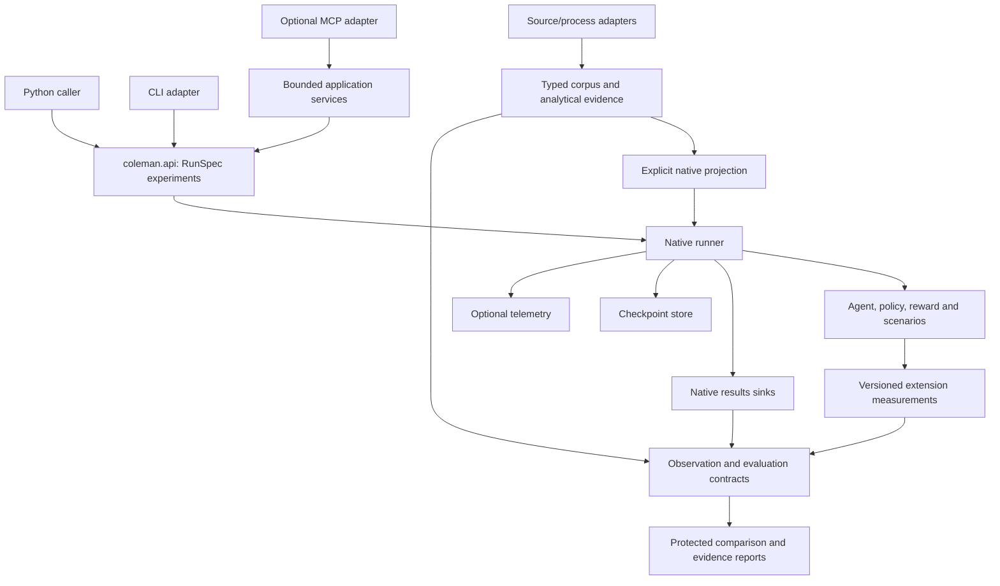

# Architecture and setup

COLEMAN's reusable decision contracts support a focused product: adaptive test
prioritization and selection for CI. The native runner remains the execution
engine. Data adapters, evidence checks and integrations compose around it.

For a working experiment, start with [getting started](getting-started.md).
For extension points, use [the extension guide](extensibility.md).

## Architecture overview



Arrows show calls or data flow, not a requirement to import a transport. Core
measurement, observation, selection and evaluation code does not need CLI or MCP.
Network and process execution remain in adapters. The corpus package's
`__main__` module is an executable boundary, rather than a domain import path.

## Where responsibilities live

| Boundary | Responsibility | Start reading |
| --- | --- | --- |
| `coleman.api`, `coleman.spec` | Resolve/validate configuration, identify and execute native runs | [Experiment API](api/experiment-api.md), [configuration](configuration.md) |
| Runner, scenarios, agents, policies, rewards | Native prioritization, modeled budgets and feedback updates | [Concepts](concepts.md), [extensions](extensibility.md) |
| `coleman.results`, `coleman.checkpoint`, `coleman.artifacts` | Native facts, resumable state and contract-specific file publication | [Result records](domain-results.md), [artifact API](api/artifacts.md) |
| `coleman.corpus` | Source contracts, cache, analytical views, projections and qualification | [Dataset guide](datasets.md), [materialization API](api/materialization.md) |
| Observations and evaluation | Availability/lineage, protected access, repeated units and justified comparisons | [Evaluation guide](evaluation-guide.md) |
| Selection and allocation | Finite coverage and scenario-payoff decisions under explicit assumptions | [Coverage](finite-coverage.md), [allocation](scenario-payoffs.md) |
| Application services and transports | Bounded workflows and CLI/HTTP/process/MCP adapters | [Integration guide](integration-guide.md) |

## Three independent operational concerns

| Concern | Default | Optional or disabled behavior |
| --- | --- | --- |
| Results | Partitioned Parquet | DuckDB/ClickHouse sinks; `NullSink` discards rows |
| Checkpoints | Local progress markers and pickle state when enabled | `NullCheckpointStore` disables persistence |
| Telemetry | Disabled | OpenTelemetry exporters and optional local monitoring stack |

Native checkpoints are trusted executable Python state. Load only checkpoints
you control. Versioned immutable domain artifacts use different contracts and do
not replace the native checkpoint format.

## Identity and reproducibility

The run ID is a compatibility-aware hash prefix of the resolved configuration.
It is not a complete hash of external data, environment or all input artifacts.
Resolved configuration and provenance help inspect those facts; source-specific
receipts bind the actual source, producer and output bytes separately.

Some source producers fingerprint the installed version and all SDK package
bytes. A docstring or unrelated module change therefore creates a new producer
identity too. Keep original producer/runtime pins when validating those old
receipts; do not retag them as a new generation. Other contracts use an explicitly
reviewed dependency closure, as documented by their producer API.

Versioned result records distinguish logical identity from content digest. Source
and capture workflows publish their own complete-last receipts where documented.
An ordinary run directory, operational manifest or partially written temporary
file must not be interpreted as one of those receipts.

The mutable JSON/CSV artifact helpers are single-writer exports. The immutable
writer handles identical cooperative concurrent publication and conflicting bytes
explicitly. Read [the artifact API](api/artifacts.md) before choosing a helper.

## Installation options

### Default run (no Docker required)

Follow [the verified-wheel installation](getting-started.md#1-install-in-a-virtual-environment).
The base package includes the library, CLI and local analytical dependencies.

### Optional integrations

Install an extra against the **same pinned wheel URL** used for the base install.
For example, the telemetry distribution requirement uses this form:

```bash
python -m pip install "coleman[telemetry] @ https://github.com/jacksonpradolima/coleman/releases/download/v4.19.0/coleman-4.19.0-py3-none-any.whl#sha256=070e21c19fb7e3f2e392bd68706c354ed5ab7f76b86db80f5f1bdc5721b767bd"
```

Use `clickhouse` for that result sink or `mcp` for the optional transport. Optional
controlled-capture recipes have additional pinned native runtime requirements,
listed in their [source guides](datasets.md).

### Development checkout

Use [contributing](contributing.md) for the locked development environment,
formatting, typing, tests and strict documentation build. Documentation and source
examples can evolve ahead of a published wheel; install your built distribution
when validating a change from a branch.

## Continue exploring

[API reference](api-reference.md) locates symbols.
[Maintainability](maintainability.md) records current measurements and targeted
improvement priorities. [Observability](observability.md) explains optional
monitoring, and [the analysis playbook](analysis-playbook.md) covers result queries.
