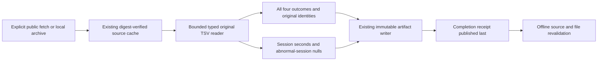

# Original Westermo results to typed analytical Parquet

Inspect real nightly, issue-focused and quarantined embedded-system test results
without collapsing abnormal outcomes into failures or inventing duration units.
COLEMAN converts an explicit session selection into observations and session
tables, verifies both against the pinned original source, and retries offline.

This adapter is available in the source revision containing this guide. It is
**not included in the previously published 4.17 wheel**. Build/install this
revision's wheel before using the commands below.

## Build and run outside the checkout

From the COLEMAN checkout, with Python 3.14 and uv:

```bash
uv build --wheel --out-dir /tmp/coleman-westermo-dist
uv venv /tmp/coleman-westermo-env --python 3.14
uv pip install --python /tmp/coleman-westermo-env/bin/python \
  /tmp/coleman-westermo-dist/coleman-*.whl
mkdir -p /tmp/coleman-westermo-work
cd /tmp/coleman-westermo-work

# Explicit anonymous public fetch, digest verification, conversion and validation.
/tmp/coleman-westermo-env/bin/python -m coleman.transports.westermo_etl \
  --fetch --cache /tmp/coleman-westermo-cache --output /tmp/coleman-westermo-output

# Offline retry: identical completed files and receipt; no additional downloads.
/tmp/coleman-westermo-env/bin/python -m coleman.transports.westermo_etl \
  --cache /tmp/coleman-westermo-cache --output /tmp/coleman-westermo-output
```

The build uses the checked-out revision's version metadata; it does not install
the older published wheel. Use a fresh distribution directory containing exactly
one wheel and install that wheel. Keep all source/cache/output paths
outside Git. `--source /path/to/test-results.zip` explicitly verifies a local
original archive instead of fetching. To select a compatible frozen session set,
pass `--recipe-stdin` and redirect the JSON recipe on stdin:

```bash
/tmp/coleman-westermo-env/bin/python -m coleman.transports.westermo_etl \
  --recipe-stdin --cache /tmp/coleman-westermo-cache \
  --output /tmp/coleman-westermo-custom-output < /path/to/recipe.json
```

Recipe bytes are bounded and schema-checked; they are never interpreted as a
filename. No URL is opened without `--fetch`.

The packaged example selects the first sixteen nightly sessions on `system13`
by the publisher's shifted start labels, with their exact `(jid, system)` keys
frozen in advance. This descriptive example is not a protected evaluation fold.
Its original-source qualification found:

| Quantity | Count |
| --- | ---: |
| Entire input rows checked | 1,063,915 |
| Selected observations | 1,064 |
| Outside-selection rows retained in the raw cache | 1,062,851 |
| Pass / fail / invalid / unmappable | 993 / 31 / 40 / 0 |
| Selected complete / abnormal sessions | 16 / 0 |

These are dependent executions from one industrial source family. Systems,
branches, parameter settings and repeated tests do not create independent projects.
The complete original release contains abnormal sessions and unmappable outcomes;
their absence from this selected example is not evidence of general absence.

## Original source, terms and modifications

Source: **Per Erik Strandberg (2022), The Westermo test results data set**, version
1.0, [author paper](https://arxiv.org/abs/2211.13622v1) and
[original public release](https://github.com/westermo/test-results-dataset/tree/31ca0ab802fd2eecf3455c6622c2c18f5b3fe775).
The original README explicitly applies **CC BY 4.0** to the data; the
[pinned license and warranty disclaimer](https://github.com/westermo/test-results-dataset/blob/31ca0ab802fd2eecf3455c6622c2c18f5b3fe775/LICENSE)
remain applicable. Attribution does not imply author endorsement. Preserve this
attribution, source/license links and the modification notice when sharing an export.

COLEMAN's modifications are session selection, typed parsing, deterministic row
ordering, separate session/observation tables and explicit unknown fields. The
original archive stays unchanged in the local cache. No third-party rows, archive
or source code are committed. The later enhanced/approximated-duration derivative
is a different artifact and is not silently substituted.

| Pin | Value |
| --- | --- |
| Source commit | `31ca0ab802fd2eecf3455c6622c2c18f5b3fe775` |
| ZIP bytes | 15,072,956 |
| ZIP SHA-256 | `7025cc28601fe9aa02095314a297e53059df5bcd9d331749d456b990d8976dd2` |
| Original TSV bytes | 127,760,900 |
| Original TSV SHA-256 | `6d5a3936230b5c0ace24a817d6eb9ae12ed5df94bac382635b31f05c840dc461` |

## Quantities, missingness and evidence boundaries

Session duration is reported **seconds of session envelope**; an abnormal session
has `null` plus `unavailable`, whereas a reported zero stays observed zero.
It is not physical runner occupancy or additive per-test work. Per-test
`oduration_raw` retains its nonnegative integer with unit
`westermo-oduration-unverified`: the original source description does not explicitly
establish its unit. Negative, fractional and nonfinite durations reject.

Raw outcomes 0/1 map to observed pass/fail. Outcomes 2/3 remain invalid/unmappable
and produce null binary verdicts with `unavailable`; both raw labels remain
available. A quarantine label records a suite classification, not a proven flaky
test or an independent trial. `parameters_raw` preserves the literal source text,
including `NULL`, without guessing whether it means an unknown or absent parameter.

Dates remain **author-shifted naive strings**, never UTC. First outcome/feature
availability, the planned test universe and physical topology are unverified.
Consequently the receipt explicitly retains `blocked_source_evidence`; no native
second-budget replay or protected empirical comparison is exposed. This export
does not fill an admitted diversity cell or establish policy superiority.



## Contracts, recovery and adding a selection

Use `load_westermo_recipe()` from `coleman.corpus.westermo_etl` to inspect the
packaged `WestermoRecipe`. Construct a new validated recipe with explicit session
keys to change the selection. Unknown schema versions, duplicate selections,
missing sessions, repeated outcome IDs and conflicting session metadata reject.
Every row is decoded, including outside-selection rows. Bounds are 128 MiB
decoded input, two million rows, 100,000 sessions, 128 selected sessions, 20,000
selected observations and 1,024 characters per field. Each output is at most 64 MiB.

`export_westermo_parquet(recipe, cache, ArtifactWriter(output))` returns the
`complete.json` path. Read it with `WestermoReceipt.from_json`, then use
`validate_westermo_etl(receipt, cache, completion.parent)` for actual offline source
and output verification. Parsing a receipt alone verifies metadata only.

Interrupted exports retain individually complete files, with no false completion
marker. Concurrent identical retries converge through the existing writer; edited
or conflicting files reject. This is source-conversion recovery, separate from
native policy checkpoints. Logical digests exclude physical row positions and
remain invariant under a source-row permutation; physical file digests preserve
those positions. Fixed single-chunk Arrow tables, row groups and writer options
avoid execution-thread chunk layout entering Parquet bytes. Producer source and
Arrow version are bound into the namespace. Unknown producers require their
recorded implementation; old exports and unrelated legacy artifacts are never
rewritten or silently migrated.
