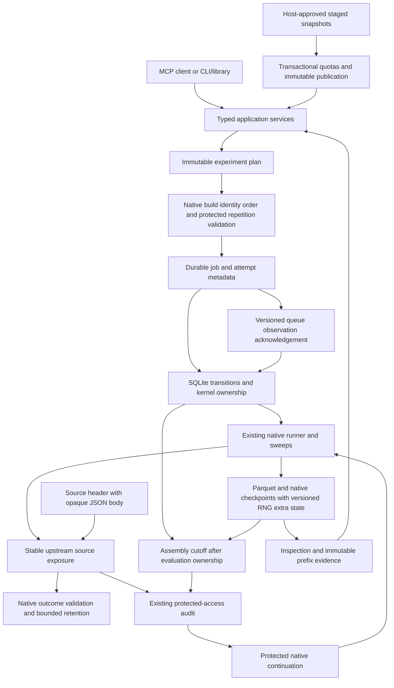
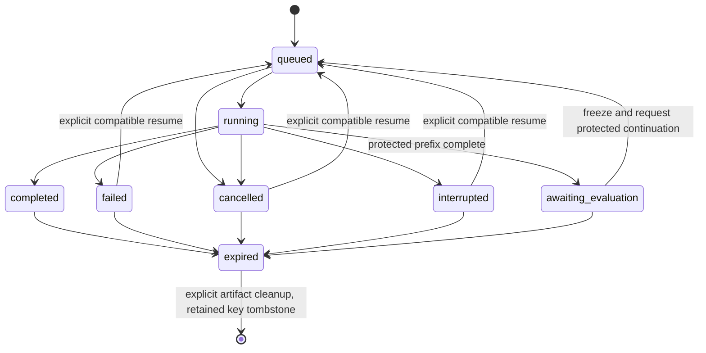

# Experiment plans, durable ownership and recovery

For the executable beginner path, see [plan, tune and recover a CI experiment](durable-experiments.md).

A conversation can end before an experiment does. A saved COLEMAN plan must still
identify its data, policy settings, repetitions, resource limits and evidence
protocol without requiring the conversation to be reconstructed.

## Compatibility boundary

The existing application-v1 service and its seven MCP tools retain their
session lifetime, wire schemas and supported smoke configurations. Durable
experiments use an additional `coleman-workflows-v1` contract and an explicitly
configured local workspace. The no-argument MCP executable retains ephemeral
behavior. Workflow schema versions are independent of MCP protocol versions.

The initial workflow allowlist is Random and UCB with RNFail, explicit seeds and
native scheduling budgets. Policy parameters are typed; arbitrary RunSpec,
plugins, source URLs and client filesystem paths are not accepted. Host setup
registers verified local snapshots and supplies their units and evidence scope.

## Identity and bounded work

Dataset identity binds exact input bytes and declared source/projection metadata.
Canonical plan identity also binds complete resolved configurations, objective,
baseline, seed coordinates, runtime/producer and resource limits. Native run IDs
retain their existing algorithm and remain distinct from workflow identities.

Search-space size is checked before calling the existing sweep expansion. UCB
axes apply only to UCB; Random is included once per relevant scheduling budget.
Configurations, seed repetitions, native builds, test candidates, modeled seconds,
observed wall time, memory and disk are separate quantities.
The job output reservation includes its owned input copy. An input that alone
fills or exceeds this allowance rejects before expansion; registration does not
guarantee that every permitted snapshot fits a chosen execution quota.

## Durable ownership

The host owns a trusted local workspace. SQLite transactions serialize bounded
job/idempotency metadata, while existing immutable artifacts retain plans,
attempt events, results and complete-last receipts. POSIX kernel locks establish
actual worker ownership; a PID alone never proves that an attempt is alive.
Multiple coordinators may inspect a workspace; conflicting starts must serialize
or fail deterministically. Supported local hosts are Linux and macOS.

Closing an MCP transport does not delete durable state or cancel an owned worker.
Explicit cancellation retains checkpoint and attempt evidence. Resume is an
explicit operation that rechecks input, plan, producer and installed-runtime
identity before loading host-owned native checkpoints. Imported evidence is
read-only data and never becomes an executable plan or trusted checkpoint.

Idempotency keys are caller-scoped and persist as bounded tombstones after result
expiry. Explicit workspace cleanup may remove expired artifacts, but does not
silently recycle a key. Exhausted metadata capacity rejects admission. Physical
retry attempts remain distinct from logical trials; exactly-once physical work
across arbitrary crashes is not promised.

## Stage and evidence boundary

Descriptive replay can inspect the full declared history. It does not qualify as
protected inference. Protected execution requires explicit temporal/group/cost
availability metadata. Tuning accesses training/validation only, then freezes the
candidate, baseline, learned-state identity, family and protocol before reserving
holdout access in the existing persistent evaluation audit.

The splitter's observation/revision sort is an audit order. The workflow joins
those identities back to the registered native build sequence before checking
contiguity, choosing validation rows, or constructing protected members. Planning
and evaluation share the existing repetition-design validator, including its
16,384 build/seed-cell cap per candidate and sibling/revision exclusions.

Once an evaluation worker owns execution, it freezes a current bounded assembly
cutoff in a separate immutable context for that invocation. Long queues and later
recovery do not reuse an expired cutoff. Source membership and partitions,
candidate choice, original prefix-state snapshots and the hypothesis family stay
fixed. Context digests can change; the upstream holdout ID and prior access ledger
cannot reset. An expired direct context rejects before another protected read.

A compatible native checkpoint carries learned state across the stage boundary;
filtering a previously computed full-history result is not a holdout protocol.
Repeated accesses remain recorded across reconnects and restarts. The owned small
fixture is constructed evidence with one repository family: seeds do not increase
its independent-unit count and its protected result is insufficient evidence.

Resource limits are local trusted-code guards with documented sampling/phase
overshoot, not an untrusted-code sandbox. A successful job can still report
insufficient scientific evidence; a validation leaderboard never becomes a
production policy endorsement automatically.

## Reading and migration

The new workspace/plan/result namespace starts at explicit schema version 1.
Its golden fixtures freeze the v1 defaults profile and complete executable
snapshots; future changes to those defaults require a consciously versioned
profile/codec, rather than silently regenerating an old plan with new defaults.
Unknown or incompatible schemas reject. There is no automatic workspace migration
or conversion of ordinary native checkpoints into workflow checkpoints. Existing
application-v1 readers, native result schemas and native run-ID normalization remain
unchanged. Read-only portable imports never become executable plans.

Completed artifacts publish last; valid orphan completion reports can be verified
and indexed after a lost SQLite commit without repeating native computation or
protected access. Partial trial summaries are explicitly labeled projections with
full-receipt/ranking digests. Large completed reports and original native bytes use
caller-owned artifact handles and bounded byte-range downloads, with no private
learning pickle in the export membership.
