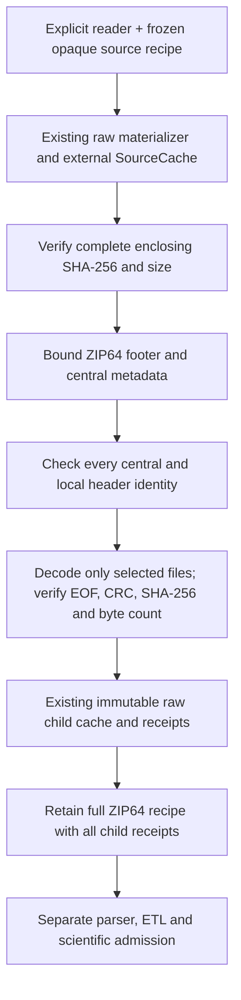

# Bounded ZIP64 selected-file integrity

The implementation for [#301](https://github.com/jacksonpradolima/coleman/issues/301)
adds an explicit ZIP64 recipe to the existing verified source cache. This page
describes the source revision containing that implementation; the published 4.7
wheel does not include this API. The feature verifies selected file membership.
The real RTPTorrent download-to-Parquet preset is separate work in
[#302](https://github.com/jacksonpradolima/coleman/issues/302).

## Run the owned CI example outside the checkout

Build and install the wheel from this revision, then copy the complete example:

```bash
uv build --out-dir /tmp/coleman-zip64-dist
uv venv /tmp/coleman-zip64-env --python 3.14
uv pip install --python /tmp/coleman-zip64-env/bin/python /tmp/coleman-zip64-dist/*.whl
mkdir -p /tmp/coleman-zip64-workspace
cp examples/zip64-selection/ci.py /tmp/coleman-zip64-workspace/ci.py
cd /tmp/coleman-zip64-workspace
/tmp/coleman-zip64-env/bin/python ci.py selected /tmp/coleman-zip64-cache
/tmp/coleman-zip64-env/bin/python ci.py selected /tmp/coleman-zip64-cache
```

The example creates actual ZIP64 local-size and end records around a tiny owned
CI correctness fixture, including an `owned@ci/serial.json` logical member name.
It verifies the enclosing SHA-256, all archive header identities, selected decoded
SHA-256/size and actual deflate EOF/CRC. It persists the canonical recipe and raw
child receipt only after the selection succeeds. Both invocations converge on the
same bytes and identities. This fixture establishes functional correctness, not
independent observations or evidence of production savings.

Reopen the same verified selection from that workspace without a reader or network:

```python
from pathlib import Path

from coleman.corpus import SourceCache
from coleman.corpus.zip64_contracts import Zip64SelectionSpec
from coleman.corpus.zip64_selection import materialize_zip64_files, validate_zip64_files

spec = Zip64SelectionSpec.from_json(Path("selected/selection.json").read_bytes())
cache = SourceCache("/tmp/coleman-zip64-cache")
validate_zip64_files(spec, cache)
receipts = materialize_zip64_files(spec, cache)
assert cache.member_path(receipts[0], "serial.json").is_file()
```

The installed-package regression test also consumes the actual selected fixture
with the native TCPCI runner, compares NAPFD/APFDc with the existing independent
tiny oracle, and reopens committed checkpoints. No ZIP64 parser, materializer or
native runner is mocked in that workflow.

## Contract and bounds

`Zip64SelectionSpec` requires integer `schema_version=1` and recipe
`bounded-zip64-file-selection-v1`. Missing, future and unknown versions reject.
Canonical JSON and fingerprints include the complete source, member pins, reviewed
data terms and explicit limits. Selections sort by logical member name; changing
archive bytes changes enclosing identity even when selected child bytes agree.

| Quantity | Meaning and hard limit |
| --- | --- |
| Enclosing source | Complete raw archive bytes; at most 8 GiB, with explicit source/member/total limits above the existing smaller defaults |
| Directory | At most 4,096 entries and 2 MiB metadata, checked before allocating standard-library ZIP objects |
| Selection | 1–128 distinct regular files; at most 64 MiB decoded bytes per file and in total |
| Paths | Portable ASCII logical names, up to 1,024 characters, with safe `@` labels; never filesystem extraction paths |
| Framing | Single disk, fixed ZIP64 end payload, stored or deflated members, reviewed local/central sizes and offsets, signed or unsigned data descriptors |

All byte counts are strict nonnegative integers. Zero is a valid empty selected
file when its SHA-256 and actual bytes agree; null, negative and non-integer byte
counts reject. An unavailable source is an acquisition failure, not a zero-byte
source. Versions, offsets, flags, CRC and exact sentinel-dependent ZIP64 extras
must agree. Duplicate/aliased names, links, special entries, traversal, prefixes,
encryption, unsupported compression and malformed metadata reject.

ZIP structures follow the [PKWARE ZIP specification](https://pkware.cachefly.net/webdocs/casestudies/APPNOTE.TXT),
with the deliberately narrower profile above and two explicitly reviewed producer
forms observed in RTPTorrent: stored entries may retain bit 1 as an inert
compression preference, and offset-only ZIP64 central metadata may retain legacy
extraction version 1.0/2.0. Bits 1/2 have no defined compression meaning for stored
payloads in the specification; only the observed bit 1 is accepted here. Local and
central flags still must agree exactly; size sentinels still require version 4.5
and both local size fields. A lower local version is accepted against central
version 4.5 only when the actual central offset was sentinel-backed and neither
central size used a sentinel. Resolving that wide offset to a small value does
not erase its origin. Offset-only metadata still requires the exact wide offset
and ZIP64 end records. Legacy profiles keep rejecting these forms.
This is not a general ZIP extractor.
Unselected payloads are not decoded or CRC-certified. Their local/central header
identities and physical bounds are checked; the entire enclosing byte stream is
still covered by its frozen source SHA-256.

## Provenance, failures and compatibility



The enclosing raw source and every child use the existing `MaterializationSpec`.
Selected archive names bind to explicit portable raw-file aliases. Child bytes,
data terms and version must match their enclosing selection. Data redistribution
terms do not assert rights to execute or redistribute enclosed subject code.
Source URIs are descriptive; the core opens no URL and imports no CLI/MCP or HTTP
transport. Readers are explicit, synchronous and caller-owned.

An interrupted acquisition never publishes a partial blob. A later child failure
may leave individually verified earlier blobs, but the operation returns no
completed selection. Retrying revalidates actual membership even for cached
children and converges through existing immutable writes. There is no new group
completion marker or learning checkpoint: callers retain the full recipe with all
returned receipts. A raw child receipt alone does not prove enclosing membership.
`validate_zip64_files` verifies source, membership and cached children without
repair or network; missing/corrupt bytes reject. Complete validation scans the
large source again, so account for that I/O cost.

Metadata/format/hash/CRC failures raise `ValueError`; filesystem/reader failures
propagate. Cache parents must be trusted and immutable during verification.
Existing ArtifactWriter local-filesystem durability limits apply; this is neither
a hostile-filesystem sandbox nor a global cache/disk quota.

Existing package-v1 and selected-member-v1 recipes retain their ZIP64 and `@`
rejections. No old recipe or receipt is silently migrated or reinterpreted.
Construct and review a separate ZIP64 recipe with full source/member pins; old
native Parquet, result records and checkpoints remain readable as before.

## External source evidence

The [RTPTorrent assessment](rtptorrent.md) records the provider metadata and
separately verified HikariCP member bytes. Bounded range research also checked
all 2,883 real central records and 477 available local headers against this
profile. Those are structural metadata checks, not a complete source hash or
selected-file membership proof. Full archive acquisition remains
incomplete at this implementation stage. Neither that member SHA-256, provider
MD5 nor an interrupted download is a complete enclosing SHA-256 proof. No curated
real-source selection recipe is published with an unverified source pin. This
reproducible acquisition blocker does not prevent network-free owned integrity
tests; it does prevent claiming real whole-source integrity or protected admission.
